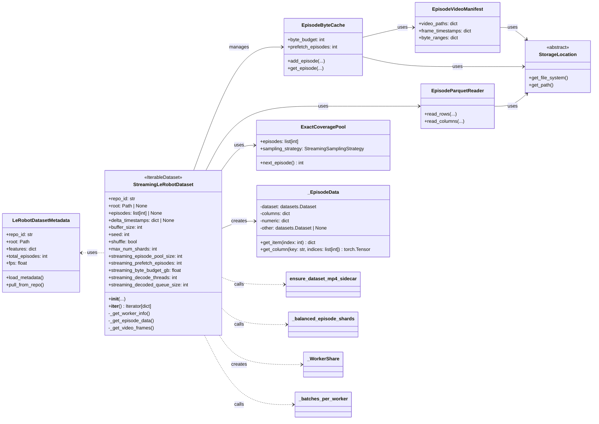

<!-- source: DeepWiki mcp.deepwiki.com · repo huggingface/lerobot · page 2.8 Streaming Datasets · fetched 2026-10-26 -->

# Streaming Datasets

<details>
<summary>Relevant source files</summary>

The following files were used as context for generating this wiki page:

- [docs/source/training_dataset_streaming.mdx](docs/source/training_dataset_streaming.mdx)
- [src/lerobot/configs/default.py](src/lerobot/configs/default.py)
- [src/lerobot/datasets/dataset_metadata.py](src/lerobot/datasets/dataset_metadata.py)
- [src/lerobot/datasets/dataset_reader.py](src/lerobot/datasets/dataset_reader.py)
- [src/lerobot/datasets/factory.py](src/lerobot/datasets/factory.py)
- [src/lerobot/datasets/lerobot_dataset.py](src/lerobot/datasets/lerobot_dataset.py)
- [src/lerobot/datasets/streaming_dataset.py](src/lerobot/datasets/streaming_dataset.py)
- [src/lerobot/datasets/utils.py](src/lerobot/datasets/utils.py)
- [src/lerobot/datasets/video_utils.py](src/lerobot/datasets/video_utils.py)
- [tests/configs/test_default.py](tests/configs/test_default.py)
- [tests/datasets/test_dataset_utils.py](tests/datasets/test_dataset_utils.py)
- [tests/datasets/test_datasets.py](tests/datasets/test_datasets.py)
- [tests/datasets/test_streaming.py](tests/datasets/test_streaming.py)
- [tests/datasets/test_streaming_factory.py](tests/datasets/test_streaming_factory.py)
- [tests/datasets/test_streaming_production.py](tests/datasets/test_streaming_production.py)
- [tests/datasets/test_streaming_workers.py](tests/datasets/test_streaming_workers.py)

</details>


This page documents the `StreamingLeRobotDataset` class and the `src/lerobot/streaming` package, which enable efficient training on large LeRobot datasets by streaming data directly from the Hugging Face Hub or local storage. It covers episode caching, Parquet readers, worker sharding, and the overall data flow for streamed training.

## Overview of StreamingLeRobotDataset

The `StreamingLeRobotDataset` [src/lerobot/datasets/streaming_dataset.py:170-170]() is an `IterableDataset` that allows `lerobot-train` to consume LeRobot datasets without downloading the entire dataset beforehand. This is particularly useful for very large datasets where local storage might be a bottleneck or for faster iteration during development. It operates by fetching data on demand, leveraging episode caching and parallel processing.

Streaming is enabled by setting `--dataset.streaming=true` in the `lerobot-train` CLI [docs/source/training_dataset_streaming.mdx:8-9](). This is distinct from `streaming_encoding`, which controls how videos are written during recording [docs/source/training_dataset_streaming.mdx:13-15]().

The core idea is to provide a continuous stream of data samples, where each sample is a dictionary containing observations, actions, and other relevant information for a specific timestep. The dataset handles the complexities of fetching, decoding, and processing this data in the background.

Sources:
- [src/lerobot/datasets/streaming_dataset.py:170-170]()
- [docs/source/training_dataset_streaming.mdx:8-9]()
- [docs/source/training_dataset_streaming.mdx:13-15]()

## Data Flow and Components

The streaming dataset pipeline involves several key components working together to deliver data efficiently to the training loop.

### 1. Dataset Initialization and Metadata Loading

When a `StreamingLeRobotDataset` is initialized, it first loads the dataset metadata (`LeRobotDatasetMetadata`) [src/lerobot/datasets/streaming_dataset.py:41-42](). This metadata contains crucial information about the dataset structure, features, episode boundaries, and video configurations. If the dataset is on the Hugging Face Hub, the metadata is downloaded and cached locally [src/lerobot/datasets/dataset_metadata.py:86-92]().

A critical step for video streaming is the MP4 index sidecar. The `ensure_dataset_mp4_sidecar` function [src/lerobot/datasets/streaming_sidecar.py:47-47]() checks for a local or published sidecar. If none is found, it builds one locally, which is then used to efficiently seek and decode video frames [docs/source/training_dataset_streaming.mdx:63-67](). This sidecar contains information about video frame timestamps and byte ranges, allowing for precise frame extraction without downloading entire video files.

### 2. Episode Sharding and Worker Distribution

For distributed training, episodes are sharded across ranks and then further distributed among DataLoader workers.
- **Rank Sharding**: Each distributed training rank receives a deterministic, frame-balanced shard of complete episodes [docs/source/training_dataset_streaming.mdx:20-21](). The `_balanced_episode_shards` function [src/lerobot/datasets/streaming_dataset.py:111-126]() assigns whole episodes to ranks greedily based on their frame counts.
- **DataLoader Workers**: Within each rank, DataLoader workers further divide the assigned episodes. Each worker gets a disjoint, frame-balanced part of the rank's episodes, with its own exact-coverage pool [docs/source/training_dataset_streaming.mdx:38-40](). This allows for parallel sample assembly and decoding. The number of workers is controlled by `--num_workers` [docs/source/training_dataset_streaming.mdx:38-38]().

### 3. Episode Caching and Pre-fetching

Each DataLoader worker maintains an `ExactCoveragePool` [src/lerobot/streaming/episode_pool.py:100-100]() of episodes. This pool mixes the worker's episodes, ensuring every selected frame is visited once per coverage epoch [docs/source/training_dataset_streaming.mdx:21-22]().
The `EpisodeByteCache` [src/lerobot/streaming/episode_cache.py:29-29]() is responsible for managing the byte budget for streamed data. It prefetches Parquet rows and MP4 byte ranges from the same byte-aware admission frontier [docs/source/training_dataset_streaming.mdx:22-23](). This pre-fetching mechanism helps to keep the data pipeline saturated and reduce latency.

The `streaming_episode_pool_size` configuration parameter controls the size of the episode pool for each worker. A larger pool increases batch diversity but also memory usage [docs/source/training_dataset_streaming.mdx:50-54](). `streaming_prefetch_episodes` determines how many complete episodes are fetched ahead of the current admission frontier [src/lerobot/configs/default.py:65-65]().

### 4. Parquet Reading and Video Decoding

- **Parquet Readers**: The `EpisodeParquetReader` [src/lerobot/streaming/episode_parquet.py:29-29]() is used to read tabular data (observations, actions, rewards, etc.) from Parquet files. It can efficiently read specific rows or columns as needed.
- **Video Decoding**: Video frames are decoded using either `pyav` or `torchcodec` backends [src/lerobot/datasets/video_utils.py:157-162](). The `decode_video_frames` function [src/lerobot/datasets/video_utils.py:122-128]() extracts frames corresponding to specific timestamps, leveraging the MP4 sidecar for efficient seeking. Depth maps are currently only supported with the `pyav` backend [src/lerobot/datasets/video_utils.py:148-152]().
- **Parallel Decoding**: `streaming_decode_threads` [src/lerobot/configs/default.py:69-69]() controls the number of threads used for parallel sample assembly and video decoding within each worker [docs/source/training_dataset_streaming.mdx:40-40]().
- **Ordered Sample Buffer**: `streaming_decoded_queue_size` [src/lerobot/configs/default.py:70-70]() defines the size of a queue that holds decoded samples in planner order, ensuring a smooth flow of data [docs/source/training_dataset_streaming.mdx:41-41]().

### 5. Sample Assembly and Transforms

Once data is fetched and decoded, samples are assembled. This includes:
- **Temporal Queries**: `delta_timestamps` [src/lerobot/datasets/lerobot_dataset.py:60-60]() are used to retrieve observations and actions at relative offsets, forming temporal windows for policies that require historical context [src/lerobot/datasets/utils.py:146-157](). Padding masks are applied for samples near episode boundaries [docs/source/training_dataset_streaming.mdx:23-24]().
- **Image Transforms**: `image_transforms` [src/lerobot/datasets/lerobot_dataset.py:59-59]() (e.g., augmentations) are applied to visual observations [src/lerobot/datasets/video_utils.py:107-119]().
- **Depth Dequantization**: If depth cameras are present, depth frames are dequantized from their stored format to the specified `depth_output_unit` (e.g., millimeters or meters) [src/lerobot/datasets/video_utils.py:77-88]().
- **RGB Normalization**: RGB frames are normalized to `[0, 1]` float32 by default, or returned as raw uint8 if `return_uint8` is true [src/lerobot/datasets/video_utils.py:102-105]().

### Diagram: Streaming Dataset Data Flow

```mermaid
graph TD
    subgraph "Training Process (Rank N)"
        A[lerobot-train] --> B(DataLoader)
        B --> C{DataLoader Worker M}
        C --> D[StreamingLeRobotDataset.iter()]
    end

    subgraph "Worker M Data Pipeline"
        D --> E(ExactCoveragePool)
        E --> F{EpisodeByteCache}
        F --> G[ParquetReader]
        F --> H[VideoDecoder (pyav/torchcodec)]
        G --> I(Tabular Data)
        H --> J(Video Frames)
        I & J --> K(Sample Assembler)
        K --> L(Apply Transforms & Dequantize)
        L --> M(Yield Sample)
    end

    subgraph "Hugging Face Hub / Local Storage"
        N[Dataset Repository]
        N -- "meta/info.json" --> O(LeRobotDatasetMetadata)
        N -- "meta/mp4-sidecars/" --> P(MP4 Index Sidecar)
        N -- "data/chunk-XXX/file-YYY.parquet" --> Q(Parquet Files)
        N -- "videos/camera/chunk-XXX/file-YYY.mp4" --> R(MP4 Video Files)
    end

    O --> D
    P --> H
    Q --> G
    R --> H

    style A fill:#f9f,stroke:#333,stroke-width:2px
    style B fill:#f9f,stroke:#333,stroke-width:2px
    style C fill:#f9f,stroke:#333,stroke-width:2px
    style D fill:#f9f,stroke:#333,stroke-width:2px
    style E fill:#f9f,stroke:#333,stroke-width:2px
    style F fill:#f9f,stroke:#333,stroke-width:2px
    style G fill:#f9f,stroke:#333,stroke-width:2px
    style H fill:#f9f,stroke:#333,stroke-width:2px
    style I fill:#f9f,stroke:#333,stroke-width:2px
    style J fill:#f9f,stroke:#333,stroke-width:2px
    style K fill:#f9f,stroke:#333,stroke-width:2px
    style L fill:#f9f,stroke:#333,stroke-width:2px
    style M fill:#f9f,stroke:#333,stroke-width:2px
```
**Diagram: Streaming Dataset Data Flow**

Sources:
- [src/lerobot/datasets/streaming_dataset.py:41-42]()
- [src/lerobot/datasets/dataset_metadata.py:86-92]()
- [src/lerobot/datasets/streaming_sidecar.py:47-47]()
- [docs/source/training_dataset_streaming.mdx:63-67]()
- [docs/source/training_dataset_streaming.mdx:20-21]()
- [src/lerobot/datasets/streaming_dataset.py:111-126]()
- [docs/source/training_dataset_streaming.mdx:38-40]()
- [docs/source/training_dataset_streaming.mdx:38-38]()
- [src/lerobot/streaming/episode_pool.py:100-100]()
- [docs/source/training_dataset_streaming.mdx:21-22]()
- [src/lerobot/streaming/episode_cache.py:29-29]()
- [docs/source/training_dataset_streaming.mdx:22-23]()
- [docs/source/training_dataset_streaming.mdx:50-54]()
- [src/lerobot/configs/default.py:65-65]()
- [src/lerobot/streaming/episode_parquet.py:29-29]()
- [src/lerobot/datasets/video_utils.py:157-162]()
- [src/lerobot/datasets/video_utils.py:122-128]()
- [src/lerobot/datasets/video_utils.py:148-152]()
- [src/lerobot/configs/default.py:69-69]()
- [docs/source/training_dataset_streaming.mdx:40-40]()
- [src/lerobot/configs/default.py:70-70]()
- [docs/source/training_dataset_streaming.mdx:41-41]()
- [src/lerobot/datasets/lerobot_dataset.py:60-60]()
- [src/lerobot/datasets/utils.py:146-157]()
- [docs/source/training_dataset_streaming.mdx:23-24]()
- [src/lerobot/datasets/lerobot_dataset.py:59-59]()
- [src/lerobot/datasets/video_utils.py:107-119]()
- [src/lerobot/datasets/video_utils.py:77-88]()
- [src/lerobot/datasets/video_utils.py:102-105]()

## Key Classes and Functions

### `StreamingLeRobotDataset`

- **Definition**: `class StreamingLeRobotDataset(torch.utils.data.IterableDataset[dict[str, Any]])` [src/lerobot/datasets/streaming_dataset.py:170-170]()
- **Purpose**: Provides an iterable interface for streaming LeRobot datasets. It manages the entire streaming process, from metadata loading and episode selection to data fetching, decoding, and sample assembly.
- **Key Parameters**:
    - `repo_id`: Identifier of the dataset on the Hugging Face Hub.
    - `root`: Local directory for caching or direct access.
    - `episodes`: Optional list of episode indices to include.
    - `delta_timestamps`: Specifies temporal windows for observations/actions.
    - `buffer_size`: Number of samples to prefetch.
    - `seed`: Random seed for shuffling.
    - `shuffle`: Whether to shuffle samples across epochs.
    - `max_num_shards`: Maximum number of shards for distributed processing.
    - `streaming_episode_pool_size`: Size of the episode pool for each worker.
    - `streaming_prefetch_episodes`: Number of episodes to prefetch.
    - `streaming_byte_budget_gb`: Hard per-rank cap for synthesized episode-video bytes [src/lerobot/configs/default.py:66-66]().
    - `streaming_decode_threads`: Number of threads for parallel sample assembly/decode [src/lerobot/configs/default.py:69-69]().
    - `streaming_decoded_queue_size`: Size of the ordered sample buffer [src/lerobot/configs/default.py:70-70]().
- **`__iter__` method**: Returns an iterator that yields processed samples. This method orchestrates the episode selection, data fetching, and decoding for each epoch.

Sources:
- [src/lerobot/datasets/streaming_dataset.py:170-170]()
- [src/lerobot/configs/default.py:66-66]()
- [src/lerobot/configs/default.py:69-69]()
- [src/lerobot/configs/default.py:70-70]()

### `src/lerobot/streaming` Package

This package contains the core logic for streaming capabilities.

#### `episode_cache.py`

- **`EpisodeByteCache`**: Manages the caching of episode data (Parquet rows and video byte ranges) within a specified byte budget. It ensures that frequently accessed episodes are readily available and handles prefetching.

Sources:
- [src/lerobot/streaming/episode_cache.py:29-29]()

#### `episode_parquet.py`

- **`EpisodeParquetReader`**: A specialized reader for Parquet files, optimized for reading episode-specific data. It can efficiently load subsets of rows and columns, which is crucial for temporal queries and selective data access.

Sources:
- [src/lerobot/streaming/episode_parquet.py:29-29]()

#### `episode_pool.py`

- **`ExactCoveragePool`**: Implements a sampling strategy that ensures every frame within a worker's assigned episodes is visited exactly once per epoch. It manages the mixing of episodes to provide diverse batches.
- **`StreamingSamplingStrategy`**: An Enum defining different strategies for sampling from the episode pool, such as `REMAINING` (default) and `ROUND_ROBIN` [src/lerobot/configs/default.py:63-63]().

Sources:
- [src/lerobot/streaming/episode_pool.py:100-100]()
- [src/lerobot/configs/default.py:63-63]()

#### `location.py`

- **`StorageLocation`**: Abstract base class for defining storage locations (e.g., local filesystem, Hugging Face Hub, S3).
- **`hf_bucket_uri`**: Utility for constructing Hugging Face Hub bucket URIs [src/lerobot/streaming/location.py:29-29]().

Sources:
- [src/lerobot/streaming/location.py:29-29]()

#### `manifest.py`

- **`EpisodeVideoManifest`**: Represents the MP4 index sidecar, containing metadata about video files, such as frame timestamps and byte offsets. This manifest is crucial for efficient random access to video frames.

Sources:
- [src/lerobot/streaming/manifest.py:29-29]()

### `src/lerobot/datasets/streaming_sidecar.py`

- **`ensure_dataset_mp4_sidecar`**: This function is responsible for ensuring the presence of an MP4 sidecar for a dataset. It checks for existing sidecars (local or published) and, if necessary, builds one locally. This process is locked to prevent race conditions during concurrent access.
- **`streaming_data_root`**: Determines the root path for streaming data, which can be a local directory or a remote URI (e.g., `hf://datasets/...`) [src/lerobot/datasets/streaming_sidecar.py:48-49]().

Sources:
- [src/lerobot/datasets/streaming_sidecar.py:47-47]()
- [src/lerobot/datasets/streaming_sidecar.py:48-49]()

### Diagram: Streaming Dataset Class Relationships


**Diagram: Streaming Dataset Class Relationships**

Sources:
- [src/lerobot/datasets/streaming_dataset.py:170-170]()
- [src/lerobot/configs/default.py:63-63]()
- [src/lerobot/configs/default.py:66-66]()
- [src/lerobot/configs/default.py:69-69]()
- [src/lerobot/configs/default.py:70-70]()
- [src/lerobot/streaming/episode_cache.py:29-29]()
- [src/lerobot/streaming/episode_parquet.py:29-29]()
- [src/lerobot/streaming/episode_pool.py:100-100]()
- [src/lerobot/streaming/location.py:29-29]()
- [src/lerobot/streaming/manifest.py:29-29]()
- [src/lerobot/datasets/streaming_sidecar.py:47-47]()
- [src/lerobot/datasets/streaming_sidecar.py:48-49]()

## Training on Streamed Data from the Hub

To train with streaming enabled, use the `lerobot-train` CLI with the `--dataset.streaming=true` flag [docs/source/training_dataset_streaming.mdx:8-9]().

```bash
lerobot-train \
  --dataset.repo_id=OWNER/DATASET \
  --dataset.streaming=true \
  --policy.type=act \
  --output_dir=outputs/train/act_streaming
```

The `make_dataset` factory function [src/lerobot/datasets/factory.py:108-108]() handles the instantiation of `StreamingLeRobotDataset` when `cfg.dataset.streaming` is set to `True` [src/lerobot/datasets/factory.py:118-118](). It also resolves `delta_timestamps` and `image_transforms` based on the training configuration [src/lerobot/datasets/factory.py:121-126]().

### Configuration Parameters

Several parameters in `DatasetConfig` [src/lerobot/configs/default.py:29-79]() control the behavior of streaming datasets:

- **`streaming: bool`**: Enables or disables streaming [src/lerobot/configs/default.py:57-57]().
- **`streaming_episode_pool_size: int | None`**: Number of episodes mixed by each DataLoader worker. If `None`, the rank mixes 32 episodes, and each worker gets `32/N` where `N` is the number of workers [src/lerobot/configs/default.py:59-62]().
- **`streaming_sampling_strategy: StreamingSamplingStrategy`**: Determines how samples are drawn from the episode pool (e.g., `REMAINING`, `ROUND_ROBIN`) [src/lerobot/configs/default.py:63-63]().
- **`streaming_prefetch_episodes: int`**: Number of complete episodes fetched ahead of the current admission frontier [src/lerobot/configs/default.py:65-65]().
- **`streaming_byte_budget_gb: float`**: Hard per-rank cap for synthesized episode-video bytes [src/lerobot/configs/default.py:66-66]().
- **`streaming_decode_threads: int`**: Number of parallel threads for sample assembly and video decoding [src/lerobot/configs/default.py:69-69]().
- **`streaming_decoded_queue_size: int`**: Size of the ordered buffer for decoded samples [src/lerobot/configs/default.py:70-70]().
- **`video_decoder_cache_size: int | None`**: Maximum number of open video decoders. For streaming, this is per rank [src/lerobot/configs/default.py:75-76]().

### MP4 Sidecar Management

The MP4 sidecar is crucial for efficient video streaming.
- **Local Build**: If a sidecar is not found on the Hub or locally, LeRobot builds it locally. This process is atomic and uses a process lock [docs/source/training_dataset_streaming.mdx:63-67]().
- **Pre-building**: Dataset maintainers can pre-build and publish sidecars using `lerobot-build-mp4-sidecar` [docs/source/training_dataset_streaming.mdx:97-102]().
- **Publication**: Publishing a sidecar for dataset repositories creates or updates a dedicated `lerobot-sidecars` branch, leaving the source dataset branch/tag unchanged [docs/source/training_dataset_streaming.mdx:107-109]().

Sources:
- [docs/source/training_dataset_streaming.mdx:8-9]()
- [src/lerobot/datasets/factory.py:108-108]()
- [src/lerobot/datasets/factory.py:118-118]()
- [src/lerobot/datasets/factory.py:121-126]()
- [src/lerobot/configs/default.py:29-79]()
- [src/lerobot/configs/default.py:57-57]()
- [src/lerobot/configs/default.py:59-62]()
- [src/lerobot/configs/default.py:63-63]()
- [src/lerobot/configs/default.py:65-65]()
- [src/lerobot/configs/default.py:66-66]()
- [src/lerobot/configs/default.py:69-69]()
- [src/lerobot/configs/default.py:70-70]()
- [src/lerobot/configs/default.py:75-76]()
- [docs/source/training_dataset_streaming.mdx:63-67]()
- [docs/source/training_dataset_streaming.mdx:97-102]()
- [docs/source/training_dataset_streaming.mdx:107-109]()

---

