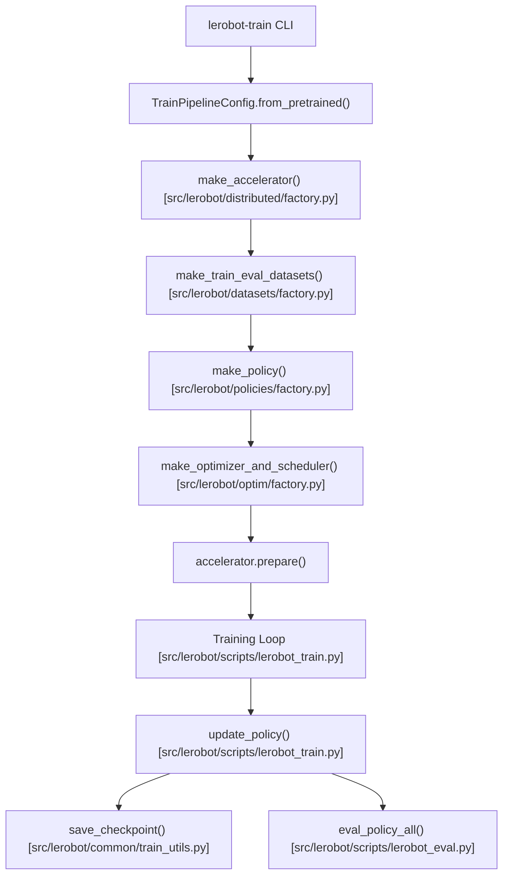
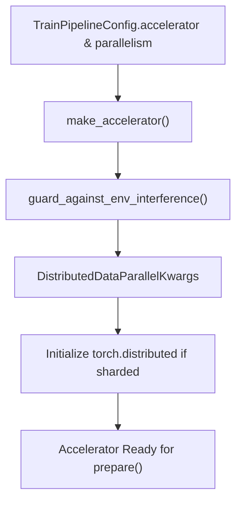

<!-- source: DeepWiki mcp.deepwiki.com · repo huggingface/lerobot · page 3.1 Training Pipeline · fetched 2026-10-26 -->

# Training Pipeline

Relevant source files

The following files were used as context for generating this wiki page:

- [docs/source/policy_diffusion_README.md](docs/source/policy_diffusion_README.md)
- [docs/source/policy_pi05_README.md](docs/source/policy_pi05_README.md)
- [docs/source/policy_pi0_README.md](docs/source/policy_pi0_README.md)
- [docs/source/policy_rtc_README.md](docs/source/policy_rtc_README.md)
- [docs/source/policy_sarm_README.md](docs/source/policy_sarm_README.md)
- [src/lerobot/common/train_utils.py](src/lerobot/common/train_utils.py)
- [src/lerobot/configs/train.py](src/lerobot/configs/train.py)
- [src/lerobot/policies/factory.py](src/lerobot/policies/factory.py)
- [src/lerobot/policies/pi0/README.md](src/lerobot/policies/pi0/README.md)
- [src/lerobot/policies/pi05/README.md](src/lerobot/policies/pi05/README.md)
- [src/lerobot/policies/rtc/README.md](src/lerobot/policies/rtc/README.md)
- [src/lerobot/rewards/factory.py](src/lerobot/rewards/factory.py)
- [src/lerobot/scripts/lerobot_train.py](src/lerobot/scripts/lerobot_train.py)
- [tests/common/test_publish.py](tests/common/test_publish.py)
- [tests/configs/test_resume_from_hub.py](tests/configs/test_resume_from_hub.py)
- [tests/policies/test_factory_peft_revision.py](tests/policies/test_factory_peft_revision.py)
- [tests/policies/test_language_processor_factory.py](tests/policies/test_language_processor_factory.py)
- [tests/rewards/test_reward_model_base.py](tests/rewards/test_reward_model_base.py)
- [tests/training/test_ema.py](tests/training/test_ema.py)
- [tests/utils/test_train_utils.py](tests/utils/test_train_utils.py)

This page details the training pipeline orchestration in LeRobot, focusing on the `train()` orchestration logic in `lerobot_train.py` [src/lerobot/scripts/lerobot_train.py:1-981](), dataset loading, policy instantiation, optimizer creation via `make_optimizer_and_scheduler` [src/lerobot/optim/factory.py:21-42](), the training loop, checkpoint persistence, exponential moving average (EMA) shadow weights, periodic evaluation, and logging. For training configurations, refer to [Training Configuration](#3.2); for optimizers and schedulers, see [Optimizers and Schedulers](#3.3).

Sources: [src/lerobot/scripts/lerobot_train.py:1-981](), [src/lerobot/optim/factory.py:21-42]()

## Overview and Orchestration Flow

The training pipeline coordinates all subsystems required to train a policy or reward model. The main entry point is `train()` (invoked via `lerobot-train`), which configures distributed execution, loads datasets, builds policies, wraps them with PEFT or EMA if requested, sets up optimizers, and runs the training loop.

*Figure 1: High-level orchestration flow bridging natural language concepts to their core code entities.*

Sources: [src/lerobot/scripts/lerobot_train.py:1-981](), [src/lerobot/configs/train.py:110-150]()

## Configuration Loading and Validation

Training is driven by `TrainPipelineConfig` [src/lerobot/configs/train.py:110-154](), parsed via Draccus. When launching a run, the configuration handles:
- **Resuming**: Resolving local checkpoints or downloading the latest checkpoint from the Hugging Face Hub [src/lerobot/configs/train.py:119-124]().
- **Dataset Settings**: Specifying repo IDs, splits, and delta timestamps via `DatasetConfig` [src/lerobot/configs/train.py:111]().
- **Policy & Reward Models**: Instantiating pre-trained configs for policies like ACT, Diffusion, or π₀.₅ [src/lerobot/configs/train.py:113-114]().
- **Legacy Migrations**: Automatically migrating legacy RA-BC fields into `SampleWeightingConfig` [src/lerobot/configs/train.py:73-106]().

Sources: [src/lerobot/configs/train.py:73-154]()

## Accelerator and Distributed Setup

The pipeline initializes a Hugging Face `Accelerator` instance via `make_accelerator` [src/lerobot/distributed/factory.py:21-65](). It configures mixed precision (e.g., `bf16`), gradient accumulation, and parallelism modes (DDP, FSDP, HSDP) [docs/source/multi_gpu_training.mdx:3-10]().

*Figure 2: Accelerator initialization flow detailing distributed safeguards and configuration mapping.*

Sources: [docs/source/multi_gpu_training.mdx:3-50](), [src/lerobot/configs/train.py:30-31]()

## Dataset and Sampler Initialization

Datasets are loaded using `make_train_eval_datasets` [src/lerobot/datasets/factory.py:69-136](). Depending on whether episode constraints like `drop_n_last_frames` are active [src/lerobot/datasets/sampler.py:26-45](), the dataloader uses `EpisodeAwareSampler` or a standard sampler wrapped in `DataLoader` with `spawn` multiprocessing context [src/lerobot/configs/train.py:131-141]().

Sources: [src/lerobot/scripts/lerobot_train.py:379-409](), [src/lerobot/datasets/factory.py:69-136](), [src/lerobot/datasets/sampler.py:26-45]()

## Policy, Processor, and Optimizer Instantiation

1.  **Policy**: Instantiated via `make_policy()` [src/lerobot/policies/factory.py:200-260]() and optionally wrapped with PEFT adapters [src/lerobot/scripts/lerobot_train.py:271-282](). The `make_policy` function handles loading from a `pretrained_path` (e.g., for resuming) while preserving the original `pretrained_path` in the config for model card generation [tests/policies/test_factory_peft_revision.py:142-177]().
2.  **Processors**: `make_pre_post_processors()` [src/lerobot/policies/factory.py:152-172]() configures observation and action normalization and transformations. For language-conditioned policies, processors are rebuilt if a recipe is present, otherwise, they are loaded from the checkpoint [tests/policies/test_language_processor_factory.py:127-167]().
3.  **Optimizers & Schedulers**: Created via `make_optimizer_and_scheduler()`, mapping `OptimizerConfig` subclasses (`AdamConfig`, `AdamWConfig`, `SGDConfig`, `XVLAAdamWConfig`) to model parameters [src/lerobot/optim/factory.py:21-42](), [src/lerobot/optim/optimizers.py:89-175]().

Sources: [src/lerobot/scripts/lerobot_train.py:271-360](), [src/lerobot/optim/factory.py:21-42](), [src/lerobot/optim/optimizers.py:89-175](), [src/lerobot/policies/factory.py:152-172](), [src/lerobot/policies/factory.py:200-260](), [tests/policies/test_factory_peft_revision.py:142-177](), [tests/policies/test_language_processor_factory.py:127-167]()

## Exponential Moving Average (EMA)

When `ema.enable=true`, an exponential moving average shadow of policy parameters is maintained using `diffusers.training_utils.EMAModel` [src/lerobot/scripts/lerobot_train.py:362-377](), [tests/training/test_ema.py:17-45]().
-   **Context Manager**: `_ema_weights(ema, policy)` temporarily swaps shadow weights into the model for evaluation or saving [src/lerobot/scripts/lerobot_train.py:102-112](), [tests/training/test_ema.py:113-141]().
-   **Parameters**: `_ema_parameters(policy)` determines which parameters are included in the EMA, specifically handling PEFT models by only including trainable parameters [src/lerobot/scripts/lerobot_train.py:120-124]().
-   **Checkpoints**: Stored in `pretrained_model_ema/` alongside live weights [docs/source/policy_pi05_README.md:62-74]().

Sources: [src/lerobot/scripts/lerobot_train.py:102-112](), [src/lerobot/scripts/lerobot_train.py:120-124](), [src/lerobot/scripts/lerobot_train.py:362-377](), [tests/training/test_ema.py:17-45](), [tests/training/test_ema.py:113-141](), [docs/source/policy_pi05_README.md:62-74]()

## Training Step: `update_policy()`

The core training step is executed by `update_policy()` [src/lerobot/scripts/lerobot_train.py:142-198]():
-   Executes forward pass under `accelerator.autocast()` [src/lerobot/scripts/lerobot_train.py:202-211]().
-   Applies optional sample weighting (`SampleWeighter`) for RA-BC [src/lerobot/scripts/lerobot_train.py:185-222]().
-   Computes gradients via `accelerator.backward(loss)` [src/lerobot/scripts/lerobot_train.py:235]().
-   Clips gradients using `accelerator.clip_grad_norm_()` [src/lerobot/scripts/lerobot_train.py:239]().
-   Steps the optimizer and scheduler [src/lerobot/scripts/lerobot_train.py:245-248]().

Sources: [src/lerobot/scripts/lerobot_train.py:142-250]()

## Checkpointing and Persistence

Checkpoints are managed by utilities in `lerobot.common.train_utils` [src/lerobot/common/train_utils.py:16-114]():
-   **Trigger**: Checked via `should_save_checkpoint()` every `save_freq` steps and at the final step [src/lerobot/common/train_utils.py:105-113]().
-   **Save Routine**: `save_checkpoint()` writes policy weights, training state (`training_step.json`, RNG state, optimizer/scheduler states), and configuration [src/lerobot/common/train_utils.py:300-360](), [tests/utils/test_train_utils.py:76-110]().
-   **Hub Integration**: `push_checkpoint_to_hub()` uploads checkpoints and creates step-based git tags on the Hugging Face Hub [src/lerobot/common/train_utils.py:600-616](), [tests/utils/test_train_utils.py:116-140]().
-   **Model Card Generation**: `publish_trained_model()` generates a `ModelCard` for the Hugging Face Hub, including details about the policy, dataset, and license, potentially inheriting information from a parent model if fine-tuned [src/lerobot/common/train_utils.py:620-700](), [tests/common/test_publish.py:124-152]().

Sources: [src/lerobot/common/train_utils.py:16-360](), [src/lerobot/common/train_utils.py:600-700](), [tests/utils/test_train_utils.py:76-140](), [tests/common/test_publish.py:124-152]()

## Periodic Evaluation and Logging

-   **Evaluation**: Executed via `eval_policy_all()` on the main process at intervals defined by `env_eval_freq` [src/lerobot/scripts/lerobot_train.py:545-592]().
-   **Logging**: Metrics such as loss, gradient norm, learning rate, and throughput are recorded using `MetricsTracker` and logged via `WandBLogger` [src/lerobot/utils/logging_utils.py:68-135](), [src/lerobot/common/wandb_utils.py:78-185]().

Sources: [src/lerobot/scripts/lerobot_train.py:545-592](), [src/lerobot/utils/logging_utils.py:68-135](), [src/lerobot/common/wandb_utils.py:78-185]()

---

