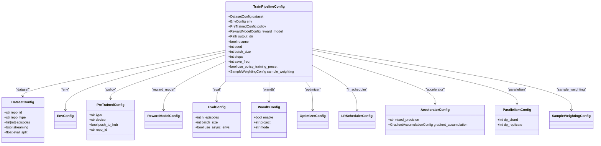
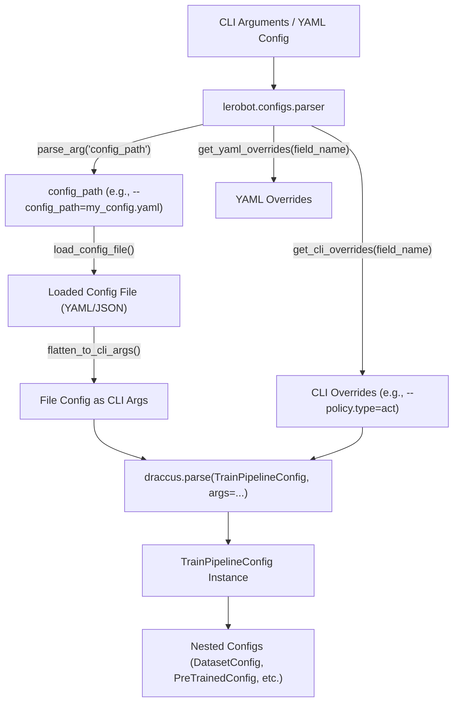
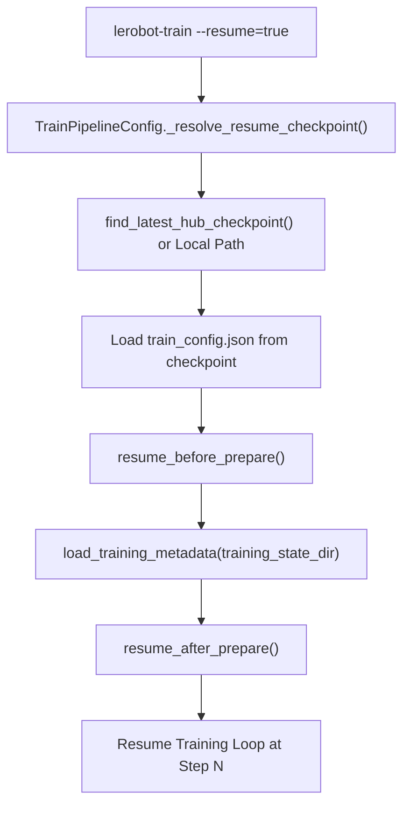

<!-- source: DeepWiki mcp.deepwiki.com · repo huggingface/lerobot · page 3.2 Training Configuration · fetched 2026-10-26 -->

# Training Configuration

Relevant source files

The following files were used as context for generating this wiki page:

- [docs/source/envhub_isaaclab_arena.mdx](docs/source/envhub_isaaclab_arena.mdx)
- [src/lerobot/common/train_utils.py](src/lerobot/common/train_utils.py)
- [src/lerobot/configs/eval.py](src/lerobot/configs/eval.py)
- [src/lerobot/configs/parser.py](src/lerobot/configs/parser.py)
- [src/lerobot/configs/train.py](src/lerobot/configs/train.py)
- [src/lerobot/envs/__init__.py](src/lerobot/envs/__init__.py)
- [src/lerobot/policies/factory.py](src/lerobot/policies/factory.py)
- [src/lerobot/policies/flux3/f3/transformer.py](src/lerobot/policies/flux3/f3/transformer.py)
- [src/lerobot/rewards/factory.py](src/lerobot/rewards/factory.py)
- [src/lerobot/scripts/lerobot_train.py](src/lerobot/scripts/lerobot_train.py)
- [tests/common/test_publish.py](tests/common/test_publish.py)
- [tests/configs/test_resume_from_hub.py](tests/configs/test_resume_from_hub.py)
- [tests/policies/test_factory_peft_revision.py](tests/policies/test_factory_peft_revision.py)
- [tests/policies/test_language_processor_factory.py](tests/policies/test_language_processor_factory.py)
- [tests/rewards/test_reward_model_base.py](tests/rewards/test_reward_model_base.py)
- [tests/test_yaml_policy_path.py](tests/test_yaml_policy_path.py)
- [tests/utils/test_train_utils.py](tests/utils/test_train_utils.py)

This page documents `TrainPipelineConfig` and all nested configurations within LeRobot, covering parameters that control a training run. It explains how defaults are set, how policy presets and RA-BC sample weighting are applied, how `draccus` parses command-line and YAML inputs, how configurations are serialized and loaded from the Hugging Face Hub, how the resume mechanism functions, and how hardware resources should be sized.

For the training loop consuming this configuration, see [Training Pipeline](#3.1). For optimizer settings, see [Optimizers and Schedulers](#3.3). For multi-GPU scaling, see [Multi-GPU and Distributed Training](#3.4).

---

## Configuration Class Hierarchy and `TrainPipelineConfig`

The top-level training configuration is defined by `TrainPipelineConfig` in `src/lerobot/configs/train.py` [src/lerobot/configs/train.py:110](). It composes multiple specialized sub-configurations via dataclasses, including `DatasetConfig`, `PreTrainedConfig`, `EvalConfig`, `WandBConfig`, `OptimizerConfig`, `LRSchedulerConfig`, `AcceleratorConfig`, and `ParallelismConfig`.

The following diagram bridges natural language concepts of configuration composition to their exact Python classes and file locations:

Sources: [src/lerobot/configs/train.py:110-170](), [src/lerobot/configs/default.py:29-150](), [src/lerobot/configs/policies.py:41-84]()

---

## Draccus-Based Parsing and CLI Overrides

LeRobot leverages `draccus` inside `src/lerobot/configs/parser.py` [src/lerobot/configs/parser.py:28]() to parse hierarchical command-line arguments and YAML/JSON configuration files into dataclass instances.

When launching training via `lerobot-train` [src/lerobot/scripts/lerobot_train.py:25](), arguments are passed using dot notation corresponding to nested dataclass fields (e.g., `--dataset.repo_id=lerobot/pusht --policy.type=act`). The parser module also supports extracting path fields from YAML files (such as `policy.path`) using `get_path_arg` [src/lerobot/configs/parser.py:47](), separating model weights loading from training hyperparameters. Non-path fields are captured as YAML overrides (`_config_yaml_overrides`) and merged with CLI arguments.

The data flow from raw CLI inputs to parsed configuration dataclasses is illustrated below:

Sources: [src/lerobot/configs/parser.py:47-101](), [src/lerobot/scripts/lerobot_train.py:25]()

---

## Configuration Loading, Saving, and Hub Serialization

Configurations are serialized to disk during checkpointing and publishing via methods inherited from `HubMixin` [src/lerobot/configs/train.py:110]().

- **Saving**: When a checkpoint is saved, `TrainPipelineConfig` is serialized into `train_config.json` inside the model checkpoint directory (`pretrained_model/train_config.json`) [src/lerobot/configs/train.py:43]().
- **Loading**: `TrainPipelineConfig.from_pretrained()` handles loading from local directories or directly from Hugging Face Hub repositories. If a root `train_config.json` is missing in an interrupted Hub run, it falls back to locating the latest checkpoint's config file (`checkpoints/<step>/pretrained_model/train_config.json`) [tests/configs/test_resume_from_hub.py:28]().

Sources: [src/lerobot/configs/train.py:34](), [src/lerobot/configs/train.py:43](), [tests/configs/test_resume_from_hub.py:28-56]()

---

## Resume Mechanism and State Restoration

When `resume=True` is passed in `TrainPipelineConfig` [src/lerobot/configs/train.py:124](), LeRobot restores both the model weights, optimizer/scheduler states, random number generator states, and training step counters.

The resume workflow bridges user commands to persistence utilities in `lerobot.common.train_utils`:

- **Configuration Precedence**: By default, when resuming, the configuration stored in the checkpoint's `train_config.json` takes precedence over CLI arguments (though explicit CLI `--*` flags still override individual attributes) [src/lerobot/configs/train.py:121]().
- **Metadata Snapshotting**: `save_training_metadata` records the step counter, `dp_world_size`, `batch_size`, and gradient accumulation steps into `training_step.json` inside `training_state/` [src/lerobot/common/train_utils.py:137]().

Sources: [src/lerobot/configs/train.py:119-124](), [src/lerobot/common/train_utils.py:137-165](), [tests/utils/test_train_utils.py:76-87](), [tests/configs/test_resume_from_hub.py:73-95]()

---

## Policy Training Presets and Sample Weighting (RA-BC)

### Policy Presets
When `use_policy_training_preset=True` (default on `TrainPipelineConfig`), the training pipeline automatically applies policy-specific optimizer and learning rate scheduler defaults defined by individual architectures [src/lerobot/configs/train.py:157](). This ensures policies like ACT or Diffusion use their optimal hyperparameters without requiring manual CLI definitions.

### Sample Weighting (RA-BC)
Reward-Aligned Behavior Cloning (RA-BC) reweights training samples using precomputed progress scores. Legacy RA-BC fields (such as `use_rabc`, `rabc_progress_path`, `rabc_kappa`, `rabc_epsilon`, and `rabc_head_mode`) are automatically migrated to the modern `sample_weighting` structure (`SampleWeightingConfig`) during configuration initialization via `_migrate_legacy_rabc_fields` [src/lerobot/configs/train.py:73]().

Sources: [src/lerobot/configs/train.py:73-106](), [src/lerobot/configs/train.py:157]()

---

## Hardware Sizing Guide and Distributed Topology

Training memory consumption depends heavily on the chosen policy architecture, observation modalities (e.g., high-resolution cameras), and batch size.

LeRobot supports three data-parallel topologies configured via `--parallelism.*` and `--accelerator.*` flags:

| Data-Parallel Layout | Description | Configuration Flag |
|---|---|---|
| **DDP** (Distributed Data Parallel) | Replicates the full model across all available GPUs | Default for multi-GPU launches [src/lerobot/scripts/lerobot_train.py:25]() |
| **FSDP** (Fully Sharded Data Parallel) | Shards model parameters, gradients, and optimizer states | `--parallelism.dp_shard=N` [src/lerobot/scripts/lerobot_train.py:25]() |
| **HSDP** (Hybrid Sharded Data Parallel) | Shards across local GPU groups and replicates across nodes | `--parallelism.dp_replicate=R --parallelism.dp_shard=S` [src/lerobot/scripts/lerobot_train.py:25]() |

### Guidelines for Memory Reduction
1. **Reduce Batch Size**: Lower `batch_size` in `TrainPipelineConfig` [src/lerobot/configs/train.py:133]().
2. **Enable Mixed Precision**: Set `--accelerator.mixed_precision=bf16` to halve memory overhead [src/lerobot/scripts/lerobot_train.py:25]() (e.g., `bf16` or `fp16`).
3. **Parameter-Efficient Fine-Tuning**: Enable `peft` to freeze backbone weights and train low-rank adapters only [src/lerobot/configs/default.py:130-143]().
4. **FSDP Sharding & Activation Checkpointing**: Use `--parallelism.dp_shard=-1` alongside FSDP wrap modules to distribute large transformer backbones [src/lerobot/distributed/__init__.py:10]().

Sources: [src/lerobot/scripts/lerobot_train.py:25](), [src/lerobot/configs/train.py:133-156](), [src/lerobot/configs/default.py:130-143]()

---

