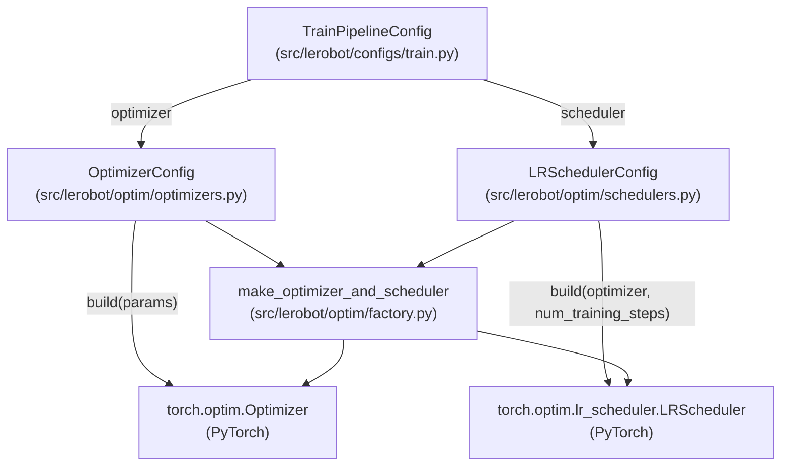
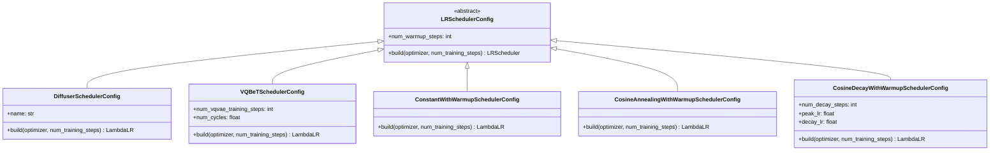

<!-- source: DeepWiki mcp.deepwiki.com · repo huggingface/lerobot · page 3.3 Optimizers and Schedulers · fetched 2026-10-26 -->

# Optimizers and Schedulers

<details>
<summary>Relevant source files</summary>

The following files were used as context for generating this wiki page:

- [docs/source/policy_evo1_README.md](docs/source/policy_evo1_README.md)
- [src/lerobot/optim/optimizers.py](src/lerobot/optim/optimizers.py)
- [src/lerobot/optim/schedulers.py](src/lerobot/optim/schedulers.py)
- [src/lerobot/policies/evo1/README.md](src/lerobot/policies/evo1/README.md)
- [src/lerobot/policies/evo1/__init__.py](src/lerobot/policies/evo1/__init__.py)
- [tests/optim/test_optimizers.py](tests/optim/test_optimizers.py)

</details>


This page documents the optimizer and learning rate scheduler subsystem in LeRobot, covering `make_optimizer_and_scheduler`, `OptimizerConfig` subclasses, available LR schedulers, warmup strategies, presets, and state persistence across training checkpoints.

For broader training orchestrations, see [Training Pipeline (3.1)](./training_pipeline.md). For how optimizer and scheduler options integrate into the main configuration hierarchy, see [Training Configuration (3.2)](./training_configuration.md).

---

## System Overview and Factory

Every training session instantiates optimizers and learning rate schedulers through configuration objects resolved via `draccus.ChoiceRegistry`. The assembly process coordinates parameter grouping (such as differential learning rates for Vision-Language-Action models or multi-optimizer setups in Reinforcement Learning) and binds them to the training loop.

The core abstract base classes and factory functions are:
- `OptimizerConfig` defined in [src/lerobot/optim/optimizers.py:46-86]()
- `LRSchedulerConfig` defined in [src/lerobot/optim/schedulers.py:39-49]()
- `make_optimizer_and_scheduler` defined in [src/lerobot/optim/factory.py]() (referenced in [src/lerobot/scripts/lerobot_train.py:74]())

### Optimizer and Scheduler Construction Flow (Natural Language to Code Space)

The following diagram bridges natural language configuration concepts to their exact code entities during initialization:

Title: "OptimizerAndSchedulerConstructionFlow"

Sources: [src/lerobot/optim/optimizers.py:46-86](), [src/lerobot/optim/schedulers.py:39-49](), [src/lerobot/scripts/lerobot_train.py:74]()

---

## OptimizerConfig and Subclasses

`OptimizerConfig` is an abstract base class utilizing `draccus.ChoiceRegistry` [src/lerobot/optim/optimizers.py:46-51](). Subclasses must implement the `build(params)` method, which accepts model parameters and returns either a single `torch.optim.Optimizer` or a dictionary of optimizers (`dict[str, torch.optim.Optimizer]`) [src/lerobot/optim/optimizers.py:64-86]().

```python
@dataclass
class OptimizerConfig(draccus.ChoiceRegistry, abc.ABC):
    lr: float
    weight_decay: float
    grad_clip_norm: float

    @abc.abstractmethod
    def build(self, params: OptimizerParams) -> torch.optim.Optimizer | dict[str, torch.optim.Optimizer]:
        ...
```
[src/lerobot/optim/optimizers.py:46-86]()

Note that `grad_clip_norm` is a field on `OptimizerConfig` used by training execution scripts for gradient norm clipping [src/lerobot/optim/optimizers.py:49]() rather than passed directly to the PyTorch optimizer constructor [src/lerobot/optim/optimizers.py:100]().

### Registered Optimizer Configurations

| Registered Name | Config Class | PyTorch Target / Return Type | Description / Notes |
|---|---|---|---|
| `adam` | `AdamConfig` | `torch.optim.Adam` | Standard Adam optimizer [src/lerobot/optim/optimizers.py:89-102]() |
| `adamw` | `AdamWConfig` | `torch.optim.AdamW` | Decoupled weight decay AdamW (default choice) [src/lerobot/optim/optimizers.py:104-117]() |
| `sgd` | `SGDConfig` | `torch.optim.SGD` | Stochastic Gradient Descent with momentum [src/lerobot/optim/optimizers.py:119-133]() |
| `xvla-adamw` | `XVLAAdamWConfig` | `torch.optim.AdamW` | Specialized differential LR optimizer for X-VLA [src/lerobot/optim/optimizers.py:135-175]() |
| `multi-adam` | `MultiAdamConfig` | `dict[str, torch.optim.Optimizer]` | Multi-optimizer mapping for SAC actor/critic [src/lerobot/optim/optimizers.py:300-368]() |

Sources: [src/lerobot/optim/optimizers.py:89-175](), [src/lerobot/optim/optimizers.py:300-368]()

---

### XVLAAdamWConfig

`XVLAAdamWConfig` splits named parameters into three groups to apply differential learning rates during fine-tuning [src/lerobot/optim/optimizers.py:135-175]():
1. **`vlm`**: Parameters containing `"vlm"` in their name, scaled by `lr * 0.1` for stable feature preservation [src/lerobot/optim/optimizers.py:156]().
2. **`soft_prompts`**: Parameters containing `"soft_prompt"`, scaled by `soft_prompt_lr_scale` [src/lerobot/optim/optimizers.py:157]().
3. **`other`**: All remaining model parameters trained at the full `lr` [src/lerobot/optim/optimizers.py:158]().

Sources: [src/lerobot/optim/optimizers.py:135-175]()

---

## LRSchedulerConfig and Schedulers

`LRSchedulerConfig` is the abstract base registry for learning rate schedulers [src/lerobot/optim/schedulers.py:39-49](). Subclasses must implement `build(optimizer, num_training_steps)` [src/lerobot/optim/schedulers.py:45-47]().

```python
@dataclass
class LRSchedulerConfig(draccus.ChoiceRegistry, abc.ABC):
    num_warmup_steps: int | None

    @abc.abstractmethod
    def build(self, optimizer: Optimizer, num_training_steps: int) -> LRScheduler | None:
        raise NotImplementedError
```
[src/lerobot/optim/schedulers.py:39-47]()

### Registered Scheduler Configurations

| Registered Name | Config Class | Implementation Details |
|---|---|---|
| `diffuser` | `DiffuserSchedulerConfig` | Wraps `diffusers.optimization.get_scheduler` [src/lerobot/optim/schedulers.py:51-61]() |
| `vqbet` | `VQBeTSchedulerConfig` | Constant LR during VQ-VAE codebook learning, followed by warmup and cosine decay [src/lerobot/optim/schedulers.py:63-84]() |
| `constant_with_warmup` | `ConstantWithWarmupSchedulerConfig` | Linear warmup up to `num_warmup_steps`, then flat constant LR (used by LingBot-VA) [src/lerobot/optim/schedulers.py:86-106]() |
| `cosine_annealing_with_warmup` | `CosineAnnealingWithWarmupSchedulerConfig` | Linear warmup followed by cosine decay to zero (used by EVO1) [src/lerobot/optim/schedulers.py:108-128]() |
| `cosine_decay_with_warmup` | `CosineDecayWithWarmupSchedulerConfig` | Linear warmup and cosine decay with automatic step scaling (used by π₀) [src/lerobot/optim/schedulers.py:130-174]() |

Sources: [src/lerobot/optim/schedulers.py:51-174]()

---

### Warmup and Decay Strategies

Specialized strategies handle complex model schedules:

- **VQ-BeT Strategy (`VQBeTSchedulerConfig`)**: Enforces a constant factor of `1.0` during the VQ-VAE phase (`current_step < num_vqvae_training_steps`), transitioning into linear warmup and cosine annealing [src/lerobot/optim/schedulers.py:70-83]().
- **π₀ Decay Strategy (`CosineDecayWithWarmupSchedulerConfig`)**: Automatically scales down warmup and decay durations if `num_training_steps < num_decay_steps`, ensuring robust schedule completion on shorter training runs [src/lerobot/optim/schedulers.py:145-161]().

### Scheduler Class Inheritance Hierarchy (Code Entity Space)

Title: "SchedulerHierarchyDiagram"

Sources: [src/lerobot/optim/schedulers.py:39-174]()

---

## Persistence and Checkpoint State Management

Optimizer and scheduler states are serialized alongside model parameters to allow seamless training resumption. 

| Function / Helper | Module | Description |
|---|---|---|
| `save_optimizer_state` | [src/lerobot/optim/optimizers.py:22-31]() | Serializes optimizer state dictionaries and parameter group configurations [src/lerobot/optim/optimizers.py:22-31]() |
| `load_optimizer_state` | [src/lerobot/optim/optimizers.py:22-31]() | Restores optimizer momentum buffers and state tensors [src/lerobot/optim/optimizers.py:22-31]() |
| `save_scheduler_state` | [src/lerobot/optim/schedulers.py:27-31]() | Writes learning rate scheduler state to `scheduler_state.json` [src/lerobot/optim/schedulers.py:27-31]() |
| `load_scheduler_state` | [src/lerobot/optim/schedulers.py:27-31]() | Reloads scheduler step progress from disk [src/lerobot/optim/schedulers.py:27-31]() |

Sources: [src/lerobot/optim/optimizers.py:22-31](), [src/lerobot/optim/schedulers.py:27-31](), [src/lerobot/common/train_utils.py:137-163]()

---

