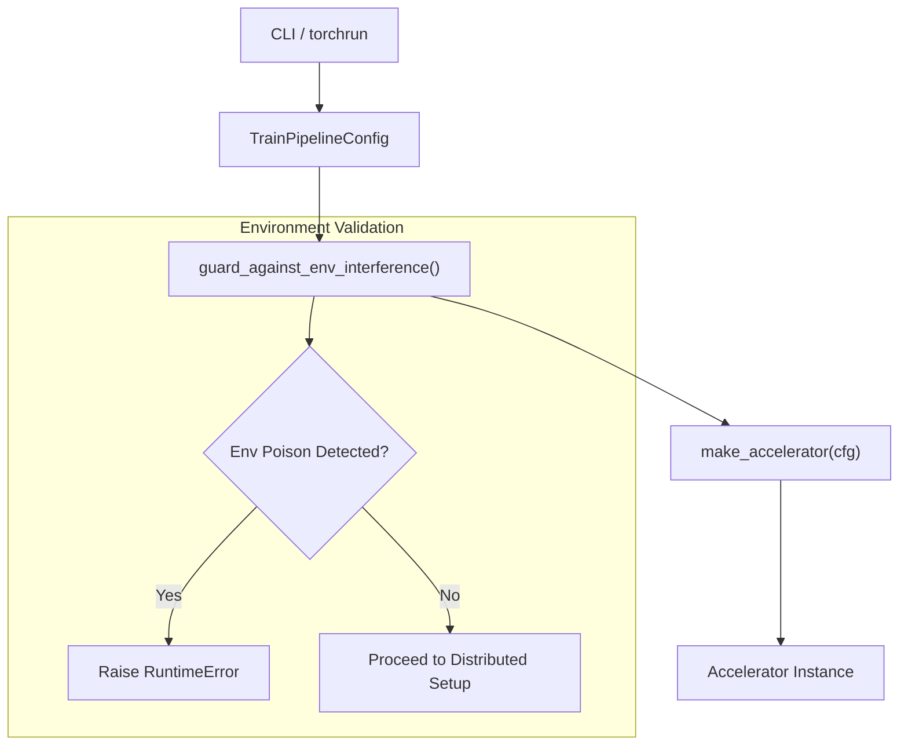
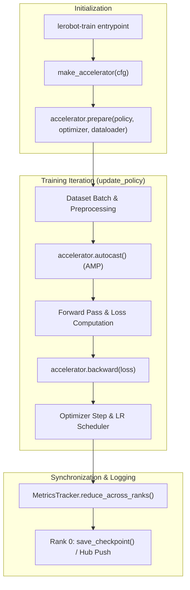
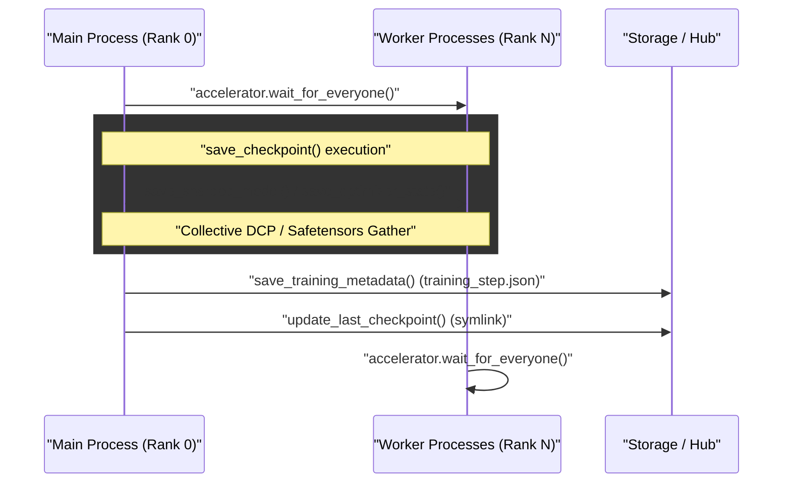

<!-- source: DeepWiki mcp.deepwiki.com · repo huggingface/lerobot · page 3.4 Multi-GPU and Distributed Training · fetched 2026-10-26 -->

# Multi-GPU and Distributed Training

Relevant source files

The following files were used as context for generating this wiki page:

- [.github/workflows/benchmark_tests.yml](.github/workflows/benchmark_tests.yml)
- [.github/workflows/claude.yml](.github/workflows/claude.yml)
- [.github/workflows/docker_publish.yml](.github/workflows/docker_publish.yml)
- [.github/workflows/fast_tests.yml](.github/workflows/fast_tests.yml)
- [.github/workflows/full_tests.yml](.github/workflows/full_tests.yml)
- [.github/workflows/issue_labeler.yml](.github/workflows/issue_labeler.yml)
- [.github/workflows/latest_deps_tests.yml](.github/workflows/latest_deps_tests.yml)
- [.github/workflows/pr_labeler.yml](.github/workflows/pr_labeler.yml)
- [.github/workflows/quality.yml](.github/workflows/quality.yml)
- [.github/workflows/release.yml](.github/workflows/release.yml)
- [.github/workflows/security.yml](.github/workflows/security.yml)
- [.github/workflows/stale.yml](.github/workflows/stale.yml)
- [docs/source/multi_gpu_training.mdx](docs/source/multi_gpu_training.mdx)
- [docs/source/torch_accelerators.mdx](docs/source/torch_accelerators.mdx)
- [src/lerobot/configs/accelerator.py](src/lerobot/configs/accelerator.py)
- [src/lerobot/configs/parallelism.py](src/lerobot/configs/parallelism.py)
- [src/lerobot/distributed/__init__.py](src/lerobot/distributed/__init__.py)
- [src/lerobot/distributed/checkpoint.py](src/lerobot/distributed/checkpoint.py)
- [src/lerobot/distributed/factory.py](src/lerobot/distributed/factory.py)
- [src/lerobot/optim/__init__.py](src/lerobot/optim/__init__.py)
- [src/lerobot/utils/logging_utils.py](src/lerobot/utils/logging_utils.py)
- [tests/common/test_checkpoint_legacy_contracts.py](tests/common/test_checkpoint_legacy_contracts.py)
- [tests/common/test_checkpoint_save_resume.py](tests/common/test_checkpoint_save_resume.py)
- [tests/configs/test_accelerator_config.py](tests/configs/test_accelerator_config.py)
- [tests/distributed/test_parallel_dims_and_factory.py](tests/distributed/test_parallel_dims_and_factory.py)
- [tests/training/test_multi_gpu.py](tests/training/test_multi_gpu.py)
- [tests/utils/test_io_utils.py](tests/utils/test_io_utils.py)
- [tests/utils/test_logging_utils.py](tests/utils/test_logging_utils.py)
- [tests/utils/test_random_utils.py](tests/utils/test_random_utils.py)

This page details LeRobot's distributed training architecture, covering Hugging Face Accelerate integration, multi-node/multi-GPU orchestration via `ParallelDims`, data-parallel configurations (DDP, FSDP, HSDP), gradient accumulation, mixed-precision training (AMP), Distributed Checkpointing (DCP) formats, and accelerator device selection.

---

## 1. Accelerate Integration and Guardrails

LeRobot integrates [Hugging Face Accelerate](https://huggingface.co/docs/accelerate) to coordinate distributed execution across GPUs and nodes. Unlike traditional pipelines that rely on external YAML configuration files (`accelerate config`), LeRobot embeds all parallelism and acceleration parameters directly into `TrainPipelineConfig` under `--parallelism.*` and `--accelerator.*` namespaces [src/lerobot/scripts/lerobot_train.py:20-22](). This guarantees that every run is fully reproducible from its saved `train_config.json` alone.

The `Accelerator` instance is instantiated via `make_accelerator(cfg)` in `src/lerobot/distributed/factory.py`, which resolves topology constraints against the runtime environment [src/lerobot/distributed/factory.py:69-101]().

### Environment Guardrails
To prevent Accelerate's environment variables (such as `ACCELERATE_USE_FSDP`) from silently overriding LeRobot's configuration schema, `guard_against_env_interference()` checks the environment at startup and halts execution if external configuration pollution is detected [src/lerobot/distributed/factory.py:45-67](). Users can bypass this check by explicitly exporting `LEROBOT_ALLOW_ACCELERATE_ENV=1`.

Diagram: Accelerator Integration Workflow

Sources: [src/lerobot/scripts/lerobot_train.py:20-22](), [src/lerobot/distributed/factory.py:45-101]()

---

## 2. Parallelism Topologies via `ParallelDims`

LeRobot supports three core data-parallel layouts, governed by the `ParallelismConfig` and instantiated through `ParallelDims` [src/lerobot/distributed/factory.py:69-101](), [src/lerobot/configs/parallelism.py:10-40]().

| Layout | Description | Configuration Flag |
| :--- | :--- | :--- |
| **DDP** (Distributed Data Parallel) | Replicates the full model parameters and optimizer state on every GPU. | Default on multi-GPU launches |
| **FSDP** (Fully Sharded Data Parallel) | Shards parameters, gradients, and optimizer states across GPU ranks. | `--parallelism.dp_shard=N` |
| **HSDP** (Hybrid Sharded Data Parallel) | Shards within localized groups (e.g., nodes) and replicates across groups. | `--parallelism.dp_replicate=R --parallelism.dp_shard=S` |

### Effective Batch Size and Step Semantics
In LeRobot, `--steps` measures loop iterations (micro-batches processed by each worker), not optimizer updates. The effective global batch size incorporates data-parallel replication/sharding scale factors and gradient accumulation steps [src/lerobot/configs/parallelism.py:42-46]():

$$\text{effective\_batch\_size} = \text{batch\_size} \times \text{dp\_world\_size} \times \text{gradient\_accumulation\_steps}$$

Where $\text{dp\_world\_size} = \text{dp\_replicate} \times \text{dp\_shard}$.

Sources: [src/lerobot/distributed/factory.py:69-101](), [src/lerobot/configs/parallelism.py:10-46]()

---

## 3. Training Loop Data Flow and Synchronization

The training loop (`train()`) handles distributed synchronization points, metric reduction, and checkpoint coordination across processes.

Diagram: Training Data Flow and Synchronization

Sources: [src/lerobot/scripts/lerobot_train.py:142-186](), [src/lerobot/utils/logging_utils.py:169-198]()

---

## 4. Gradient Accumulation and Mixed Precision (AMP)

### Gradient Accumulation
Gradient accumulation is managed natively via Accelerate. The `update_policy` function integrates with `accelerator.accumulate(policy)` to suppress gradient synchronization on non-final micro-batches, preventing unnecessary communication overhead [src/lerobot/scripts/lerobot_train.py:142-186]().

### Mixed Precision
LeRobot provides device-safe automatic mixed precision via `get_autocast_context()` in `src/lerobot/utils/device_utils.py` [src/lerobot/utils/device_utils.py:136-158](). This utility checks device capabilities before applying `torch.autocast`:
- **MPS / Unported Devices:** Falls back to `nullcontext()` to preserve native tensor dtypes.
- **CUDA (Compute Capability < 8.0):** Gracefully falls back from `bfloat16` to `float16`.
- **Supported Hardware:** Instantiates `torch.autocast(device_type=device_type, dtype=dtype)` [src/lerobot/utils/device_utils.py:136-158]().

Sources: [src/lerobot/scripts/lerobot_train.py:142-186](), [src/lerobot/utils/device_utils.py:136-158]()

---

## 5. Distributed Checkpointing (DCP) and Formats

LeRobot supports multiple checkpoint structures determined by `CheckpointFormat` in `src/lerobot/configs/accelerator.py` [src/lerobot/configs/accelerator.py:10-20]():

- `CheckpointFormat.SAFETENSORS`: Standard monolithic `model.safetensors` file. Ideal for single-node or DDP runs; requires gathering weights on rank 0 during save.
- `CheckpointFormat.DCP`: Uses PyTorch Distributed Checkpoint (`pytorch_model_fsdp_0/`) sharded files. Essential for large-scale FSDP models to avoid rank 0 out-of-memory errors during saves and resumes.
- `CheckpointFormat.SAFETENSORS_AND_DCP`: Writes both representations concurrently.

Diagram: Checkpoint Saving Sequence

Sources: [src/lerobot/configs/accelerator.py:10-20](), [src/lerobot/distributed/checkpoint.py:10-100]()

---

## 6. Accelerator Selection and Device Utilities

Device selection is handled dynamically through `auto_select_torch_device()` and `get_safe_torch_device()` in `src/lerobot/utils/device_utils.py` [src/lerobot/utils/device_utils.py:23-70](). 

- **CUDA:** Detected via `torch.cuda.is_available()`. Peak memory statistics are reset and monitored via `torch.cuda.reset_peak_memory_stats()` [src/lerobot/scripts/lerobot_train.py:181-182]().
- **MPS:** Apple Silicon support via `torch.backends.mps.is_available()`, incorporating datatype restrictions (e.g., coercing `float64` to `float32`) [src/lerobot/utils/device_utils.py:86-110]().
- **XPU:** Intel GPU accelerator integration with capability checks for double-precision support [src/lerobot/utils/device_utils.py:94-108]().

Sources: [src/lerobot/utils/device_utils.py:23-110](), [src/lerobot/scripts/lerobot_train.py:181-182]()

---

