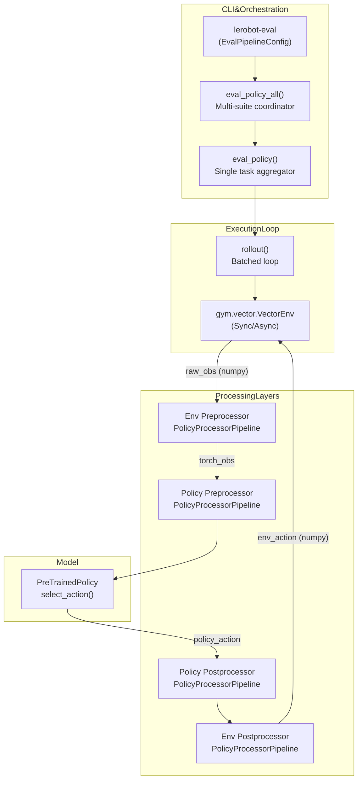
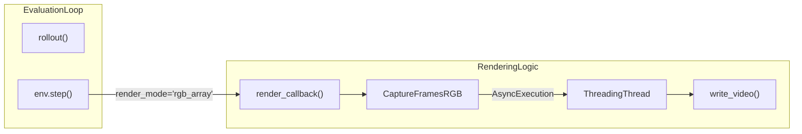
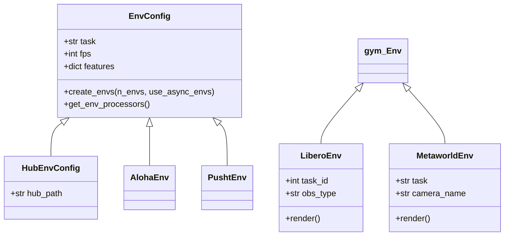

<!-- source: DeepWiki mcp.deepwiki.com · repo huggingface/lerobot · page 3.5 Evaluation Pipeline · fetched 2026-10-26 -->

# Evaluation Pipeline

Relevant source files

The following files were used as context for generating this wiki page:

- [docs/source/adding_benchmarks.mdx](docs/source/adding_benchmarks.mdx)
- [docs/source/env_processor.mdx](docs/source/env_processor.mdx)
- [docs/source/libero.mdx](docs/source/libero.mdx)
- [docs/source/libero_plus.mdx](docs/source/libero_plus.mdx)
- [docs/source/metaworld.mdx](docs/source/metaworld.mdx)
- [src/lerobot/envs/configs.py](src/lerobot/envs/configs.py)
- [src/lerobot/envs/factory.py](src/lerobot/envs/factory.py)
- [src/lerobot/envs/libero.py](src/lerobot/envs/libero.py)
- [src/lerobot/envs/metaworld.py](src/lerobot/envs/metaworld.py)
- [src/lerobot/envs/utils.py](src/lerobot/envs/utils.py)
- [src/lerobot/processor/relative_action_processor.py](src/lerobot/processor/relative_action_processor.py)
- [src/lerobot/scripts/lerobot_eval.py](src/lerobot/scripts/lerobot_eval.py)
- [src/lerobot/utils/eval_stats.py](src/lerobot/utils/eval_stats.py)
- [tests/envs/test_dispatch.py](tests/envs/test_dispatch.py)
- [tests/envs/test_freeze_after_episode_end.py](tests/envs/test_freeze_after_episode_end.py)
- [tests/policies/test_relative_actions.py](tests/policies/test_relative_actions.py)
- [tests/scripts/test_lerobot_eval_summary.py](tests/scripts/test_lerobot_eval_summary.py)
- [tests/utils/test_eval_stats.py](tests/utils/test_eval_stats.py)
- [utils/documentation_tests.txt](utils/documentation_tests.txt)

The evaluation pipeline provides infrastructure for assessing trained policies through rollout execution in simulation or real-world environments. It handles batched environment execution, metrics collection (rewards, success rates), video rendering for visualization, and parallel evaluation across multiple task groups.

## Overview

The evaluation system is implemented primarily in `src/lerobot/scripts/lerobot_eval.py` and consists of three hierarchical evaluation functions:
- **`rollout()`**: Executes a single batched rollout through vectorized environments [src/lerobot/scripts/lerobot_eval.py:168-183]().
- **`eval_policy()`**: Runs multiple rollouts to collect episode statistics for a single task.
- **`eval_policy_all()`**: Evaluates across multiple task groups (suites) with optional parallelization.

The pipeline supports both standalone evaluation via the `lerobot-eval` CLI command and periodic evaluation during training via the `train()` function [src/lerobot/scripts/lerobot_eval.py:27-50]().

Sources: `[src/lerobot/scripts/lerobot_eval.py:16-50]`, `[src/lerobot/scripts/lerobot_eval.py:168-183]`

## Evaluation Architecture and Data Flow

The evaluation pipeline bridges environment-specific data formats with policy-specific input requirements using a multi-stage processing flow. The following diagram maps natural language evaluation concepts directly to their corresponding code entities in the codebase.

Sources: `[src/lerobot/scripts/lerobot_eval.py:168-457]`, `[src/lerobot/envs/factory.py:37-55]`, `[src/lerobot/envs/configs.py:126-128]`

## Core Evaluation Functions

### Rollout Execution

The `rollout()` function executes a single episode across a batch of vectorized environments [src/lerobot/scripts/lerobot_eval.py:168-183]().

**Rollout Loop Logic:**
1. **Reset**: Environments are initialized with specific seeds if provided.
2. **Step Loop**: For each step until all environments in the batch are `done` or `max_steps` is reached:
   - **Observation Preprocessing**: `preprocess_observation` converts numpy arrays to tensors, handles channel-first conversion, and normalizes images to `[0, 1]` [src/lerobot/envs/utils.py:68-149]().
   - **Task Injection**: Injects task descriptions into the observation dictionary by accessing `task_description` or `task` attributes on sub-environments.
   - **Environment Processors**: Applies environment-specific transforms via `env_preprocessor`.
   - **Policy Processors**: Applies policy-specific transforms (normalization, device placement) via `preprocessor`.
   - **Inference**: `policy.select_action(observation)` computes the action.
   - **Postprocessing**: Actions are unnormalized by `postprocessor` and optionally transformed by `env_postprocessor`. This includes converting relative actions back to absolute actions if `RelativeActionsProcessorStep` was used during preprocessing [src/lerobot/processor/relative_action_processor.py:73-99]().
   - **Execution**: `env.step(action)` executes the action in the environment.
3. **Data Stacking**: Returns a dictionary of stacked tensors containing `action`, `reward`, `success`, and `done` flags.

Sources: `[src/lerobot/scripts/lerobot_eval.py:168-457]`, `[src/lerobot/envs/utils.py:68-149]`, `[src/lerobot/processor/relative_action_processor.py:73-99]`

### Episode Aggregation and Metrics

The `eval_policy()` function runs multiple rollouts to collect episode statistics and compute aggregate metrics.

**Metrics Tracked:**
- `avg_sum_reward`: Mean of total rewards per episode.
- `avg_max_reward`: Mean of maximum rewards achieved in each episode.
- `pc_success`: Percentage of successful episodes (based on `info["is_success"]`).
- `eval_s`: Total wall-clock time spent in evaluation.
- `pc_success_ci95`: 95% Wilson interval for success rate, providing a confidence range for the success metric [docs/source/adding_benchmarks.mdx:59-60]().

**Done Masking:**
To ensure metrics are only calculated for valid steps prior to environment termination, a mask is applied based on the first `True` in the `done` tensor.

Sources: `[src/lerobot/scripts/lerobot_eval.py:460-654]`, `[docs/source/adding_benchmarks.mdx:59-60]`

### Multi-Task Coordination and Parallel Evaluation

The `eval_policy_all()` function coordinates evaluation across multiple task groups or suites.
- **Parallel Execution**: If `eval_cfg.max_parallel_tasks > 1`, it utilizes `concurrent.futures.ThreadPoolExecutor` to evaluate multiple task groups concurrently.
- **Aggregation**: It maintains an `overall` dictionary to store aggregated success rates and rewards across all suites and tasks.

Sources: `[src/lerobot/scripts/lerobot_eval.py:680-793]`

## Video Rendering

Rendering is integrated into the rollout loop via a `render_callback` [src/lerobot/scripts/lerobot_eval.py:176]().

### Rendering Pipeline

**Implementation Details:**
- **Frame Collection**: Frames are collected in a list during the rollout [src/lerobot/scripts/lerobot_eval.py:520-526]().
- **Asynchronous Writing**: To avoid blocking the main evaluation thread, videos are written to disk using a background thread [src/lerobot/scripts/lerobot_eval.py:608-617]().
- **Storage**: Videos are saved to `{videos_dir}/{task_name}_{env_id}/eval_episode_{n}.mp4` [src/lerobot/scripts/lerobot_eval.py:601]().

Sources: `[src/lerobot/scripts/lerobot_eval.py:517-621]`, `[src/lerobot/utils/io_utils.py:92]`

## Benchmark Support and Configuration Space

The pipeline includes specialized support for robotics benchmarks through `EnvConfig` and `VectorEnv` implementations. The class hierarchy below bridges environment configuration types to their underlying code structures.

### LIBERO Benchmark
- **Environment**: `LiberoEnv` handles multi-task suites (spatial, object, goal, 10, 90) [src/lerobot/envs/libero.py:107-164]().
- **Initialization**: `get_task_init_states` loads task-specific initial configurations, supporting LIBERO-plus perturbations [src/lerobot/envs/libero.py:67-88]().
- **Control**: Supports relative and absolute control modes and handles camera mapping for policy consistency [src/lerobot/envs/libero.py:128-161]().
- **LIBERO-plus**: The `LiberoEnv` can be configured to run LIBERO-plus, a robustness benchmark that applies perturbations to the original LIBERO tasks [src/lerobot/envs/libero.py:131](), [docs/source/libero_plus.mdx:1-24]().

Sources: `[src/lerobot/envs/libero.py:67-164]`, `[src/lerobot/envs/factory.py:58-122]`, `[src/lerobot/envs/metaworld.py:78-141]`, `[docs/source/libero_plus.mdx:1-24]`

### Meta-World Benchmark
- **Environment**: `MetaworldEnv` wraps the Meta-World MT1 tasks [src/lerobot/envs/metaworld.py:78-141]().
- **Task Descriptions**: Loads task descriptions from `metaworld_config.json` for language conditioning [src/lerobot/envs/metaworld.py:33-53]().

Sources: `[src/lerobot/envs/metaworld.py:78-141]`, `[src/lerobot/envs/metaworld.py:33-53]`

### EnvHub Integration
- **Loading**: `make_env` can load environments directly from the Hugging Face Hub using a repository identifier [src/lerobot/envs/factory.py:58-87]().
- **Security**: Requires explicit `trust_remote_code=True` to execute hub-provided environment code [src/lerobot/envs/factory.py:63]().

Sources: `[src/lerobot/envs/factory.py:58-122]`, `[src/lerobot/envs/factory.py:63]`

---

