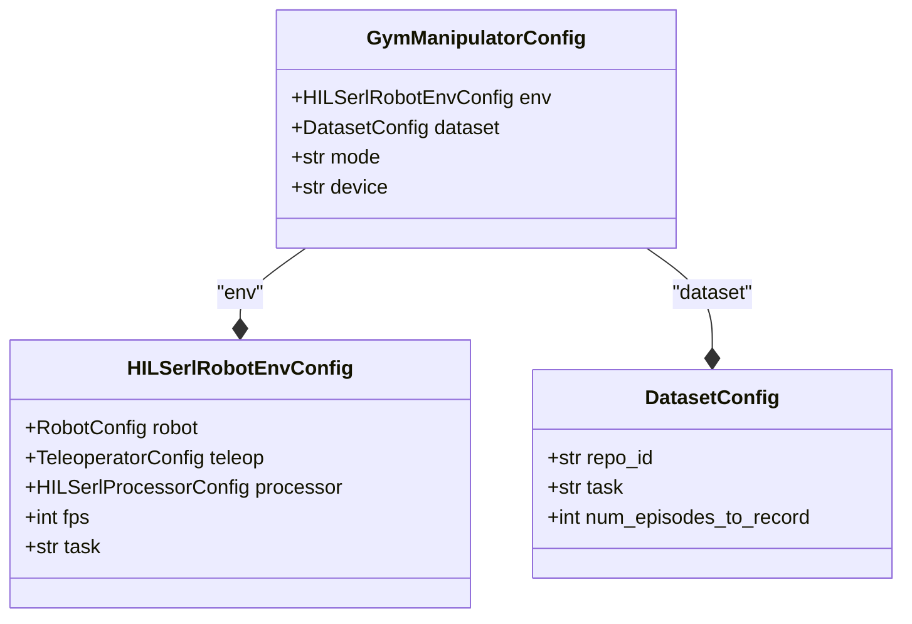
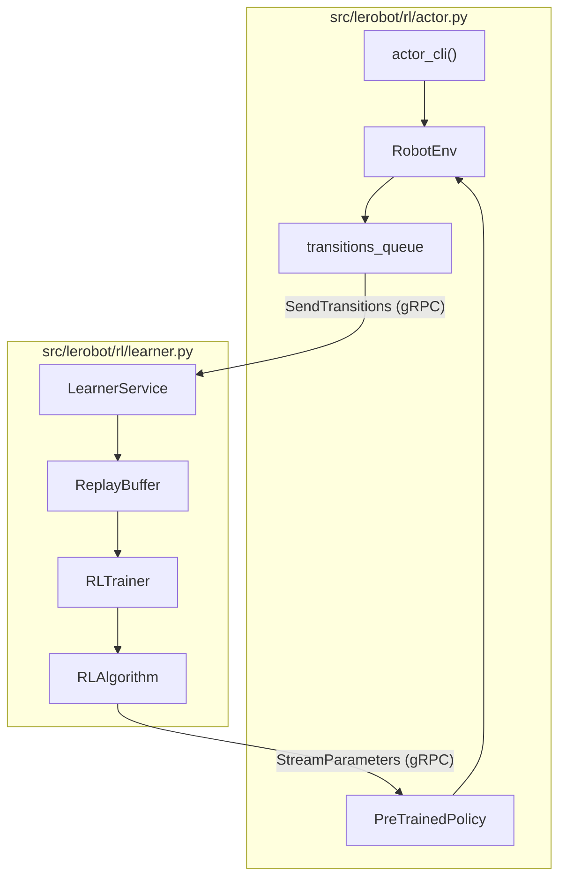
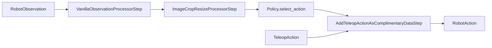

<!-- source: DeepWiki mcp.deepwiki.com · repo huggingface/lerobot · page 3.6 Reinforcement Learning · fetched 2026-10-26 -->

# Reinforcement Learning

Relevant source files

The following files were used as context for generating this wiki page:

- [docs/source/envhub_leisaac.mdx](docs/source/envhub_leisaac.mdx)
- [docs/source/hilserl.mdx](docs/source/hilserl.mdx)
- [examples/backward_compatibility/replay.py](examples/backward_compatibility/replay.py)
- [examples/lekiwi/replay.py](examples/lekiwi/replay.py)
- [examples/phone_to_so100/replay.py](examples/phone_to_so100/replay.py)
- [examples/so100_to_so100_EE/replay.py](examples/so100_to_so100_EE/replay.py)
- [src/lerobot/rl/actor.py](src/lerobot/rl/actor.py)
- [src/lerobot/rl/buffer.py](src/lerobot/rl/buffer.py)
- [src/lerobot/rl/crop_dataset_roi.py](src/lerobot/rl/crop_dataset_roi.py)
- [src/lerobot/rl/eval_policy.py](src/lerobot/rl/eval_policy.py)
- [src/lerobot/rl/gym_manipulator.py](src/lerobot/rl/gym_manipulator.py)
- [src/lerobot/rl/learner.py](src/lerobot/rl/learner.py)
- [src/lerobot/rl/learner_service.py](src/lerobot/rl/learner_service.py)
- [src/lerobot/rl/queue.py](src/lerobot/rl/queue.py)
- [tests/rl/test_queue.py](tests/rl/test_queue.py)
- [tests/utils/test_replay_buffer.py](tests/utils/test_replay_buffer.py)

## Purpose and Scope
This page details LeRobot's reinforcement learning (RL) framework, focusing on the HIL-SERL (Human-in-the-Loop Sample-Efficient Reinforcement Learning) workflow, Soft Actor-Critic (SAC) algorithms, TDMPC, QC-FQL, the distributed actor-learner architecture using gRPC (`learner_service.py`), `GymManipulatorConfig` and `RobotEnv` in `gym_manipulator.py`, and human-in-the-loop data collection pipelines.

Sources: [docs/source/hilserl.mdx:1-30](), [src/lerobot/rl/actor.py:17-47](), [src/lerobot/rl/learner.py:18-45]()

---

## Overview

LeRobot supports both imitation learning and reinforcement learning (RL) paradigms. While imitation learning (IL) policies learn from pre-collected demonstrations, RL policies learn through online interaction with environments, optimizing for cumulative reward signals. LeRobot provides a distributed architecture for RL, specifically tailored for sample-efficient real-robot training.

**Supported RL Algorithms:**

| Algorithm | Status | Type | Use Case |
|-----------|--------|------|----------|
| **HIL-SERL** | Available | Off-Policy RL | Human-in-the-loop training with demonstrations and interventions [docs/source/hilserl.mdx:5-15](). |
| **SAC** | Available | Off-Policy RL | Soft Actor-Critic; general-purpose continuous control backbone [docs/source/hilserl.mdx:11](). |
| **TDMPC** | Available | Model-Based RL | Sample-efficient learning with world models. |
| **QC-FQL** | Coming Soon | Offline RL | Learning from fixed datasets with Q-learning. |

Sources: [src/lerobot/rl/actor.py:17-47](), [src/lerobot/rl/learner.py:18-45](), [docs/source/hilserl.mdx:5-15]()

---

## RL Configuration Architecture

RL training utilizes specialized configuration classes to manage environment interaction, distributed communication, and policy parameters. The primary configuration for RL is `TrainRLServerPipelineConfig` [src/lerobot/rl/train_rl.py:50]().

### Gym Manipulator Configuration
For real-robot HIL-SERL training, the configuration is centered around `GymManipulatorConfig`, which nests environment and dataset settings [src/lerobot/rl/gym_manipulator.py:99-106]().

Title: Gym Manipulator Configuration Hierarchy

Sources: [src/lerobot/rl/gym_manipulator.py:87-106](), [docs/source/hilserl.mdx:69-134]()

---

## HIL-SERL: Human-in-the-loop RL

HIL-SERL (Human-in-the-Loop Sample-Efficient Reinforcement Learning) is the primary RL workflow in LeRobot. It combines three key ingredients:
1. **Offline Demonstrations & Reward Classifier**: A handful of human-teleop episodes plus a vision-based success detector (trained via a reward classifier) give the policy a shaped starting point [docs/source/hilserl.mdx:9-10]().
2. **Actor-Learner Loop**: A distributed architecture where an actor explores the physical robot while a learner updates the policy [src/lerobot/rl/actor.py:19-21]().
3. **Human Interventions**: A human operator can jump in at any time to correct dangerous or unproductive behavior using a teleoperator. The `InterventionActionProcessorStep` detects these corrections via `TeleopEvents` and overrides policy actions [src/lerobot/processor/hil_processor.py:131-171](), [docs/source/hilserl.mdx:11-12]().

### Distributed Architecture
The workflow is split into two main processes: `actor_cli` (`actor.py`) and `train_cli` (`learner.py`). They communicate via gRPC services defined in `LearnerService` (`learner_service.py`) and `services_pb2_grpc` [src/lerobot/rl/learner_service.py:1-135](), [src/lerobot/transport/services_pb2_grpc.py:1-442]().

Title: Distributed Actor-Learner Architecture and gRPC Dataflow

Sources: [src/lerobot/rl/actor.py:120-195](), [src/lerobot/rl/learner.py:123-195](), [src/lerobot/rl/learner_service.py:1-135](), [src/lerobot/transport/services_pb2_grpc.py:1-442]()

---

## SAC Algorithm Implementation

The Soft Actor-Critic (SAC) algorithm serves as the backbone for HIL-SERL. It optimizes for both expected reward and policy entropy to encourage exploration [docs/source/hilserl.mdx:11]().

### Key Components
- **Actor-Learner Communication**: The actor receives policy weights via `StreamParameters` and sends experience via `SendTransitions` [src/lerobot/rl/actor.py:142-145](), [src/lerobot/rl/learner_service.py:1-135]().
- **Replay Buffer**: The `ReplayBuffer` stores transitions [src/lerobot/rl/learner.py:116](). It supports memory optimization by not storing duplicate `next_state` when it can be derived from `state` [src/lerobot/rl/buffer.py:106-108](). The buffer can also apply image augmentations like `random_shift` [src/lerobot/rl/buffer.py:74-78]().
- **Experience Mixing**: The `OnlineOfflineMixer` combines fresh online data from the actor with the initial offline demonstrations to maintain stability [src/lerobot/rl/learner.py:117]().

Sources: [src/lerobot/rl/learner.py:114-118](), [src/lerobot/rl/actor.py:142-145](), [src/lerobot/rl/learner_service.py:1-135](), [src/lerobot/rl/buffer.py:106-108](), [src/lerobot/rl/buffer.py:74-78]()

---

## RL Processor Pipeline

RL policies require complex data transformations between the robot hardware, the human operator, and the policy. LeRobot uses a modular `DataProcessorPipeline` [src/lerobot/processor/pipeline.py:74-86]().

### HIL Processor Steps
Specific steps in `hil_processor.py` manage human-in-the-loop logic:
- `AddTeleopEventsAsInfoStep`: Adds teleoperator control events (terminate, success) to the transition info [src/lerobot/processor/hil_processor.py:131-171]().
- `AddTeleopActionAsComplimentaryDataStep`: Adds the raw action from a teleoperator to the transition's complementary data [src/lerobot/processor/hil_processor.py:94-124]().
- `ImageCropResizeProcessorStep`: Crops and resizes image observations for visual pipelines [src/lerobot/processor/hil_processor.py:173-191]().

### Pipeline Data Flow
Title: RL Processor Pipeline Data Flow

Sources: [src/lerobot/rl/gym_manipulator.py:31-54](), [src/lerobot/processor/hil_processor.py:94-191](), [src/lerobot/processor/pipeline.py:74-86]()

---

## Gym HIL Simulation and Real Robot Environments

LeRobot provides `RobotEnv`, a Gymnasium-compatible environment that wraps physical robots or simulations for RL [src/lerobot/rl/gym_manipulator.py:123-124]().

### Key Features
- **Observation Space**: Includes `agent_pos` (joint positions) and `pixels` (camera feeds) [src/lerobot/rl/gym_manipulator.py:170-178]().
- **Action Space**: Configured for continuous control, typically joint positions or end-effector actions.
- **Reset Trajectory**: `reset_follower_position` uses a smooth linear interpolation to return the robot to a starting pose safely [src/lerobot/rl/gym_manipulator.py:108-121]().
- **ROI Preprocessing**: The `crop_dataset_roi.py` tool allows users to manually select visual regions of interest (ROI) to focus the policy on relevant task features [src/lerobot/rl/crop_dataset_roi.py:31-117]().

Sources: [src/lerobot/rl/gym_manipulator.py:108-178](), [src/lerobot/rl/crop_dataset_roi.py:31-117]()

---

## HIL Data Collection Workflow

The HIL-SERL workflow involves a specific sequence of data collection and training steps [docs/source/hilserl.mdx:61-134]():

1. **Demonstration Collection**: Record initial episodes using `gym_manipulator.py` in `mode="record"` to provide a starting point for the policy [src/lerobot/rl/gym_manipulator.py:104]().
2. **ROI Selection**: Use `crop_dataset_roi.py` to define the visual workspace and generate a cropped version of the dataset for the reward classifier [src/lerobot/rl/crop_dataset_roi.py:163-186]().
3. **Start Learner**: Launch `learner.py` (`train_cli`) with the `TrainRLServerPipelineConfig` [src/lerobot/rl/learner.py:123-136]().
4. **Start Actor**: Launch `actor.py` (`actor_cli`). It connects to the learner via `establish_learner_connection` and begins the interaction loop [src/lerobot/rl/actor.py:120-152]().
5. **Human Intervention**: During execution, the operator monitors the robot and uses a gamepad or teleoperator to provide corrections [src/lerobot/rl/actor.py:33-35]().
6. **Evaluation**: Use `eval_policy` to periodically check the success rate of the trained policy in the environment [src/lerobot/rl/eval_policy.py:38-52]().

Sources: [src/lerobot/rl/actor.py:33-47](), [src/lerobot/rl/learner.py:123-136](), [docs/source/hilserl.mdx:61-134]()

---

