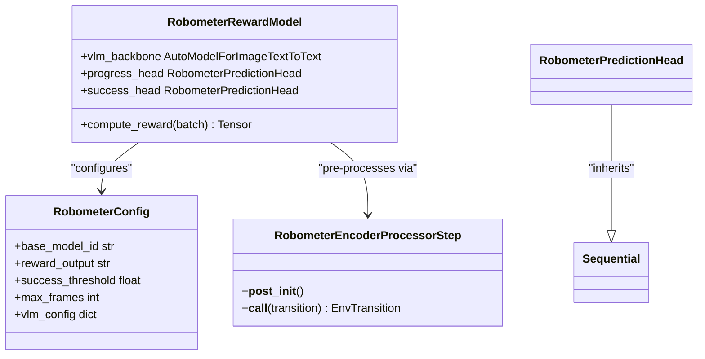

<!-- source: DeepWiki mcp.deepwiki.com · repo huggingface/lerobot · page 3.7 Reward Modeling · fetched 2026-10-26 -->

# Reward Modeling

<details>
<summary>Relevant source files</summary>

The following files were used as context for generating this wiki page:

- [src/lerobot/common/train_utils.py](src/lerobot/common/train_utils.py)
- [src/lerobot/configs/train.py](src/lerobot/configs/train.py)
- [src/lerobot/policies/factory.py](src/lerobot/policies/factory.py)
- [src/lerobot/rewards/classifier/modeling_classifier.py](src/lerobot/rewards/classifier/modeling_classifier.py)
- [src/lerobot/rewards/classifier/processor_classifier.py](src/lerobot/rewards/classifier/processor_classifier.py)
- [src/lerobot/rewards/factory.py](src/lerobot/rewards/factory.py)
- [src/lerobot/rewards/pretrained.py](src/lerobot/rewards/pretrained.py)
- [src/lerobot/rewards/robometer/compute_rabc_weights.py](src/lerobot/rewards/robometer/compute_rabc_weights.py)
- [src/lerobot/rewards/robometer/modeling_robometer.py](src/lerobot/rewards/robometer/modeling_robometer.py)
- [src/lerobot/rewards/sarm/compute_rabc_weights.py](src/lerobot/rewards/sarm/compute_rabc_weights.py)
- [src/lerobot/rewards/sarm/modeling_sarm.py](src/lerobot/rewards/sarm/modeling_sarm.py)
- [src/lerobot/rewards/sarm/processor_sarm.py](src/lerobot/rewards/sarm/processor_sarm.py)
- [src/lerobot/rewards/sarm/sarm_utils.py](src/lerobot/rewards/sarm/sarm_utils.py)
- [src/lerobot/rewards/topreward/compute_rabc_weights.py](src/lerobot/rewards/topreward/compute_rabc_weights.py)
- [src/lerobot/rewards/topreward/modeling_topreward.py](src/lerobot/rewards/topreward/modeling_topreward.py)
- [src/lerobot/rewards/topreward/processor_topreward.py](src/lerobot/rewards/topreward/processor_topreward.py)
- [src/lerobot/scripts/lerobot_train.py](src/lerobot/scripts/lerobot_train.py)
- [tests/common/test_publish.py](tests/common/test_publish.py)
- [tests/configs/test_resume_from_hub.py](tests/configs/test_resume_from_hub.py)
- [tests/policies/test_factory_peft_revision.py](tests/policies/test_factory_peft_revision.py)
- [tests/policies/test_language_processor_factory.py](tests/policies/test_language_processor_factory.py)
- [tests/rewards/test_reward_model_base.py](tests/rewards/test_reward_model_base.py)
- [tests/rewards/test_sarm_processor.py](tests/rewards/test_sarm_processor.py)
- [tests/utils/test_train_utils.py](tests/utils/test_train_utils.py)

</details>


Reward modeling in LeRobot provides learned signals to guide robot learning when explicit environment rewards are unavailable or insufficient. This page covers reward model types (**SARM**, **RewardClassifier**, **ROBOMETER**, and **TOPReward**), the **RA-BC (Reward-Aligned Behavior Cloning)** weighting mechanism, annotation modes, and progress computation scripts (`compute_rabc_weights.py`).

---

## 1. Reward Model Types

LeRobot provides a unified interface for different reward model architectures through the `PreTrainedRewardModel` base class [src/lerobot/rewards/pretrained.py]() and the factory functions in `src/lerobot/rewards/factory.py` [src/lerobot/rewards/factory.py:33-135](). 

The supported model classes and configuration objects are summarized below:

| Model Type | Config Class | Model Class | Description |
|---|---|---|---|
| **SARM** | `SARMConfig` [src/lerobot/rewards/sarm/configuration_sarm.py]() | `SARMRewardModel` [src/lerobot/rewards/sarm/modeling_sarm.py:55-80]() | Success-Aware Reward Model predicting dense rewards and stage progress `φ(o_t) ∈ [0, 1]` from observations. |
| **ROBOMETER** | `RobometerConfig` [src/lerobot/rewards/robometer/configuration_robometer.py:50-51]() | `RobometerRewardModel` [src/lerobot/rewards/robometer/modeling_robometer.py:169-182]() | General-purpose video-language model (Qwen3-VL backbone) predicting dense progress and success probabilities. |
| **TOPReward** | `TOPRewardConfig` [src/lerobot/rewards/topreward/configuration_topreward.py]() | `TOPRewardModel` [src/lerobot/rewards/topreward/modeling_topreward.py]() | Zero-shot model extracting token log-probabilities from off-the-shelf VLMs as a reward signal. |
| **Classifier** | `RewardClassifierConfig` [src/lerobot/rewards/classifier/configuration_classifier.py]() | `Classifier` [src/lerobot/rewards/classifier/modeling_classifier.py:100-110]() | Lightweight neural network scoring observations or trajectories for task success. |

Reward models are instantiated via `make_reward_model(cfg)` [src/lerobot/rewards/factory.py:107-135](), which inspects `cfg.type`, loads pretrained weights if `cfg.pretrained_path` is specified, and places the model on the requested device. Pre- and post-processor pipelines are created via `make_reward_pre_post_processors` [src/lerobot/rewards/factory.py:138-193]().

Sources: [src/lerobot/rewards/factory.py:33-193](), [src/lerobot/rewards/__init__.py:15-25](), [src/lerobot/rewards/sarm/modeling_sarm.py:55-80](), [src/lerobot/rewards/robometer/modeling_robometer.py:169-182](), [src/lerobot/rewards/classifier/modeling_classifier.py:100-110]()

---

## 2. RA-BC Weighting Mechanism

**RA-BC (Reward-Aligned Behavior Cloning)** uses a progress signal to weight demonstration frames during policy training. Instead of treating all trajectory frames equally, frames with higher progress improvement receive higher loss weighting.

### Data Flow from Natural Language to Weighted Policy Training

```mermaid
flowchart TD
    subgraph NaturalLanguageSpace ["Natural Language & Trajectory Space"]
        INST[""Task Instruction: Pick up the block""]
        VIDEO[""Trajectory Video Frames (T,H,W,C)""]
    end

    subgraph CodeEntitySpace ["Reward Modeling Code Entities"]
        R_CFG["RobometerConfig / SARMConfig"]
        R_MODEL["RobometerRewardModel / SARMRewardModel"]
        COMPUTE_SCRIPT["compute_rabc_weights.py"]
        PQ["robometer_progress.parquet"]
    end

    subgraph PolicyTrainingSpace ["Policy Training Code Entities"]
        WEIGH["RABCWeights"]
        TRAIN_LOOP["lerobot-train"]
        POL["PreTrainedPolicy"]
    end

    INST & VIDEO --> R_MODEL
    R_CFG --> R_MODEL
    R_MODEL -- "run via" --> COMPUTE_SCRIPT
    COMPUTE_SCRIPT -- "writes" --> PQ
    PQ -- "read by" --> WEIGH
    WEIGH -- "progress_sparse" --> TRAIN_LOOP
    TRAIN_LOOP -- "weighted gradient update" --> POL
```

### Weight Computation Logic
The RA-BC weight loading logic reads the `progress_sparse` column from pre-computed Parquet artifacts [src/lerobot/rewards/robometer/compute_rabc_weights.py:27-28](). During batch sampling, temporal progress deltas are computed as `r_i = φ(o_{t+\Delta}) - φ(o_t)`, and policy losses are scaled by these deltas prior to backward reduction.

The `TrainPipelineConfig` [src/lerobot/configs/train.py:110-110]() includes a `sample_weighting` field of type `SampleWeightingConfig` [src/lerobot/configs/train.py:35-35](). This configuration dictates how sample weights are applied during training. Legacy RA-BC fields (`use_rabc`, `rabc_progress_path`, `rabc_kappa`, `rabc_epsilon`, `rabc_head_mode`) are migrated to the `sample_weighting` structure if present [src/lerobot/configs/train.py:73-104]().

Sources: [src/lerobot/rewards/robometer/compute_rabc_weights.py:17-44](), [src/lerobot/rewards/sarm/compute_rabc_weights.py:100-150](), [src/lerobot/configs/train.py:35-35](), [src/lerobot/configs/train.py:73-104](), [src/lerobot/configs/train.py:110-110]()

---

## 3. SARM: Success-Aware Reward Model

SARM is designed for stage-aware progress prediction and supports annotation modes such as `single_stage`, `dense_only`, and `dual` [src/lerobot/rewards/sarm/processor_sarm.py:94-94]().

### SARM Processing Pipeline
The `SARMEncodingProcessorStep` encodes visual observations and text instructions using CLIP and generates stage and progress labels [src/lerobot/rewards/sarm/processor_sarm.py:76-80]():
- **CLIP Encoding**: Uses `CLIPModel` (`openai/clip-vit-base-patch32`) to compute visual and text embeddings [src/lerobot/rewards/sarm/processor_sarm.py:120-123]().
- **Stage Discovery**: Resolves annotation columns (`subtask_names`, `subtask_start_frames`, `subtask_end_frames`) from dataset episode metadata [src/lerobot/rewards/sarm/processor_sarm.py:164-166]().
- **Rewind Augmentation**: Applies `apply_rewind_augmentation` to simulate execution rollbacks and enhance temporal robustness [src/lerobot/rewards/sarm/sarm_utils.py:67-67]().

Sources: [src/lerobot/rewards/sarm/processor_sarm.py:67-180](), [src/lerobot/rewards/sarm/modeling_sarm.py:55-80](), [src/lerobot/rewards/sarm/sarm_utils.py:67-67]()

---

## 4. ROBOMETER: General-Purpose Reward Model

ROBOMETER builds on a Vision-Language Model backbone (`Qwen/Qwen3-VL-4B-Instruct`) and adds lightweight prediction heads for progress, success, and preference estimation [src/lerobot/rewards/robometer/modeling_robometer.py:16-49]().

### Model Architecture and Code Entities



### Processing Pipeline
The `RobometerEncoderProcessorStep` [src/lerobot/rewards/robometer/processor_robometer.py:108-115]() prepares model inputs by:
1. Converting frames to PIL images using `_frames_to_pil` [src/lerobot/rewards/robometer/processor_robometer.py:64-70]().
2. Formatting `PROGRESS_PROMPT` strings containing task instructions [src/lerobot/rewards/robometer/processor_robometer.py:55-61]().
3. Inserting special tokens like `<|prog_token|>` after each frame to extract per-frame progress and success features [src/lerobot/rewards/robometer/modeling_robometer.py:34-45]().

Sources: [src/lerobot/rewards/robometer/modeling_robometer.py:16-182](), [src/lerobot/rewards/robometer/configuration_robometer.py:50-127](), [src/lerobot/rewards/robometer/processor_robometer.py:55-162]()

---

## 5. Progress Computation Scripts (`compute_rabc_weights.py`)

LeRobot provides scripts to pre-compute progress curves across entire datasets, serializing the results into Parquet files for RA-BC training.

### Script Execution and Flow
For ROBOMETER and SARM, execution scripts (such as `src/lerobot/rewards/robometer/compute_rabc_weights.py`) perform the following steps:
1. Instantiate the reward model via `RobometerRewardModel.from_pretrained` and set up the encoder processor [src/lerobot/rewards/robometer/compute_rabc_weights.py:114-129]().
2. Iterate over episode indices in the `LeRobotDataset` [src/lerobot/rewards/robometer/compute_rabc_weights.py:145-145]().
3. Use a frame-steps linspace strategy (`_build_subsample_indices`) to evaluate fixed-size subsampled frame windows (`K=4` by default) [src/lerobot/rewards/robometer/compute_rabc_weights.py:19-24,92-100]().
4. Write out Parquet records containing global frame indices, episode IDs, and computed progress curves [src/lerobot/rewards/robometer/compute_rabc_weights.py:182-195]().

### Parquet Output Schema
The generated artifacts adhere to a standardized schema consumed by RA-BC training utilities:

| Column Name | Data Type | Description |
|---|---|---|
| `index` | `int64` | Global frame index within the `LeRobotDataset`. |
| `episode_index` | `int64` | Index of the recorded episode. |
| `progress_sparse` | `float32` | Normalized subtask/progress value `[0, 1]`. |
| `success_probs` | `float32` | Optional per-frame success probability for filtering. |

Sources: [src/lerobot/rewards/robometer/compute_rabc_weights.py:19-195](), [src/lerobot/rewards/sarm/compute_rabc_weights.py:463-705]()

---

