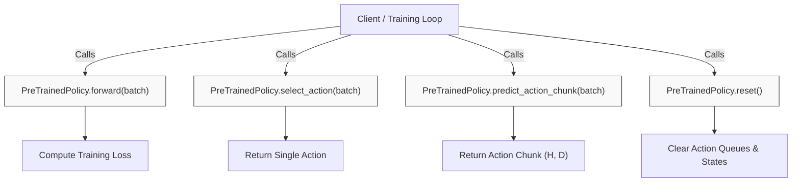
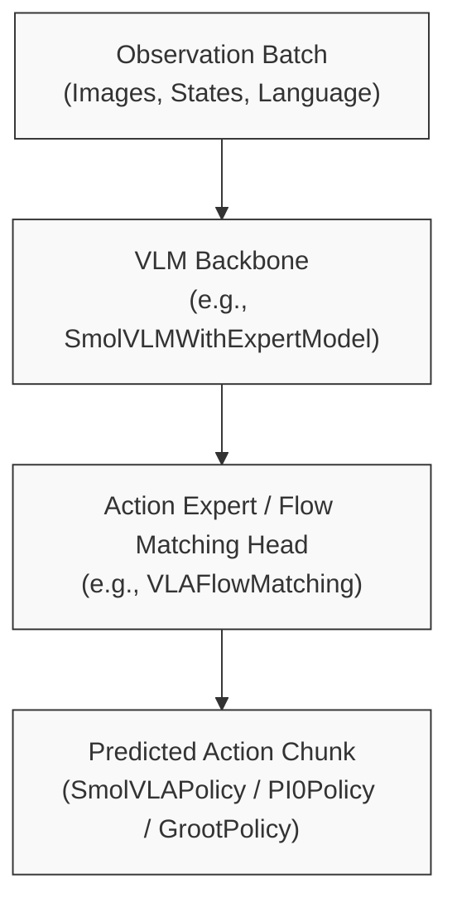

<!-- source: DeepWiki mcp.deepwiki.com · repo huggingface/lerobot · page 4 Policy Architectures · fetched 2026-10-26 -->

# Policy Architectures

Relevant source files

The following files were used as context for generating this wiki page:

- [README.md](README.md)
- [docs/source/_toctree.yml](docs/source/_toctree.yml)
- [pyproject.toml](pyproject.toml)
- [src/lerobot/policies/__init__.py](src/lerobot/policies/__init__.py)
- [src/lerobot/policies/groot/processor_groot.py](src/lerobot/policies/groot/processor_groot.py)
- [src/lerobot/policies/pi0/modeling_pi0.py](src/lerobot/policies/pi0/modeling_pi0.py)
- [src/lerobot/policies/pi05/modeling_pi05.py](src/lerobot/policies/pi05/modeling_pi05.py)
- [src/lerobot/policies/pretrained.py](src/lerobot/policies/pretrained.py)
- [src/lerobot/policies/smolvla/modeling_smolvla.py](src/lerobot/policies/smolvla/modeling_smolvla.py)
- [src/lerobot/policies/smolvla/smolvlm_with_expert.py](src/lerobot/policies/smolvla/smolvlm_with_expert.py)
- [src/lerobot/policies/vqbet/vqbet_utils.py](src/lerobot/policies/vqbet/vqbet_utils.py)
- [src/lerobot/templates/lerobot_modelcard_template.md](src/lerobot/templates/lerobot_modelcard_template.md)
- [src/lerobot/utils/import_utils.py](src/lerobot/utils/import_utils.py)
- [tests/policies/pi0_pi05/test_pi05_vision_inference.py](tests/policies/pi0_pi05/test_pi05_vision_inference.py)
- [tests/policies/pi0_pi05/test_pi0_vision_inference.py](tests/policies/pi0_pi05/test_pi0_vision_inference.py)
- [uv.lock](uv.lock)

## Purpose and Scope

This document provides a high-level overview of the policy architecture system in LeRobot. Policies serve as the core neural network models that map sensor observations (images, states, language instructions) to robotic actions. LeRobot provides a unified framework supporting diverse policy paradigms, ranging from lightweight imitation learning models to large-scale Vision-Language-Action (VLA) foundation models.

LeRobot classifies policies into three main categories:
*   **Imitation Learning (IL):** ACT, Diffusion Policy, VQ-BeT, Multitask DiT.
*   **Reinforcement Learning (RL):** TDMPC, SAC (via GaussianActor), QC-FQL.
*   **Vision-Language-Action (VLA):** π₀, π₀.₅, π₀-FAST, SmolVLA, GR00T, EO-1, VLA-JEPA, EVO1, FastWAM, LingBot-VA.

This page introduces the foundational interface (`PreTrainedPolicy`), core categories, and modular design patterns. For deep technical details, configuration specs, and implementation-specific guides, see the child pages below:
- [Policy Interface and Base Classes](#4.1) — Document `PreTrainedPolicy` and `PreTrainedConfig`, abstract methods (`reset`, `forward`, `predict_action_chunk`, `select_action`), shared utilities, and PEFT integration.
- [Imitation Learning Policies](#4.2) — Detail ACT, Diffusion Policy, VQ-BeT, TDMPC, Multitask DiT: architectures, configs, training objectives, and use cases.
- [Vision-Language-Action Policies](#4.3) — Explain VLA models (π₀, π₀.₅, X-VLA, GR00T, SmolVLA, WALL-X, EO-1, VLA-JEPA, MolmoAct2, EVO1, FastWAM, LingBot-VA), VLM backbones, flow matching, and training strategies.
- [Action Tokenization and π₀-FAST](#4.4) — Detail FAST action tokenization: DCT compression, BPE tokenization, `lerobot-train-tokenizer`, and autoregressive action prediction.
- [Policy Factory and Plugin System](#4.5) — Explain `get_policy_class`, `make_policy`, `make_policy_config`, dynamic policy loading, plugin registration, and adding custom policies.
- [Real-Time Chunking](#4.6) — Describe the RTC system for continuous action generation: `RTCInferenceEngine`, action queues, correction, guidance weight schedules, and inference optimization.

Sources: [src/lerobot/policies/pretrained.py:61-88](), [src/lerobot/policies/smolvla/modeling_smolvla.py:142-169]()

---

## Policy Interface and Base Classes

All policy implementations in LeRobot inherit from the `PreTrainedPolicy` base class defined in `src/lerobot/policies/pretrained.py` [src/lerobot/policies/pretrained.py:61](). This class integrates with Hugging Face's `HubMixin` to provide standardized weight loading, serialization, parameter tracking, and distributed training hooks [src/lerobot/policies/pretrained.py:61]().

### Core Interface Contract

Subclasses of `PreTrainedPolicy` implement a standard set of methods that govern training and inference lifecycles:

For detailed method signatures, abstract requirements, parameter management, and PEFT / LoRA wrapping, see [Policy Interface and Base Classes](#4.1).

Sources: [src/lerobot/policies/pretrained.py:61-146]()

---

## Policy Categories and Modular Design

LeRobot organizes policy architectures into distinct families based on learning paradigm and modality integration.

### Imitation Learning (IL)
Imitation learning policies are optimized for fast training on small-to-moderate demonstration datasets. Models like ACT and Diffusion Policy leverage action chunking to predict sequences of future actions, mitigating compound error accumulation during execution. For details, see [Imitation Learning Policies](#4.2).

### Vision-Language-Action (VLA) Foundation Models
VLA policies pair pre-trained Vision-Language Model (VLM) backbones (such as PaliGemma, Qwen-VL, or SmolVLM) with specialized action experts or flow-matching heads. This enables robust generalization across complex tasks guided by natural language instructions and visual observations.

For specific architectural breakdowns of models like π₀, SmolVLA, and GR00T, see [Vision-Language-Action Policies](#4.3).

Sources: [src/lerobot/policies/smolvla/modeling_smolvla.py:142-167](), [src/lerobot/policies/pi0/modeling_pi0.py:185-187](), [src/lerobot/policies/groot/processor_groot.py:79-87]()

---

## Action Chunking and Real-Time Control

To ensure smooth real-world execution, LeRobot policies support temporal action chunking and real-time inference utilities:
*   **Action Chunking:** Returning a tensor of shape `(horizon, action_dim)` per forward pass.
*   **Real-Time Chunking (RTC):** Managed via `RTCProcessor` and inference engines that correct queues dynamically during execution delays [src/lerobot/policies/pi0/modeling_pi0.py:73](), [src/lerobot/policies/smolvla/modeling_smolvla.py:176-191]().

For complete documentation on action queues, correction schedules, and optimization, see [Real-Time Chunking](#4.6).

Sources: [src/lerobot/policies/pi0/modeling_pi0.py:73](), [src/lerobot/policies/smolvla/modeling_smolvla.py:148-191]()

---

