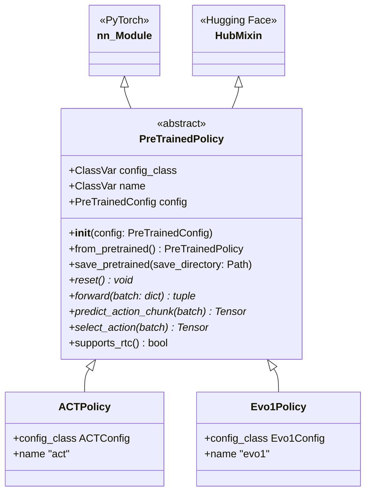
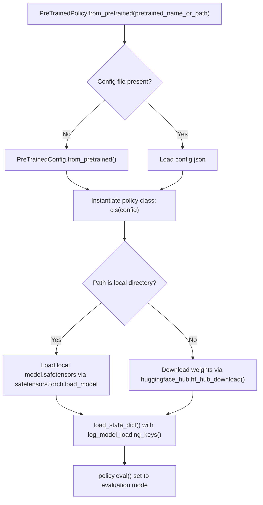

<!-- source: DeepWiki mcp.deepwiki.com · repo huggingface/lerobot · page 4.1 Policy Interface and Base Classes · fetched 2026-10-26 -->

# Policy Interface and Base Classes

<details>
<summary>Relevant source files</summary>

The following files were used as context for generating this wiki page:

- [docs/source/bring_your_own_policies.mdx](docs/source/bring_your_own_policies.mdx)
- [src/lerobot/configs/policies.py](src/lerobot/configs/policies.py)
- [src/lerobot/configs/rewards.py](src/lerobot/configs/rewards.py)
- [src/lerobot/policies/evo1/modeling_evo1.py](src/lerobot/policies/evo1/modeling_evo1.py)
- [src/lerobot/policies/evo1/processor_evo1.py](src/lerobot/policies/evo1/processor_evo1.py)
- [src/lerobot/policies/fastwam/processor_fastwam.py](src/lerobot/policies/fastwam/processor_fastwam.py)
- [src/lerobot/policies/lingbot_va/processor_lingbot_va.py](src/lerobot/policies/lingbot_va/processor_lingbot_va.py)
- [src/lerobot/policies/pi0_fast/processor_pi0_fast.py](src/lerobot/policies/pi0_fast/processor_pi0_fast.py)
- [src/lerobot/policies/utils.py](src/lerobot/policies/utils.py)
- [src/lerobot/policies/xvla/processor_xvla.py](src/lerobot/policies/xvla/processor_xvla.py)
- [src/lerobot/rl/algorithms/configs.py](src/lerobot/rl/algorithms/configs.py)
- [src/lerobot/transport/utils.py](src/lerobot/transport/utils.py)
- [tests/policies/evo1/test_evo1.py](tests/policies/evo1/test_evo1.py)
- [tests/training/test_visual_validation.py](tests/training/test_visual_validation.py)

</details>


This page documents the abstract base class `PreTrainedPolicy` [src/lerobot/policies/pretrained.py:61](), the configuration base class `PreTrainedConfig` [src/lerobot/configs/policies.py:41](), and the interface contract that all policy implementations in LeRobot must follow. This architecture governs model initialization, training loops, action evaluation, checkpointing, serialization, and hardware integration.

---

## Overview and Purpose

All policy models in LeRobot inherit from `PreTrainedPolicy`, which combines PyTorch's `nn.Module` with Hugging Face's `HubMixin` to provide a standardized framework across imitation learning (IL), reinforcement learning (RL), and vision-language-action (VLA) models [src/lerobot/policies/pretrained.py:61](). 

The interface standardizes:
- **Model Lifecycle**: Instantiation from scratch or via `from_pretrained()`, state dict saving via `save_pretrained()` [src/lerobot/policies/pretrained.py:118-212]().
- **Training**: Loss calculation via `forward()` and parameter retrieval via `get_optim_params()` [src/lerobot/policies/pretrained.py:230-240]() [docs/source/bring_your_own_policies.mdx:123-144]().
- **Inference**: Chunk-based action generation via `predict_action_chunk()` and single-step selection via `select_action()` [src/lerobot/policies/pretrained.py:242-258]().
- **Advanced Capabilities**: Parameter-Efficient Fine-Tuning (PEFT) integration and Real-Time Chunking (RTC) support [src/lerobot/policies/pretrained.py:214-220] [src/lerobot/policies/pretrained.py:260-281]().

Sources: [src/lerobot/policies/pretrained.py:61-88](), [src/lerobot/configs/policies.py:41-84]()

---

## PreTrainedConfig Base Class

The `PreTrainedConfig` class inherits from `draccus.ChoiceRegistry` and `HubMixin`, serving as the base configuration for all policies [src/lerobot/configs/policies.py:41](). It defines common hyperparameters, input/output feature definitions, and default optimization presets.

### Core Configuration Attributes

| Attribute | Type | Description |
|-----------|------|-------------|
| `n_obs_steps` | `int` | Number of observation history steps passed to the policy [src/lerobot/configs/policies.py:56](). |
| `input_features` | `dict[str, PolicyFeature]` | Mapping of input observation names to their `FeatureType` and tensor shapes [src/lerobot/configs/policies.py:59](). |
| `output_features` | `dict[str, PolicyFeature]` | Mapping of output target names (e.g., `ACTION`) to their definitions [src/lerobot/configs/policies.py:60](). |
| `device` | `str \| None` | Target compute device (`cuda`, `cpu`, `mps`) [src/lerobot/configs/policies.py:62](). |
| `use_amp` | `bool` | Enables Automatic Mixed Precision (AMP) during training [src/lerobot/configs/policies.py:65](). |
| `use_peft` | `bool` | Flag indicating whether PEFT adapters are enabled [src/lerobot/configs/policies.py:68](). |

Subclasses must implement abstract properties and methods such as `observation_delta_indices`, `action_delta_indices`, `reward_delta_indices`, `get_optimizer_preset()`, `get_scheduler_preset()`, and `validate_features()` [src/lerobot/configs/policies.py:106-130]().

Sources: [src/lerobot/configs/policies.py:41-131]()

---

## PreTrainedPolicy Class Structure

### Class Definition and Subclass Enforcements

`PreTrainedPolicy` is an abstract base class (`abc.ABC`) inheriting from `nn.Module` and `HubMixin` [src/lerobot/policies/pretrained.py:61](). Its `__init_subclass__` hook validates that every implemented policy defines the `config_class` and `name` attributes, and correctly pairs text generation capabilities [src/lerobot/policies/pretrained.py:99-117]().

Title: "Policy Class Hierarchy and Interface"


Sources: [src/lerobot/policies/pretrained.py:61-117](), [src/lerobot/policies/evo1/modeling_evo1.py:35-37]()

---

## Abstract Methods and Interface

Subclasses of `PreTrainedPolicy` must implement a set of required interface methods to ensure seamless execution across training, evaluation, and deployment scripts:

### 1. reset()
Clears internal observation/action deques and resets KV-caches or recurrence states. This must be invoked upon environment resets to eliminate temporal leakage between episodes [src/lerobot/policies/pretrained.py:222]() [src/lerobot/policies/evo1/modeling_evo1.py:182-183]().

### 2. forward()
Computes the training or validation loss given a batch dictionary. Returns a tuple containing the scalar loss tensor and an optional dictionary of scalar logging metrics [src/lerobot/policies/pretrained.py:230-240]().

### 3. predict_action_chunk()
Generates a full temporal action sequence of shape `(batch_size, chunk_size, action_dim)` conditioned on the current observations [src/lerobot/policies/pretrained.py:242-249]() [docs/source/bring_your_own_policies.mdx:127-129]().

### 4. select_action()
Returns a single control action tensor of shape `(batch_size, action_dim)` for execution at the current environment tick. Typically consumes chunks produced by `predict_action_chunk()` using internal queues [src/lerobot/policies/pretrained.py:251-258]() [docs/source/bring_your_own_policies.mdx:131-133]().

### 5. supports_rtc()
Returns a boolean indicating whether the policy natively integrates with Real-Time Chunking (`RTCProcessor`) for continuous action correction [src/lerobot/policies/pretrained.py:214-220]() [src/lerobot/policies/evo1/modeling_evo1.py:39-40]().

Sources: [src/lerobot/policies/pretrained.py:214-258](), [src/lerobot/policies/evo1/modeling_evo1.py:39-40](), [src/lerobot/policies/evo1/modeling_evo1.py:182-183]()

---

## Shared Utilities and Helpers

Policies and data pipelines leverage shared utility functions defined in `src/lerobot/policies/utils.py` to manage queues and transform raw environment frames into tensors [src/lerobot/policies/utils.py:30-146]().

- `populate_queues(queues, batch, exclude_keys)`: Appends incoming observations to per-key deques, auto-initializing them on first use [src/lerobot/policies/utils.py:30-52]().
- `prepare_observation_for_inference(observation, device, task, robot_type)`: Converts raw NumPy observation dictionaries into batched, device-resident PyTorch tensors, performing efficient `uint8`-to-float normalization and channel permutation (`(H, W, C)` to `(C, H, W)`) on the GPU device [src/lerobot/policies/utils.py:102-146]().
- `build_inference_frame(observation, device, ds_features, task, robot_type)`: Constructs a model-ready observation tensor dictionary from a raw observation, using `ds_features` to specify which features to extract [src/lerobot/policies/utils.py:149-173]().

Sources: [src/lerobot/policies/utils.py:30-52](), [src/lerobot/policies/utils.py:102-146](), [src/lerobot/policies/utils.py:149-173]()

---

## Policy Lifecycle and Hub Integration

### Loading and Saving Checkpoints

Policies use `from_pretrained()` to pull configurations and safetensors weights from local directories or the Hugging Face Hub, and `save_pretrained()` to serialize models [src/lerobot/policies/pretrained.py:118-212](). Under distributed setups like Fully Sharded Data Parallel (FSDP), `save_pretrained()` gathers the full state dict across ranks before writing safetensors files on the main process [src/lerobot/policies/pretrained.py:130-146]().

Title: "Policy Loading and Serialization Architecture"


Sources: [src/lerobot/policies/pretrained.py:118-212]()

---

## Parameter-Efficient Fine-Tuning (PEFT) Integration

LeRobot integrates with the `peft` library to support low-rank adaptation and parameter-efficient fine-tuning [src/lerobot/policies/pretrained.py:39-44](). 

- **`wrap_with_peft`**: Wraps the underlying policy or module with PEFT adapters based on configuration settings [src/lerobot/policies/pretrained.py:260-281]().
- **Default Targets**: Policies define default target modules via `_get_default_peft_targets()` to apply adapters to attention projections or linear layers without fine-tuning the entire backbone [src/lerobot/policies/pretrained.py:283]().

Sources: [src/lerobot/policies/pretrained.py:39-44](), [src/lerobot/policies/pretrained.py:260-281]()

---

## Real-Time Chunking (RTC) Integration

For policies that support continuous-time corrections and real-time execution latency handling, an `RTCProcessor` instance is initialized during policy construction [src/lerobot/policies/evo1/modeling_evo1.py:65-70]() [src/lerobot/rollout/inference/rtc.py:24-35]().

Title: "Policy Inference Data Flow (Sync vs RTC)"
Source Code Integration: `PreTrainedPolicy.select_action` and `RTCProcessor`
```mermaid
graph LR
    subgraph "Execution Pipeline"
        Obs["RobotObservation"] --> Pre["PolicyProcessorPipeline"]
        Pre --> Select["PreTrainedPolicy.select_action"]
    end
    
    Select --> Chunk["predict_action_chunk"]
    Chunk -->|supports_rtc() == True| RTC["RTCProcessor (modeling_rtc.py)"]
    Chunk -->|supports_rtc() == False| Queue["Per-policy Action Queue deque"]
    
    RTC --> Action["RobotAction Tensor"]
    Queue --> Action
```

Sources: [src/lerobot/policies/evo1/modeling_evo1.py:65-70](), [src/lerobot/rollout/inference/rtc.py:24-48]()

---

