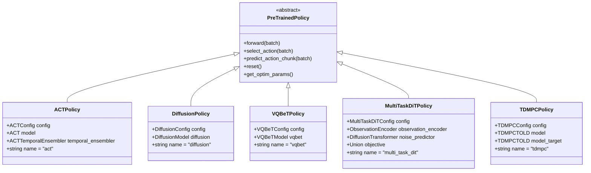
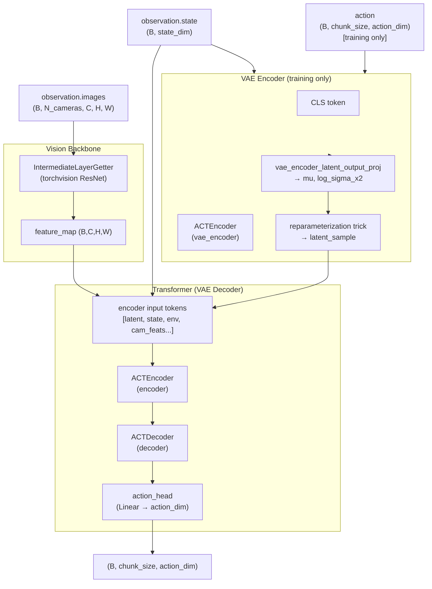
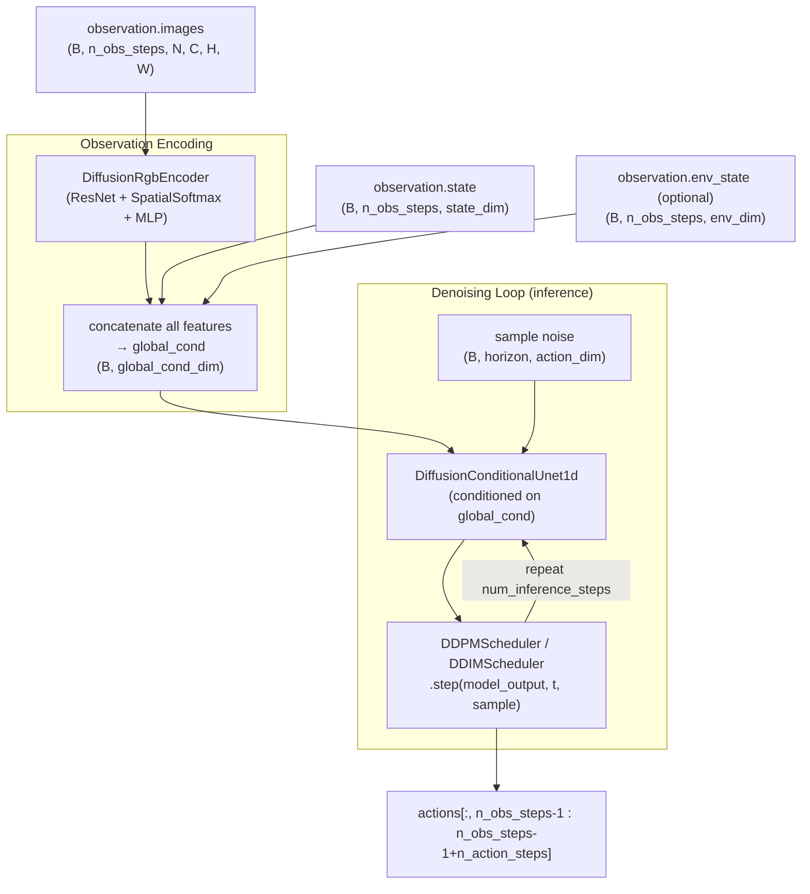
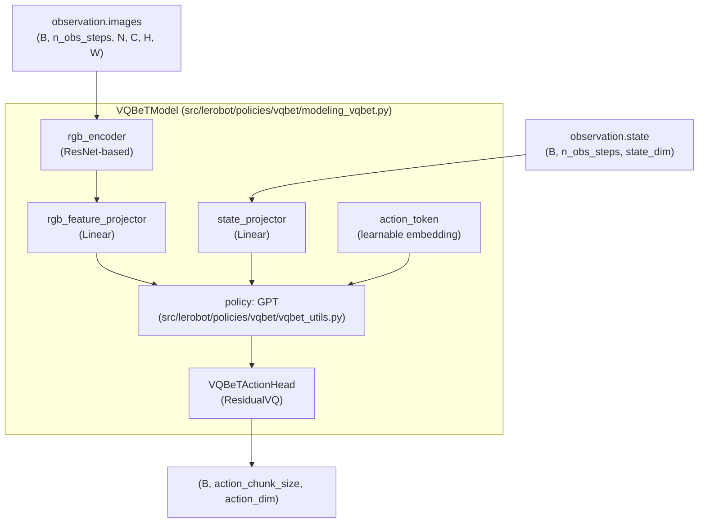
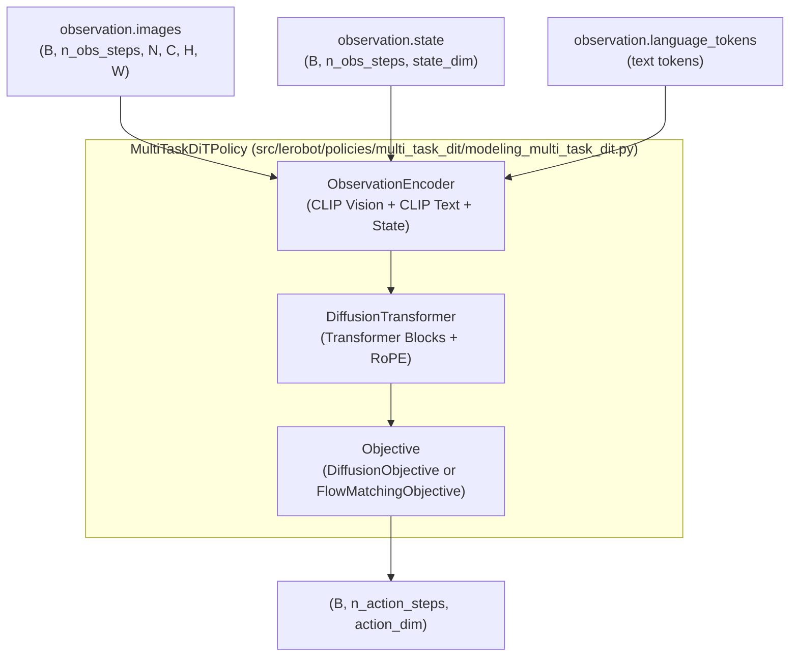
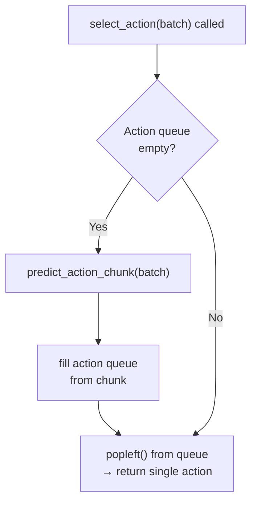

<!-- source: DeepWiki mcp.deepwiki.com · repo huggingface/lerobot · page 4.2 Imitation Learning Policies · fetched 2026-10-26 -->

# Imitation Learning Policies

Relevant source files

The following files were used as context for generating this wiki page:

- [docs/source/multi_task_dit.mdx](docs/source/multi_task_dit.mdx)
- [docs/source/policy_multi_task_dit_README.md](docs/source/policy_multi_task_dit_README.md)
- [docs/source/vlabench.mdx](docs/source/vlabench.mdx)
- [src/lerobot/policies/act/configuration_act.py](src/lerobot/policies/act/configuration_act.py)
- [src/lerobot/policies/act/modeling_act.py](src/lerobot/policies/act/modeling_act.py)
- [src/lerobot/policies/diffusion/configuration_diffusion.py](src/lerobot/policies/diffusion/configuration_diffusion.py)
- [src/lerobot/policies/diffusion/modeling_diffusion.py](src/lerobot/policies/diffusion/modeling_diffusion.py)
- [src/lerobot/policies/multi_task_dit/README.md](src/lerobot/policies/multi_task_dit/README.md)
- [src/lerobot/policies/multi_task_dit/__init__.py](src/lerobot/policies/multi_task_dit/__init__.py)
- [src/lerobot/policies/multi_task_dit/configuration_multi_task_dit.py](src/lerobot/policies/multi_task_dit/configuration_multi_task_dit.py)
- [src/lerobot/policies/multi_task_dit/modeling_multi_task_dit.py](src/lerobot/policies/multi_task_dit/modeling_multi_task_dit.py)
- [src/lerobot/policies/tdmpc/modeling_tdmpc.py](src/lerobot/policies/tdmpc/modeling_tdmpc.py)
- [src/lerobot/policies/vqbet/configuration_vqbet.py](src/lerobot/policies/vqbet/configuration_vqbet.py)
- [src/lerobot/policies/vqbet/modeling_vqbet.py](src/lerobot/policies/vqbet/modeling_vqbet.py)
- [tests/artifacts/policies/pusht_diffusion_/actions.safetensors](tests/artifacts/policies/pusht_diffusion_/actions.safetensors)
- [tests/artifacts/policies/pusht_diffusion_/grad_stats.safetensors](tests/artifacts/policies/pusht_diffusion_/grad_stats.safetensors)
- [tests/artifacts/policies/pusht_diffusion_/output_dict.safetensors](tests/artifacts/policies/pusht_diffusion_/output_dict.safetensors)
- [tests/artifacts/policies/pusht_diffusion_/param_stats.safetensors](tests/artifacts/policies/pusht_diffusion_/param_stats.safetensors)

This page details the imitation learning (IL) policies included in LeRobot: **ACT**, **Diffusion Policy**, **VQ-BeT**, **Multitask DiT**, and **TD-MPC**. All policies learn to reproduce demonstrated behavior from `LeRobotDataset` recordings. This page covers architecture internals, configuration parameters, and training behavior for each.

For the abstract base class that all implement, see [Policy Interface and Base Classes](#4.1). For VLA-style policies ($\pi_0$, SmolVLA, GR00T), see [Vision-Language-Action Policies](#4.3). For how to register or extend the policy registry, see [Policy Factory and Plugin System](#4.5). For the full training pipeline, see [Training Pipeline](#3.1).

---

## Policy Summary

| Policy | Type | Key Module | Config Class | `name` |
|--------|------|-----------|--------------|--------|
| ACT | Transformer + optional VAE | `ACT` | `ACTConfig` | `"act"` |
| Diffusion | Conditional U-Net + DDPM/DDIM | `DiffusionModel` | `DiffusionConfig` | `"diffusion"` |
| VQ-BeT | GPT + VQ-VAE action head | `VQBeTModel` | `VQBeTConfig` | `"vqbet"` |
| Multitask DiT | Transformer + CLIP Conditioning | `DiffusionTransformer` | `MultiTaskDiTConfig` | `"multi_task_dit"` |
| TD-MPC | Model-Based RL/IL | `TDMPCTOLD` | `TDMPCConfig` | `"tdmpc"` |

All policies subclass `PreTrainedPolicy` and are selected by passing `--policy.type=<name>` to `lerobot-train`.

Sources: [src/lerobot/policies/act/modeling_act.py:42-49](), [src/lerobot/policies/diffusion/modeling_diffusion.py:55-62](), [src/lerobot/policies/vqbet/modeling_vqbet.py:40-46](), [src/lerobot/policies/multi_task_dit/modeling_multi_task_dit.py:70-72](), [src/lerobot/policies/tdmpc/modeling_tdmpc.py:45-64]()

---

## Class Hierarchy

**Policy classes and their core submodules linking codebase entities:**

Sources: [src/lerobot/policies/act/modeling_act.py:42-49](), [src/lerobot/policies/diffusion/modeling_diffusion.py:55-62](), [src/lerobot/policies/vqbet/modeling_vqbet.py:40-46](), [src/lerobot/policies/multi_task_dit/modeling_multi_task_dit.py:70-107](), [src/lerobot/policies/tdmpc/modeling_tdmpc.py:45-85]()

---

## ACT (Action Chunking with Transformers)

**Reference paper:** [Learning Fine-Grained Bimanual Manipulation with Low-Cost Hardware](https://huggingface.co/papers/2304.13705)

ACT generates a fixed-length *chunk* of actions from a single forward pass. It is highly recommended for beginners due to its fast training and low parameter count (~80M).

### Architecture

**ACT forward pass data flow:**

At inference, the latent variable `z` is typically derived from the `mu` of the VAE encoder or set to zero if `use_vae` is false [src/lerobot/policies/act/modeling_act.py:151-160]().

Sources: [src/lerobot/policies/act/modeling_act.py:42-165](), [src/lerobot/policies/act/modeling_act.py:256-510]()

### Training Loss

`ACTPolicy.forward` computes:
- **L1 loss** between predicted and ground-truth action chunks [src/lerobot/policies/act/modeling_act.py:145-148]().
- **KL divergence** (if `use_vae=True`): `loss = l1_loss + kl_weight * mean_kld` [src/lerobot/policies/act/modeling_act.py:151-160]().

Sources: [src/lerobot/policies/act/modeling_act.py:139-166]()

---

## Diffusion Policy

**Reference paper:** [Diffusion Policy: Visuomotor Policy Learning via Action Diffusion](https://huggingface.co/papers/2303.04137)

Diffusion Policy frames action generation as a denoising diffusion problem. A U-Net iteratively denoises a random trajectory conditioned on an observation encoding.

### Architecture

Sources: [src/lerobot/policies/diffusion/modeling_diffusion.py:56-122](), [src/lerobot/policies/diffusion/configuration_diffusion.py:23-107]()

---

## VQ-BeT (Vector-Quantized Behavior Transformer)

**Reference paper:** [Behavior Generation with Latent Actions](https://huggingface.co/papers/2403.03181)

VQ-BeT discretizes continuous actions into a learned codebook using a Residual VQ-VAE, then uses a GPT transformer to predict sequences of these discrete action codes [src/lerobot/policies/vqbet/modeling_vqbet.py:163-164]().

### Architecture

Sources: [src/lerobot/policies/vqbet/modeling_vqbet.py:40-64](), [src/lerobot/policies/vqbet/vqbet_utils.py:35-36](), [src/lerobot/policies/vqbet/modeling_vqbet.py:113-165]()

---

## Multitask DiT Policy

**Reference paper:** [A Careful Examination of Large Behavior Models for Multitask Dexterous Manipulation](https://arxiv.org/abs/2507.05331)

Multitask DiT leverages a Transformer (DiT) with text and vision conditioning. It supports both **Diffusion** and **Flow Matching** objectives [src/lerobot/policies/multi_task_dit/modeling_multi_task_dit.py:17-26]().

### Architecture and Objectives

- **CLIP Vision Encoder**: Processes RGB images from multiple camera views [docs/source/multi_task_dit.mdx:9]().
- **CLIP Text Encoder**: Encodes language task instructions (frozen weights with learnable projection) [docs/source/multi_task_dit.mdx:10]().
- **Diffusion Transformer**: Predicts action sequences conditioned on observations and language [docs/source/multi_task_dit.mdx:11]().
- **Diffusion Objective**: Uses standard denoising schedulers (DDPM/DDIM) [src/lerobot/policies/multi_task_dit/modeling_multi_task_dit.py:90-96]().
- **Flow Matching Objective**: Uses ODE integration (Euler/RK4) [src/lerobot/policies/multi_task_dit/modeling_multi_task_dit.py:97-103](). It typically uses a beta sampling strategy for timesteps during training [docs/source/multi_task_dit.mdx:103]().

Sources: [src/lerobot/policies/multi_task_dit/modeling_multi_task_dit.py:70-107](), [src/lerobot/policies/multi_task_dit/modeling_multi_task_dit.py:131-141](), [docs/source/multi_task_dit.mdx:9-11]()

### Training Configuration

Multitask DiT has specific installation requirements: `pip install lerobot[multi_task_dit]` [docs/source/multi_task_dit.mdx:19-21]().

Key training parameters include:
- `policy.horizon`: Number of action steps to predict.
- `policy.n_action_steps`: Number of action steps to execute.
- `policy.objective`: Can be `diffusion` or `flow_matching`.
- `policy.noise_scheduler_type`: For diffusion, e.g., `DDPM` or `DDIM`.
- `policy.timestep_sampling_strategy`: For flow matching, `beta` or `uniform`.
- `policy.num_layers`, `policy.hidden_dim`, `policy.num_heads`: Control transformer capacity.
- `policy.use_rope`: Rotary Position Embedding (RoPE) is the default and recommended positional encoding.
- `policy.vision_encoder_name`, `policy.text_encoder_name`: Specify CLIP models.
- `policy.vision_encoder_lr_multiplier`: Vision encoder learning rate is scaled by this multiplier [docs/source/multi_task_dit.mdx:181-182]().

Sources: [docs/source/multi_task_dit.mdx:58-182]()

---

## TD-MPC

**Reference papers:** [TD-MPC](https://huggingface.co/papers/2203.04955) and [FOWM](https://huggingface.co/papers/2310.16029).

TD-MPC is a model-based policy that can perform inference using either a learned policy head ($\pi$) or Model Predictive Control (MPC) using the Cross-Entropy Method (CEM) [src/lerobot/policies/tdmpc/modeling_tdmpc.py:125-130]().

### Key Functions
- `predict_action_chunk`: Encodes observations into latent $z$, then calls `plan` (MPC) or the policy head `pi` [src/lerobot/policies/tdmpc/modeling_tdmpc.py:108-134]().
- `plan`: Performs CEM-based planning over the latent world model.

Sources: [src/lerobot/policies/tdmpc/modeling_tdmpc.py:17-22](), [src/lerobot/policies/tdmpc/modeling_tdmpc.py:45-64](), [src/lerobot/policies/tdmpc/modeling_tdmpc.py:108-164]()

---

## Shared Patterns

All policies implement a common `select_action` pattern to handle action chunking and environment execution. They use internal `_queues` to manage temporal history [src/lerobot/policies/diffusion/modeling_diffusion.py:83](), [src/lerobot/policies/vqbet/modeling_vqbet.py:113-117]().

Sources: [src/lerobot/policies/diffusion/modeling_diffusion.py:125-161](), [src/lerobot/policies/act/modeling_act.py:101-123](), [src/lerobot/policies/vqbet/modeling_vqbet.py:126-157](), [src/lerobot/policies/tdmpc/modeling_tdmpc.py:137-164]()

---

