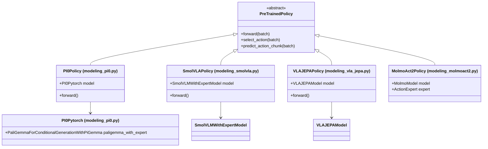
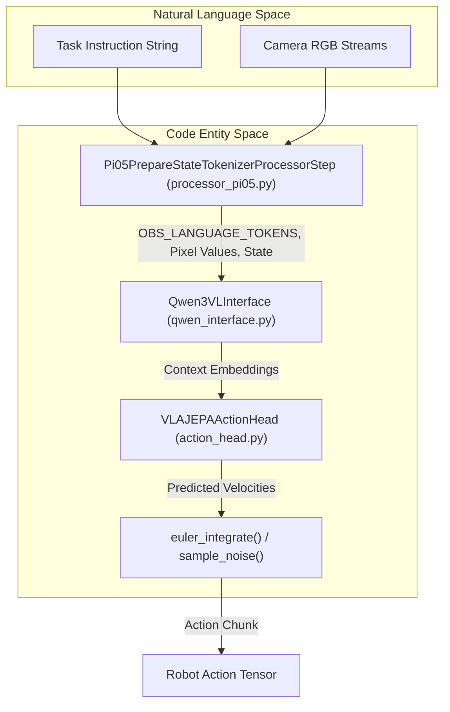

<!-- source: DeepWiki mcp.deepwiki.com · repo huggingface/lerobot · page 4.3 Vision-Language-Action Policies · fetched 2026-10-26 -->

# Vision-Language-Action Policies

Relevant source files

The following files were used as context for generating this wiki page:

- [docs/source/eo1.mdx](docs/source/eo1.mdx)
- [docs/source/evo1.mdx](docs/source/evo1.mdx)
- [docs/source/fastwam.mdx](docs/source/fastwam.mdx)
- [docs/source/molmoact2.mdx](docs/source/molmoact2.mdx)
- [docs/source/pi0.mdx](docs/source/pi0.mdx)
- [docs/source/pi05.mdx](docs/source/pi05.mdx)
- [docs/source/pi0fast.mdx](docs/source/pi0fast.mdx)
- [docs/source/policy_fastwam_README.md](docs/source/policy_fastwam_README.md)
- [docs/source/sarm.mdx](docs/source/sarm.mdx)
- [docs/source/vla_jepa.mdx](docs/source/vla_jepa.mdx)
- [examples/rtc/eval_dataset.py](examples/rtc/eval_dataset.py)
- [src/lerobot/policies/common/flow_matching.py](src/lerobot/policies/common/flow_matching.py)
- [src/lerobot/policies/eo1/configuration_eo1.py](src/lerobot/policies/eo1/configuration_eo1.py)
- [src/lerobot/policies/eo1/modeling_eo1.py](src/lerobot/policies/eo1/modeling_eo1.py)
- [src/lerobot/policies/eo1/processor_eo1.py](src/lerobot/policies/eo1/processor_eo1.py)
- [src/lerobot/policies/evo1/configuration_evo1.py](src/lerobot/policies/evo1/configuration_evo1.py)
- [src/lerobot/policies/evo1/evo1_model.py](src/lerobot/policies/evo1/evo1_model.py)
- [src/lerobot/policies/evo1/flow_matching.py](src/lerobot/policies/evo1/flow_matching.py)
- [src/lerobot/policies/evo1/internvl3_embedder.py](src/lerobot/policies/evo1/internvl3_embedder.py)
- [src/lerobot/policies/fastwam/configuration_fastwam.py](src/lerobot/policies/fastwam/configuration_fastwam.py)
- [src/lerobot/policies/fastwam/modeling_fastwam.py](src/lerobot/policies/fastwam/modeling_fastwam.py)
- [src/lerobot/policies/fastwam/wan/adapters.py](src/lerobot/policies/fastwam/wan/adapters.py)
- [src/lerobot/policies/fastwam/wan/components.py](src/lerobot/policies/fastwam/wan/components.py)
- [src/lerobot/policies/fastwam/wan/modular.py](src/lerobot/policies/fastwam/wan/modular.py)
- [src/lerobot/policies/flux3/configuration_flux3.py](src/lerobot/policies/flux3/configuration_flux3.py)
- [src/lerobot/policies/flux3/modeling_flux3.py](src/lerobot/policies/flux3/modeling_flux3.py)
- [src/lerobot/policies/groot/groot_n1_7.py](src/lerobot/policies/groot/groot_n1_7.py)
- [src/lerobot/policies/lingbot_va/configuration_lingbot_va.py](src/lerobot/policies/lingbot_va/configuration_lingbot_va.py)
- [src/lerobot/policies/lingbot_va/modeling_lingbot_va.py](src/lerobot/policies/lingbot_va/modeling_lingbot_va.py)
- [src/lerobot/policies/molmoact2/configuration_molmoact2.py](src/lerobot/policies/molmoact2/configuration_molmoact2.py)
- [src/lerobot/policies/molmoact2/modeling_molmoact2.py](src/lerobot/policies/molmoact2/modeling_molmoact2.py)
- [src/lerobot/policies/molmoact2/molmoact2_hf_model/action_tokenizer.py](src/lerobot/policies/molmoact2/molmoact2_hf_model/action_tokenizer.py)
- [src/lerobot/policies/molmoact2/molmoact2_hf_model/inference.py](src/lerobot/policies/molmoact2/molmoact2_hf_model/inference.py)
- [src/lerobot/policies/molmoact2/molmoact2_hf_model/modeling_molmoact2.py](src/lerobot/policies/molmoact2/molmoact2_hf_model/modeling_molmoact2.py)
- [src/lerobot/policies/molmoact2/processor_molmoact2.py](src/lerobot/policies/molmoact2/processor_molmoact2.py)
- [src/lerobot/policies/molmoact2/utils_molmoact2.py](src/lerobot/policies/molmoact2/utils_molmoact2.py)
- [src/lerobot/policies/pi0/modeling_pi0.py](src/lerobot/policies/pi0/modeling_pi0.py)
- [src/lerobot/policies/pi05/modeling_pi05.py](src/lerobot/policies/pi05/modeling_pi05.py)
- [src/lerobot/policies/pretrained.py](src/lerobot/policies/pretrained.py)
- [src/lerobot/policies/smolvla/modeling_smolvla.py](src/lerobot/policies/smolvla/modeling_smolvla.py)
- [src/lerobot/policies/smolvla/smolvlm_with_expert.py](src/lerobot/policies/smolvla/smolvlm_with_expert.py)
- [src/lerobot/policies/vla_jepa/action_head.py](src/lerobot/policies/vla_jepa/action_head.py)
- [src/lerobot/policies/vla_jepa/configuration_vla_jepa.py](src/lerobot/policies/vla_jepa/configuration_vla_jepa.py)
- [src/lerobot/policies/vla_jepa/modeling_vla_jepa.py](src/lerobot/policies/vla_jepa/modeling_vla_jepa.py)
- [src/lerobot/policies/vla_jepa/processor_vla_jepa.py](src/lerobot/policies/vla_jepa/processor_vla_jepa.py)
- [src/lerobot/policies/vla_jepa/qwen_interface.py](src/lerobot/policies/vla_jepa/qwen_interface.py)
- [src/lerobot/policies/vla_jepa/world_model.py](src/lerobot/policies/vla_jepa/world_model.py)
- [src/lerobot/policies/vqbet/vqbet_utils.py](src/lerobot/policies/vqbet/vqbet_utils.py)
- [src/lerobot/policies/wall_x/modeling_wall_x.py](src/lerobot/policies/wall_x/modeling_wall_x.py)
- [src/lerobot/policies/xvla/configuration_xvla.py](src/lerobot/policies/xvla/configuration_xvla.py)
- [src/lerobot/policies/xvla/modeling_xvla.py](src/lerobot/policies/xvla/modeling_xvla.py)
- [src/lerobot/scripts/augment_dataset_quantile_stats.py](src/lerobot/scripts/augment_dataset_quantile_stats.py)
- [tests/datasets/test_augment_quantile_stats.py](tests/datasets/test_augment_quantile_stats.py)
- [tests/datasets/test_compute_stats.py](tests/datasets/test_compute_stats.py)
- [tests/policies/common/test_flow_matching.py](tests/policies/common/test_flow_matching.py)
- [tests/policies/eo1/test_eo1.py](tests/policies/eo1/test_eo1.py)
- [tests/policies/fastwam/test_fastwam_policy.py](tests/policies/fastwam/test_fastwam_policy.py)
- [tests/policies/molmoact2/test_molmoact2.py](tests/policies/molmoact2/test_molmoact2.py)
- [tests/policies/pi0_pi05/test_pi05_training_time_rtc.py](tests/policies/pi0_pi05/test_pi05_training_time_rtc.py)
- [tests/policies/pi0_pi05/test_pi05_vision_inference.py](tests/policies/pi0_pi05/test_pi05_vision_inference.py)
- [tests/policies/pi0_pi05/test_pi0_vision_inference.py](tests/policies/pi0_pi05/test_pi0_vision_inference.py)
- [tests/policies/vla_jepa/conftest.py](tests/policies/vla_jepa/conftest.py)
- [tests/policies/vla_jepa/test_action_head.py](tests/policies/vla_jepa/test_action_head.py)
- [tests/policies/vla_jepa/test_vla_jepa.py](tests/policies/vla_jepa/test_vla_jepa.py)
- [tests/policies/vla_jepa/test_world_model.py](tests/policies/vla_jepa/test_world_model.py)

This page details the Vision-Language-Action (VLA) policy implementations in LeRobot, covering models such as **$\pi_0$**, **$\pi_{0.5}$**, **$\pi_0$-FAST**, **SmolVLA**, **GR00T**, **X-VLA**, **WALL-X**, **EO-1**, **VLA-JEPA**, **MolmoAct2**, **EVO1**, **FastWAM**, and **LingBot-VA**. These architectures combine large-scale pretrained Vision-Language Models (VLMs) with specialized robotic action decoders to map visual observations and natural language instructions to continuous or discrete motor control signals.

For the abstract base class interface (`PreTrainedPolicy`), see [src/lerobot/policies/pretrained.py:70-75](). For parameter-efficient fine-tuning (PEFT/LoRA) integration across these policies, see [src/lerobot/policies/pretrained.py:40-46]().

---

## Common Architectural Pattern

Most VLA policies in LeRobot adopt a hybrid design featuring a high-capacity VLM backbone for semantic understanding and a separate action expert decoder for robotic control.

*   **VLM Backbone**: Encodes camera images and language tokens into high-dimensional representations [src/lerobot/policies/vla_jepa/modeling_vla_jepa.py:71-77]().
*   **Action Expert / Head**: Processes robot state and noise-injected action chunks, conditioning its predictions on the VLM representations via cross-attention or shared transformer layers [src/lerobot/policies/pi0/modeling_pi0.py:185-188](), [src/lerobot/policies/vla_jepa/modeling_vla_jepa.py:84-86]().

### Policy Class Hierarchy: Natural Language to Code Entities

Sources: [src/lerobot/policies/pretrained.py:70-75](), [src/lerobot/policies/pi0/modeling_pi0.py:185-188](), [src/lerobot/policies/smolvla/modeling_smolvla.py:142-167](), [src/lerobot/policies/vla_jepa/modeling_vla_jepa.py:48-86]()

---

## Data Flow and Multimodal Fusion

VLA inputs include language prompts, multiple camera streams, and proprioceptive states. These are routed through processor pipelines and assembled into structured tensor formats before being passed to the underlying backbone.

### Multimodal Pipeline Data Flow

Sources: [src/lerobot/policies/pi0/modeling_pi0.py:113-142](), [src/lerobot/policies/vla_jepa/modeling_vla_jepa.py:72-86](), [src/lerobot/policies/vla_jepa/processor_vla_jepa.py:1-100](), [src/lerobot/policies/pi05/processor_pi05.py:42-55]()

---

## Flow Matching and Training Strategies

Most modern LeRobot VLA models (such as $\pi_0$, SmolVLA, MolmoAct2, and EVO1) perform continuous action generation via **Flow Matching** rather than traditional diffusion or deterministic regression.

1.  **Time Sampling**: A continuous time step $t \sim \text{Beta}(\alpha, \beta)$ is sampled using `sample_time` [src/lerobot/policies/wall_x/modeling_wall_x.py:154-162](). The `sample_beta` function [src/lerobot/policies/common/flow_matching.py:105-134]() draws raw Beta samples, and `sample_time_beta` [src/lerobot/policies/common/flow_matching.py:167-171]() applies policy-specific scaling and offsets.
2.  **Noising**: Gaussian noise is drawn using `sample_noise` [src/lerobot/policies/common/flow_matching.py:137-164]() and linearly interpolated between noise and target actions via `make_flow_matching_inputs` [src/lerobot/policies/common/flow_matching.py:300-320]().
3.  **Velocity Field Prediction**: The action expert minimizes the mean squared error between its predicted velocity vector field and the ground-truth linear path between noise and target actions.
4.  **Inference Integration**: During generation, the policy integrates predicted velocities over discretized steps using ODE solvers or Euler integration via `euler_integrate` [src/lerobot/policies/common/flow_matching.py:323-421]().

Sources: [src/lerobot/policies/wall_x/modeling_wall_x.py:154-162](), [src/lerobot/policies/common/flow_matching.py:105-134](), [src/lerobot/policies/common/flow_matching.py:137-164](), [src/lerobot/policies/common/flow_matching.py:167-171](), [src/lerobot/policies/common/flow_matching.py:300-320](), [src/lerobot/policies/common/flow_matching.py:323-421]()

---

## Specific Policy Implementations

### $\pi_0$ (PI0) and $\pi_{0.5}$ (PI05)
*   **Backbone**: PaliGemma 2B variant (`gemma_2b`) combined with a Gemma 300M action expert (`gemma_300m`) [src/lerobot/policies/pi0/configuration_pi0.py:31-32](), [src/lerobot/policies/pi05/configuration_pi05.py:31-32]().
*   **$\pi_{0.5}$ Additions**: Introduces **MEM (Observation Memory)** for short-horizon history via `use_visual_memory` and `use_proprioceptive_memory`, fusing historical frames [src/lerobot/policies/pi05/configuration_pi05.py:39-52]() and preparing states via `Pi05PrepareStateTokenizerProcessorStep` [src/lerobot/policies/pi05/processor_pi05.py:42-55]().
*   **Normalization**: Defaults to quantile-based normalization (`QUANTILES`) for state and action features [docs/source/pi05.mdx:108-113]().

Sources: [src/lerobot/policies/pi0/configuration_pi0.py:31-32](), [src/lerobot/policies/pi05/configuration_pi05.py:31-52](), [src/lerobot/policies/pi05/processor_pi05.py:42-55](), [docs/source/pi05.mdx:108-113]()

### SmolVLA
*   **Backbone**: SmolVLM2-500M [src/lerobot/policies/smolvla/smolvlm_with_expert.py:1-100]().
*   **Specialization**: Designed for consumer hardware; includes specific geometry transforms for Aloha/Trossen arms, mapping gripper linear measurements to angular radian spaces to match pretraining distributions [src/lerobot/policies/smolvla/modeling_smolvla.py:1-150]().

Sources: [src/lerobot/policies/smolvla/modeling_smolvla.py:1-150]()

### VLA-JEPA
*   **Backbone**: Qwen3-VL (`Qwen/Qwen3-VL-2B-Instruct`) [src/lerobot/policies/vla_jepa/configuration_vla_jepa.py:45]().
*   **Components**: Couples a `VLAJEPAActionHead` (DiT-B flow matching) with an optional `ActionConditionedVideoPredictor` world model (`facebook/vjepa2-vitl-fpc64-256`) to forecast future video frames alongside action generation [src/lerobot/policies/vla_jepa/modeling_vla_jepa.py:72-113]().

Sources: [src/lerobot/policies/vla_jepa/configuration_vla_jepa.py:45-46](), [src/lerobot/policies/vla_jepa/modeling_vla_jepa.py:72-113]()

### GR00T
*   **Backbone**: Cosmos-Reason2 / Qwen3-VL variant [src/lerobot/policies/groot/groot_n1_7.py:1-100]().
*   **Usage**: Designed for humanoid robot reasoning and manipulation tasks, accepting multi-modal input (vision, language, proprioception) and predicting action chunks via flow matching [src/lerobot/policies/groot/groot_n1_7.py:1-100]().

Sources: [src/lerobot/policies/groot/groot_n1_7.py:1-100]()

### MolmoAct2
*   **Backbone**: Molmo VLM backbone (`allenai/MolmoAct2`) [docs/source/molmoact2.mdx:1-6]().
*   **Action Modes**: Supports continuous flow-matching (`continuous`), discrete token-based prediction (`discrete`), or hybrid formulations [docs/source/molmoact2.mdx:90-110]().

Sources: [docs/source/molmoact2.mdx:1-110]()

### WALL-X
*   **Backbone**: Qwen2.5-VL with Mixture-of-Experts (MoE) decoder blocks [src/lerobot/policies/wall_x/qwen_model/qwen2_5_vl_moe.py:104-144](). Enables hard-routed token processing across heterogeneous cross-embodiment tasks.

Sources: [src/lerobot/policies/wall_x/qwen_model/qwen2_5_vl_moe.py:104-144]()

### X-VLA, EO-1, EVO1, FastWAM, and LingBot-VA
*   **X-VLA**: Employs soft prompts and learnable task embeddings to adapt frozen backbones to novel robot kinematics without full parameter updates [src/lerobot/policies/xvla/modeling_xvla.py:1-50]().
*   **EO-1**: Integrates end-to-end task grounding for robotic manipulators with customized processor pipelines [src/lerobot/policies/eo1/modeling_eo1.py:1-40]().
*   **EVO1**: Leverages flow matching action expert loops with custom cosine-decay scheduling [src/lerobot/policies/evo1/flow_matching.py:1-30]().
*   **FastWAM / LingBot-VA**: Specialized tokenizers and world-action models for compressed, tokenized action autoregression and fast inference. FastWAM uses a WAN (World-Action Network) architecture [src/lerobot/policies/fastwam/wan/modular.py:1-50]().

Sources: [src/lerobot/policies/xvla/modeling_xvla.py:1-50](), [src/lerobot/policies/eo1/modeling_eo1.py:1-40](), [src/lerobot/policies/evo1/flow_matching.py:1-30](), [src/lerobot/policies/fastwam/wan/modular.py:1-50]()

---

## Comparison of VLA Architectures

| Policy | Backbone | Action Strategy | Extra Dependency Extra |
| :--- | :--- | :--- | :--- |
| **$\pi_0$ / $\pi_{0.5}$** | PaliGemma (2B) | Flow Matching (+ MEM) | `pi` |
| **SmolVLA** | SmolVLM (500M) | Flow Matching | `smolvla` |
| **GR00T** | Qwen3-VL / Cosmos | Flow Matching | `groot` |
| **VLA-JEPA** | Qwen3-VL (2B) | Flow Matching + V-JEPA | `vla_jepa` |
| **MolmoAct2** | Molmo-7B-D | Flow Matching / Discrete | `molmoact2` |
| **WALL-X** | Qwen2.5-VL MoE | Flow Matching / MoE | `wall_x` |
| **X-VLA** | Custom VLM | Soft Prompts | `xvla` |
| **EO-1** | Custom VLM | Continuous Control | `eo1` |

Sources: [src/lerobot/policies/pi0/modeling_pi0.py:163-171](), [src/lerobot/policies/pi05/configuration_pi05.py:31-52](), [src/lerobot/policies/vla_jepa/modeling_vla_jepa.py:72-113](), [src/lerobot/policies/groot/groot_n1_7.py:1-100](), [docs/source/molmoact2.mdx:1-6](), [src/lerobot/policies/smolvla/modeling_smolvla.py:24-27]()

---

