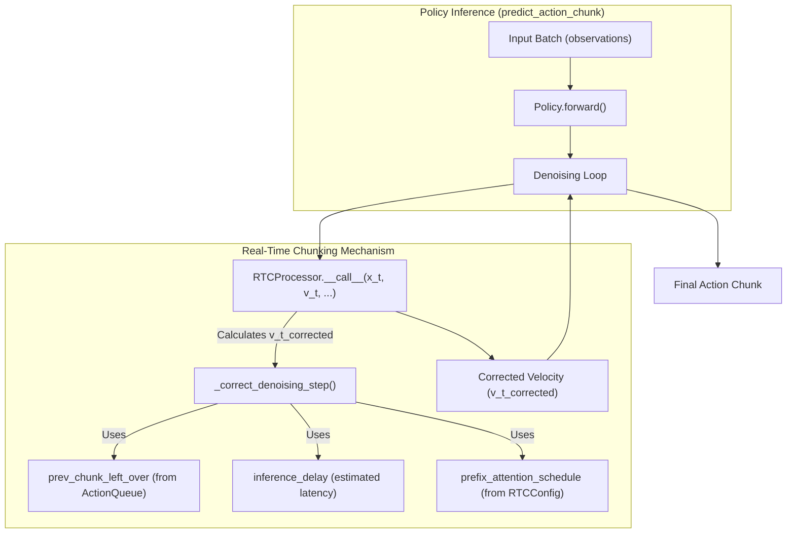
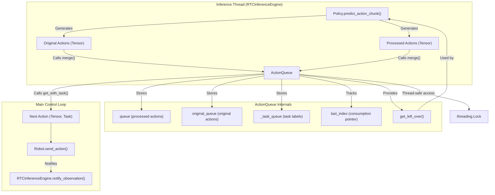

<!-- source: DeepWiki mcp.deepwiki.com · repo huggingface/lerobot · page 4.6 Real-Time Chunking · fetched 2026-10-26 -->

# Real-Time Chunking

<details>
<summary>Relevant source files</summary>

The following files were used as context for generating this wiki page:

- [docs/source/feetech.mdx](docs/source/feetech.mdx)
- [docs/source/phone_teleop.mdx](docs/source/phone_teleop.mdx)
- [docs/source/processors_robots_teleop.mdx](docs/source/processors_robots_teleop.mdx)
- [docs/source/rtc.mdx](docs/source/rtc.mdx)
- [src/lerobot/policies/rtc/action_queue.py](src/lerobot/policies/rtc/action_queue.py)
- [src/lerobot/policies/rtc/configuration_rtc.py](src/lerobot/policies/rtc/configuration_rtc.py)
- [src/lerobot/policies/rtc/modeling_rtc.py](src/lerobot/policies/rtc/modeling_rtc.py)
- [src/lerobot/policies/rtc/relative.py](src/lerobot/policies/rtc/relative.py)
- [src/lerobot/rollout/context.py](src/lerobot/rollout/context.py)
- [src/lerobot/rollout/inference/factory.py](src/lerobot/rollout/inference/factory.py)
- [src/lerobot/rollout/inference/rtc.py](src/lerobot/rollout/inference/rtc.py)
- [src/lerobot/rollout/inference/sync.py](src/lerobot/rollout/inference/sync.py)
- [tests/policies/rtc/test_action_queue.py](tests/policies/rtc/test_action_queue.py)
- [tests/policies/rtc/test_configuration_rtc.py](tests/policies/rtc/test_configuration_rtc.py)
- [tests/policies/rtc/test_modeling_rtc.py](tests/policies/rtc/test_modeling_rtc.py)
- [tests/policies/test_pretrained_interactive_contracts.py](tests/policies/test_pretrained_interactive_contracts.py)
- [tests/test_interactive_rollout.py](tests/test_interactive_rollout.py)
- [tests/test_rollout.py](tests/test_rollout.py)
- [tests/test_rollout_action_ordering.py](tests/test_rollout_action_ordering.py)

</details>


## Purpose and Scope
This page details the Real-Time Chunking (RTC) system in LeRobot, designed for continuous action generation in flow-matching based Vision-Language-Action (VLA) and imitation learning policies (such as `PI0Policy`, `PI05Policy`, `SmolVLAPolicy`, and `GrootPolicy`) [src/lerobot/policies/pi0/modeling_pi0.py:67-67](), [src/lerobot/policies/smolvla/modeling_smolvla.py:74-74](), [src/lerobot/policies/pi05/modeling_pi05.py:65-65](), [src/lerobot/policies/groot/modeling_groot.py:65-72]().

Scope includes the `RTCProcessor`, action queues, temporal correction algorithms, guidance weight schedules, and inference optimizations like training-time hard-prefix conditioning (`mode='trained'`).

Sources: [docs/source/rtc.mdx:1-227]()

---

## 1. Overview and Motivation
Action chunking policies predict sequences of future actions (action chunks) from current observations [docs/source/rtc.mdx:5-10](). However, generating a new chunk takes significant inference time (inference delay), creating execution gaps. Naively executing chunks sequentially leads to pauses, jerky transitions, or sudden changes in behavior whenever a new chunk arrives late or diverges from previously executed actions [docs/source/rtc.mdx:5-10]().

RTC addresses this by:
1. **Overlapping Execution and Inference**: New chunks are generated asynchronously in the background while the robot continues executing the tail of the previous chunk [docs/source/rtc.mdx:9-14]().
2. **Temporal Consistency**: New chunks are constrained during iterative denoising to align smoothly with the remaining executed portion of the previous chunk [docs/source/rtc.mdx:16-19]().
3. **Guidance and Hard Prefix Conditioning**: Blending previous actions via Jacobian guidance (`mode='guided'`) or hard prefix inpainting (`mode='trained'`) [docs/source/rtc.mdx:95-100]().

Sources: [src/lerobot/policies/rtc/modeling_rtc.py:17-20](), [docs/source/rtc.mdx:1-100]()

---

## 2. Core Architecture and Code Entity Mapping
The RTC system bridges high-level policy inference with low-level robot execution through modular processors, configuration schemas, and asynchronous queue management.

### System-to-Code Mapping Diagram

```mermaid
graph TD
    subgraph NaturalLanguageSpace["Natural Language Space"]
        Config[""RTC Configuration Schema""]
        Processor[""Denoising Correction Processor""]
        ActionQueueNL[""Asynchronous Action Queue""]
        InferenceEngineNL[""Inference Engine Loop""]
        PolicyNL[""Policy (e.g., Pi05)""]
        RobotNL[""Robot Hardware""]
    end

    subgraph CodeEntitySpace["Code Entity Space"]
        RTCConfigCls["src/lerobot/policies/rtc/configuration_rtc.py::RTCConfig"]
        RTCProcessorCls["src/lerobot/policies/rtc/modeling_rtc.py::RTCProcessor"]
        ActionQueueCls["src/lerobot/policies/rtc/action_queue.py::ActionQueue"]
        RTCInferenceEngineCls["src/lerobot/rollout/inference/rtc.py::RTCInferenceEngine"]
        PreTrainedPolicyCls["src/lerobot/policies/pretrained.py::PreTrainedPolicy"]
        ThreadSafeRobotCls["src/lerobot/rollout/robot_wrapper.py::ThreadSafeRobot"]
    end

    Config --> RTCConfigCls
    Processor --> RTCProcessorCls
    ActionQueueNL --> ActionQueueCls
    InferenceEngineNL --> RTCInferenceEngineCls
    PolicyNL --> PreTrainedPolicyCls
    RobotNL --> ThreadSafeRobotCls

    RTCInferenceEngineCls -- "Manages" --> ActionQueueCls
    RTCInferenceEngineCls -- "Calls predict_action_chunk" --> PreTrainedPolicyCls
    PreTrainedPolicyCls -- "Uses" --> RTCProcessorCls
    RTCInferenceEngineCls -- "Notifies" --> ThreadSafeRobotCls
```

**RTC Component Hierarchy**:
1. **Configuration Layer**: `RTCConfig` defines parameters such as `execution_horizon`, `max_guidance_weight`, and `prefix_attention_schedule` [src/lerobot/policies/rtc/configuration_rtc.py:20-55]().
2. **Processing Layer**: `RTCProcessor` implements the mathematical correction logic applied during flow-matching denoising steps [src/lerobot/policies/rtc/modeling_rtc.py:30-298]().
3. **Action Queue**: `ActionQueue` is a thread-safe queue for managing action chunks, handling original and processed actions, and tracking task provenance [src/lerobot/policies/rtc/action_queue.py:35-70]().
4. **Inference Layer**: `RTCInferenceEngine` manages the asynchronous execution loop, latency tracking, and thread-safe action merging [src/lerobot/rollout/inference/rtc.py:100-250]().

Sources: [src/lerobot/policies/rtc/modeling_rtc.py:30-298](), [src/lerobot/policies/rtc/configuration_rtc.py:20-55](), [src/lerobot/rollout/inference/rtc.py:100-250](), [src/lerobot/policies/rtc/action_queue.py:35-70]()

---

## 3. RTCConfig and Configuration Options
The `RTCConfig` data class exposes configuration hooks for tuning real-time chunking behavior:

| Parameter | Type | Default | Description |
| --- | --- | --- | --- |
| `enabled` | `bool` | `False` | Master switch enabling RTC processing. |
| `mode` | `Literal["guided", "trained"]` | `"guided"` | Action-prefix conditioning method (`guided` via Jacobian guidance, `trained` via training-time hard prefix). |
| `execution_horizon` | `int` | `10` | Number of timesteps from the previous chunk to maintain consistency with. |
| `max_guidance_weight` | `float` | `10.0` | Maximum weight applied to enforce consistency with the previous chunk. |
| `prefix_attention_schedule` | `RTCAttentionSchedule` | `EXP` | Decay schedule for guidance weight across denoising steps (`LINEAR`, `EXP`, `ONES`, `ZEROS`). |
| `debug` | `bool` | `False` | Tracks internal denoising states for offline inspection and visualization. |

For `mode='trained'`, both `execution_horizon` and the rollout backend queue threshold (`inference.queue_threshold`) must be at least the checkpoint's `rtc_training_max_delay`, and `execution_horizon` must not exceed `chunk_size - rtc_training_max_delay`. This ensures the system operates within the bounds established for hard-prefix conditioning [docs/source/rtc.mdx:95-105](), [src/lerobot/rollout/context.py:120-139]().

Sources: [src/lerobot/policies/rtc/configuration_rtc.py:20-55](), [docs/source/rtc.mdx:90-105](), [src/lerobot/rollout/context.py:120-139]()

---

## 4. RTCProcessor Implementation and Denoising Correction
`RTCProcessor` coordinates the manipulation of noisy action trajectories during flow matching [src/lerobot/policies/rtc/modeling_rtc.py:30-298]().

### Denoising Correction Data Flow



### Correction Logic
The correction adjusts predicted velocities during denoising by blending the unconstrained vector field with the target trajectory derived from `prev_chunk_left_over`, shifted by the measured `inference_delay` [src/lerobot/policies/rtc/modeling_rtc.py:186-230]():

```python
# Conceptual implementation from src/lerobot/policies/rtc/modeling_rtc.py:214-230
v_t_target = (prev_chunk_consumed - x_t_execution_zone) / dt
weight = self._get_prefix_attention_weight(time, num_steps)
v_t[..., :execution_horizon, :] = v_t_original + weight * (v_t_target - v_t_original)
```

Sources: [src/lerobot/policies/rtc/modeling_rtc.py:30-298](), [src/lerobot/policies/rtc/modeling_rtc.py:150-230]()

---

## 5. Action Queue Management
The `ActionQueue` acts as a thread-safe circular buffer facilitating asynchronous inference and continuous execution [src/lerobot/policies/rtc/action_queue.py:35-70]().

### ActionQueue Data Flow



- **Asynchronous Updates**: A background thread within `RTCInferenceEngine` invokes `policy.predict_action_chunk()` to generate new action chunks. These chunks are then merged into the `ActionQueue` [src/lerobot/rollout/inference/rtc.py:180-200]().
- **Action Merging**: The `merge()` method handles adding new actions. In RTC-enabled mode, it replaces the queue, accounting for `real_delay`. In RTC-disabled mode, it appends actions [src/lerobot/policies/rtc/action_queue.py:173-181]().
- **Latency Tracking**: `RTCInferenceEngine` estimates `inference_delay` based on observed latency and `time_per_step` [src/lerobot/rollout/inference/rtc.py:144-158](). This delay is used to condition the policy and manage the queue.
- **Leftover Extraction**: `get_left_over()` provides the unconsumed original actions from the current chunk, which are used as `prev_chunk_left_over` for the next policy inference call [src/lerobot/policies/rtc/action_queue.py:138-152]().
- **Task Provenance**: The `ActionQueue` stores task labels alongside actions, ensuring that `get_with_task()` returns the correct task associated with each action, even when chunks are replaced [src/lerobot/policies/rtc/action_queue.py:81-98](), [tests/policies/rtc/test_action_queue.py:131-140]().

Sources: [src/lerobot/policies/rtc/action_queue.py:35-70](), [src/lerobot/rollout/inference/rtc.py:180-200](), [src/lerobot/policies/rtc/action_queue.py:173-181](), [src/lerobot/rollout/inference/rtc.py:144-158](), [src/lerobot/policies/rtc/action_queue.py:138-152](), [src/lerobot/policies/rtc/action_queue.py:81-98](), [tests/policies/rtc/test_action_queue.py:131-140]()

---

## 6. Integration in VLA Policies
Policies integrate RTC through dedicated initialization routines and keyword arguments:

- **SmolVLA**: Instantiates `RTCProcessor` within `init_rtc_processor()` and forwards prefix data inside `_get_action_chunk()` [src/lerobot/policies/smolvla/modeling_smolvla.py:176-197]().
- **π₀ and π₀.₅**: Configurable via `PI0Config.rtc_config` and `PI05Config.rtc_config`, handling training-time hard prefix padding via `_prepare_trained_rtc_prefix()` [src/lerobot/policies/pi0/modeling_pi0.py:67-67](), [src/lerobot/policies/pi05/modeling_pi05.py:65-123]().
- **GR00T**: Implements `supports_rtc() -> bool` returning `True` to allow engine orchestration [src/lerobot/policies/groot/modeling_groot.py:71-72]().
- **`supports_rtc_inference()`**: A utility function to check if a policy declares RTC support and accepts the RTC call shape for `predict_action_chunk` [src/lerobot/rollout/inference/rtc.py:88-102]().

Sources: [src/lerobot/policies/smolvla/modeling_smolvla.py:176-197](), [src/lerobot/policies/pi05/modeling_pi05.py:76-123](), [src/lerobot/policies/groot/modeling_groot.py:71-72](), [src/lerobot/rollout/inference/rtc.py:88-102]()

---

## 7. Guidance Weight Scheduling
Guidance schedules control how rapidly the temporal consistency constraint decays as denoising proceeds:

| Schedule | Implementation Formula |
| --- | --- |
| `LINEAR` | `weight = max_weight * (1 - step / num_steps)` [src/lerobot/policies/rtc/modeling_rtc.py:270-272]() |
| `EXP` | `weight = max_weight * exp(-step / num_steps)` [src/lerobot/policies/rtc/modeling_rtc.py:274-276]() |
| `CONSTANT` | `weight = max_weight` [src/lerobot/policies/rtc/modeling_rtc.py:278-280]() |

Sources: [src/lerobot/policies/rtc/modeling_rtc.py:250-290]()

---

