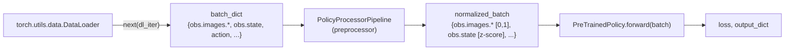
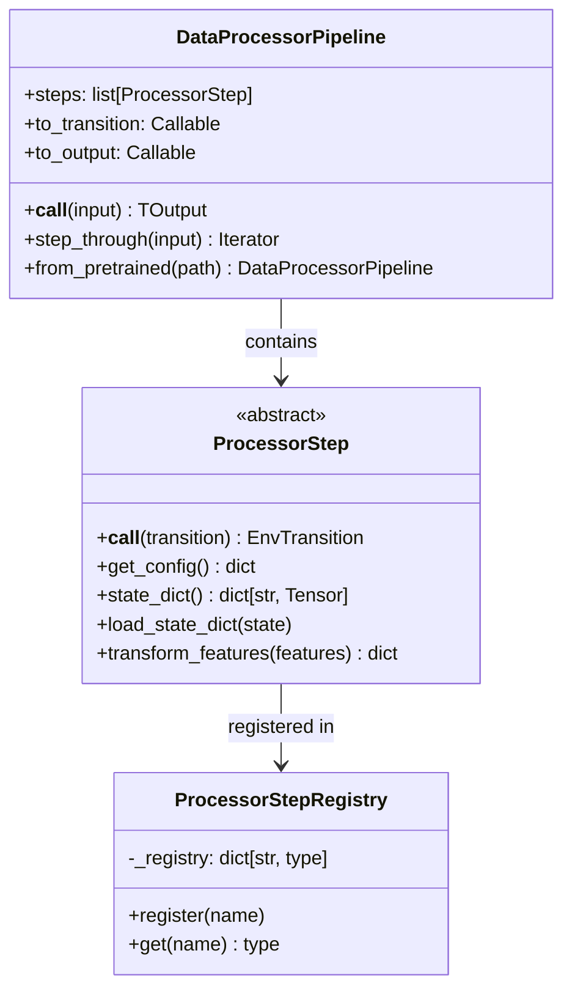

<!-- source: DeepWiki mcp.deepwiki.com · repo huggingface/lerobot · page 5 Data Processing Pipeline · fetched 2026-10-26 -->

# Data Processing Pipeline

Relevant source files

The following files were used as context for generating this wiki page:

- [src/lerobot/processor/delta_action_processor.py](src/lerobot/processor/delta_action_processor.py)
- [src/lerobot/processor/device_processor.py](src/lerobot/processor/device_processor.py)
- [src/lerobot/processor/env_processor.py](src/lerobot/processor/env_processor.py)
- [src/lerobot/processor/factory.py](src/lerobot/processor/factory.py)
- [src/lerobot/processor/gym_action_processor.py](src/lerobot/processor/gym_action_processor.py)
- [src/lerobot/processor/hil_processor.py](src/lerobot/processor/hil_processor.py)
- [src/lerobot/processor/migrate_policy_normalization.py](src/lerobot/processor/migrate_policy_normalization.py)
- [src/lerobot/processor/normalize_processor.py](src/lerobot/processor/normalize_processor.py)
- [src/lerobot/processor/pipeline.py](src/lerobot/processor/pipeline.py)
- [tests/processor/test_pipeline_from_pretrained_helpers.py](tests/processor/test_pipeline_from_pretrained_helpers.py)

This page provides an overview of the processor system that transforms raw observations and actions between their external representations and the internal format required by LeRobot policies. It describes the sequential data processing framework, the internal `EnvTransition` data format, and how processors are composed, saved, and reused.

For details about specific aspects of the system, see the child pages:
- [Processor Architecture](#5.1) — Detail `PolicyProcessorPipeline` and `RobotProcessorPipeline`, processor composition, `make_pre_post_processors`, overrides, custom processors, and debugging hooks.
- [Observation and Action Processors](#5.2) — Explain common processors: `device_processor`, `rename_observations_processor`, normalizer/unnormalizer, rename maps, empty cameras, relative/absolute actions, and policy-specific steps.
- [Feature Mapping and Validation](#5.3) — Describe `dataset_to_policy_features`, `env_to_policy_features`, `pipeline_features`, feature validation, input/output features, and shape inference.
- [Normalization and Statistics](#5.4) — Explain statistics computation (`compute_stats`, quantile augmentation), normalization modes (`MEAN_STD`, `MIN_MAX`, `QUANTILES`), storage/loading, and use in preprocessors.
- [Environment-Specific Processors](#5.5) — Detail `make_env_pre_post_processors`, env-specific transforms (LIBERO conditioning, image rotation), `add_envs_task`, and robot/teleop processors.
- [Batch and Transition Converters](#5.6) — Explain conversion between batch dicts, transitions, and policy input formats, plus the tokenizer processor and collation for language-conditioned policies.
- [Image Transforms and Augmentation](#5.7) — Document `src/lerobot/transforms`: image transform configs, random subset application, deprecated API, the `image_augmentation_processor`, and `lerobot-imgtransform-viz`.

Sources: [src/lerobot/processor/pipeline.py:17-29]()

---

## Role in the System

Policies expect normalized `torch.Tensor` objects with standardized key names (e.g., `observation.images.laptop`, `observation.state`, `action`). Datasets store raw values with dataset-specific keys, and environments produce numpy arrays with environment-specific formats. The processor system provides the bidirectional transformation layer between these representations.

Every training iteration and every rollout episode passes data through processor pipelines:

| Pipeline | Direction | Typical Input | Typical Output |
|---|---|---|---|
| **Preprocessor** (`PolicyProcessorPipeline`) | Dataset/env → Policy | Raw batch dict or observation dict | Normalized, device-placed tensors |
| **Postprocessor** (`PolicyProcessorPipeline`) | Policy → env/robot | Policy output tensor (actions) | Unnormalized, CPU-based numpy arrays |

**Data flow during training:**

Title: "TrainingDataFlow"

**Data flow during rollout/evaluation:**

Title: "EvaluationDataFlow"

```mermaid
flowchart LR
    Env["gym.vector.VectorEnv"]
    RawObs["raw_observation\n(numpy arrays)"]
    EnvPre["env_preprocessor"]
    AdaptObs["adapted_observation"]
    Pre["PolicyProcessorPipeline\n(preprocessor)"]
    NormObs["normalized_tensors"]
    Pol["PreTrainedPolicy.select_action(obs)"]
    RawAct["raw_action_tensor"]
    Post["PolicyProcessorPipeline\n(postprocessor)"]
    UnnormAct["unnormalized_action"]
    EnvPost["env_postprocessor"]
    NumpyAct["numpy_action_array"]

    Env -->|"reset()/step()"| RawObs
    RawObs --> EnvPre
    EnvPre --> AdaptObs
    AdaptObs --> Pre
    Pre --> NormObs
    NormObs --> Pol
    Pol --> RawAct
    RawAct --> Post
    Post --> UnnormAct
    UnnormAct --> EnvPost
    EnvPost --> NumpyAct
    NumpyAct -->|"step(action)"| Env
```

Sources: [src/lerobot/processor/pipeline.py:17-29]()

---

## 5.1 Processor Architecture

The processor architecture centers around `DataProcessorPipeline`, `PolicyProcessorPipeline`, and `RobotProcessorPipeline` [src/lerobot/processor/pipeline.py:341-341](), which chain multiple `ProcessorStep` components [src/lerobot/processor/pipeline.py:150-150]() sequentially. Steps are registered via `ProcessorStepRegistry` [src/lerobot/processor/pipeline.py:66-66]() for serialization and instantiation from configuration files.

For details on step composition, overrides, custom processors, and debugging hooks like `step_through`, see [Processor Architecture](#5.1).

Title: "ProcessorArchitecture"

Sources: [src/lerobot/processor/pipeline.py:66-148](), [src/lerobot/processor/pipeline.py:150-206](), [src/lerobot/processor/pipeline.py:341-400]()

---

## 5.2 Observation and Action Processors

Common processors handle input transformations such as device placement (`DeviceProcessorStep` [src/lerobot/processor/device_processor.py:34-35]()), observation renaming (`RenameObservationsProcessorStep` [src/lerobot/processor/factory.py:125-126]()), and range normalization (`NormalizerProcessorStep` [src/lerobot/processor/normalize_processor.py:36-36](), `UnnormalizerProcessorStep` [src/lerobot/processor/normalize_processor.py:36-36]()). They also manage empty cameras, channel transpositions, and policy-specific processing steps like `RelativeActionsProcessorStep` and `AbsoluteActionsProcessorStep` [src/lerobot/processor/factory.py:46-46]().

For details on common processor steps and configuration options, see [Observation and Action Processors](#5.2).

Sources: [src/lerobot/processor/pipeline.py:17-29](), [src/lerobot/processor/device_processor.py:34-35](), [src/lerobot/processor/factory.py:46-46](), [src/lerobot/processor/factory.py:125-126](), [src/lerobot/processor/normalize_processor.py:36-36]()

---

## 5.3 Feature Mapping and Validation

Pipeline features bridge datasets, environments, and policies through functions such as `aggregate_pipeline_dataset_features`, `dataset_to_policy_features`, and `env_to_policy_features` [src/lerobot/datasets/pipeline_features.py:68-144](). They handle feature validation, input/output feature mapping, and shape inference across transformations.

For details on feature specification and validation mechanisms, see [Feature Mapping and Validation](#5.3).

Sources: [src/lerobot/datasets/pipeline_features.py:68-144]()

---

## 5.4 Normalization and Statistics

Statistics computation (`compute_stats`, quantile augmentation) and normalization modes (`MEAN_STD`, `MIN_MAX`, `QUANTILES`) govern how data is scaled before entering policy networks. These statistics are stored with datasets or models and loaded dynamically into normalizer processor steps. The `_NormalizationMixin` [src/lerobot/processor/normalize_processor.py:40-41]() provides the core functionality for managing and applying these statistics.

For details on statistics computation and normalization modes, see [Normalization and Statistics](#5.4).

Sources: [src/lerobot/processor/pipeline.py:17-29](), [src/lerobot/processor/normalize_processor.py:40-41]()

---

## 5.5 Environment-Specific Processors

During evaluation and simulation rollouts, environment-specific transformations adapt simulator outputs and inputs. This includes `make_env_pre_post_processors`, LIBERO task conditioning (`LiberoProcessorStep` [src/lerobot/processor/env_processor.py:27-28]()), image rotations, and robot/teleop specific bridging processors like `AddTeleopActionAsComplimentaryDataStep` [src/lerobot/processor/hil_processor.py:104-105]() and `AddTeleopEventsAsInfoStep` [src/lerobot/processor/hil_processor.py:141-142]().

For details on environment integration and specialized adaptors, see [Environment-Specific Processors](#5.5).

Sources: [src/lerobot/processor/pipeline.py:17-29](), [src/lerobot/processor/env_processor.py:27-28](), [src/lerobot/processor/hil_processor.py:104-105](), [src/lerobot/processor/hil_processor.py:141-142]()

---

## 5.6 Batch and Transition Converters

All processor steps operate on an internal `EnvTransition` dictionary format [src/lerobot/processor/pipeline.py:48-55](). Converters like `batch_to_transition`, `transition_to_batch`, and `create_transition` manage translation between batch dicts, transition structures, and policy formats [src/lerobot/processor/pipeline.py:59-59](). Additionally, steps like `Torch2NumpyActionProcessorStep` [src/lerobot/processor/gym_action_processor.py:31-32]() and `Numpy2TorchActionProcessorStep` [src/lerobot/processor/gym_action_processor.py:75-76]() handle conversions between PyTorch tensors and NumPy arrays for environment interaction.

For details on transition structures, collation, and tokenizer processors for language-conditioned policies, see [Batch and Transition Converters](#5.6).

Sources: [src/lerobot/processor/pipeline.py:48-55](), [src/lerobot/processor/pipeline.py:59-59](), [src/lerobot/processor/gym_action_processor.py:31-32](), [src/lerobot/processor/gym_action_processor.py:75-76]()

---

## 5.7 Image Transforms and Augmentation

The `src/lerobot/transforms` package provides functionalities for image transformations and augmentation. This includes various image transform configurations, random subset application, and the `image_augmentation_processor`. Tools like `lerobot-imgtransform-viz` aid in visualizing these transformations.

For details on image processing, augmentation, and related utilities, see [Image Transforms and Augmentation](#5.7).

Sources: [src/lerobot/processor/pipeline.py:17-29]()

---

