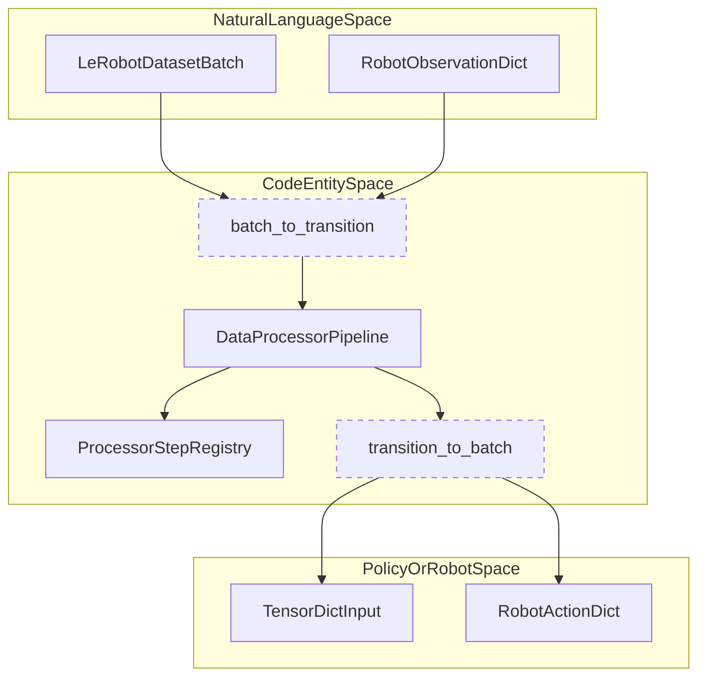
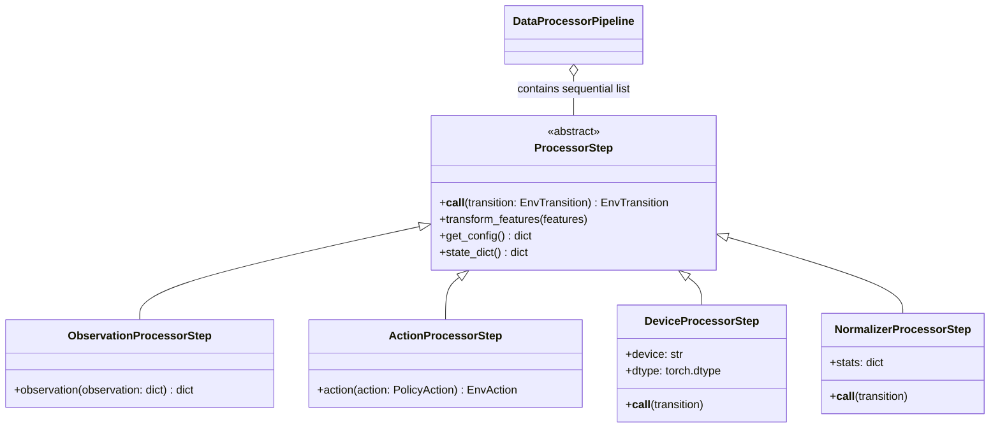

<!-- source: DeepWiki mcp.deepwiki.com · repo huggingface/lerobot · page 5.1 Processor Architecture · fetched 2026-10-26 -->

# Processor Architecture

Relevant source files

The following files were used as context for generating this wiki page:

- [src/lerobot/lerobot_types.py](src/lerobot/lerobot_types.py)
- [src/lerobot/processor/delta_action_processor.py](src/lerobot/processor/delta_action_processor.py)
- [src/lerobot/processor/device_processor.py](src/lerobot/processor/device_processor.py)
- [src/lerobot/processor/env_processor.py](src/lerobot/processor/env_processor.py)
- [src/lerobot/processor/factory.py](src/lerobot/processor/factory.py)
- [src/lerobot/processor/gym_action_processor.py](src/lerobot/processor/gym_action_processor.py)
- [src/lerobot/processor/hil_processor.py](src/lerobot/processor/hil_processor.py)
- [src/lerobot/processor/migrate_policy_normalization.py](src/lerobot/processor/migrate_policy_normalization.py)
- [src/lerobot/processor/normalize_processor.py](src/lerobot/processor/normalize_processor.py)
- [src/lerobot/processor/pipeline.py](src/lerobot/processor/pipeline.py)
- [tests/processor/test_act_processor.py](tests/processor/test_act_processor.py)
- [tests/processor/test_diffusion_processor.py](tests/processor/test_diffusion_processor.py)
- [tests/processor/test_gaussian_actor_processor.py](tests/processor/test_gaussian_actor_processor.py)
- [tests/processor/test_pipeline.py](tests/processor/test_pipeline.py)
- [tests/processor/test_pipeline_from_pretrained_helpers.py](tests/processor/test_pipeline_from_pretrained_helpers.py)
- [tests/processor/test_smolvla_processor.py](tests/processor/test_smolvla_processor.py)
- [tests/processor/test_tdmpc_processor.py](tests/processor/test_tdmpc_processor.py)
- [tests/processor/test_vqbet_processor.py](tests/processor/test_vqbet_processor.py)
- [tests/rewards/test_classifier_processor.py](tests/rewards/test_classifier_processor.py)

This page details `PolicyProcessorPipeline`, `RobotProcessorPipeline`, processor composition, `make_pre_post_processors`, overrides, custom processors, and debugging hooks across the LeRobot data transformation stack.

---

## Overview

In robotics, there is a fundamental mismatch between raw sensor data (images, joint positions) and what machine learning models expect (normalized tensors, tokenized language). Every policy in LeRobot uses two processor pipelines to bridge this gap:

- **Preprocessor** — transforms a raw batch or robot observation dictionary into the tensor format expected by `policy.select_action()` or `policy.forward()`.
- **Postprocessor** — transforms the raw tensor output of the policy into a usable action (e.g., unnormalizing values, slicing to environment action dimensions).

Both pipelines are instances of `DataProcessorPipeline` (aliased as `PolicyProcessorPipeline` or `RobotProcessorPipeline`), which executes an ordered list of `ProcessorStep` objects over an internal `EnvTransition` dictionary [src/lerobot/processor/pipeline.py:17-29]().

Sources: [src/lerobot/processor/pipeline.py:17-29](), [src/lerobot/processor/pipeline.py:76-88]()

---

## Module Structure

The processor system is organized in `src/lerobot/processor/`.

| Symbol | Location | Role |
|---|---|---|
| `DataProcessorPipeline` | `lerobot.processor` | Sequential container for applying `ProcessorStep` objects [src/lerobot/processor/pipeline.py:188-250]() |
| `PolicyProcessorPipeline` | `lerobot.processor` | Alias for pipelines that input/output policy-specific formats [src/lerobot/processor/pipeline.py:76-88]() |
| `RobotProcessorPipeline` | `lerobot.processor` | Alias for pipelines that input/output robot-specific formats [src/lerobot/processor/pipeline.py:76-88]() |
| `ProcessorStep` | `lerobot.processor` | Abstract base class for individual transform steps [src/lerobot/processor/pipeline.py:150-158]() |
| `ProcessorStepRegistry` | `lerobot.processor` | Registry for mapping string names to step classes for serialization [src/lerobot/processor/pipeline.py:66-73]() |
| `EnvTransition` | `lerobot.lerobot_types` | Internal `dict` format used between steps [src/lerobot/lerobot_types.py:49-55]() |
| `TransitionKey` | `lerobot.lerobot_types` | Enum defining keys of `EnvTransition` (e.g., `OBSERVATION`, `ACTION`) [src/lerobot/lerobot_types.py:49-55]() |

Sources: [src/lerobot/processor/pipeline.py:66-250](), [src/lerobot/lerobot_types.py:49-55]()

---

## Data Flow and Composition

LeRobot uses `EnvTransition` as the universal data container. It represents a complete robot-environment interaction, including observation, action, reward, and complementary data [src/lerobot/processor/pipeline.py:17-29]().

### Diagram: Pipeline Entity Association Map

When `pipeline(input)` is called:
1. `to_transition(input)` converts input to `EnvTransition` [src/lerobot/processor/pipeline.py:18-29]().
2. Each `ProcessorStep.__call__(transition)` is applied in order [src/lerobot/processor/pipeline.py:179-180]().
3. `to_output(transition)` converts the result back to the external format [src/lerobot/processor/pipeline.py:18-29]().

Sources: [src/lerobot/processor/pipeline.py:18-180](), [src/lerobot/processor/converters.py:40-146]()

---

## Robot vs Policy Pipelines

While both inherit from `DataProcessorPipeline`, they serve different stages of the robotics stack:

| Aspect | `RobotProcessorPipeline` | `PolicyProcessorPipeline` |
|---|---|---|
| **Input/Output** | Individual robot values (`dict[str, Any]`) | Batched tensors (`dict[str, torch.Tensor]`) |
| **Use Case** | Real-time robot control (Teleop → Robot) | Model training and inference |
| **Data Format** | Unbatched, heterogeneous | Batched, homogeneous |

For hardware integration, `RobotProcessorPipeline` is often used to map teleop device actions to robot-compatible formats, while `PolicyProcessorPipeline` handles the normalization and device placement required for neural network forward passes.

Sources: [src/lerobot/processor/pipeline.py:76-88](), [src/lerobot/processor/factory.py:50-57]()

---

## Processor Factory and Feature Contracts

The creation of pre- and post-processors is centralized in factory functions such as `make_pre_post_processors` [src/lerobot/processor/migrate_policy_normalization.py:62](). This function acts as a dispatcher that routes to policy-specific factory functions or loads existing pipelines from a pretrained path.

### Feature Contracts
Each `ProcessorStep` must implement `transform_features()` [src/lerobot/processor/pipeline.py:150-158](). This method declares how the step alters the shape or type of data features [tests/processor/test_pipeline.py:101-105]().
- `aggregate_pipeline_dataset_features()`: Applies `transform_features` across an entire pipeline to determine the final dataset structure [tests/processor/test_pipeline.py:32-33]().
- `create_initial_features()`: Initializes the feature dictionary from raw action and observation specs [src/lerobot/processor/pipeline.py:18-29]().

Sources: [src/lerobot/processor/pipeline.py:150-158](), [src/lerobot/processor/migrate_policy_normalization.py:62](), [tests/processor/test_pipeline.py:32-33](), [src/lerobot/processor/pipeline.py:18-29]()

---

## Implementation: `ProcessorStep`

To implement a custom processor, subclass `ProcessorStep` and register it using the `@ProcessorStepRegistry.register()` decorator [src/lerobot/processor/pipeline.py:78-79]().

### Diagram: Processor Hierarchy Class Map

### Key Specialized Steps
- **`DeviceProcessorStep`**: Moves all tensors in an `EnvTransition` to a target device (e.g., `cuda`) and casts precision [src/lerobot/processor/device_processor.py:34-38]().
- **`NormalizerProcessorStep`**: Scales features based on dataset statistics (mean/std, min/max, or quantiles) [src/lerobot/processor/normalize_processor.py:39-101]().
- **`UnnormalizerProcessorStep`**: Reverses the scaling process, typically used in post-processing actions [src/lerobot/processor/normalize_processor.py:500-504]().
- **`RenameObservationsProcessorStep`**: Maps observation keys from dataset names to policy-expected names [src/lerobot/processor/factory.py:96]().

Sources: [src/lerobot/processor/pipeline.py:150-201](), [src/lerobot/processor/device_processor.py:34-38](), [src/lerobot/processor/normalize_processor.py:39-101](), [src/lerobot/processor/normalize_processor.py:500-504](), [src/lerobot/processor/factory.py:96]()

---

## Processor Overrides Mechanism

The factory functions support overrides mechanisms via `preprocessor_overrides` and `postprocessor_overrides`. These dictionaries allow users to modify processor parameters (like normalization statistics) at runtime without changing the saved configuration files. For example, `_NormalizationMixin` in `NormalizerProcessorStep` explicitly preserves explicitly provided stats during `load_state_dict()` calls, allowing users to override normalization statistics from saved models [src/lerobot/processor/normalize_processor.py:50-72]().

When a policy is loaded from disk, LeRobot also performs a reconnection step for relative/absolute action transforms. Since absolute action processor steps need a live reference to relative action processor steps to read cached state, this reference is re-established after independent deserialization of pre- and post-processors.

Sources: [src/lerobot/processor/pipeline.py:66-250](), [src/lerobot/processor/normalize_processor.py:50-72]()

---

## Debugging with Hooks

The `DataProcessorPipeline` supports hooks for debugging data flow between steps [src/lerobot/processor/pipeline.py:188-250]().

- Preprocess hooks: Called before any steps are executed [src/lerobot/processor/pipeline.py:188-250]().
- Postprocess hooks: Called after all steps are completed [src/lerobot/processor/pipeline.py:188-250]().
- Step hooks: Called after each individual `ProcessorStep` [src/lerobot/processor/pipeline.py:188-250]().

Hooks are executed during the pipeline's `__call__` method in sequence.

Sources: [src/lerobot/processor/pipeline.py:188-250]()

---

