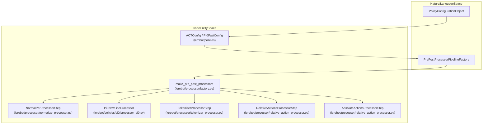

<!-- source: DeepWiki mcp.deepwiki.com · repo huggingface/lerobot · page 5.2 Observation and Action Processors · fetched 2026-10-26 -->

# Observation and Action Processors

Relevant source files

The following files were used as context for generating this wiki page:

- [docs/source/robomme.mdx](docs/source/robomme.mdx)
- [src/lerobot/envs/robomme.py](src/lerobot/envs/robomme.py)
- [src/lerobot/policies/act/processor_act.py](src/lerobot/policies/act/processor_act.py)
- [src/lerobot/policies/diffusion/processor_diffusion.py](src/lerobot/policies/diffusion/processor_diffusion.py)
- [src/lerobot/policies/gaussian_actor/processor_gaussian_actor.py](src/lerobot/policies/gaussian_actor/processor_gaussian_actor.py)
- [src/lerobot/policies/multi_task_dit/processor_multi_task_dit.py](src/lerobot/policies/multi_task_dit/processor_multi_task_dit.py)
- [src/lerobot/policies/pi0/processor_pi0.py](src/lerobot/policies/pi0/processor_pi0.py)
- [src/lerobot/policies/pi05/memory.py](src/lerobot/policies/pi05/memory.py)
- [src/lerobot/policies/smolvla/processor_smolvla.py](src/lerobot/policies/smolvla/processor_smolvla.py)
- [src/lerobot/policies/tdmpc/processor_tdmpc.py](src/lerobot/policies/tdmpc/processor_tdmpc.py)
- [src/lerobot/policies/vqbet/processor_vqbet.py](src/lerobot/policies/vqbet/processor_vqbet.py)
- [src/lerobot/processor/delta_action_processor.py](src/lerobot/processor/delta_action_processor.py)
- [src/lerobot/processor/device_processor.py](src/lerobot/processor/device_processor.py)
- [src/lerobot/processor/env_processor.py](src/lerobot/processor/env_processor.py)
- [src/lerobot/processor/factory.py](src/lerobot/processor/factory.py)
- [src/lerobot/processor/gym_action_processor.py](src/lerobot/processor/gym_action_processor.py)
- [src/lerobot/processor/hil_processor.py](src/lerobot/processor/hil_processor.py)
- [src/lerobot/processor/migrate_policy_normalization.py](src/lerobot/processor/migrate_policy_normalization.py)
- [src/lerobot/processor/normalize_processor.py](src/lerobot/processor/normalize_processor.py)
- [src/lerobot/processor/pipeline.py](src/lerobot/processor/pipeline.py)
- [src/lerobot/processor/rename_processor.py](src/lerobot/processor/rename_processor.py)
- [tests/processor/test_pi_tokenizer_configuration.py](tests/processor/test_pi_tokenizer_configuration.py)
- [tests/processor/test_pipeline_from_pretrained_helpers.py](tests/processor/test_pipeline_from_pretrained_helpers.py)
- [tests/processor/test_rename_processor.py](tests/processor/test_rename_processor.py)
- [tests/test_robomme_env.py](tests/test_robomme_env.py)

## Purpose and Scope

This page details the implementation and data flow of common processor steps used within the LeRobot data processing pipeline. These steps handle device placement, key renaming, normalization, unnormalization, relative/absolute action transformations, and model-specific processing. For the overarching processor architecture and pipeline composition, see [Processor Architecture](5.1).

Sources: [src/lerobot/processor/pipeline.py:150-158](), [src/lerobot/processor/normalize_processor.py:40-90]()

---

## Overview: Preprocessing and Postprocessing Flows

The LeRobot processing system utilizes `PolicyProcessorPipeline` and `RobotProcessorPipeline` instances to transform data streams [src/lerobot/processor/pipeline.py:18-29](). The fundamental unit of execution is the `ProcessorStep`, which operates on an `EnvTransition` [src/lerobot/processor/pipeline.py:150-179]().

- **Preprocessor**: Transforms raw environment or dataset batches into policy-compatible inputs.
- **Postprocessor**: Transforms model-predicted actions back into physical or simulator-compatible formats.

```mermaid
graph LR
    subgraph "NaturalLanguageSpace"
        RawBatch["RawBatchInput"]
        PolicyInput["PolicyModelInput"]
        PolicyOutput["ModelPredictionOutput"]
        EnvAction["EnvironmentAction"]
    end

    subgraph "CodeEntitySpace"
        BatchToTrans["batch_to_transition<br/>(lerobot/processor/converters.py)"]
        RenameStep["RenameObservationsProcessorStep<br/>(lerobot/processor/rename_processor.py)"]
        DeviceStep["DeviceProcessorStep<br/>(lerobot/processor/device_processor.py)"]
        NormStep["NormalizerProcessorStep<br/>(lerobot/processor/normalize_processor.py)"]
        TransToBatch["transition_to_batch<br/>(lerobot/processor/converters.py)"]
        
        ActionToTrans["policy_action_to_transition<br/>(lerobot/processor/converters.py)"]
        UnnormStep["UnnormalizerProcessorStep<br/>(lerobot/processor/normalize_processor.py)"]
        TransToAction["transition_to_policy_action<br/>(lerobot/processor/converters.py)"]
    end

    RawBatch --> BatchToTrans
    BatchToTrans --> RenameStep
    RenameStep --> DeviceStep
    DeviceStep --> NormStep
    NormStep --> TransToBatch
    TransToBatch --> PolicyInput
    
    PolicyInput --> Policy["PreTrainedPolicy.forward<br/>(lerobot/policies/pretrained.py)"]
    Policy --> PolicyOutput
    
    PolicyOutput --> ActionToTrans
    ActionToTrans --> UnnormStep
    UnnormStep --> TransToAction
    TransToAction --> EnvAction
```

**Diagram: Observation and Action Processing Flow bridging Natural Language Space to Code Entity Space**

Sources: [src/lerobot/processor/pipeline.py:17-29](), [src/lerobot/processor/pipeline.py:150-158]()

---

## Core Processor Steps

### Device Processor

**Purpose**: Moves all tensor data within an `EnvTransition` to the targeted compute device (CPU, CUDA, or MPS) [src/lerobot/processor/device_processor.py:22-45]().

| Parameter | Type | Description |
|-----------|------|-------------|
| `device` | `str` \| `torch.device` | Target execution device |

Sources: [src/lerobot/processor/device_processor.py:22-45]()

### Normalizer Processor

**Purpose**: Standardizes observation and action features based on dataset statistics, supporting multiple scaling modes via `NormalizationMode` [src/lerobot/configs/types.py:52]().

- `MEAN_STD`: Computes $(x - \mu) / \sigma$ [src/lerobot/processor/normalize_processor.py:204-207]().
- `MIN_MAX`: Scales features to $[-1, 1]$ [src/lerobot/processor/normalize_processor.py:211-215]().
- `QUANTILES`: Clips and scales using the 1st and 99th percentiles [src/lerobot/processor/normalize_processor.py:219-224]().
- `QUANTILE10`: Scales using 10th and 90th percentiles [src/lerobot/processor/normalize_processor.py:228-233]().

**Implementation Detail**: `NormalizerProcessorStep` leverages `_NormalizationMixin` to handle state dict persistence, device placement, and reshaping flat visual statistics to `(C, 1, 1)` for proper broadcasting over image tensors [src/lerobot/processor/normalize_processor.py:40-154]().

Sources: [src/lerobot/processor/normalize_processor.py:40-154](), [src/lerobot/processor/normalize_processor.py:171-236]()

### Unnormalizer Processor

**Purpose**: Reverses the normalization applied by the normalizer on model outputs, converting normalized policy action predictions back into physical ranges [src/lerobot/processor/normalize_processor.py:253-317]().

Sources: [src/lerobot/processor/normalize_processor.py:253-317]()

### Rename Observations Processor

**Purpose**: Maps observation keys from environment or dataset conventions (e.g., `observation.images.laptop`) to policy expectations [src/lerobot/processor/rename_processor.py:22-30]().

| Parameter | Type | Description |
|-----------|------|-------------|
| `rename_map` | `dict[str, str]` | Mapping table from old key names to new key names |

The `RenameObservationsProcessorStep` maintains temporal padding and mask suffixes automatically when keys are renamed (e.g., `_is_pad`, `_padding_mask`) [src/lerobot/processor/rename_processor.py:93-102]().

Sources: [src/lerobot/processor/rename_processor.py:22-102](), [tests/processor/test_rename_processor.py:35-84]()

### Vanilla Observation Processor

**Purpose**: Converts standard Gymnasium observations into LeRobot transition tensors [src/lerobot/processor/observation_processor.py:31-52](). It normalizes image dtypes from `uint8` (H, W, C) to `float32` (C, H, W) in the $[0, 1]$ range and maps state components [src/lerobot/processor/observation_processor.py:39-52]().

Sources: [src/lerobot/processor/observation_processor.py:31-92]()

---

## Specialized Processors

### Tokenizer and Action Tokenizer Processors
- **`TokenizerProcessorStep`**: Converts text tasks into token IDs and attention masks for language-conditioned policies [tests/processor/test_tokenizer_processor.py:151-176]().
- **`ActionTokenizerProcessorStep`**: Encodes continuous actions into discrete tokens (e.g., using FAST compression) [tests/processor/test_tokenizer_processor.py:118-135]().

Sources: [tests/processor/test_tokenizer_processor.py:118-176]()

### Empty Cameras Processor
Inserts zero-filled placeholder frames in multi-camera configurations when a camera stream is missing or disabled, ensuring consistent input dimensions [src/lerobot/processor/observation_processor.py:31-33]().

Sources: [src/lerobot/processor/observation_processor.py:31-33]()

---

## Policy-Specific Processing Steps

### Relative and Absolute Actions Processors

- **`RelativeActionsProcessorStep`**: Converts absolute actions into relative displacements by subtracting the current state (`action -= state`) across specified dimensions [src/lerobot/processor/relative_action_processor.py:40-100](). It caches the last observed state to support inverse operations [src/lerobot/processor/relative_action_processor.py:100-146]().
- **`AbsoluteActionsProcessorStep`**: Reverses the transformation by adding back the cached state reference to model predictions (`action += state`) [src/lerobot/processor/relative_action_processor.py:69-96]().

Sources: [src/lerobot/processor/relative_action_processor.py:40-146]()

### Policy-Specific Steps

Many policies define custom processor steps to handle their unique input/output requirements. These are typically found within the policy's module.

- **`Pi0NewLineProcessor`**: For the PI0 policy, this step ensures that task descriptions end with a newline character, which is required for compatibility with the PaliGemma tokenizer [src/lerobot/policies/pi0/processor_pi0.py:39-92]().
- **`LiberoProcessorStep`**: Processes LIBERO environment observations, extracting and concatenating robot state components (end-effector position, axis-angle, gripper joint positions) into a flat state vector and rotating image observations by 180 degrees [src/lerobot/processor/env_processor.py:27-108]().
- **`IsaaclabArenaProcessorStep`**: Handles IsaacLab Arena observations, extracting state components and converting image formats from `(B, H, W, C)` uint8 to `(B, C, H, W)` float32 [0, 1] [src/lerobot/processor/env_processor.py:153-182]().
- **`AddTeleopActionAsComplimentaryDataStep`**: Adds the raw action from a teleoperator to the transition's complementary data, useful for human-in-the-loop (HIL) scenarios [src/lerobot/processor/hil_processor.py:104-138]().
- **`AddTeleopEventsAsInfoStep`**: Extracts control events (e.g., terminate, success) from teleoperators and adds them to the transition's info dictionary [src/lerobot/processor/hil_processor.py:143-180]().
- **`ImageCropResizeProcessorStep`**: Crops and/or resizes image observations, handling device placement for operations [src/lerobot/processor/hil_processor.py:183-192]().
- **`Torch2NumpyActionProcessorStep`**: Converts a PyTorch tensor action to a NumPy array, often used when passing policy outputs to environments expecting NumPy [src/lerobot/processor/gym_action_processor.py:31-72]().
- **`Numpy2TorchActionProcessorStep`**: Converts a NumPy array action to a PyTorch tensor, including teleop actions in complementary data [src/lerobot/processor/gym_action_processor.py:76-108]().
- **`MapTensorToDeltaActionDictStep`**: Maps a flat action tensor from a policy to a structured delta action dictionary, decomposing it into end-effector delta movements and optionally gripper actions [src/lerobot/processor/delta_action_processor.py:27-73]().
- **`MapDeltaActionToRobotActionStep`**: Converts delta actions (e.g., from a teleoperator) into robot target actions for inverse kinematics, including scaling and noise filtering [src/lerobot/processor/delta_action_processor.py:76-155]().

Sources: [src/lerobot/policies/pi0/processor_pi0.py:39-92](), [src/lerobot/processor/env_processor.py:27-108](), [src/lerobot/processor/env_processor.py:153-182](), [src/lerobot/processor/hil_processor.py:104-138](), [src/lerobot/processor/hil_processor.py:143-180](), [src/lerobot/processor/hil_processor.py:183-192](), [src/lerobot/processor/gym_action_processor.py:31-72](), [src/lerobot/processor/gym_action_processor.py:76-108](), [src/lerobot/processor/delta_action_processor.py:27-73](), [src/lerobot/processor/delta_action_processor.py:76-155]()

---

## Data Converters

LeRobot provides conversion utilities for moving data between raw dictionaries and `EnvTransition` objects:

- **`to_tensor`**: Converts lists, numpy arrays, and scalar values into PyTorch tensors [src/lerobot/processor/converters.py:35-36]().
- **`batch_to_transition`**: Groups flat batch dictionaries into hierarchical `EnvTransition` structures [src/lerobot/processor/converters.py:222-254]().
- **`transition_to_batch`**: Flattens `EnvTransition` structures back into dictionaries [src/lerobot/processor/converters.py:257-285]().

Sources: [src/lerobot/processor/converters.py:35-285]()

---

## Factory Pattern and Registration

Processors are instantiated dynamically using string registries, allowing complete pipelines to be serialized to and deserialized from configuration files.

**Diagram: Policy-to-Processor Factory Mapping bridging Natural Language Space to Code Entity Space**

Sources: [src/lerobot/processor/pipeline.py:66-129](), [src/lerobot/processor/factory.py:39-44]()

---

