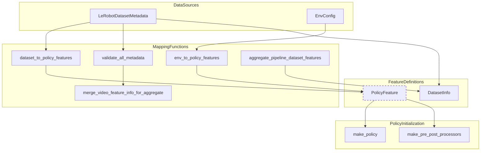
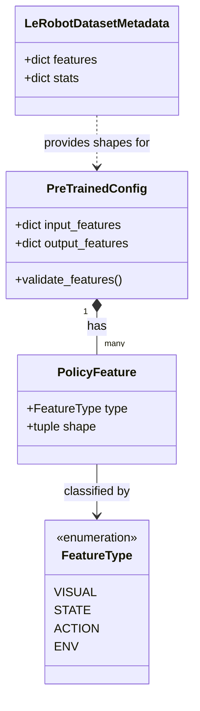

<!-- source: DeepWiki mcp.deepwiki.com · repo huggingface/lerobot · page 5.3 Feature Mapping and Validation · fetched 2026-10-26 -->

# Feature Mapping and Validation

Relevant source files

The following files were used as context for generating this wiki page:

- [src/lerobot/configs/__init__.py](src/lerobot/configs/__init__.py)
- [src/lerobot/configs/video.py](src/lerobot/configs/video.py)
- [src/lerobot/datasets/aggregate.py](src/lerobot/datasets/aggregate.py)
- [src/lerobot/datasets/compute_stats.py](src/lerobot/datasets/compute_stats.py)
- [src/lerobot/datasets/depth_utils.py](src/lerobot/datasets/depth_utils.py)
- [src/lerobot/datasets/feature_utils.py](src/lerobot/datasets/feature_utils.py)
- [src/lerobot/datasets/image_writer.py](src/lerobot/datasets/image_writer.py)
- [src/lerobot/datasets/pipeline_features.py](src/lerobot/datasets/pipeline_features.py)
- [src/lerobot/utils/collate.py](src/lerobot/utils/collate.py)
- [src/lerobot/utils/feature_utils.py](src/lerobot/utils/feature_utils.py)
- [src/lerobot/utils/foxglove_visualization.py](src/lerobot/utils/foxglove_visualization.py)
- [src/lerobot/utils/keyboard_input.py](src/lerobot/utils/keyboard_input.py)
- [src/lerobot/utils/process.py](src/lerobot/utils/process.py)
- [src/lerobot/utils/random_utils.py](src/lerobot/utils/random_utils.py)
- [src/lerobot/utils/rerun_visualization.py](src/lerobot/utils/rerun_visualization.py)
- [src/lerobot/utils/transition.py](src/lerobot/utils/transition.py)
- [src/lerobot/utils/utils.py](src/lerobot/utils/utils.py)
- [tests/datasets/test_aggregate.py](tests/datasets/test_aggregate.py)
- [tests/datasets/test_video_encoding.py](tests/datasets/test_video_encoding.py)
- [tests/fixtures/dataset_factories.py](tests/fixtures/dataset_factories.py)
- [tests/fixtures/hub.py](tests/fixtures/hub.py)
- [tests/utils/test_foxglove_visualization.py](tests/utils/test_foxglove_visualization.py)

This document explains how features are mapped, validated, and transformed as they flow between datasets, environments, and policies in the LeRobot framework. Feature mapping ensures that observation and action data from diverse sources can be correctly consumed by different policy architectures.

**Scope**: This page covers the extraction of features from metadata, the `PolicyFeature` representation, key remapping via processors, validation mechanisms for dataset integrity, input/output feature configurations, and automatic shape inference [src/lerobot/datasets/feature_utils.py:39-80](), [src/lerobot/datasets/aggregate.py:123-157]().

## Overview

The LeRobot framework supports multiple data sources (datasets, simulation environments, real robots) and multiple policy architectures. Feature mapping bridges these components by:

1. **Extracting** feature definitions from data sources (metadata or hardware configs).
2. **Converting** them to a standardized `PolicyFeature` representation.
3. **Remapping** keys to match policy expectations (e.g., via observation remapping processors).
4. **Validating** consistency between components (shapes, dtypes, and versions).
5. **Assigning** features as policy inputs (`input_features`) or outputs (`output_features`).

Sources: [src/lerobot/datasets/feature_utils.py:39-80](), [src/lerobot/datasets/aggregate.py:123-157]()

## Feature Mapping Flow

The following diagram illustrates how features are extracted from various sources and processed into policy-ready inputs and outputs using aggregation and conversion utilities.

**Natural Language to Code Entity: Feature Flow**

Sources: [src/lerobot/datasets/aggregate.py:79-157](), [src/lerobot/datasets/feature_utils.py:39-80](), [src/lerobot/datasets/pipeline_features.py:71-147]()

## Dataset Feature Structure and Pipeline Features

In LeRobot, features are defined in metadata files (`meta/info.json`) and represented in memory by `DatasetInfo` and dictionary structures [src/lerobot/datasets/feature_utils.py:83-118](). Pipeline features categorize data streams into specific types handled by preprocessors and policies [src/lerobot/configs/types.py:27-32]().

| Field | Description | Code Symbol |
| :--- | :--- | :--- |
| `dtype` | The data type (e.g., `video`, `image`, `float32`) | `ft["dtype"]` [src/lerobot/datasets/feature_utils.py:59-64]() |
| `shape` | The dimensions of the feature (e.g., `(3, 480, 640)`) | `ft["shape"]` [src/lerobot/datasets/feature_utils.py:63-76]() |
| `names` | Human-readable names for dimensions | `ft["names"]` |
| `info` | Extra metadata, especially for video encoding | `ft["info"]` [src/lerobot/datasets/aggregate.py:88-114]() |

**Natural Language to Code Entity: Feature Entity Relationship**

Sources: [src/lerobot/configs/__init__.py:27-32](), [src/lerobot/datasets/feature_utils.py:39-80]()

## Feature Extraction and Conversion

### Dataset-to-Policy Features
The feature utility module converts LeRobot dataset metadata into a dictionary of `PolicyFeature` objects, mapping dataset dtypes to `FeatureType` categorizations (e.g., `video`/`image` to visual types, numeric dtypes to state or action tensors) [src/lerobot/datasets/feature_utils.py:39-80](). Helper functions such as `get_hf_features_from_features` translate LeRobot feature dictionaries into Hugging Face `datasets.Features` structures [src/lerobot/datasets/feature_utils.py:39-80]().

### Pipeline Feature Aggregation
The `aggregate_pipeline_dataset_features` function [src/lerobot/datasets/pipeline_features.py:71-147]() is central to transforming raw action and observation specifications into a dataset-ready format. It takes an `DataProcessorPipeline` and initial feature definitions, applies the pipeline's transformations, and then categorizes and filters the resulting features.

The process involves:
1. **Transformation**: Applying the `pipeline.transform_features` method to the `initial_features` [src/lerobot/datasets/pipeline_features.py:99]().
2. **Categorization**: Identifying features as either `ACTION` or `OBSERVATION` (further split into image or state) [src/lerobot/datasets/pipeline_features.py:110-125](). Image features are identified by their shape (3 dimensions) or key prefixes like `OBS_IMAGES` [src/lerobot/datasets/pipeline_features.py:118-124]().
3. **Filtering**: Optionally excluding image features (`exclude_images=True`) or filtering state/action features based on regex `patterns` [src/lerobot/datasets/pipeline_features.py:128-131]().
4. **Naming**: Stripping common prefixes (e.g., `action.`, `observation.state.`) from feature keys to create clean names [src/lerobot/datasets/pipeline_features.py:66-68](), [src/lerobot/datasets/pipeline_features.py:134]().
5. **Conversion**: Finally, converting the processed features into the LeRobot dataset format using `hw_to_dataset_features` [src/lerobot/datasets/pipeline_features.py:141-144]().

### Video Feature Merging
When aggregating datasets, `merge_video_feature_info_for_aggregate` handles heterogeneous video metadata. If source datasets have conflicting encoder settings (such as `video.extra_options`), the aggregator normalizes these fields or sets conflicting keys to `null` while emitting warnings, ensuring that merged metadata remains valid [src/lerobot/datasets/aggregate.py:79-120](). Furthermore, `features_equal_for_merge` verifies schema compatibility across datasets before aggregation takes place [src/lerobot/datasets/feature_utils.py:141-170]().

Sources: [src/lerobot/datasets/aggregate.py:79-120](), [src/lerobot/datasets/feature_utils.py:39-170](), [src/lerobot/datasets/pipeline_features.py:71-147]()

## Validation Mechanisms

### Consistency Validation
Policies often require specific visual feature consistency. Functions like `features_equal_for_merge` and metadata validators ensure that dimensions, data types, and canonicalized markers (such as depth map flags via `canonicalize_depth_marker`) align correctly [src/lerobot/datasets/feature_utils.py:121-170]().

### Dataset Aggregation Validation
Before merging multiple datasets, `validate_all_metadata` iterates through source metadata objects to ensure all participating datasets share consistent `fps`, `robot_type`, and `features` schemas [src/lerobot/datasets/aggregate.py:123-157](). Any discrepancy triggers a `ValueError` to prevent data corruption during aggregation [src/lerobot/datasets/aggregate.py:146-155]().

Sources: [src/lerobot/datasets/aggregate.py:123-157](), [src/lerobot/datasets/feature_utils.py:121-170]()

## Shape Inference and Configuration

LeRobot supports automatic shape inference. When `input_features` or `output_features` are omitted from policy configurations, factories inspect dataset metadata to automatically infer shapes and data types [src/lerobot/datasets/feature_utils.py:39-80](). 

1. **Metadata Inspection**: The system reads the dataset's `features` mapping [src/lerobot/datasets/feature_utils.py:52-78]().
2. **Mapping Conversion**: Features are converted via `get_hf_features_from_features` or mapped to `PolicyFeature` structures [src/lerobot/datasets/feature_utils.py:39-80]().
3. **Configuration Injection**: The inferred definitions are populated into the policy configuration prior to model instantiation.

Sources: [src/lerobot/datasets/feature_utils.py:39-80]()

---

