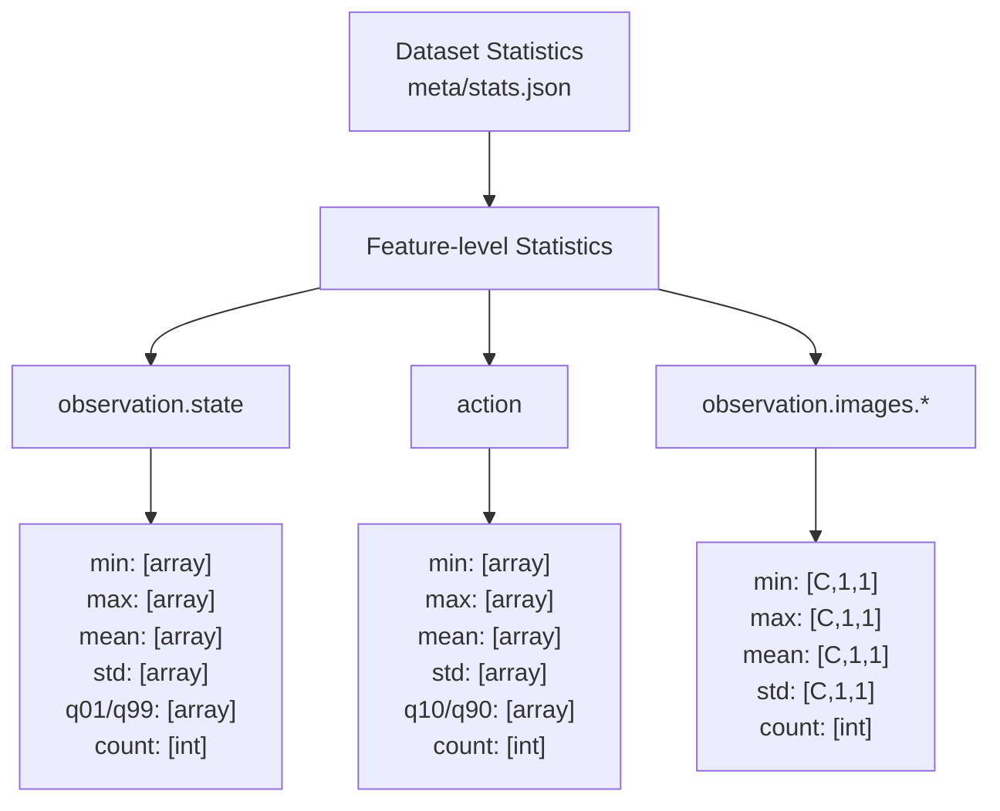
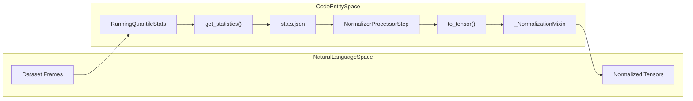

<!-- source: DeepWiki mcp.deepwiki.com · repo huggingface/lerobot · page 5.4 Normalization and Statistics · fetched 2026-10-26 -->

# Normalization and Statistics

Relevant source files

The following files were used as context for generating this wiki page:

- [docs/source/molmoact2.mdx](docs/source/molmoact2.mdx)
- [docs/source/pi0.mdx](docs/source/pi0.mdx)
- [docs/source/pi05.mdx](docs/source/pi05.mdx)
- [docs/source/pi0fast.mdx](docs/source/pi0fast.mdx)
- [docs/source/sarm.mdx](docs/source/sarm.mdx)
- [src/lerobot/configs/__init__.py](src/lerobot/configs/__init__.py)
- [src/lerobot/configs/video.py](src/lerobot/configs/video.py)
- [src/lerobot/datasets/aggregate.py](src/lerobot/datasets/aggregate.py)
- [src/lerobot/datasets/compute_stats.py](src/lerobot/datasets/compute_stats.py)
- [src/lerobot/datasets/depth_utils.py](src/lerobot/datasets/depth_utils.py)
- [src/lerobot/datasets/feature_utils.py](src/lerobot/datasets/feature_utils.py)
- [src/lerobot/datasets/image_writer.py](src/lerobot/datasets/image_writer.py)
- [src/lerobot/datasets/pipeline_features.py](src/lerobot/datasets/pipeline_features.py)
- [src/lerobot/processor/observation_processor.py](src/lerobot/processor/observation_processor.py)
- [src/lerobot/processor/tokenizer_processor.py](src/lerobot/processor/tokenizer_processor.py)
- [src/lerobot/scripts/augment_dataset_quantile_stats.py](src/lerobot/scripts/augment_dataset_quantile_stats.py)
- [tests/artifacts/policies/save_policy_to_safetensors.py](tests/artifacts/policies/save_policy_to_safetensors.py)
- [tests/datasets/test_aggregate.py](tests/datasets/test_aggregate.py)
- [tests/datasets/test_augment_quantile_stats.py](tests/datasets/test_augment_quantile_stats.py)
- [tests/datasets/test_compute_stats.py](tests/datasets/test_compute_stats.py)
- [tests/datasets/test_video_encoding.py](tests/datasets/test_video_encoding.py)
- [tests/fixtures/dataset_factories.py](tests/fixtures/dataset_factories.py)
- [tests/fixtures/hub.py](tests/fixtures/hub.py)
- [tests/policies/test_policies.py](tests/policies/test_policies.py)
- [tests/processor/test_batch_conversion.py](tests/processor/test_batch_conversion.py)
- [tests/processor/test_normalize_processor.py](tests/processor/test_normalize_processor.py)
- [tests/processor/test_observation_processor.py](tests/processor/test_observation_processor.py)
- [tests/processor/test_tokenizer_processor.py](tests/processor/test_tokenizer_processor.py)

This page details the dataset statistics computation, storage, and normalization architecture in LeRobot. Statistics are computed from datasets and used by processors to normalize observations and actions during training, and denormalize model outputs during inference [src/lerobot/processor/observation_processor.py:17-29]().

## Overview

Dataset statistics enable policies to train on numerically stable, scaled data. LeRobot computes per-feature statistics—such as min, max, mean, standard deviation, and quantiles—from training datasets and serializes them into the dataset metadata (`meta/stats.json`). During training, `NormalizerProcessorStep` transforms observations and actions into a normalized representation [src/lerobot/processor/observation_processor.py:206](). During evaluation or deployment, `UnnormalizerProcessorStep` maps model predictions back to the original physical action space [src/lerobot/processor/observation_processor.py:206]().

**Sources:** [src/lerobot/processor/observation_processor.py:39-90](), [src/lerobot/processor/observation_processor.py:17-29]()

## Statistics Structure

### Statistics Dictionary Format

*Figure 1: Hierarchical layout of dataset statistics stored in metadata.*

Each feature entry in the statistics dictionary contains several computed fields:
- **`min` / `max`**: Minimum and maximum observed values per dimension across all dataset frames [src/lerobot/datasets/compute_stats.py:130-131]().
- **`mean` / `std`**: Mean and standard deviation per dimension [src/lerobot/datasets/compute_stats.py:132-133]().
- **Quantiles (`q01`, `q10`, `q50`, `q90`, `q99`)**: Percentiles used for robust quantile-based scaling [src/lerobot/datasets/compute_stats.py:31-57]().
- **`count`**: Total number of samples evaluated for the feature [src/lerobot/datasets/compute_stats.py:134-134]().

For visual features (images/videos), statistics are computed per channel and reshaped to `(C, 1, 1)` to allow proper broadcasting during tensor normalization [src/lerobot/processor/observation_processor.py:139-154]().

**Sources:** [src/lerobot/processor/observation_processor.py:169-206](), [src/lerobot/datasets/compute_stats.py:31-57](), [tests/processor/test_observation_processor.py:117-128]()

## Statistics Computation, Storage, and Augmentation

### Data Flow and Code Mapping

*Figure 2: Data flow from raw dataset frames through incremental accumulation to processor normalization.*

Statistics management relies on several core classes and scripts:

1. **Incremental Accumulation**: `RunningQuantileStats` maintains running moments (mean, variance, min, max) and estimates quantiles using dynamically adjusting histograms [src/lerobot/datasets/compute_stats.py:34-57]().
2. **Histogram Binning**: When observed data ranges expand beyond initial boundaries, histogram bins are dynamically adjusted and redistributed without requiring all historical frames in memory [src/lerobot/datasets/compute_stats.py:143-166]().
3. **Serialization**: Computed statistics are written to `meta/stats.json` via utility functions like `write_stats` [src/lerobot/datasets/aggregate.py:40-40]().
4. **Quantile Augmentation**: For legacy datasets lacking quantile keys (`q01`, `q99`), the script `augment_dataset_quantile_stats.py` computes running-histogram global quantile estimates across all episodes [src/lerobot/scripts/augment_dataset_quantile_stats.py:17-39]().

**Sources:** [src/lerobot/datasets/compute_stats.py:34-182](), [src/lerobot/scripts/augment_dataset_quantile_stats.py:17-39](), [src/lerobot/datasets/aggregate.py:40-40]()

## Normalization Modes

### Supported Normalization Strategies

LeRobot defines multiple normalization modes in `NormalizationMode` [src/lerobot/configs/types.py:28-34](). These modes map to specific feature types inside the processing configuration [src/lerobot/processor/observation_processor.py:92-94]().

| Mode | Formula | Primary Use Case |
|------|---------|------------------|
| `MEAN_STD` | $\frac{x - \text{mean}}{\text{std} + \epsilon}$ | Default scaling for continuous states and actions [tests/processor/test_observation_processor.py:149]() |
| `MIN_MAX` | $2 \cdot \frac{x - \text{min}}{\text{max} - \text{min} + \epsilon} - 1$ | Rescales features to the $[-1, 1]$ interval [tests/processor/test_observation_processor.py:163]() |
| `QUANTILES` | $2 \cdot \frac{x - q_{01}}{q_{99} - q_{01} + \epsilon} - 1$ | Robust scaling using 1st and 99th percentiles [tests/processor/test_observation_processor.py:195]() |
| `QUANTILE10` | $2 \cdot \frac{x - q_{10}}{q_{90} - q_{10} + \epsilon} - 1$ | Robust scaling using 10th and 90th percentiles [tests/processor/test_observation_processor.py:212]() |

The `_NormalizationMixin` class executes these transformations using a numerical stability epsilon ($\epsilon = 10^{-8}$) [src/lerobot/processor/observation_processor.py:97-98]().

**Sources:** [src/lerobot/processor/observation_processor.py:92-98](), [tests/processor/test_observation_processor.py:138-215](), [src/lerobot/configs/types.py:28-34]()

## Implementation: Normalizer and Unnormalizer

Two primary processor steps inherit from `_NormalizationMixin` to handle normalization and inverse transformation:

### NormalizerProcessorStep
Executed during the **pre-processing** stage. It inspects transition structures and normalizes observation states and actions [src/lerobot/processor/observation_processor.py:206]().
- **Target Keys**: `TransitionKey.OBSERVATION` and `TransitionKey.ACTION` [src/lerobot/processor/observation_processor.py:206]().
- **Execution**: Iterates through features, queries the normalization mapping, and applies the selected formula using cached tensor statistics [src/lerobot/processor/observation_processor.py:206]().

### UnnormalizerProcessorStep
Executed during the **post-processing** stage during inference. It reverses policy action predictions back into physical robot control values [src/lerobot/processor/observation_processor.py:206]().
- **Target Keys**: `TransitionKey.ACTION` [src/lerobot/processor/observation_processor.py:206]().
- **Execution**: Applies inverse formulas (e.g., $x \cdot (\text{std} + \epsilon) + \text{mean}$) [src/lerobot/processor/observation_processor.py:206]().

**Sources:** [src/lerobot/processor/observation_processor.py:206](), [tests/processor/test_observation_processor.py:131-135]()

## Aggregation and Validation

When merging multiple datasets via `aggregate_datasets`, the aggregation pipeline validates and consolidates metadata:
- **Metadata Validation**: Confirms that frames per second (`fps`), `robot_type`, and feature structures match across all source datasets [src/lerobot/datasets/aggregate.py:123-157]().
- **Video Metadata Reconciliation**: Heterogeneous video encoder configurations (such as different CRF settings or presets) are compared field-by-field; conflicting attributes are set to `null` with a logged warning [src/lerobot/datasets/aggregate.py:79-120]().
- **Statistics Recomputation**: Combined dataset statistics are recomputed using `aggregate_stats` to ensure accurate global scaling [src/lerobot/datasets/aggregate.py:31-31]().

**Sources:** [src/lerobot/datasets/aggregate.py:79-157](), [src/lerobot/datasets/aggregate.py:31-31]()

## Summary Table: Code Entities

| System Entity | Class / Function Name | Module Path |
|---|---|---|
| Normalization Math & Tensors | `_NormalizationMixin` | [src/lerobot/processor/observation_processor.py:40-156]() |
| Incremental Statistics | `RunningQuantileStats` | [src/lerobot/datasets/compute_stats.py:31-132]() |
| Pre-Training Normalizer | `NormalizerProcessorStep` | [src/lerobot/processor/observation_processor.py:206]() |
| Post-Inference Unnormalizer | `UnnormalizerProcessorStep` | [src/lerobot/processor/observation_processor.py:206]() |
| Tensor Converter | `to_tensor` | [src/lerobot/processor/tokenizer_processor.py:31-35]() |
| Quantile Augmentation | `compute_quantile_stats_for_dataset` | [src/lerobot/scripts/augment_dataset_quantile_stats.py:150-188]() |

**Sources:** [src/lerobot/processor/observation_processor.py:40-206](), [src/lerobot/datasets/compute_stats.py:31-132](), [src/lerobot/processor/tokenizer_processor.py:31-35](), [src/lerobot/scripts/augment_dataset_quantile_stats.py:150-188]()

---

