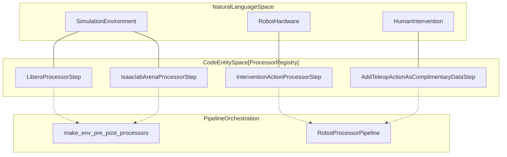
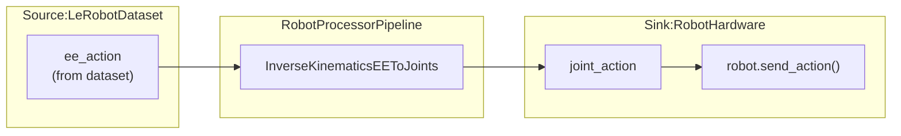

<!-- source: DeepWiki mcp.deepwiki.com · repo huggingface/lerobot · page 5.5 Environment-Specific Processors · fetched 2026-10-26 -->

# Environment-Specific Processors

Relevant source files

The following files were used as context for generating this wiki page:

- [docs/source/env_processor.mdx](docs/source/env_processor.mdx)
- [docs/source/feetech.mdx](docs/source/feetech.mdx)
- [docs/source/libero_plus.mdx](docs/source/libero_plus.mdx)
- [docs/source/phone_teleop.mdx](docs/source/phone_teleop.mdx)
- [docs/source/processors_robots_teleop.mdx](docs/source/processors_robots_teleop.mdx)
- [docs/source/rtc.mdx](docs/source/rtc.mdx)
- [src/lerobot/envs/configs.py](src/lerobot/envs/configs.py)
- [src/lerobot/envs/factory.py](src/lerobot/envs/factory.py)
- [src/lerobot/envs/libero.py](src/lerobot/envs/libero.py)
- [src/lerobot/envs/metaworld.py](src/lerobot/envs/metaworld.py)
- [src/lerobot/envs/utils.py](src/lerobot/envs/utils.py)
- [src/lerobot/policies/rtc/configuration_rtc.py](src/lerobot/policies/rtc/configuration_rtc.py)
- [src/lerobot/policies/rtc/modeling_rtc.py](src/lerobot/policies/rtc/modeling_rtc.py)
- [src/lerobot/processor/relative_action_processor.py](src/lerobot/processor/relative_action_processor.py)
- [src/lerobot/scripts/lerobot_eval.py](src/lerobot/scripts/lerobot_eval.py)
- [tests/envs/test_dispatch.py](tests/envs/test_dispatch.py)
- [tests/envs/test_freeze_after_episode_end.py](tests/envs/test_freeze_after_episode_end.py)
- [tests/policies/rtc/test_configuration_rtc.py](tests/policies/rtc/test_configuration_rtc.py)
- [tests/policies/rtc/test_modeling_rtc.py](tests/policies/rtc/test_modeling_rtc.py)
- [tests/policies/test_relative_actions.py](tests/policies/test_relative_actions.py)

This page details processor steps specialized for particular simulation environments, robot hardware, or human-in-the-loop (HIL) reinforcement learning workflows. These components handle the translation of raw environment observations into standardized formats before policy consumption, manage workspace bounds, coordinate inverse/forward kinematics, and inject human intervention signals.

**Scope:** This page covers `make_env_pre_post_processors`, environment-specific transformations (such as LIBERO conditioning, quaternion-to-axis-angle conversion, and 180-degree image rotations), `add_envs_task`, and robot/teleoperator processor pipelines.

---

## Overview

Simulation environments and physical hardware platforms emit observations in divergent schemas. For instance, a LIBERO environment returns nested dictionaries containing robot states and camera frames [src/lerobot/envs/libero.py:107-167](); an IsaacLab Arena simulation exposes structured `policy` and `camera_obs` tensors [src/lerobot/envs/utils.py:123-126](); and teleoperated robotic arms require workspace clamping and inverse kinematics solvers [docs/source/phone_teleop.mdx:109-116]().

Environment-specific processors reconcile these discrepancies by mapping raw inputs to the standard LeRobot keys (`observation.state`, `observation.images.<name>`) [src/lerobot/envs/utils.py:77-149]().

**Diagram: Bridge from Environment Space to Code Entity Space**

Sources: [src/lerobot/envs/factory.py:37-55](), [src/lerobot/processor/relative_action_processor.py:102-117](), [docs/source/phone_teleop.mdx:109-116]()

---

## Simulation Environment Processors

Simulation benchmarks require preprocessing to adapt simulator-native structures into training-ready transitions.

### `make_env_pre_post_processors` and Task Addition
**File:** [src/lerobot/envs/factory.py:37-55]()

The `make_env_pre_post_processors` factory orchestrates observation and action processors for environments. By default, it retrieves environment-specific processors via `env_cfg.get_env_processors()` [src/lerobot/envs/factory.py:55](). It also handles configuration overrides for multimodal architectures (such as `XVLAConfig`) which require specialized conditioning [src/lerobot/envs/factory.py:50-53]().

Additionally, utilities such as `add_envs_task` attach task descriptions or language conditioning strings to observation dicts, enabling language-conditioned imitation learning across vectorized environments.

### `LiberoProcessorStep`
**File:** [src/lerobot/processor/relative_action_processor.py:102-117]()
**Registry Name:** `"libero_processor"`

LIBERO environments return nested dictionaries with `robot_state` components and camera frames [src/lerobot/envs/libero.py:107-167](). `LiberoProcessorStep` applies the following transformations:

| Input Key | Transformation | Output Key |
|---|---|---|
| `agentview_image` / `robot0_eye_in_hand_image` | Rotated 180 degrees via `torch.flip(img, dims=[2, 3])` | `observation.images.<name>` |
| `robot_state` | Extract `eef.pos` (3D), `eef.quat` (4D), and `gripper.qpos` (2D). Convert quaternion to axis-angle | `observation.state` (8D vector) |

The quaternion-to-axis-angle conversion uses `_quat2axisangle`, which clamps scalar components and handles edge cases where the rotation angle approaches zero.

### `IsaaclabArenaProcessorStep`
**File:** [src/lerobot/envs/utils.py:123-126]()
**Registry Name:** `"isaaclab_arena_processor"`

This step parses observations from IsaacLab Arena environments:
- **State Extraction:** Collects specified keys from `observation["policy"]` based on `state_keys` and concatenates them into a flat state vector mapped to `observation.state` [src/lerobot/envs/utils.py:123-124]().
- **Image Processing:** Extracts image tensors from `observation["camera_obs"]` using `camera_keys`, converting uint8 tensors of shape `(B, H, W, C)` to float32 tensors of shape `(B, C, H, W)` normalized to `[0, 1]` [src/lerobot/envs/utils.py:126]().

Sources: [src/lerobot/envs/factory.py:37-55](), [src/lerobot/envs/libero.py:107-167](), [src/lerobot/envs/utils.py:123-126](), [src/lerobot/processor/relative_action_processor.py:102-117]()

---

## Processors for Robots and Teleoperators

When deploying policies on real hardware or replaying recorded datasets, inputs pass through kinematic solvers and workspace safety constraints.

**Diagram: Data Flow for Kinematics-Based Replay**

### Kinematic Processor Steps
- **`InverseKinematicsEEToJoints`**: Converts target End-Effector (EE) poses into joint position commands via numerical or analytical solvers [docs/source/processors_robots_teleop.mdx:49-55]().
- **`ForwardKinematicsJointsToEE`**: Maps raw joint configurations from the robot bus into task-space operational coordinates for the policy [docs/source/processors_robots_teleop.mdx:59-62]().
- **`EEReferenceAndDelta`**: Establishes reference poses upon teleoperation activation and computes relative operational space deltas [docs/source/phone_teleop.mdx:130-142]().
- **`EEBoundsAndSafety`**: Clamps end-effector commands to predefined workspace boundaries and filters out excessive step jumps [docs/source/phone_teleop.mdx:144-152]().

Sources: [docs/source/phone_teleop.mdx:130-152](), [docs/source/processors_robots_teleop.mdx:49-62]()

---

## Reinforcement Learning (HIL) Processors

In Human-in-the-Loop (HIL) workflows, processors mediate between autonomous policy actions, teleoperator inputs, and environment feedback.

### `InterventionActionProcessorStep`
Detects human intervention via teleoperator state flags and replaces policy actions with human demonstration inputs.

### `AddTeleopActionAsComplimentaryDataStep`
**File:** [src/lerobot/scripts/lerobot_eval.py:133-165]()
Registry Name: `"add_teleop_action_as_complementary_data"`
Retrieves raw teleoperator actions and injects them into transition metadata under the `teleop_action` key [src/lerobot/scripts/lerobot_eval.py:160-161]().

### `AddTeleopEventsAsInfoStep`
Extracts episode termination flags, success signals, and intervention markers from teleoperators conforming to the `HasTeleopEvents` protocol.

### `ImageCropResizeProcessorStep`
Applies configurable bounding-box crops and resizes across image observation keys while handling device placements (e.g., fallback for non-CPU-native accelerators).

Sources: [src/lerobot/scripts/lerobot_eval.py:133-165]()

---

## Step Registry Summary

| Registry Name | Class | Purpose |
|---|---|---|
| `"libero_processor"` | `LiberoProcessorStep` | LIBERO state flattening, quaternion conversion, and image rotation [tests/envs/test_dispatch.py:80]() |
| `"isaaclab_arena_processor"` | `IsaaclabArenaProcessorStep` | IsaacLab GPU observation mapping and tensor layout conversion |
| `"add_teleop_action_as_complementary_data"` | `AddTeleopActionAsComplimentaryDataStep` | Injects human teleop inputs into transition complementary data [src/lerobot/scripts/lerobot_eval.py:133]() |
| `"add_teleop_action_as_info"` | `AddTeleopEventsAsInfoStep` | Appends control events (`success`, `terminate`) to info dicts |
| `"image_crop_resize_processor"` | `ImageCropResizeProcessorStep` | Crops and resizes camera observation tensors |

Sources: [src/lerobot/scripts/lerobot_eval.py:133](), [tests/envs/test_dispatch.py:80]()

---

