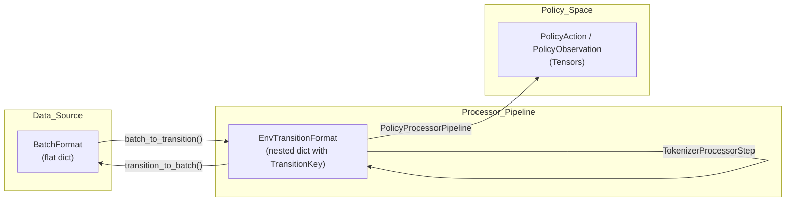
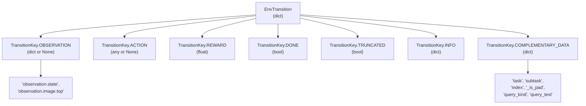

<!-- source: DeepWiki mcp.deepwiki.com · repo huggingface/lerobot · page 5.6 Batch and Transition Converters · fetched 2026-10-26 -->

# Batch and Transition Converters

Relevant source files

The following files were used as context for generating this wiki page:

- [docs/source/introduction_processors.mdx](docs/source/introduction_processors.mdx)
- [src/lerobot/processor/converters.py](src/lerobot/processor/converters.py)
- [src/lerobot/processor/observation_processor.py](src/lerobot/processor/observation_processor.py)
- [src/lerobot/processor/render_messages_processor.py](src/lerobot/processor/render_messages_processor.py)
- [src/lerobot/processor/tokenizer_processor.py](src/lerobot/processor/tokenizer_processor.py)
- [tests/artifacts/policies/save_policy_to_safetensors.py](tests/artifacts/policies/save_policy_to_safetensors.py)
- [tests/policies/test_policies.py](tests/policies/test_policies.py)
- [tests/processor/test_batch_conversion.py](tests/processor/test_batch_conversion.py)
- [tests/processor/test_converters.py](tests/processor/test_converters.py)
- [tests/processor/test_normalize_processor.py](tests/processor/test_normalize_processor.py)
- [tests/processor/test_observation_processor.py](tests/processor/test_observation_processor.py)
- [tests/processor/test_tokenizer_processor.py](tests/processor/test_tokenizer_processor.py)

## Purpose and Scope

This page documents the converter functions, collation utilities, and specialized processors that transform data between different formats used throughout LeRobot's data processing pipeline. These converters bridge key data representations: the **Batch Format** (flat dictionaries used in datasets and gym environments), the **EnvTransition Format** (structured dictionaries used in processor pipelines), policy-specific input formats (including tokenized language instructions and DCT-compressed action sequences), and collated batches for language-conditioned models.

These converters ensure that data remains consistent as it flows from a `LeRobotDataset` through a `DataProcessorPipeline` to a `PreTrainedPolicy`, and finally to a `Robot` or `gym.Env`.

Sources: [src/lerobot/processor/converters.py:1-214](), [src/lerobot/processor/tokenizer_processor.py:17-46](), [docs/source/introduction_processors.mdx:55-70]()

---

## Data Format Overview

LeRobot uses several distinct data formats for different stages of the robotics pipeline:

| Format | Structure | Primary Use Case | Example Keys |
|--------|-----------|------------------|--------------|
| **Batch** | Flat dictionary | Dataset items, environment steps | `"observation.state"`, `"action"`, `"next.reward"` |
| **EnvTransition** | Nested dictionary with `TransitionKey` enum | Processor pipeline internal format | `TransitionKey.OBSERVATION`, `TransitionKey.ACTION` |
| **RobotObservation** | TypedDict (flat) | Raw hardware feedback | `"observation.state"`, `"observation.image.cam_high"` |
| **PolicyAction** | Tensor or Dict | Policy output | `torch.Tensor` (chunk of actions) |

### Data Format Transformation Flow
Title: "Data Format Transformation Flow"

Sources: [src/lerobot/processor/converters.py:217-273](), [src/lerobot/processor/tokenizer_processor.py:56-119](), [docs/source/introduction_processors.mdx:55-70]()

---

## EnvTransition Structure

An `EnvTransition` is a dictionary where keys are members of the `TransitionKey` enum. This format is the standard for the `DataProcessorPipeline`.

### TransitionKey Enum

The `TransitionKey` enum (defined in `lerobot.lerobot_types`) standardizes access to transition components:
- `OBSERVATION`: Typically a dictionary of sensors/images.
- `ACTION`: The control signal.
- `REWARD`: Scalar feedback.
- `DONE` / `TRUNCATED`: Episode termination flags.
- `INFO`: Metadata dictionary.
- `COMPLEMENTARY_DATA`: Pipeline-specific state (e.g., padding flags, task indices, language strings, or text-generation queries).

### EnvTransition Entity Mapping
Title: "EnvTransition Entity Mapping"

Sources: [src/lerobot/processor/converters.py:166-214](), [src/lerobot/utils/constants.py:45-50]()

---

## Core Converter Functions

### batch_to_transition()

Converts a flat Batch dictionary (as returned by `LeRobotDataset.__getitem__`) to a structured `EnvTransition`.

**Transformation Logic:**
1. **Observation Grouping**: All keys starting with `"observation."` (defined by `OBS_PREFIX`) are grouped into a nested dictionary under `TransitionKey.OBSERVATION` [src/lerobot/processor/converters.py:276-280]().
2. **Action/Reward/Done**: Maps `"action"`, `"reward"`, `"done"`, and `"truncated"` to their respective `TransitionKey` entries [src/lerobot/processor/converters.py:281-284]().
3. **Complementary Data**: Extracts metadata such as `"task"`, `"subtask"`, `"index"`, and padding flags (`"_is_pad"`) into `TransitionKey.COMPLEMENTARY_DATA` via `_extract_complementary_data` [src/lerobot/processor/converters.py:191-200]().

### transition_to_batch()

The inverse of `batch_to_transition`. It flattens an `EnvTransition` back into a dictionary suitable for environment steps or dataset storage.

**Transformation Logic:**
1. **Flattening**: The `OBSERVATION` and `COMPLEMENTARY_DATA` sub-dictionaries are unpacked to the top level [src/lerobot/processor/converters.py:320-321]().
2. **Standard Keys**: `ACTION`, `REWARD`, `DONE`, and `TRUNCATED` are mapped back to their string literal equivalents (e.g., `"action"`, `"reward"`) [src/lerobot/processor/converters.py:316-319]().

Sources: [src/lerobot/processor/converters.py:185-214](), [tests/processor/test_batch_conversion.py:64-140]()

---

## Tokenizer Processors and Language Conditioning

For language-conditioned and vision-language-action (VLA) policies, specialized processor steps handle tokenization and recipe rendering.

### TokenizerProcessorStep

This step extracts task descriptions from `complementary_data` and uses a Hugging Face `transformers` tokenizer to produce token IDs and attention masks.

- **Task Extraction**: It looks for a `task` key (configurable via `task_key`) in `complementary_data` [src/lerobot/processor/tokenizer_processor.py:120-145]().
- **Subtask Extraction**: Optionally extracts a `subtask` string for multi-stage tasks [src/lerobot/processor/tokenizer_processor.py:146-171]().
- **Tokenization**: Uses `AutoTokenizer` from the `transformers` library to convert strings into `input_ids` and `attention_mask` [src/lerobot/processor/tokenizer_processor.py:107-118]() [tests/processor/test_tokenizer_processor.py:145-177]().
- **Observation Update**: The resulting tensors are added to the `observation` dictionary using keys like `observation.language.tokens` [src/lerobot/processor/tokenizer_processor.py:35-43]() [tests/processor/test_tokenizer_processor.py:164-177]().

### ActionTokenizerProcessorStep

Used in policies like π₀-FAST, this step tokenizes continuous actions into discrete tokens, often utilizing Frequency-space Action Sequence Tokenization (FAST).

- **Action Tokenization**: Converts `TransitionKey.ACTION` into discrete token sequences [src/lerobot/processor/tokenizer_processor.py:400-401]().
- **Truncation Check**: Can reject sequences that exceed `max_action_tokens` if `allow_truncation` is false [tests/processor/test_tokenizer_processor.py:117-135]().

### RenderTrainingMessagesStep

The `RenderTrainingMessagesStep` processor step resolves training recipes against per-frame language annotations (`language_persistent` and `language_events`), emitting chat messages, message streams, and target message indices into complementary data [src/lerobot/processor/render_messages_processor.py:42-44]().

Sources: [src/lerobot/processor/tokenizer_processor.py:58-172](), [src/lerobot/processor/render_messages_processor.py:1-50](), [tests/processor/test_tokenizer_processor.py:117-177]()

---

## Collation for Language-Conditioned Policies (`lerobot_collate_fn`)

When training language-conditioned policies, standard PyTorch collation (`default_collate`) fails on string data, list structures, and chat message dicts. LeRobot provides `lerobot_collate_fn` to handle language batches.

### Collation Behavior

- **Drop None Samples**: Samples where recipes yielded no target message (returning `None`) are filtered out [src/lerobot/processor/render_messages_processor.py:126-127](). If an entire batch is `None`, the function returns `None`.
- **Preserve Python Lists**: Fields like `messages_rendered`, `message_streams`, `target_message_indices`, `language_persistent`, and `language_events` are maintained as plain Python lists across the batch rather than being stacked into tensors [src/lerobot/processor/converters.py:172-188]().
- **Default Collation**: All remaining tensorizable keys delegate to PyTorch's `default_collate`.

Sources: [src/lerobot/processor/converters.py:172-188](), [src/lerobot/processor/render_messages_processor.py:126-127]()

---

## Unified Tensor Conversion

The `to_tensor()` utility is a core helper used by many converters and processors to ensure data is in the correct format for PyTorch models.

### to_tensor()

A unified function using `singledispatch` to handle various input types:

- **`torch.Tensor`**: Performs dtype and device casting [src/lerobot/processor/converters.py:74-81]().
- **`np.ndarray`**: Converts to tensor, handling 0-dimensional scalars (converted to 0-dim tensors) [src/lerobot/processor/converters.py:84-107]().
- **`dict`**: Recursively traverses and converts all values, filtering out `None` entries [src/lerobot/processor/converters.py:127-153]().
- **`list` / `tuple`**: Standard sequence conversion [src/lerobot/processor/converters.py:120-125]().

Sources: [src/lerobot/processor/converters.py:40-153](), [tests/processor/test_converters.py:31-159]()

---

## RL Buffer Batch Transition

In Reinforcement Learning contexts, a specific batch structure is used for replay buffers to support algorithms like SAC or TDMPC, maintaining state, action, reward, and next observation mappings.

Sources: [src/lerobot/processor/converters.py:185-214]()

---

