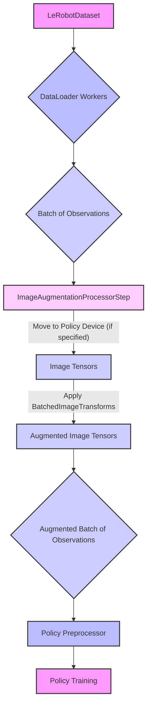

<!-- source: DeepWiki mcp.deepwiki.com · repo huggingface/lerobot · page 5.7 Image Transforms and Augmentation · fetched 2026-10-26 -->

# Image Transforms and Augmentation

<details>
<summary>Relevant source files</summary>

The following files were used as context for generating this wiki page:

- [docs/source/lerobot-dataset-v3.mdx](docs/source/lerobot-dataset-v3.mdx)
- [src/lerobot/processor/__init__.py](src/lerobot/processor/__init__.py)
- [src/lerobot/processor/image_augmentation_processor.py](src/lerobot/processor/image_augmentation_processor.py)
- [src/lerobot/scripts/lerobot_imgtransform_viz.py](src/lerobot/scripts/lerobot_imgtransform_viz.py)
- [src/lerobot/transforms/__init__.py](src/lerobot/transforms/__init__.py)
- [src/lerobot/transforms/deprecated.py](src/lerobot/transforms/deprecated.py)
- [src/lerobot/transforms/transforms.py](src/lerobot/transforms/transforms.py)
- [tests/artifacts/image_transforms/default_transforms.safetensors](tests/artifacts/image_transforms/default_transforms.safetensors)
- [tests/artifacts/image_transforms/save_image_transforms_to_safetensors.py](tests/artifacts/image_transforms/save_image_transforms_to_safetensors.py)
- [tests/datasets/test_image_transforms.py](tests/datasets/test_image_transforms.py)

</details>


This page details the image transformation and augmentation capabilities within LeRobot, focusing on the `src/lerobot/transforms` module. It covers how image transform configurations are defined, the application of random subsets of transforms, the deprecated API, the `ImageAugmentationProcessorStep` for GPU-accelerated augmentation, and the `lerobot-imgtransform-viz` script for visualization.

## Image Transform Configurations

Image transformations are configured using `ImageTransformConfig` and `ImageTransformsConfig` classes [src/lerobot/transforms/transforms.py:43-46](). These dataclasses allow for specifying the type of transform and its parameters.

- `ImageTransformConfig`: Defines a single image transform, including its `type` (e.g., "ColorJitter", "RandomAffine") and `kwargs` (parameters for the transform) [src/lerobot/transforms/transforms.py:43-46]().
- `ImageTransformsConfig`: Manages a collection of `ImageTransformConfig` instances. It includes settings like `enable` (to activate/deactivate transforms), `max_num_transforms` (maximum number of transforms to apply), and a dictionary `tfs` mapping transform names to their `ImageTransformConfig` [src/lerobot/transforms/transforms.py:43-46]().

The `ImageTransforms` class [src/lerobot/transforms/transforms.py:43-46]() is the primary entry point for applying these configurations. It takes an `ImageTransformsConfig` and applies the specified transformations to input image tensors.

Sources:
- [src/lerobot/transforms/transforms.py:43-46]()

## Batched Image Transforms

LeRobot's image transforms are designed to operate efficiently on batches of images. The core idea is that every transform applies to a whole batch at once, with independent random parameters for each sample within the batch [src/lerobot/transforms/transforms.py:111-131](). This design allows for GPU acceleration and consistent behavior whether applied in a dataloader worker or directly on the policy device.

All batched transforms consume float frames in the range `[0, 1]` with a shape of `(B, N, C, H, W)`, where `B` is the batch size, `N` is the number of frames per sample (e.g., observation history), `C` is the number of channels (1 or 3), and `H`, `W` are height and width [src/lerobot/transforms/transforms.py:111-131]().

Key batched transform classes include:
- `BatchedCoarseDropout` [src/lerobot/transforms/__init__.py:28]()
- `BatchedGammaCorrection` [src/lerobot/transforms/__init__.py:30]()
- `BatchedGaussianNoise` [src/lerobot/transforms/__init__.py:31]()
- `BatchedGaussianPatchBrightness` [src/lerobot/transforms/__init__.py:32]()
- `BatchedMotionBlur` [src/lerobot/transforms/__init__.py:34]()
- `BatchedPlanckianJitter` [src/lerobot/transforms/__init__.py:35]()
- `BatchedRandomAffine` [src/lerobot/transforms/__init__.py:37]()
- `BatchedRandomShadow` [src/lerobot/transforms/__init__.py:39]()
- `BatchedSharpnessJitter` [src/lerobot/transforms/__init__.py:41]()
- `JPEGCompression` [src/lerobot/transforms/__init__.py:46]()

The `make_batched_transform_from_config` function [src/lerobot/transforms/__init__.py:48]() is used to instantiate these batched transforms from an `ImageTransformConfig`.

### Random Subset Application

The `BatchedRandomSubsetApply` class [src/lerobot/transforms/__init__.py:40]() allows for applying a random subset of configured transforms. This is crucial for data augmentation strategies where not all transforms should be applied to every image, or where the order of application should be randomized. It can take a sequence of transforms, optional sampling weights (`p`), and specify how many transforms to apply (`n_subset`) [src/lerobot/transforms/deprecated.py:160-175]().

Sources:
- [src/lerobot/transforms/__init__.py:28]()
- [src/lerobot/transforms/__init__.py:30]()
- [src/lerobot/transforms/__init__.py:31]()
- [src/lerobot/transforms/__init__.py:32]()
- [src/lerobot/transforms/__init__.py:34]()
- [src/lerobot/transforms/__init__.py:35]()
- [src/lerobot/transforms/__init__.py:37]()
- [src/lerobot/transforms/__init__.py:39]()
- [src/lerobot/transforms/__init__.py:40]()
- [src/lerobot/transforms/__init__.py:41]()
- [src/lerobot/transforms/__init__.py:46]()
- [src/lerobot/transforms/__init__.py:48]()
- [src/lerobot/transforms/deprecated.py:160-175]()
- [src/lerobot/transforms/transforms.py:111-131]()

## Deprecated API

The `src/lerobot/transforms/deprecated.py` module contains deprecated per-sample transform names [src/lerobot/transforms/deprecated.py:14-15](). These were part of the public API in `v0.6.1` and are kept as thin front ends over their batched replacements for one release cycle to ensure backward compatibility. They issue a `FutureWarning` when used, advising to use the `Batched` versions instead [src/lerobot/transforms/deprecated.py:50-58]().

For example, `SharpnessJitter` is deprecated in favor of `BatchedSharpnessJitter` [src/lerobot/transforms/deprecated.py:112-115](). These deprecated classes internally wrap the new batched transforms using the `_OneSample` helper class, which handles adding and removing the batch dimension and converting data types to match the batched transform's expectations [src/lerobot/transforms/deprecated.py:61-99]().

Sources:
- [src/lerobot/transforms/deprecated.py:14-15]()
- [src/lerobot/transforms/deprecated.py:50-58]()
- [src/lerobot/transforms/deprecated.py:61-99]()
- [src/lerobot/transforms/deprecated.py:112-115]()

## `ImageAugmentationProcessorStep`

The `ImageAugmentationProcessorStep` [src/lerobot/processor/image_augmentation_processor.py:47]() is a key component for applying image augmentations during training, especially when `image_transforms.backend="gpu"`. This processor step is designed to run on the policy device, applying augmentations to each training batch before it reaches the policy preprocessor [src/lerobot/processor/image_augmentation_processor.py:17-22](). This offloads augmentation from dataloader workers, allowing them to focus on decoding, and ensures augmentations are performed efficiently on the GPU.

### Configuration and Usage

The `ImageAugmentationProcessorStep` is configured with an `ImageTransformsConfig` (or a dictionary that can be converted to one) [src/lerobot/processor/image_augmentation_processor.py:68](). It can specify `image_keys` to augment, the `device` to perform transformations on (e.g., "cuda"), a `chunk_size` to manage memory usage, whether to `compile_model` with `torch.compile`, and a `seed` for reproducibility [src/lerobot/processor/image_augmentation_processor.py:69-74]().

The `__post_init__` method initializes a `BatchedImageTransforms` instance based on the provided configuration [src/lerobot/processor/image_augmentation_processor.py:76-79](). It also sets up a `torch.Generator` specific to the step, ensuring that random draws for augmentation are reproducible and do not interfere with other random processes in the policy [src/lerobot/processor/image_augmentation_processor.py:80-81]().

### Data Flow

When the `observation` method is called [src/lerobot/processor/image_augmentation_processor.py:98](), it iterates through the selected image keys in the input `observation` dictionary. For each image tensor, it optionally moves it to the specified device and then applies the `_transforms` (the `BatchedImageTransforms` instance) using the step's dedicated `generator` [src/lerobot/processor/image_augmentation_processor.py:108-116]().

The `transform_features` method [src/lerobot/processor/image_augmentation_processor.py:131]() indicates that image augmentation does not change the shape or type of the features.

The following diagram illustrates the data flow for image augmentation during training:


**Diagram: Image Augmentation Data Flow**

Sources:
- [src/lerobot/processor/image_augmentation_processor.py:17-22]()
- [src/lerobot/processor/image_augmentation_processor.py:47]()
- [src/lerobot/processor/image_augmentation_processor.py:68]()
- [src/lerobot/processor/image_augmentation_processor.py:69-74]()
- [src/lerobot/processor/image_augmentation_processor.py:76-79]()
- [src/lerobot/processor/image_augmentation_processor.py:80-81]()
- [src/lerobot/processor/image_augmentation_processor.py:98]()
- [src/lerobot/processor/image_augmentation_processor.py:108-116]()
- [src/lerobot/processor/image_augmentation_processor.py:131]()

## `lerobot-imgtransform-viz`

The `lerobot-imgtransform-viz` script [src/lerobot/scripts/lerobot_imgtransform_viz.py:16]() is a command-line tool designed to visualize the effects of image transforms for a given configuration. It generates examples of transformed images, showing how they would appear when output by the LeRobot dataset [src/lerobot/scripts/lerobot_imgtransform_viz.py:17-18]().

### Usage

The script can be run from the command line, specifying a dataset `repo_id`, episodes, and image transform configurations.

```bash
lerobot-imgtransform-viz \
  --repo_id=lerobot/pusht \
  --episodes='[0]' \
  --image_transforms.enable=True
```

This command will generate output images in `outputs/image_transforms` [src/lerobot/scripts/lerobot_imgtransform_viz.py:33]().

### Functionality

The `visualize_image_transforms` function [src/lerobot/scripts/lerobot_imgtransform_viz.py:112]() is the main entry point. It performs the following steps:
1. **Loads a `LeRobotDataset`**: It initializes a `LeRobotDataset` based on the provided `repo_id`, `episodes`, and other dataset configurations [src/lerobot/scripts/lerobot_imgtransform_viz.py:113-118]().
2. **Saves the original frame**: It extracts the first frame from the first camera of the first episode and saves it as `original_frame.png` [src/lerobot/scripts/lerobot_imgtransform_viz.py:123-125]().
3. **Saves all transforms**: The `save_all_transforms` function [src/lerobot/scripts/lerobot_imgtransform_viz.py:52]() applies the entire `ImageTransformsConfig` to the original frame multiple times (controlled by `n_examples`) and saves the resulting images. This demonstrates the combined effect of the configured augmentations.
4. **Saves each transform individually**: The `save_each_transform` function [src/lerobot/scripts/lerobot_imgtransform_viz.py:66]() iterates through each individual transform defined in the `ImageTransformsConfig`. For each transform, it applies it in isolation to the original frame, generating `n_examples` of random applications, as well as applications with minimum, maximum, and average parameter values [src/lerobot/scripts/lerobot_imgtransform_viz.py:75-107](). This helps in understanding the effect of each specific augmentation.

The `_single_transform` helper function [src/lerobot/scripts/lerobot_imgtransform_viz.py:47]() is used to create an `ImageTransforms` instance that applies only a single specified transform.

```mermaid
graph TD
    A[lerobot-imgtransform-viz CLI] --> B{visualize_image_transforms(cfg)};
    B --> C[LeRobotDataset(repo_id, ...)];
    C --> D[Get original_frame];
    D --> E[Save original_frame.png];
    E --> F{save_all_transforms(cfg.image_transforms, original_frame, ...)};
    F --> G[Generate N combined transformed images];
    G --> H[Save combined images to outputs/image_transforms/all/];
    E --> I{save_each_transform(cfg.image_transforms, original_frame, ...)};
    I --> J[For each tf_name, tf_cfg in cfg.image_transforms.tfs];
    J --> K[Generate N random applications of tf_cfg];
    J --> L[Generate min, max, mean applications of tf_cfg];
    K --> M[Save images to outputs/image_transforms/tf_name/];
    L --> M;

    style A fill:#f9f,stroke:#333,stroke-width:2px;
    style B fill:#bbf,stroke:#333,stroke-width:2px;
    style C fill:#ccf,stroke:#333,stroke-width:2px;
    style D fill:#ccf,stroke:#333,stroke-width:2px;
    style E fill:#ccf,stroke:#333,stroke-width:2px;
    style F fill:#fcf,stroke:#333,stroke-width:2px;
    style G fill:#ccf,stroke:#333,stroke-width:2px;
    style H fill:#ccf,stroke:#333,stroke-width:2px;
    style I fill:#fcf,stroke:#333,stroke-width:2px;
    style J fill:#bbf,stroke:#333,stroke-width:2px;
    style K fill:#ccf,stroke:#333,stroke-width:2px;
    style L fill:#ccf,stroke:#333,stroke-width:2px;
    style M fill:#ccf,stroke:#333,stroke-width:2px;
```
**Diagram: `lerobot-imgtransform-viz` Workflow**

Sources:
- [src/lerobot/scripts/lerobot_imgtransform_viz.py:16]()
- [src/lerobot/scripts/lerobot_imgtransform_viz.py:17-18]()
- [src/lerobot/scripts/lerobot_imgtransform_viz.py:33]()
- [src/lerobot/scripts/lerobot_imgtransform_viz.py:47]()
- [src/lerobot/scripts/lerobot_imgtransform_viz.py:52]()
- [src/lerobot/scripts/lerobot_imgtransform_viz.py:66]()
- [src/lerobot/scripts/lerobot_imgtransform_viz.py:75-107]()
- [src/lerobot/scripts/lerobot_imgtransform_viz.py:112]()
- [src/lerobot/scripts/lerobot_imgtransform_viz.py:113-118]()
- [src/lerobot/scripts/lerobot_imgtransform_viz.py:123-125]()

---

