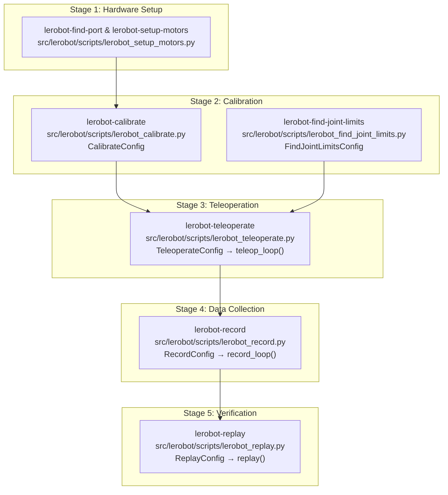
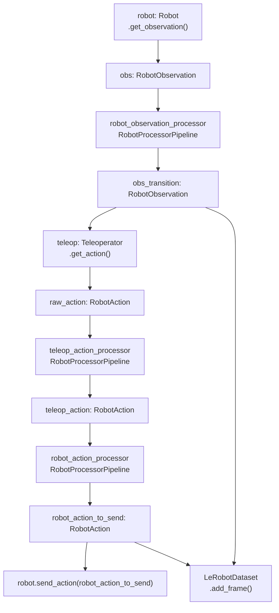

<!-- source: DeepWiki mcp.deepwiki.com · repo huggingface/lerobot · page 6 Robot Hardware Integration · fetched 2026-10-26 -->

# Robot Hardware Integration

<details>
<summary>Relevant source files</summary>

The following files were used as context for generating this wiki page:

- [docs/source/act.mdx](docs/source/act.mdx)
- [docs/source/earthrover_mini_plus.mdx](docs/source/earthrover_mini_plus.mdx)
- [docs/source/groot.mdx](docs/source/groot.mdx)
- [docs/source/hope_jr.mdx](docs/source/hope_jr.mdx)
- [docs/source/il_robots.mdx](docs/source/il_robots.mdx)
- [docs/source/reachy2.mdx](docs/source/reachy2.mdx)
- [docs/source/smolvla.mdx](docs/source/smolvla.mdx)
- [docs/source/streaming_video_encoding.mdx](docs/source/streaming_video_encoding.mdx)
- [src/lerobot/cameras/__init__.py](src/lerobot/cameras/__init__.py)
- [src/lerobot/cameras/camera.py](src/lerobot/cameras/camera.py)
- [src/lerobot/robots/earthrover_mini_plus/robot_earthrover_mini_plus.py](src/lerobot/robots/earthrover_mini_plus/robot_earthrover_mini_plus.py)
- [src/lerobot/robots/hope_jr/hope_jr_arm.py](src/lerobot/robots/hope_jr/hope_jr_arm.py)
- [src/lerobot/robots/hope_jr/hope_jr_hand.py](src/lerobot/robots/hope_jr/hope_jr_hand.py)
- [src/lerobot/robots/koch_follower/koch_follower.py](src/lerobot/robots/koch_follower/koch_follower.py)
- [src/lerobot/robots/lekiwi/config_lekiwi.py](src/lerobot/robots/lekiwi/config_lekiwi.py)
- [src/lerobot/robots/lekiwi/lekiwi.py](src/lerobot/robots/lekiwi/lekiwi.py)
- [src/lerobot/robots/lekiwi/lekiwi_client.py](src/lerobot/robots/lekiwi/lekiwi_client.py)
- [src/lerobot/robots/lekiwi/lekiwi_host.py](src/lerobot/robots/lekiwi/lekiwi_host.py)
- [src/lerobot/robots/omx_follower/omx_follower.py](src/lerobot/robots/omx_follower/omx_follower.py)
- [src/lerobot/robots/openarm_follower/openarm_follower.py](src/lerobot/robots/openarm_follower/openarm_follower.py)
- [src/lerobot/robots/so_follower/so_follower.py](src/lerobot/robots/so_follower/so_follower.py)
- [src/lerobot/teleoperators/keyboard/teleop_keyboard.py](src/lerobot/teleoperators/keyboard/teleop_keyboard.py)
- [tests/robots/test_so100_follower.py](tests/robots/test_so100_follower.py)

</details>


This page introduces the robot hardware integration system in LeRobot, detailing the hardware abstraction layers, supported platforms, configuration patterns, and the operational workflow spanning calibration, teleoperation, data collection, and deployment.

For comprehensive details on individual sub-systems, refer to the child pages:
- Abstract interfaces and factory functions: [Robot and Teleoperator Abstraction](#6.1)
- Full hardware catalog and optional extras: [Supported Hardware](#6.2)
- Dataclass-based configuration: [Configuration System](#6.3)
- Calibration workflow: [Calibration and Setup](#6.4)
- Live teleoperation: [Teleoperation](#6.5)
- Dataset recording: [Recording Episodes](#6.6)
- Episode replay: [Replay and Verification](#6.7)
- Inverse kinematics and control modes: [End-Effector Control and Kinematics](#6.8)
- Unitree G1 humanoid specifics: [Unitree G1 Integration](#6.9)
- Camera implementations: [Camera Systems](#6.10)
- Motor bus implementations: [Motor Systems](#6.11)
- Deployment strategies (Sentry, Highlight, DAgger): [Policy Deployment and Rollout Strategies](#6.12)
- Network-connected mobile robots (Host/Client): [Distributed Robots: LeKiwi Host/Client](#6.13)

---

## Architecture Overview

The hardware layer is organized around abstract base classes that define standard interface contracts (`connect`, `disconnect`, `calibrate`, `get_observation`, `send_action`, `get_action`). These compose upward into specific robot and teleoperator implementations, which integrate with motor buses and camera streams.

**Hardware Abstraction Hierarchy**

```mermaid
classDiagram
    class Robot {
        <<abstract>>
        +connect(calibrate)
        +disconnect()
        +calibrate()
        +get_observation() RobotObservation
        +send_action(action) RobotAction
        +is_connected bool
        +name str
        +robot_type str
        +observation_features dict
        +action_features dict
    }

    class Teleoperator {
        <<abstract>>
        +connect(calibrate)
        +disconnect()
        +calibrate()
        +get_action() RobotAction
        +send_feedback(feedback)
        +is_connected bool
    }

    class Camera {
        <<abstract>>
        +connect()
        +disconnect()
        +read()
    }

    Robot <|-- "SO100Follower\nsrc/lerobot/robots/so_follower/so_follower.py"
    Robot <|-- "SO101Follower\nsrc/lerobot/robots/so_follower/so_follower.py"
    Robot <|-- "KochFollower\nsrc/lerobot/robots/koch_follower/koch_follower.py"
    Robot <|-- "LeKiwi\nsrc/lerobot/robots/lekiwi/lekiwi.py"
    Robot <|-- "OpenArmFollower\nsrc/lerobot/robots/openarm_follower/openarm_follower.py"
    Robot <|-- "BiSOFollower\nsrc/lerobot/robots/bi_so_follower.py"
    Robot <|-- "Reachy2Robot\nsrc/lerobot/robots/reachy2.py"
    Robot <|-- "UnitreeG1Robot\nsrc/lerobot/robots/unitree_g1.py"
    Robot <|-- "RebotB601Follower\nsrc/lerobot/robots/rebot_b601_follower.py"
    Robot <|-- "EarthRoverMiniPlus\nsrc/lerobot/robots/earthrover_mini_plus/robot_earthrover_mini_plus.py"

    Teleoperator <|-- "SO100Leader\nsrc/lerobot/teleoperators/so_leader.py"
    Teleoperator <|-- "KeyboardTeleop\nsrc/lerobot/teleoperators/keyboard/teleop_keyboard.py"
    Teleoperator <|-- "GamepadTeleop\nsrc/lerobot/teleoperators/gamepad.py"
    Teleoperator <|-- "OpenArmLeader\nsrc/lerobot/teleoperators/openarm_leader.py"
    Teleoperator <|-- "UnitreeG1Teleoperator\nsrc/lerobot/teleoperators/unitree_g1.py"
    Teleoperator <|-- "RebotArm102Leader\nsrc/lerobot/teleoperators/rebot_102_leader.py"
    Teleoperator <|-- "KeyboardRoverTeleop\nsrc/lerobot/teleoperators/keyboard/teleop_keyboard.py"

    "SO100Follower\nsrc/lerobot/robots/so_follower/so_follower.py" --> "FeetechMotorsBus\nsrc/lerobot/motors/feetech/feetech.py"
    "SO100Follower\nsrc/lerobot/robots/so_follower/so_follower.py" --> "OpenCVCamera\nsrc/lerobot/cameras/opencv.py"
    "LeKiwi\nsrc/lerobot/robots/lekiwi/lekiwi.py" --> "FeetechMotorsBus\nsrc/lerobot/motors/feetech/feetech.py"
    "LeKiwi\nsrc/lerobot/robots/lekiwi/lekiwi.py" --> "OpenCVCamera\nsrc/lerobot/cameras/opencv.py"
    "OpenArmFollower\nsrc/lerobot/robots/openarm_follower/openarm_follower.py" --> "DamiaoMotorsBus\nsrc/lerobot/motors/damiao.py"
    "EarthRoverMiniPlus\nsrc/lerobot/robots/earthrover_mini_plus/robot_earthrover_mini_plus.py" --> "Frodobots SDK"
```

Sources: [src/lerobot/robots/robot.py:30-189](), [src/lerobot/teleoperators/teleoperator.py:29-195](), [src/lerobot/robots/utils.py:27-90](), [src/lerobot/teleoperators/utils.py:36-118](), [src/lerobot/robots/so_follower/so_follower.py:58-82](), [src/lerobot/robots/lekiwi/lekiwi.py:55-81](), [src/lerobot/robots/openarm_follower/openarm_follower.py:53-71](), [src/lerobot/robots/earthrover_mini_plus/robot_earthrover_mini_plus.py:95-118]()

---

## Supported Hardware at a Glance

LeRobot supports a wide array of robotic arms, mobile platforms, humanoids, and teleoperation interfaces. Devices are instantiated via factory functions using configuration type strings.

### Robots (`make_robot_from_config`)

| `config.type` string | Class | Module |
|---|---|---|
| `so100_follower` | `SO100Follower` | `src/lerobot/robots/so_follower/so_follower.py` |
| `so101_follower` | `SO101Follower` | `src/lerobot/robots/so_follower/so_follower.py` |
| `koch_follower` | `KochFollower` | `src/lerobot/robots/koch_follower/koch_follower.py` |
| `omx_follower` | `OmxFollower` | `src/lerobot/robots/omx_follower/omx_follower.py` |
| `lekiwi` | `LeKiwi` | `src/lerobot/robots/lekiwi/lekiwi.py` |
| `lekiwi_client` | `LeKiwiClient` | `src/lerobot/robots/lekiwi/lekiwi_client.py` |
| `bi_so_follower` | `BiSOFollower` | `src/lerobot/robots/bi_so_follower.py` |
| `hope_jr_hand` | `HopeJrHand` | `src/lerobot/robots/hope_jr/hope_jr_hand.py` |
| `hope_jr_arm` | `HopeJrArm` | `src/lerobot/robots/hope_jr/hope_jr_arm.py` |
| `reachy2` | `Reachy2Robot` | `src/lerobot/robots/reachy2.py` |
| `openarm_follower` | `OpenArmFollower` | `src/lerobot/robots/openarm_follower/openarm_follower.py` |
| `bi_openarm_follower` | `BiOpenArmFollower` | `src/lerobot/robots/bi_openarm_follower.py` |
| `rebot_b601_follower` | `RebotB601Follower` | `src/lerobot/robots/rebot_b601_follower.py` |
| `bi_rebot_b601_follower` | `BiRebotB601Follower` | `src/lerobot/robots/bi_rebot_b601_follower.py` |
| `unitree_g1` | `UnitreeG1Robot` | `src/lerobot/robots/unitree_g1.py` |
| `earthrover_mini_plus` | `EarthRoverMiniPlus` | `src/lerobot/robots/earthrover_mini_plus/robot_earthrover_mini_plus.py` |

Sources: [src/lerobot/robots/utils.py:27-85](), [src/lerobot/scripts/lerobot_record.py:118-134](), [src/lerobot/scripts/lerobot_replay.py:54-71]()

### Teleoperators (`make_teleoperator_from_config`)

| `config.type` string | Class | Notes |
|---|---|---|
| `so100_leader` | `SO100Leader` | Physical leader arm, Feetech motors |
| `so101_leader` | `SO101Leader` | Physical leader arm, Feetech motors |
| `koch_leader` | `KochLeader` | Physical leader arm, Dynamixel motors |
| `omx_leader` | `OmxLeader` | Physical leader arm |
| `openarm_leader` | `OpenArmLeader` | 7-DOF arm, Damiao CAN motors |
| `bi_so_leader` | `BiSOLeader` | Bimanual SO leader pair |
| `bi_openarm_leader` | `BiOpenArmLeader` | Bimanual OpenArm leader pair |
| `keyboard` | `KeyboardTeleop` | Keyboard input |
| `keyboard_ee` | `KeyboardEndEffectorTeleop` | Keyboard in end-effector space |
| `keyboard_rover` | `KeyboardRoverTeleop` | Keyboard input for mobile robots |
| `gamepad` | `GamepadTeleop` | Gamepad/joystick input |
| `homunculus_glove` | `HomunculusGlove` | Wearable glove input |
| `homunculus_arm` | `HomunculusArm` | Wearable exoskeleton input |
| `unitree_g1` | `UnitreeG1Teleoperator` | Unitree G1 teleoperation |
| `reachy2_teleoperator` | `Reachy2Teleoperator` | Reachy2 teleoperation |
| `openarm_mini` | `OpenArmMini` | Compact teleop device |
| `bi_openarm_mini` | `BiOpenArmMini` | Bimanual OpenArm Mini |
| `rebot_102_leader` | `RebotArm102Leader` | Rebot leader arm |
| `bi_rebot_102_leader` | `BiRebot102Leader` | Bimanual Rebot leader arm |

Sources: [src/lerobot/teleoperators/utils.py:36-114](), [src/lerobot/scripts/lerobot_record.py:135-153](), [src/lerobot/teleoperators/keyboard/teleop_keyboard.py:30-33]()

For further details, see [Supported Hardware](#6.2).

---

## Operational Workflow

Hardware operation follows a standardized sequence from motor configuration and calibration to live teleoperation, dataset recording, and replay verification.

**CLI and Script Execution Pipeline**



Sources: [src/lerobot/scripts/lerobot_calibrate.py:75-101](), [src/lerobot/scripts/lerobot_teleoperate.py:135-184](), [src/lerobot/scripts/lerobot_record.py:171-210](), [src/lerobot/scripts/lerobot_replay.py:94-134](), [src/lerobot/scripts/lerobot_find_joint_limits.py:76-187]()

---

## Control Loop Data Flow

During live control (`lerobot-teleoperate`) and recording (`lerobot-record`), data flows through robust processor pipelines that handle normalization, feature mapping, and safety clamping before commands reach physical actuators or datasets.

**teleop_loop() and record_loop() Data Flow**



Sources: [src/lerobot/scripts/lerobot_teleoperate.py:155-200](), [src/lerobot/scripts/lerobot_record.py:171-210]()

---

## Sub-System Overviews

- **Robot and Teleoperator Abstraction**: Defines the core interface contracts (`connect`, `disconnect`, `calibrate`, `get_observation`, `send_action`, `get_action`) and factory mechanisms. For details, see [Robot and Teleoperator Abstraction](#6.1).
- **Configuration System**: Utilizes `RobotConfig` and `TeleoperatorConfig` dataclasses with `draccus`-based parsing and subclass registration. For details, see [Configuration System](#6.3).
- **Calibration and Setup**: Employs CLI utilities like `lerobot-find-port`, `lerobot-setup-motors`, `lerobot-calibrate`, and `lerobot-find-joint-limits`. For details, see [Calibration and Setup](#6.4).
- **Teleoperation & Recording**: Executes real-time control loops via `lerobot-teleoperate` and data collection via `lerobot-record`. For details, see [Teleoperation](#6.5) and [Recording Episodes](#6.6).
- **Replay & Verification**: Replays recorded episodes via `lerobot-replay` to validate hardware repeatability. For details, see [Replay and Verification](#6.7).
- **Kinematics & Control**: Handles inverse kinematics, coordinate frames, and `RobotKinematics` calculations. For details, see [End-Effector Control and Kinematics](#6.8).
- **Unitree G1**: Integrates humanoid control modes, sensors, and whole-body controllers. For details, see [Unitree G1 Integration](#6.9).
- **Cameras & Motors**: Manages OpenCV, Intel RealSense, ZMQ streams, and `MotorsBus` communication for Dynamixel, Feetech, and CAN motors. For details, see [Camera Systems](#6.10) and [Motor Systems](#6.11).
- **Deployment & Distributed Systems**: Implements policy rollout strategies and network host/client splits for mobile robots. For details, see [Policy Deployment and Rollout Strategies](#6.12) and [Distributed Robots: LeKiwi Host/Client](#6.13).

---

