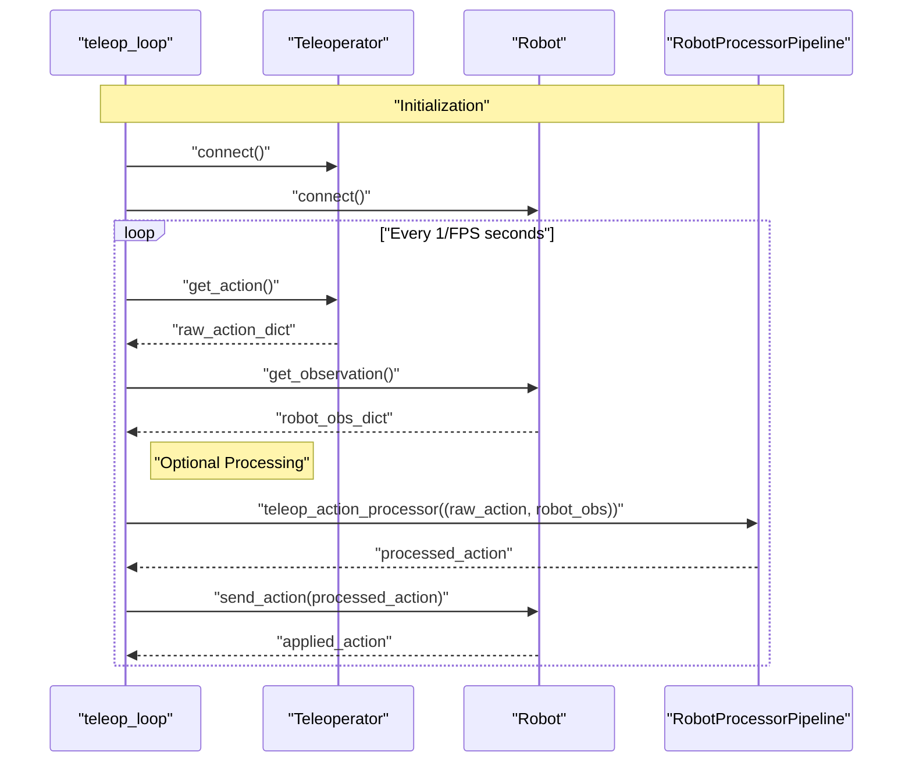

<!-- source: DeepWiki mcp.deepwiki.com · repo huggingface/lerobot · page 6.1 Robot and Teleoperator Abstraction · fetched 2026-10-26 -->

# Robot and Teleoperator Abstraction

Relevant source files

The following files were used as context for generating this wiki page:

- [src/lerobot/cameras/__init__.py](src/lerobot/cameras/__init__.py)
- [src/lerobot/cameras/camera.py](src/lerobot/cameras/camera.py)
- [src/lerobot/robots/hope_jr/hope_jr_arm.py](src/lerobot/robots/hope_jr/hope_jr_arm.py)
- [src/lerobot/robots/hope_jr/hope_jr_hand.py](src/lerobot/robots/hope_jr/hope_jr_hand.py)
- [src/lerobot/robots/koch_follower/koch_follower.py](src/lerobot/robots/koch_follower/koch_follower.py)
- [src/lerobot/robots/lekiwi/config_lekiwi.py](src/lerobot/robots/lekiwi/config_lekiwi.py)
- [src/lerobot/robots/lekiwi/lekiwi.py](src/lerobot/robots/lekiwi/lekiwi.py)
- [src/lerobot/robots/lekiwi/lekiwi_client.py](src/lerobot/robots/lekiwi/lekiwi_client.py)
- [src/lerobot/robots/lekiwi/lekiwi_host.py](src/lerobot/robots/lekiwi/lekiwi_host.py)
- [src/lerobot/robots/omx_follower/omx_follower.py](src/lerobot/robots/omx_follower/omx_follower.py)
- [src/lerobot/robots/openarm_follower/openarm_follower.py](src/lerobot/robots/openarm_follower/openarm_follower.py)
- [src/lerobot/robots/so_follower/so_follower.py](src/lerobot/robots/so_follower/so_follower.py)
- [src/lerobot/robots/utils.py](src/lerobot/robots/utils.py)
- [src/lerobot/scripts/lerobot_calibrate.py](src/lerobot/scripts/lerobot_calibrate.py)
- [src/lerobot/scripts/lerobot_find_joint_limits.py](src/lerobot/scripts/lerobot_find_joint_limits.py)
- [src/lerobot/scripts/lerobot_record.py](src/lerobot/scripts/lerobot_record.py)
- [src/lerobot/scripts/lerobot_replay.py](src/lerobot/scripts/lerobot_replay.py)
- [src/lerobot/scripts/lerobot_setup_motors.py](src/lerobot/scripts/lerobot_setup_motors.py)
- [src/lerobot/scripts/lerobot_teleoperate.py](src/lerobot/scripts/lerobot_teleoperate.py)
- [src/lerobot/teleoperators/utils.py](src/lerobot/teleoperators/utils.py)
- [tests/robots/test_so100_follower.py](tests/robots/test_so100_follower.py)
- [tests/scripts/test_setup_motors.py](tests/scripts/test_setup_motors.py)

## Purpose and Scope

This page documents the abstraction layer that enables LeRobot to work with diverse physical hardware through a unified interface. The `Robot` and `Teleoperator` base classes provide a common API for controlling robots and reading teleoperation devices, allowing scripts like `lerobot-record`, `lerobot-teleoperate`, and `lerobot-replay` to work seamlessly across different hardware platforms without modification.

The abstraction handles the lifecycle of hardware connections, provides schema discovery for observations and actions, manages calibration data persistence, and bridges the gap between raw motor values and high-level control scripts.

Sources: [src/lerobot/robots/robot.py:30-40](), [src/lerobot/teleoperators/teleoperator.py:29-39]()

---

## Core Abstractions

LeRobot defines two primary abstract interfaces for hardware interaction, defined in `src/lerobot/robots/robot.py` and `src/lerobot/teleoperators/teleoperator.py`.

### Robot Interface

`Robot` ([src/lerobot/robots/robot.py:30-211]()) is the abstract base class for all physical robots. Every subclass must declare two class-level attributes and implement all abstract methods:

**Class attributes (set in every subclass):**

| Attribute | Type | Purpose |
|-----------|------|---------|
| `config_class` | `type[RobotConfig]` | The expected configuration dataclass for this robot [src/lerobot/robots/robot.py:43]() |
| `name` | `str` | Unique string identifier (e.g. `"so100_follower"`) [src/lerobot/robots/robot.py:44]() |

**Abstract properties:**

| Property | Returns | Notes |
|----------|---------|-------|
| `observation_features` | `dict` | Schema of `get_observation()` output; callable without connecting [src/lerobot/robots/robot.py:88-100]() |
| `action_features` | `dict` | Schema of `send_action()` input; callable without connecting [src/lerobot/robots/robot.py:102-113]() |
| `is_connected` | `bool` | Connection state guard [src/lerobot/robots/robot.py:115-122]() |
| `is_calibrated` | `bool` | `True` if calibration is not applicable [src/lerobot/robots/robot.py:135-139]() |

**Abstract methods:**

| Method | Signature | Purpose |
|--------|-----------|---------|
| `connect` | `(calibrate: bool = True) -> None` | Establish hardware communication; optionally auto-calibrate [src/lerobot/robots/robot.py:124-133]() |
| `calibrate` | `() -> None` | Run calibration routine; updates `self.calibration` dict [src/lerobot/robots/robot.py:141-149]() |
| `configure` | `() -> None` | Apply one-time or runtime configuration (motor modes, etc.) [src/lerobot/robots/robot.py:173-179]() |
| `get_observation` | `() -> RobotObservation` | Read current sensory state [src/lerobot/robots/robot.py:181-189]() |
| `send_action` | `(action: RobotAction) -> RobotAction` | Send command; returns the action actually applied [src/lerobot/robots/robot.py:191-204]() |
| `disconnect` | `() -> None` | Release hardware resources [src/lerobot/robots/robot.py:206-211]() |

Sources: [src/lerobot/robots/robot.py:30-211]()

### Teleoperator Interface

`Teleoperator` ([src/lerobot/teleoperators/teleoperator.py:29-208]()) is the abstract base class for all input devices (leader arms, keyboards, gamepads, etc.).

**Class attributes (set in every subclass):**

| Attribute | Type | Purpose |
|-----------|------|---------|
| `config_class` | `type[TeleoperatorConfig]` | Expected configuration dataclass [src/lerobot/teleoperators/teleoperator.py:42]() |
| `name` | `str` | Unique string identifier (e.g. `"koch_leader"`) [src/lerobot/teleoperators/teleoperator.py:43]() |

**Abstract properties:**

| Property | Returns | Notes |
|----------|---------|-------|
| `action_features` | `dict` | Schema of `get_action()` output; callable without connecting [src/lerobot/teleoperators/teleoperator.py:87-98]() |
| `feedback_features` | `dict` | Schema of `send_feedback()` input; callable without connecting [src/lerobot/teleoperators/teleoperator.py:100-111]() |
| `is_connected` | `bool` | Connection state guard [src/lerobot/teleoperators/teleoperator.py:113-120]() |
| `is_calibrated` | `bool` | `True` if calibration is not applicable [src/lerobot/teleoperators/teleoperator.py:133-137]() |

**Abstract methods:**

| Method | Signature | Purpose |
|--------|-----------|---------|
| `connect` | `(calibrate: bool = True) -> None` | Establish hardware communication [src/lerobot/teleoperators/teleoperator.py:122-131]() |
| `calibrate` | `() -> None` | Run calibration routine; updates `self.calibration` dict [src/lerobot/teleoperators/teleoperator.py:139-147]() |
| `get_action` | `() -> RobotAction` | Read current control input as a flat action dict [src/lerobot/teleoperators/teleoperator.py:179-188]() |
| `send_feedback` | `(feedback: dict[str, Any]) -> None` | Send haptic or state feedback to the device [src/lerobot/teleoperators/teleoperator.py:190-197]() |
| `disconnect` | `() -> None` | Release hardware resources [src/lerobot/teleoperators/teleoperator.py:202-208]() |

Sources: [src/lerobot/teleoperators/teleoperator.py:29-208]()

---

## Factory Pattern and Device Creation

The codebase uses a factory pattern to instantiate robots and teleoperators from their respective configuration objects. This decoupling allows users to switch hardware by simply changing a configuration string.

### Configuration to Entity Mapping

The following diagram bridges the natural language configuration space to the specific code entities used in the factory.

Diagram: Configuration to Entity Mapping

```mermaid
graph TB
    subgraph "Config_Layer"
        RobotCfg["RobotConfig"]
        TeleopCfg["TeleoperatorConfig"]
    end

    subgraph "Factory_Functions"
        MakeRobot["make_robot_from_config()\nsrc/lerobot/robots/utils.py"]
        MakeTeleop["make_teleoperator_from_config()\nsrc/lerobot/teleoperators/utils.py"]
    end

    subgraph "Robot_Implementations"
        SOFollower["SOFollower\n(so_follower, so100_follower, so101_follower)"]
        KochFollower["KochFollower\n(koch_follower)"]
        OmxFollower["OmxFollower\n(omx_follower)"]
        LeKiwi["LeKiwi\n(lekiwi)"]
        LeKiwiClient["LeKiwiClient\n(lekiwi_client)"]
        HopeJrArm["HopeJrArm\n(hope_jr_arm)"]
        HopeJrHand["HopeJrHand\n(hope_jr_hand)"]
        Reachy2["Reachy2Robot\n(reachy2)"]
        UnitreeG1Robot["UnitreeG1Robot\n(unitree_g1)"]
        RebotB601["RebotB601Follower\n(rebot_b601_follower)"]
        OpenArmFollower["OpenArmFollower\n(openarm_follower)"]
        BiSOFollower["BiSOFollower\n(bi_so_follower)"]
        BiOpenArmFollower["BiOpenArmFollower\n(bi_openarm_follower)"]
        BiRebotB601Follower["BiRebotB601Follower\n(bi_rebot_b601_follower)"]
    end

    subgraph "Teleoperator_Implementations"
        KochLeader["KochLeader\n(koch_leader)"]
        SOLeader["SOLeader\n(so_leader, so100_leader, so101_leader)"]
        Keyboard["KeyboardTeleop\n(keyboard)"]
        KeyboardEE["KeyboardEndEffectorTeleop\n(keyboard_ee)"]
        Gamepad["GamepadTeleop\n(gamepad)"]
        UnitreeG1Teleop["UnitreeG1Teleoperator\n(unitree_g1)"]
        HomunculusGlove["HomunculusGlove\n(homunculus_glove)"]
        HomunculusArm["HomunculusArm\n(homunculus_arm)"]
        Reachy2Teleoperator["Reachy2Teleoperator\n(reachy2_teleoperator)"]
        OpenArmLeader["OpenArmLeader\n(openarm_leader)"]
        OpenArmMini["OpenArmMini\n(openarm_mini)"]
        BiSOLeader["BiSOLeader\n(bi_so_leader)"]
        BiOpenArmLeader["BiOpenArmLeader\n(bi_openarm_leader)"]
        BiOpenArmMini["BiOpenArmMini\n(bi_openarm_mini)"]
        Rebot102Leader["RebotArm102Leader\n(rebot_102_leader)"]
        BiRebot102Leader["BiRebot102Leader\n(bi_rebot_102_leader)"]
    end

    RobotCfg --> MakeRobot
    TeleopCfg --> MakeTeleop

    MakeRobot --> SOFollower
    MakeRobot --> KochFollower
    MakeRobot --> OmxFollower
    MakeRobot --> LeKiwi
    MakeRobot --> LeKiwiClient
    MakeRobot --> HopeJrArm
    MakeRobot --> HopeJrHand
    MakeRobot --> Reachy2
    MakeRobot --> UnitreeG1Robot
    MakeRobot --> RebotB601
    MakeRobot --> OpenArmFollower
    MakeRobot --> BiSOFollower
    MakeRobot --> BiOpenArmFollower
    MakeRobot --> BiRebotB601Follower

    MakeTeleop --> KochLeader
    MakeTeleop --> SOLeader
    MakeTeleop --> Keyboard
    MakeTeleop --> KeyboardEE
    MakeTeleop --> Gamepad
    MakeTeleop --> UnitreeG1Teleop
    MakeTeleop --> HomunculusGlove
    MakeTeleop --> HomunculusArm
    MakeTeleop --> Reachy2Teleoperator
    MakeTeleop --> OpenArmLeader
    MakeTeleop --> OpenArmMini
    MakeTeleop --> BiSOLeader
    MakeTeleop --> BiOpenArmLeader
    MakeTeleop --> BiOpenArmMini
    MakeTeleop --> Rebot102Leader
    MakeTeleop --> BiRebot102Leader
```

Sources: [src/lerobot/robots/utils.py:27-90](), [src/lerobot/teleoperators/utils.py:36-118]()

### make_robot_from_config

`make_robot_from_config()` dispatches on `config.type` to instantiate the appropriate class [src/lerobot/robots/utils.py:27-85](). For example, it maps `"so100_follower"` to `SO100Follower` (a subclass of `SOFollower`) [src/lerobot/robots/utils.py:37-40](). It also supports more complex robots like `LeKiwi` [src/lerobot/robots/utils.py:45-48]() and `OpenArmFollower` [src/lerobot/robots/utils.py:65-68](). If a type is not recognized among built-ins, it attempts to load it via `make_device_from_device_class` which handles third-party plugin registration [src/lerobot/robots/utils.py:87]().

Sources: [src/lerobot/robots/utils.py:27-90]()

### make_teleoperator_from_config

`make_teleoperator_from_config()` performs a similar dispatch for teleoperation devices [src/lerobot/teleoperators/utils.py:36-114](). It supports a wide range of devices from physical leader arms like `KochLeader` [src/lerobot/teleoperators/utils.py:42-45]() to virtual devices like `KeyboardTeleop` [src/lerobot/teleoperators/utils.py:38-41]() and `GamepadTeleop` [src/lerobot/teleoperators/utils.py:62-65](). It also includes bimanual variants such as `BiOpenArmMini` [src/lerobot/teleoperators/utils.py:102-105]() and new hardware like `RebotArm102Leader` [src/lerobot/teleoperators/utils.py:106-109]().

Sources: [src/lerobot/teleoperators/utils.py:36-118]()

---

## Data Flow and Implementation Details

### Teleoperation Control Loop

The core interaction between these abstractions occurs in the teleoperation loop, typically implemented in `teleop_loop` [src/lerobot/scripts/lerobot_teleoperate.py:155-184]().

Diagram: Teleoperation Control Loop Sequence

Sources: [src/lerobot/scripts/lerobot_teleoperate.py:155-184]()

### Calibration Management

Both `Robot` and `Teleoperator` handle calibration data persistence to ensure that joint offsets and ranges are preserved across sessions. Upon initialization, they check for a calibration file at `self.calibration_fpath` ([src/lerobot/robots/robot.py:53](), [src/lerobot/teleoperators/teleoperator.py:53]()). 

- `_load_calibration()`: Loads `MotorCalibration` objects from a JSON file using `draccus` [src/lerobot/robots/robot.py:151-160]().
- `_save_calibration()`: Dumps the current `self.calibration` dictionary to JSON [src/lerobot/robots/robot.py:162-171]().

The `lerobot-calibrate` script provides a unified CLI to trigger these routines:
1. It creates the device via the factory [src/lerobot/scripts/lerobot_calibrate.py:91-94]().
2. It calls `device.connect(calibrate=False)` to establish a link without forcing an immediate auto-calibration [src/lerobot/scripts/lerobot_calibrate.py:104]().
3. It executes the hardware-specific `device.calibrate()` method [src/lerobot/scripts/lerobot_calibrate.py:107]().

Sources: [src/lerobot/robots/robot.py:46-57](), [src/lerobot/teleoperators/teleoperator.py:45-56](), [src/lerobot/scripts/lerobot_calibrate.py:87-101]()

### Safety and Kinematics

#### ensure_safe_goal_position
The `ensure_safe_goal_position` utility ([src/lerobot/robots/utils.py:93-128]()) is a critical safety component. It caps the magnitude of relative movements to prevent high-velocity impacts or motor damage. It compares the `goal_pos` to the `present_pos` and clamps the difference to a `max_relative_target` [src/lerobot/robots/utils.py:109-115]().

#### Joint Limits Discovery
The `lerobot-find-joint-limits` script uses the `RobotKinematics` class to track end-effector bounds and joint limits in real-time while a user moves the robot via teleoperation [src/lerobot/scripts/lerobot_find_joint_limits.py:130-185](). It computes forward kinematics [src/lerobot/scripts/lerobot_find_joint_limits.py:143]() and updates running minimum/maximum values for both joint positions and Cartesian coordinates [src/lerobot/scripts/lerobot_find_joint_limits.py:170-173]().

#### Replay and Verification
The `lerobot-replay` script allows for verifying robot repeatability by replaying actions from a recorded episode [src/lerobot/scripts/lerobot_replay.py:15-42](). It loads actions from a `LeRobotDataset` [src/lerobot/scripts/lerobot_replay.py:111]() and sends them sequentially to the robot via `robot.send_action` [src/lerobot/scripts/lerobot_replay.py:136](), using a `CycleTimer` to maintain the dataset's original frame rate [src/lerobot/scripts/lerobot_replay.py:118]().

Sources: [src/lerobot/robots/utils.py:93-128](), [src/lerobot/scripts/lerobot_find_joint_limits.py:95-188](), [src/lerobot/scripts/lerobot_replay.py:102-142]()

---

