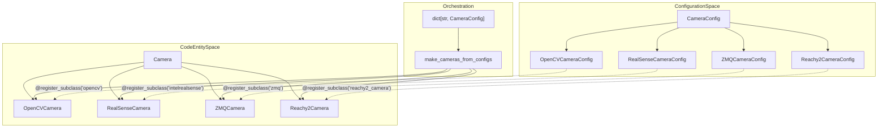
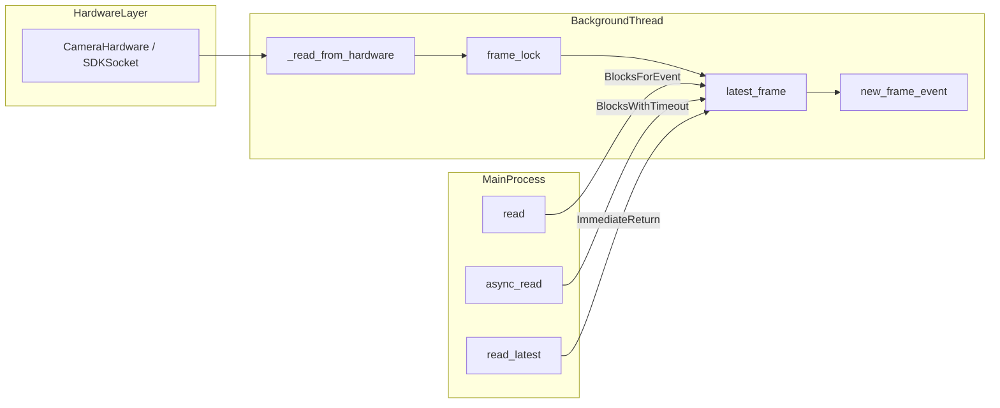
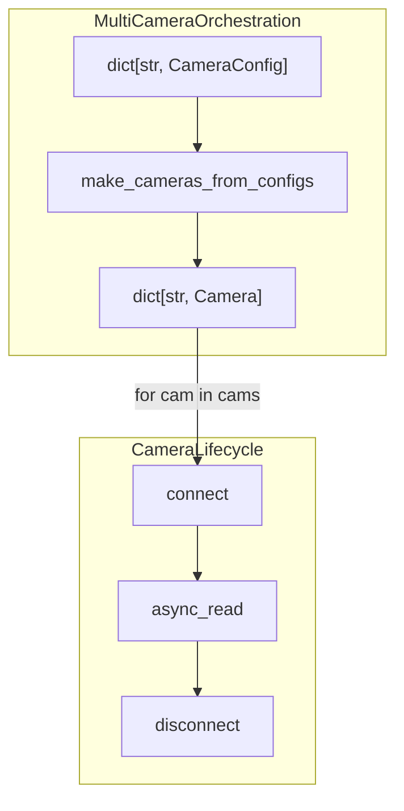

<!-- source: DeepWiki mcp.deepwiki.com · repo huggingface/lerobot · page 6.10 Camera Systems · fetched 2026-10-26 -->

# Camera Systems

Relevant source files

The following files were used as context for generating this wiki page:

- [docs/source/cameras.mdx](docs/source/cameras.mdx)
- [docs/source/third_party_robots.mdx](docs/source/third_party_robots.mdx)
- [docs/source/third_party_sensors.mdx](docs/source/third_party_sensors.mdx)
- [src/lerobot/cameras/configs.py](src/lerobot/cameras/configs.py)
- [src/lerobot/cameras/opencv/__init__.py](src/lerobot/cameras/opencv/__init__.py)
- [src/lerobot/cameras/opencv/camera_opencv.py](src/lerobot/cameras/opencv/camera_opencv.py)
- [src/lerobot/cameras/opencv/configuration_opencv.py](src/lerobot/cameras/opencv/configuration_opencv.py)
- [src/lerobot/cameras/reachy2_camera/configuration_reachy2_camera.py](src/lerobot/cameras/reachy2_camera/configuration_reachy2_camera.py)
- [src/lerobot/cameras/reachy2_camera/reachy2_camera.py](src/lerobot/cameras/reachy2_camera/reachy2_camera.py)
- [src/lerobot/cameras/realsense/camera_realsense.py](src/lerobot/cameras/realsense/camera_realsense.py)
- [src/lerobot/cameras/realsense/configuration_realsense.py](src/lerobot/cameras/realsense/configuration_realsense.py)
- [src/lerobot/cameras/utils.py](src/lerobot/cameras/utils.py)
- [src/lerobot/cameras/zmq/camera_zmq.py](src/lerobot/cameras/zmq/camera_zmq.py)
- [src/lerobot/cameras/zmq/configuration_zmq.py](src/lerobot/cameras/zmq/configuration_zmq.py)
- [src/lerobot/scripts/convert_dataset_v21_to_v30.py](src/lerobot/scripts/convert_dataset_v21_to_v30.py)
- [src/lerobot/scripts/lerobot_annotate.py](src/lerobot/scripts/lerobot_annotate.py)
- [src/lerobot/scripts/lerobot_find_cameras.py](src/lerobot/scripts/lerobot_find_cameras.py)
- [src/lerobot/scripts/lerobot_find_port.py](src/lerobot/scripts/lerobot_find_port.py)
- [src/lerobot/scripts/lerobot_train_tokenizer.py](src/lerobot/scripts/lerobot_train_tokenizer.py)
- [tests/cameras/test_opencv.py](tests/cameras/test_opencv.py)
- [tests/cameras/test_reachy2_camera.py](tests/cameras/test_reachy2_camera.py)
- [tests/cameras/test_realsense.py](tests/cameras/test_realsense.py)
- [tests/scripts/test_lerobot_annotate.py](tests/scripts/test_lerobot_annotate.py)

## Purpose and Scope

This document covers the camera integration system in LeRobot, which provides a unified interface for capturing visual observations from various camera hardware. The camera system supports local USB cameras via OpenCV [src/lerobot/cameras/opencv/camera_opencv.py:52-95](), Intel RealSense depth cameras [src/lerobot/cameras/realsense/camera_realsense.py:48-110](), Reachy 2 robot cameras [src/lerobot/cameras/reachy2_camera/reachy2_camera.py:57-70](), and remote cameras streaming over ZeroMQ networks [src/lerobot/cameras/zmq/camera_zmq.py:54-60]().

For information about robot-camera integration and episode recording workflows, see [Recording Episodes](6.6). For dataset video encoding and storage, see [Video Processing](2.4).

Sources: [src/lerobot/cameras/utils.py:1-69](), [src/lerobot/cameras/camera.py:26-40]()

---

## Camera Architecture Overview

LeRobot's camera system uses a plugin-based architecture with a common base interface and configuration system. All camera implementations inherit from a base `Camera` class [src/lerobot/cameras/camera.py:26]() and are configured via subclasses of `CameraConfig` [src/lerobot/cameras/configs.py]().

### System Entity Mapping

The following diagram maps natural language concepts to the specific code entities that implement them.

**Diagram: Camera System Architecture and Entity Mapping**

The system consists of three layers:
1. **Configuration Layer**: Type-specific `CameraConfig` subclasses registered via `@CameraConfig.register_subclass("type")` [src/lerobot/cameras/opencv/configuration_opencv.py:23](), [src/lerobot/cameras/realsense/configuration_realsense.py:20](), [src/lerobot/cameras/reachy2_camera/configuration_reachy2_camera.py:22](), [src/lerobot/cameras/zmq/configuration_zmq.py:24]().
2. **Implementation Layer**: Camera classes implementing `connect()`, `read()`, `async_read()`, and `disconnect()` [src/lerobot/cameras/camera.py]().
3. **Factory Layer**: `make_cameras_from_configs()` instantiates cameras from configuration dictionaries by matching the `type` field [src/lerobot/cameras/utils.py:25-56]().

Sources: [src/lerobot/cameras/utils.py:25-56](), [src/lerobot/cameras/opencv/camera_opencv.py:52-95](), [src/lerobot/cameras/realsense/camera_realsense.py:48-110](), [src/lerobot/cameras/camera.py:26-184]()

---

## Supported Camera Types

### OpenCV Cameras
Provides support for standard USB webcams and video files via `OpenCVCamera` [src/lerobot/cameras/opencv/camera_opencv.py:52-95](). It utilizes a background thread to prevent blocking the main control loop during hardware I/O [src/lerobot/cameras/opencv/camera_opencv.py:113-118](). It supports specific OpenCV backends and FOURCC codes to optimize frame rates [src/lerobot/cameras/opencv/configuration_opencv.py:52-58]().

**Configuration:** `OpenCVCameraConfig`
- `index_or_path`: Integer index (e.g., `0`) or `Path` to video file [src/lerobot/cameras/opencv/configuration_opencv.py:61]().
- `fourcc`: Optional 4-character string (e.g., `"MJPG"`) to force a specific codec [src/lerobot/cameras/opencv/configuration_opencv.py:65]().
- `backend`: OpenCV backend identifier via `Cv2Backends` [src/lerobot/cameras/opencv/configuration_opencv.py:66]().

Sources: [src/lerobot/cameras/opencv/camera_opencv.py:52-127](), [src/lerobot/cameras/opencv/configuration_opencv.py:25-76]()

### Intel RealSense Cameras
Supports D400-series and other RealSense devices using `pyrealsense2` via `RealSenseCamera` [src/lerobot/cameras/realsense/camera_realsense.py:48-56](). It allows simultaneous capture of color and depth maps [src/lerobot/cameras/realsense/camera_realsense.py:48-56](). RealSense cameras are identified by serial numbers for stability across reboots [src/lerobot/cameras/realsense/camera_realsense.py:124-127]().

**Configuration:** `RealSenseCameraConfig`
- `serial_number_or_name`: Unique device serial or model name [src/lerobot/cameras/realsense/configuration_realsense.py:70]().
- `use_depth`: Boolean flag to enable depth stream [src/lerobot/cameras/realsense/configuration_realsense.py:72]().

Sources: [src/lerobot/cameras/realsense/camera_realsense.py:48-150](), [src/lerobot/cameras/realsense/configuration_realsense.py:22-60]()

### Reachy 2 Cameras
Integrates with the Reachy 2 robot's `CameraManager` over gRPC via `Reachy2Camera` [src/lerobot/cameras/reachy2_camera/reachy2_camera.py:97-104](). Supports both "teleop" (left/right) and "depth" (rgb/depth) camera views [src/lerobot/cameras/reachy2_camera/reachy2_camera.py:57-70]().

**Configuration:** `Reachy2CameraConfig`
- `name`: `"teleop"` or `"depth"` [src/lerobot/cameras/reachy2_camera/configuration_reachy2_camera.py:47]().
- `image_type`: `"left"`/`"right"` for teleop, `"rgb"`/`"depth"` for depth [src/lerobot/cameras/reachy2_camera/configuration_reachy2_camera.py:48-49]().
- `ip_address` and `port`: Network settings for the robot's camera server [src/lerobot/cameras/reachy2_camera/configuration_reachy2_camera.py:54-55]().

Sources: [src/lerobot/cameras/reachy2_camera/reachy2_camera.py:57-106](), [src/lerobot/cameras/reachy2_camera/configuration_reachy2_camera.py:24-77]()

### ZMQ Remote Cameras
Enables network-based streaming using ZeroMQ via `ZMQCamera` [src/lerobot/cameras/zmq/camera_zmq.py:54-60](). This class connects to a ZMQ Publisher (`zmq.SUB`), subscribes to frame topics, and decodes incoming JSON messages containing Base64 encoded images [src/lerobot/cameras/zmq/camera_zmq.py:55-60](). It supports `zmq.CONFLATE` to ensure only the latest message is held in the buffer [src/lerobot/cameras/zmq/camera_zmq.py:131]().

**Configuration:** `ZMQCameraConfig`
- `server_address`: IP of the camera server [src/lerobot/cameras/zmq/configuration_zmq.py:27]().
- `port`: ZMQ port (default `5555`) [src/lerobot/cameras/zmq/configuration_zmq.py:28]().
- `camera_name`: The specific camera key to extract from the JSON message [src/lerobot/cameras/zmq/configuration_zmq.py:29]().

Sources: [src/lerobot/cameras/zmq/camera_zmq.py:54-108](), [src/lerobot/cameras/zmq/configuration_zmq.py:24-44]()

---

## Camera Discovery

The CLI script `lerobot-find-cameras` provides auto-discovery for local devices [src/lerobot/scripts/lerobot_find_cameras.py]().

| Command | Supported Types | Identification Method |
|---------|-----------------|-----------------------|
| `lerobot-find-cameras opencv` | USB Webcams, Integrated | Device Index (`0`, `1`, ...) [src/lerobot/cameras/opencv/camera_opencv.py:47]() |
| `lerobot-find-cameras realsense` | Intel RealSense | Serial Number [src/lerobot/cameras/realsense/camera_realsense.py:124]() |

Note: On Linux, OpenCV indices can be unstable. Using `lerobot-find-cameras` helps identify the correct `/dev/videoX` path [src/lerobot/cameras/opencv/camera_opencv.py:60-65](). Reachy 2 and ZMQ cameras do not support auto-discovery and must be configured manually [docs/source/cameras.mdx:46-47]().

Sources: [docs/source/cameras.mdx:15-41](), [src/lerobot/cameras/opencv/camera_opencv.py:52-65](), [src/lerobot/cameras/realsense/camera_realsense.py:58-61](), [src/lerobot/scripts/lerobot_find_cameras.py:47-127]()

---

## Data Flow and Threading

All LeRobot cameras implement a standardized threading model to ensure low-latency access to the latest frames.

**Diagram: Camera Data Flow and Threading Model**

### Key Methods
- **`read()`**: Standard blocking read. Waits for the hardware to return a frame [src/lerobot/cameras/camera.py:111-119](). In `OpenCVCamera`, it captures a single frame synchronously [src/lerobot/cameras/opencv/camera_opencv.py:214-234]().
- **`async_read(timeout_ms)`**: Returns the latest unconsumed frame from the background thread. Blocks up to `timeout_ms` only if the buffer is empty or the frame has already been consumed [src/lerobot/cameras/camera.py:121-151]().
- **`read_latest(max_age_ms)`**: Returns the current content of the memory buffer immediately (peeking). If the frame is older than `max_age_ms`, it raises a `TimeoutError` [src/lerobot/cameras/camera.py:153-180]().

Sources: [src/lerobot/cameras/camera.py:111-180](), [src/lerobot/cameras/opencv/camera_opencv.py:214-360](), [src/lerobot/cameras/realsense/camera_realsense.py:234-315](), [src/lerobot/cameras/zmq/camera_zmq.py:230-280]()

---

## Multi-Camera Setups

Multi-camera setups are handled by instantiating multiple `Camera` objects from a dictionary of configurations.

### Configuration and Instantiation
The `make_cameras_from_configs` utility function handles the dynamic creation of camera instances based on the `type` field in each configuration [src/lerobot/cameras/utils.py:25-56]().

**Diagram: Multi-Camera Lifecycle Orchestration**

### Feature Mapping
In robot implementations, camera resolutions are used to define observation shapes. The `Camera` base class stores `fps`, `width`, and `height` from the config [src/lerobot/cameras/camera.py:42-50](). For `OpenCVCamera`, these are used to configure the capture buffer dimensions [src/lerobot/cameras/opencv/camera_opencv.py:123-127](). Rotation settings are applied using OpenCV rotation flags derived from `Cv2Rotation` enums [src/lerobot/cameras/utils.py:59-69]().

Sources: [src/lerobot/cameras/utils.py:25-56](), [src/lerobot/cameras/camera.py:42-50](), [src/lerobot/cameras/opencv/camera_opencv.py:123-127](), [src/lerobot/cameras/utils.py:59-69]()

---

