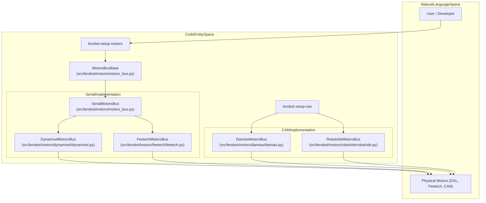
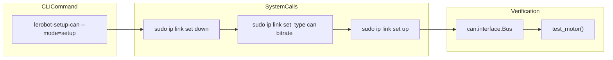

<!-- source: DeepWiki mcp.deepwiki.com · repo huggingface/lerobot · page 6.11 Motor Systems · fetched 2026-10-26 -->

# Motor Systems

Relevant source files

The following files were used as context for generating this wiki page:

- [docs/source/damiao.mdx](docs/source/damiao.mdx)
- [src/lerobot/motors/__init__.py](src/lerobot/motors/__init__.py)
- [src/lerobot/motors/calibration_gui.py](src/lerobot/motors/calibration_gui.py)
- [src/lerobot/motors/damiao/__init__.py](src/lerobot/motors/damiao/__init__.py)
- [src/lerobot/motors/damiao/damiao.py](src/lerobot/motors/damiao/damiao.py)
- [src/lerobot/motors/damiao/tables.py](src/lerobot/motors/damiao/tables.py)
- [src/lerobot/motors/dynamixel/dynamixel.py](src/lerobot/motors/dynamixel/dynamixel.py)
- [src/lerobot/motors/encoding_utils.py](src/lerobot/motors/encoding_utils.py)
- [src/lerobot/motors/feetech/feetech.py](src/lerobot/motors/feetech/feetech.py)
- [src/lerobot/motors/motors_bus.py](src/lerobot/motors/motors_bus.py)
- [src/lerobot/motors/robstride/__init__.py](src/lerobot/motors/robstride/__init__.py)
- [src/lerobot/motors/robstride/robstride.py](src/lerobot/motors/robstride/robstride.py)
- [src/lerobot/motors/robstride/tables.py](src/lerobot/motors/robstride/tables.py)
- [src/lerobot/robots/so_follower/config_so_follower.py](src/lerobot/robots/so_follower/config_so_follower.py)
- [src/lerobot/scripts/lerobot_setup_can.py](src/lerobot/scripts/lerobot_setup_can.py)
- [src/lerobot/teleoperators/so_leader/config_so_leader.py](src/lerobot/teleoperators/so_leader/config_so_leader.py)
- [tests/motors/test_dynamixel.py](tests/motors/test_dynamixel.py)
- [tests/motors/test_feetech.py](tests/motors/test_feetech.py)
- [tests/utils/test_encoding_utils.py](tests/utils/test_encoding_utils.py)
- [tests/utils/test_process.py](tests/utils/test_process.py)

This page documents the motor control protocols, hardware interfaces, and configuration procedures for all supported motor types in LeRobot. For information about robot-level abstractions and calibration workflows, see **6.4 Calibration and Setup**. For camera integration, see **6.10 Camera Systems**.

## Overview

LeRobot supports several motor control protocols across serial and CAN communication interfaces:

| Protocol | Communication | SDK Dependency | Motors Used |
|----------|--------------|----------------|-------------|
| **Dynamixel** | Serial (RS485) | `dynamixel-sdk` | Koch v1.1 arms |
| **Feetech** | Serial (RS485/TTL) | `feetech-servo-sdk` | SO-100, SO-101, HopeJR, LeKiwi, OpenArm Mini |
| **Damiao** | CAN Bus | `python-can` | OpenArm Follower/Leader |
| **Robstride** | CAN Bus | `python-can` | High-performance actuators |

Each protocol requires specific hardware (USB adapters or CAN interfaces) and software setup. Motors must be configured with unique IDs and matching baudrates before use.

Sources: `[src/lerobot/motors/dynamixel/dynamixel.py:93-98]()`, `[src/lerobot/motors/feetech/feetech.py:89-93]()`, `[src/lerobot/motors/damiao/damiao.py:75-85]()`, `[src/lerobot/motors/robstride/robstride.py:68-77]()`

## Motor Control Architecture

The following diagram maps the relationship between the natural language hardware concepts and the specific code entities used to control them.

**Motor System Entity Map**

Sources: `[src/lerobot/motors/motors_bus.py:58-130]()`, `[src/lerobot/motors/dynamixel/dynamixel.py:93-125]()`, `[src/lerobot/motors/feetech/feetech.py:89-125]()`, `[src/lerobot/motors/damiao/damiao.py:75-121]()`, `[src/lerobot/motors/robstride/robstride.py:68-118]()`

## Serial Communication Motors

### Dynamixel Protocol
Dynamixel motors use RS485 serial communication. The `DynamixelMotorsBus` class `[src/lerobot/motors/dynamixel/dynamixel.py:93-125]()` wraps the `dynamixel_sdk`.

- **Protocol Version:** 2.0 `[src/lerobot/motors/dynamixel/dynamixel.py:44]()`
- **Key Functions:** 
    - `sync_reader` and `sync_writer` (using `GroupSyncRead`/`GroupSyncWrite`) for efficient multi-motor control `[src/lerobot/motors/dynamixel/dynamixel.py:121-122]()`.
    - `configure_motors` ensures `Return_Delay_Time` is reduced to the minimum of 2µs (value 0) for lower latency `[src/lerobot/motors/dynamixel/dynamixel.py:154-158]()`.

Sources: `[src/lerobot/motors/dynamixel/dynamixel.py:111-125]()`, `[src/lerobot/motors/dynamixel/dynamixel.py:154-158]()`

### Feetech Protocol
Feetech motors (STS/SCS series) are handled by `FeetechMotorsBus` `[src/lerobot/motors/feetech/feetech.py:89-130]()`. 
- **SDK Patch:** The implementation includes a monkeypatch `patch_setPacketTimeout` for `PortHandler.setPacketTimeout` to fix timing issues in the unofficial PyPI SDK `[src/lerobot/motors/feetech/feetech.py:76-88]()`.
- **Protocol Versions:** Supports both Protocol 0 and Protocol 1 via `_find_single_motor_p0` and `_find_single_motor_p1` `[src/lerobot/motors/feetech/feetech.py:165-171]()`.
- **Teleoperation:** Used extensively in teleoperators, applying side-specific motor or joint handling when necessary. The `SOFollowerConfig` and `SOLeaderConfig` define `num_read_retries` to handle occasional corrupted status packets, especially when multiple joints move simultaneously `[src/lerobot/robots/so_follower/config_so_follower.py:51-54]()`, `[src/lerobot/teleoperators/so_leader/config_so_leader.py:32-36]()`.

Sources: `[src/lerobot/motors/feetech/feetech.py:106-125]()`, `[src/lerobot/motors/feetech/feetech.py:76-88]()`, `[src/lerobot/motors/feetech/feetech.py:165-171]()`, `[src/lerobot/robots/so_follower/config_so_follower.py:51-54]()`, `[src/lerobot/teleoperators/so_leader/config_so_leader.py:32-36]()`

## CAN Bus Motors

CAN bus motors offer higher bandwidth and lower latency. LeRobot utilizes `python-can` to interface with these actuators.

### Damiao Motors
The `DamiaoMotorsBus` `[src/lerobot/motors/damiao/damiao.py:75-151]()` supports several control modes including MIT, Position-Velocity, and Velocity.

- **State Caching:** It maintains a `_last_known_states` cache to handle packet drops safely `[src/lerobot/motors/damiao/damiao.py:138-147]()`.
- **Interface Detection:** Automatically detects `socketcan` (Linux) vs `slcan` (macOS/Serial) based on the port name `[src/lerobot/motors/damiao/damiao.py:169-175]()`.
- **Gains:** Stores dynamic gains for $K_p$ and $K_d$, defaulting to $10.0$ and $0.5$ respectively `[src/lerobot/motors/damiao/damiao.py:151-152]()`.
- **Robot Integration:** The `OpenArmFollower` uses this bus to control 7 DOF arms, utilizing `MotorNormMode.DEGREES` exclusively.

Sources: `[src/lerobot/motors/damiao/damiao.py:75-153]()`

### Robstride Motors
`RobstrideMotorsBus` implements the Robstride CAN protocol, primarily using the MIT control mode `[src/lerobot/motors/robstride/robstride.py:68-163]()`.

- **Motor Limits:** Uses a `MOTOR_LIMIT_PARAMS` table for different motor types to safely scale control signals `[src/lerobot/motors/robstride/tables.py:49-58]()`.
- **Gains:** Implements dynamic gain storage for $K_p$ (stiffness) and $K_d$ (damping), defaulting to $K_p=10.0$ and $K_d=0.5$ `[src/lerobot/motors/robstride/robstride.py:136-136]()`.
- **Control Modes:** Supports `MIT`, `POS_VEL`, and `VEL` modes `[src/lerobot/motors/robstride/tables.py:39-43]()`.

Sources: `[src/lerobot/motors/robstride/robstride.py:126-163]()`, `[src/lerobot/motors/robstride/tables.py:38-58]()`

## CAN Bus Configuration (`lerobot-setup-can`)

For CAN-based robots like OpenArm, the `lerobot-setup-can` script automates interface configuration and debugging `[src/lerobot/scripts/lerobot_setup_can.py:15-39]()`.

**Data Flow: CAN Setup & Test**

Sources: `[src/lerobot/scripts/lerobot_setup_can.py:77-122]()`, `[src/lerobot/scripts/lerobot_setup_can.py:123-159]()`, `[src/lerobot/scripts/lerobot_setup_can.py:162-210]()`

- **Modes:** Supports `setup` (interface config), `test` (ping motors), and `speed` (latency benchmarking) `[src/lerobot/scripts/lerobot_setup_can.py:63-72]()`.
- **Interface Status:** Checks if the interface is UP and if CAN FD (Flexible Data-rate) is enabled via `check_interface_status` `[src/lerobot/scripts/lerobot_setup_can.py:77-91]()`.
- **Motor Testing:** The `test_motor` function sends `CAN_CMD_ENABLE` (0xFC) and `CAN_CMD_DISABLE` (0xFD) messages to verify motor responsiveness `[src/lerobot/scripts/lerobot_setup_can.py:123-159]()`.

Sources: `[src/lerobot/scripts/lerobot_setup_can.py:77-122]()`, `[src/lerobot/scripts/lerobot_setup_can.py:123-159]()`, `[src/lerobot/scripts/lerobot_setup_can.py:162-210]()`

## Calibration GUI

LeRobot provides a Pygame-based GUI for fine-tuning motor ranges and homing offsets `[src/lerobot/motors/calibration_gui.py:1-15]()`.

- **RangeSlider:** Each motor is represented by a slider row `[src/lerobot/motors/calibration_gui.py:56-59]()`.
- **Interaction:** Users can drag brackets to set `range_min` and `range_max`, or a triangle to set the current target position `[src/lerobot/motors/calibration_gui.py:98-130]()`.
- **Data Persistence:** The GUI interacts with `MotorCalibration` objects which store `homing_offset`, `range_min`, and `range_max` `[src/lerobot/motors/motors_bus.py:175-181]()`.

Sources: `[src/lerobot/motors/calibration_gui.py:56-130]()`, `[src/lerobot/motors/motors_bus.py:175-181]()`

## Motor Data Structures

The system relies on standardized classes to represent motors and their states across all buses.

| Class | Purpose | File |
|-------|---------|------|
| `Motor` | Stores motor `id`, `model`, `norm_mode`, `motor_type_str`, and `recv_id`. | `[src/lerobot/motors/motors_bus.py:185-191]()` |
| `MotorCalibration` | Stores `homing_offset`, `range_min`, and `range_max`. | `[src/lerobot/motors/motors_bus.py:176-182]()` |
| `MotorState` | TypedDict for feedback (position, velocity, torque, temp). | `[src/lerobot/motors/damiao/damiao.py:67-73]()` |

Sources: `[src/lerobot/motors/motors_bus.py:176-191]()`, `[src/lerobot/motors/damiao/damiao.py:67-73]()`

---

