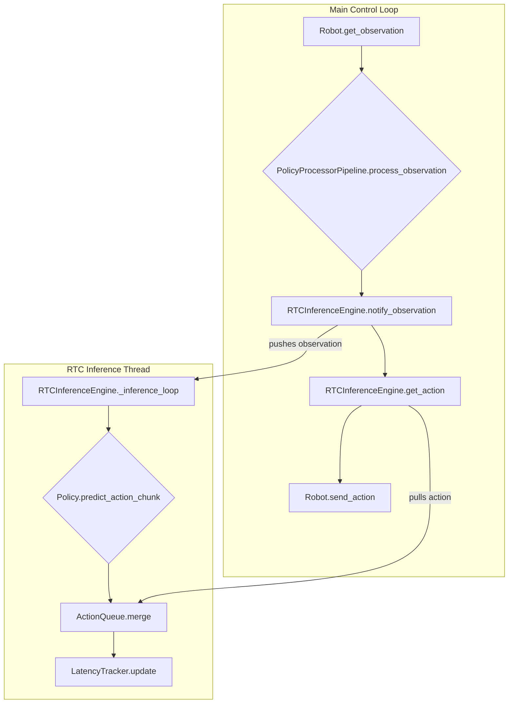
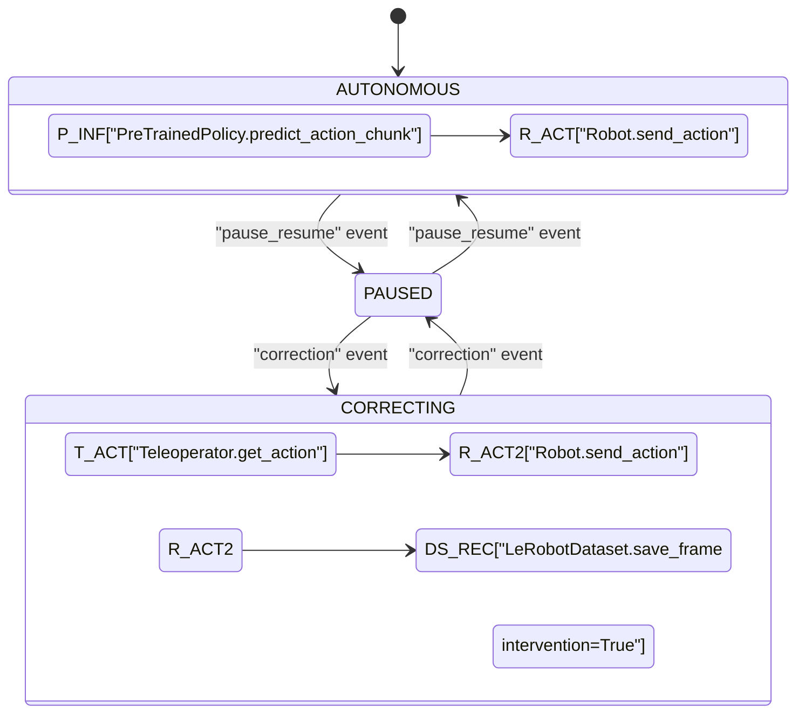

<!-- source: DeepWiki mcp.deepwiki.com · repo huggingface/lerobot · page 6.12 Policy Deployment and Rollout Strategies · fetched 2026-10-26 -->

# Policy Deployment and Rollout Strategies

<details>
<summary>Relevant source files</summary>

The following files were used as context for generating this wiki page:

- [docs/source/inference.mdx](docs/source/inference.mdx)
- [docs/source/integrate_hardware.mdx](docs/source/integrate_hardware.mdx)
- [src/lerobot/common/control_utils.py](src/lerobot/common/control_utils.py)
- [src/lerobot/policies/rtc/action_queue.py](src/lerobot/policies/rtc/action_queue.py)
- [src/lerobot/policies/rtc/latency_tracker.py](src/lerobot/policies/rtc/latency_tracker.py)
- [src/lerobot/policies/rtc/relative.py](src/lerobot/policies/rtc/relative.py)
- [src/lerobot/rollout/configs.py](src/lerobot/rollout/configs.py)
- [src/lerobot/rollout/context.py](src/lerobot/rollout/context.py)
- [src/lerobot/rollout/inference/factory.py](src/lerobot/rollout/inference/factory.py)
- [src/lerobot/rollout/inference/rtc.py](src/lerobot/rollout/inference/rtc.py)
- [src/lerobot/rollout/inference/sync.py](src/lerobot/rollout/inference/sync.py)
- [src/lerobot/rollout/strategies/base.py](src/lerobot/rollout/strategies/base.py)
- [src/lerobot/rollout/strategies/core.py](src/lerobot/rollout/strategies/core.py)
- [src/lerobot/rollout/strategies/dagger.py](src/lerobot/rollout/strategies/dagger.py)
- [src/lerobot/rollout/strategies/episodic.py](src/lerobot/rollout/strategies/episodic.py)
- [src/lerobot/rollout/strategies/factory.py](src/lerobot/rollout/strategies/factory.py)
- [src/lerobot/rollout/strategies/highlight.py](src/lerobot/rollout/strategies/highlight.py)
- [src/lerobot/rollout/strategies/sentry.py](src/lerobot/rollout/strategies/sentry.py)
- [src/lerobot/scripts/lerobot_rollout.py](src/lerobot/scripts/lerobot_rollout.py)
- [tests/configs/test_plugin_loading.py](tests/configs/test_plugin_loading.py)
- [tests/policies/rtc/test_action_queue.py](tests/policies/rtc/test_action_queue.py)
- [tests/policies/test_pretrained_interactive_contracts.py](tests/policies/test_pretrained_interactive_contracts.py)
- [tests/test_interactive_rollout.py](tests/test_interactive_rollout.py)
- [tests/test_rollout.py](tests/test_rollout.py)
- [tests/test_rollout_action_ordering.py](tests/test_rollout_action_ordering.py)

</details>


The purpose of `lerobot-rollout` is to provide a single command-line interface (`src/lerobot/scripts/lerobot_rollout.py`) and a pluggable strategy framework for deploying trained imitation learning and reinforcement learning policies onto physical robot hardware [src/lerobot/scripts/lerobot_rollout.py:17-20](). This system decouples high-level deployment workflows—such as autonomous evaluation, continuous recording, or human-in-the-loop data collection—from low-level robot communication and policy inference mechanics.

---

## System Architecture

The rollout system is structured around configuration registries (`RolloutStrategyConfig`, `InferenceEngineConfig`), execution state containers (`RolloutContext`), and control loop implementations (`RolloutStrategy`) [src/lerobot/rollout/configs.py:43-63]().

Title: "Rollout System Entity Mapping"
```mermaid
graph TD
    subgraph "Configuration Space"
        RCfg["RolloutConfig"] -- "contains" --> SCfg["RolloutStrategyConfig"]
        RCfg -- "contains" --> ICfg["InferenceEngineConfig"]
    end

    subgraph "Execution Space"
        CLI["lerobot_rollout.py"] -- "calls" --> BRC["build_rollout_context"]
        BRC -- "returns" --> RContext["RolloutContext"]
        
        RContext -- "wraps" --> TSR["ThreadSafeRobot"]
        RContext -- "wraps" --> IE["InferenceEngine"]
        RContext -- "wraps" --> P["PreTrainedPolicy"]
        
        IE -- "manages" --> Sync["SyncInferenceEngine"]
        IE -- "manages" --> RTC["RTCInferenceEngine"]
    end

    subgraph "Strategy Space"
        RS["RolloutStrategy"]
        RS <|-- Base["BaseStrategy"]
        RS <|-- Sentry["SentryStrategy"]
        RS <|-- DAgger["DAggerStrategy"]
        RS <|-- Highlight["HighlightStrategy"]
        RS <|-- Episodic["EpisodicStrategy"]
    end

    CLI -- "dispatches to" --> RS
    RS -- "uses" --> RContext
```
Sources: [src/lerobot/rollout/context.py:17-20](), [src/lerobot/rollout/context.py:205-217](), [src/lerobot/rollout/inference/factory.py:22-31](), [src/lerobot/rollout/configs.py:42-47]()

---

## Rollout Context and Configuration

The `RolloutContext` is a unified container initialized once by `build_rollout_context` before a deployment session starts [src/lerobot/rollout/context.py:205-217](). It groups state into five topical sub-contexts:

- **RuntimeContext**: Holds global configuration (`RolloutConfig`), a `shutdown_event` (`threading.Event`), and execution flags [src/lerobot/rollout/context.py:154-163]().
- **HardwareContext**: Contains the `ThreadSafeRobot` wrapper and an optional `Teleoperator`, along with `initial_position` dictionaries used to return the robot safely during teardown [src/lerobot/rollout/context.py:167-181]().
- **PolicyContext**: Manages the `PreTrainedPolicy`, its pre/post-processor pipelines, and the active `InferenceEngine` [src/lerobot/rollout/context.py:185-191]().
- **ProcessorContext**: Holds robot-side pipelines such as `robot_observation_processor`, `robot_action_processor`, and `teleop_action_processor` [src/lerobot/rollout/context.py:195-200]().
- **DatasetContext**: Manages bookkeeping for `LeRobotDataset` writing, feature remapping, and validation [src/lerobot/rollout/context.py:203-210]().

### ThreadSafeRobot Wrapper
To prevent race conditions between the main synchronous control loop and asynchronous inference threads (such as those running in Real-Time Chunking mode), the robot instance is wrapped inside `ThreadSafeRobot` [src/lerobot/rollout/robot_wrapper.py:25-30](). This wrapper uses internal locking mechanisms to serialize `get_observation()` and `send_action()` calls across threads [src/lerobot/rollout/robot_wrapper.py:46-60]().

Sources: [src/lerobot/rollout/context.py:154-217](), [src/lerobot/rollout/robot_wrapper.py:25-60]()

---

## Inference Backends

LeRobot supports two primary inference backends managed via `InferenceEngine` configurations:

| Backend | Config Class | Use Case | Implementation Detail |
| :--- | :--- | :--- | :--- |
| **Sync** | `SyncInferenceConfig` | Standard evaluation | Executes one policy forward pass per control tick, blocking until actions are returned [src/lerobot/rollout/inference/sync.py:27-31](). |
| **RTC** | `RTCInferenceConfig` | Slow VLA models | Real-Time Chunking. Runs inference in a background thread, maintaining an action queue to smooth out latency spikes [src/lerobot/rollout/inference/rtc.py:35-42](). |

Policies such as `Pi0Policy`, `SmolVLAPolicy`, and `MolmoAct2Policy` support RTC inference. When using trained RTC modes, validation checks like `_validate_trained_rtc_rollout_config` ensure that execution horizons and queue thresholds comply with checkpoint constraints [src/lerobot/rollout/context.py:103-140]().

Title: "RTC Inference Engine Data Flow"

Sources: [src/lerobot/rollout/inference/rtc.py:35-42](), [src/lerobot/rollout/inference/rtc.py:300-305](), [src/lerobot/rollout/inference/rtc.py:400-405](), [src/lerobot/policies/rtc/action_queue.py:35-42]()

Sources: [src/lerobot/rollout/inference/factory.py:22-31](), [src/lerobot/rollout/context.py:103-140](), [src/lerobot/scripts/lerobot_rollout.py:30-34]()

---

## Rollout Strategies

Execution strategies are subclassed from `RolloutStrategy` and instantiated via `create_strategy` based on `RolloutStrategyConfig.type` [src/lerobot/rollout/configs.py:42-67](). Each strategy implements a self-contained control loop.

### 1. Base Strategy (`--strategy.type=base`)
Autonomous policy execution with no data recording, used for quick evaluation or demonstrations [src/lerobot/rollout/configs.py:85-90]().

### 2. Sentry Strategy (`--strategy.type=sentry`)
Continuous autonomous recording with periodic background uploads to the Hugging Face Hub. Episodes are auto-rotated based on camera FPS and `target_video_file_size_mb` to align video chunking with dataset storage specifications [src/lerobot/rollout/configs.py:93-117]().

### 3. Highlight Strategy (`--strategy.type=highlight`)
Autonomous rollout paired with a memory-bounded ring buffer (`ring_buffer_seconds`). Pressing the configured `save_key` flushes the buffered telemetry to a dataset and initiates live recording [src/lerobot/rollout/configs.py:120-139]().

### 4. Episodic Strategy (`--strategy.type=episodic`)
Mirrors `lerobot-record` behavior by running fixed-length recording episodes separated by reset phases [src/lerobot/rollout/configs.py:168-186](). It supports smooth handovers between policy execution and teleoperation during reset intervals [src/lerobot/rollout/strategies/episodic.py:61-68]().

### 5. DAgger Strategy (`--strategy.type=dagger`)
Implements human-in-the-loop interactive imitation learning (Recovery and Correction paradigm). A thread-safe `DAggerEvents` manager handles transitions between `AUTONOMOUS`, `PAUSED`, and `CORRECTING` phases [src/lerobot/rollout/strategies/dagger.py:88-120]().

Title: "DAgger State Machine Data Flow"

Sources: [src/lerobot/rollout/strategies/dagger.py:88-102](), [src/lerobot/rollout/strategies/dagger.py:15-43]()

---

## CLI Usage

The `lerobot-rollout` script accepts nested configuration overrides via `draccus` [src/lerobot/configs/parser.py]():

```bash
lerobot-rollout \
    --strategy.type=sentry \
    --policy.path=lerobot/pi0_base \
    --inference.type=rtc \
    --robot.type=so100_follower \
    --robot.port=/dev/ttyACM0 \
    --dataset.repo_id=user/rollout_sentry_data \
    --duration=3600
```
Sources: [src/lerobot/scripts/lerobot_rollout.py:71-79](), [docs/source/inference.mdx:48-64]()

---

