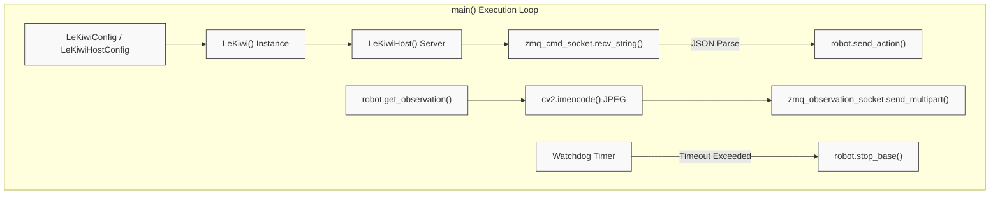

<!-- source: DeepWiki mcp.deepwiki.com · repo huggingface/lerobot · page 6.13 Distributed Robots: LeKiwi Host/Client · fetched 2026-10-26 -->

# Distributed Robots: LeKiwi Host/Client

<details>
<summary>Relevant source files</summary>

The following files were used as context for generating this wiki page:

- [examples/lekiwi/evaluate.py](examples/lekiwi/evaluate.py)
- [examples/lekiwi/record.py](examples/lekiwi/record.py)
- [examples/lekiwi/teleoperate.py](examples/lekiwi/teleoperate.py)
- [examples/phone_to_so100/evaluate.py](examples/phone_to_so100/evaluate.py)
- [examples/phone_to_so100/record.py](examples/phone_to_so100/record.py)
- [examples/phone_to_so100/teleoperate.py](examples/phone_to_so100/teleoperate.py)
- [examples/so100_to_so100_EE/evaluate.py](examples/so100_to_so100_EE/evaluate.py)
- [examples/so100_to_so100_EE/record.py](examples/so100_to_so100_EE/record.py)
- [examples/so100_to_so100_EE/teleoperate.py](examples/so100_to_so100_EE/teleoperate.py)
- [src/lerobot/cameras/__init__.py](src/lerobot/cameras/__init__.py)
- [src/lerobot/cameras/camera.py](src/lerobot/cameras/camera.py)
- [src/lerobot/robots/hope_jr/hope_jr_arm.py](src/lerobot/robots/hope_jr/hope_jr_arm.py)
- [src/lerobot/robots/hope_jr/hope_jr_hand.py](src/lerobot/robots/hope_jr/hope_jr_hand.py)
- [src/lerobot/robots/koch_follower/koch_follower.py](src/lerobot/robots/koch_follower/koch_follower.py)
- [src/lerobot/robots/lekiwi/config_lekiwi.py](src/lerobot/robots/lekiwi/config_lekiwi.py)
- [src/lerobot/robots/lekiwi/lekiwi.py](src/lerobot/robots/lekiwi/lekiwi.py)
- [src/lerobot/robots/lekiwi/lekiwi_client.py](src/lerobot/robots/lekiwi/lekiwi_client.py)
- [src/lerobot/robots/lekiwi/lekiwi_host.py](src/lerobot/robots/lekiwi/lekiwi_host.py)
- [src/lerobot/robots/omx_follower/omx_follower.py](src/lerobot/robots/omx_follower/omx_follower.py)
- [src/lerobot/robots/openarm_follower/openarm_follower.py](src/lerobot/robots/openarm_follower/openarm_follower.py)
- [src/lerobot/robots/so_follower/so_follower.py](src/lerobot/robots/so_follower/so_follower.py)
- [src/lerobot/utils/robot_utils.py](src/lerobot/utils/robot_utils.py)
- [tests/robots/test_so100_follower.py](tests/robots/test_so100_follower.py)

</details>


## Purpose and Scope

This page details the architecture for distributed control of mobile robots within LeRobot, specifically focusing on the LeKiwi platform. It covers the host/client split implemented via `LeKiwiHost` [src/lerobot/robots/lekiwi/lekiwi_host.py:38-59]() and `LeKiwiClient` [src/lerobot/robots/lekiwi/lekiwi_client.py:33-346](), the ZeroMQ (ZMQ) transport layer configurations (`LeKiwiHostConfig` and `LeKiwiClientConfig` [src/lerobot/robots/lekiwi/config_lekiwi.py:69-113]()), JPEG image encoding, watchdog safety mechanisms, and the remote exchange of observation and action payloads.

---

## LeKiwi Host/Client Architecture

The LeKiwi distributed robot framework uses a host-client model to separate high-level inference and coordination from low-level hardware actuation and sensor acquisition. 
- The **Host** (`lekiwi_host.py`) runs directly on the mobile robot compute unit (e.g., Raspberry Pi or companion PC), directly accessing the `LeKiwi` motor bus and cameras [src/lerobot/robots/lekiwi/lekiwi.py:56-81]().
- The **Client** (`lekiwi_client.py`) runs on a remote workstation or operator laptop where policies or teleoperation controllers execute, sending target velocities/positions and receiving remote observation streams.

Sources: [src/lerobot/robots/lekiwi/lekiwi.py:56-81](), [src/lerobot/robots/lekiwi/lekiwi_client.py:33-346](), [src/lerobot/robots/lekiwi/lekiwi_host.py:38-59]()

---

## LeKiwi Client (`LeKiwiClient`)

The `LeKiwiClient` class [src/lerobot/robots/lekiwi/lekiwi_client.py:40-346]() acts as the proxy robot interface on the remote evaluation/training workstation. Configured via `LeKiwiClientConfig` [src/lerobot/robots/lekiwi/config_lekiwi.py:85-113](), it establishes outgoing ZMQ connections to receive multi-camera vision frames and robot state while pushing command vectors.

### Key Implementation Details
* **Sockets**: Instantiates a `zmq.PUSH` socket (`zmq_cmd_socket`) for sending actions and a `zmq.PULL` socket (`zmq_observation_socket`) for reading frames [src/lerobot/robots/lekiwi/lekiwi_client.py:135-142]().
* **Connection & Polling**: Uses `connect()` [src/lerobot/robots/lekiwi/lekiwi_client.py:130-154]() with a timeout guard and `_poll_and_get_latest_message()` [src/lerobot/robots/lekiwi/lekiwi_client.py:158-189]() to drain stale packets and retain only the latest observation frame.
* **Parsing**: `_parse_observation()` [src/lerobot/robots/lekiwi/lekiwi_client.py:191-200]() unpacks multipart ZMQ payloads consisting of a JSON metadata header followed by raw JPEG camera buffers.
* **Camera Limitations**: Depth cameras are explicitly disabled on LeKiwi client-host links because transport payloads are restricted to color frames [src/lerobot/robots/lekiwi/lekiwi_client.py:53-58]().

```mermaid
graph TD
    subgraph NaturalLanguage["User / Policy Space"]
        A["RobotAction"] -->|send_action()| B[LeKiwiClient]
    end

    subgraph CodeEntitySpace["LeKiwiClient Code Entities"]
        B --> C["_zmq.Context()"]
        C --> D["zmq_cmd_socket (PUSH)"]
        C --> E["zmq_observation_socket (PULL)"]
        E --> F["_poll_and_get_latest_message()"]
        F --> G["_parse_observation(frames)"]
        G --> H["RobotObservation dict"]
    end

    D -- "tcp://remote_ip:port_zmq_cmd" --> HostCmd["LeKiwiHost PULL"]
    HostObs["LeKiwiHost PUSH"] -- "tcp://remote_ip:port_zmq_observations" --> E

    classDef default fill:#f9f9f9,stroke:#333,stroke-width:1px;
```
**Diagram: LeKiwi Client Component Mapping**
Sources: [src/lerobot/robots/lekiwi/config_lekiwi.py:85-113](), [src/lerobot/robots/lekiwi/lekiwi_client.py:40-200]()

---

## LeKiwi Host (`LeKiwiHost`)

The `LeKiwiHost` server executes on the robot hardware alongside the physical `LeKiwi` instance [src/lerobot/robots/lekiwi/lekiwi_host.py:61-141]().

### Key Implementation Details
* **Server Binding**: Binds a `zmq.PULL` socket (`zmq_cmd_socket`) for commands and a `zmq.PUSH` socket (`zmq_observation_socket`) for streaming sensor data [src/lerobot/robots/lekiwi/lekiwi_host.py:41-49]().
* **Main Loop & Watchdog**: The `main()` loop [src/lerobot/robots/lekiwi/lekiwi_host.py:61-141]() polls incoming commands, executes them via `robot.send_action()` [src/lerobot/robots/lekiwi/lekiwi_host.py:84](), and triggers a safety stop (`robot.stop_base()`) if communication lapses beyond `watchdog_timeout_ms` [src/lerobot/robots/lekiwi/lekiwi_host.py:93-99]().
* **Bandwidth Optimization**: Compresses observation frames into high-quality JPEGs via `cv2.imencode()` before packaging them into multipart messages [src/lerobot/robots/lekiwi/lekiwi_host.py:109-112]().


**Diagram: LeKiwi Host Control Loop**
Sources: [src/lerobot/robots/lekiwi/config_lekiwi.py:69-82](), [src/lerobot/robots/lekiwi/lekiwi_host.py:38-141]()

---

## ZMQ Transport

The ZeroMQ transport layer uses specific socket options to prioritize real-time responsiveness over reliable queue delivery:
* **`zmq.CONFLATE`**: Enabled (`1`) on the client action command socket to keep only the latest message, discarding older enqueued velocities [src/lerobot/robots/lekiwi/lekiwi_client.py:138]().
* **High-Water Marks (`RCVHWM` / `SNDHWM`)**: Set to `2` on observation sockets to prevent memory bloat and shed stale network frames during transmission lag [src/lerobot/robots/lekiwi/lekiwi_client.py:145](), [src/lerobot/robots/lekiwi/lekiwi_host.py:48]().
* **Multipart Packaging**: Observation packets combine a JSON descriptor header with raw binary JPEG chunks [src/lerobot/robots/lekiwi/lekiwi_host.py:117-119](), avoiding the 33% CPU and bandwidth overhead of Base64 encoding.

Sources: [src/lerobot/robots/lekiwi/lekiwi_client.py:138](), [src/lerobot/robots/lekiwi/lekiwi_client.py:145](), [src/lerobot/robots/lekiwi/lekiwi_host.py:48](), [src/lerobot/robots/lekiwi/lekiwi_host.py:117-119]()

---

## Remote Observation/Action Exchange

Data exchange is structured around synchronous polling cycles:
1. **Observation Acquisition**: The host calls `robot.get_observation()` [src/lerobot/robots/lekiwi/lekiwi_host.py:101](), extracts camera frames, compresses them, and pushes them across the network [src/lerobot/robots/lekiwi/lekiwi_host.py:109-119]().
2. **Client Reconstruction**: The client receives multipart arrays, parses the JSON header via `_parse_observation()` [src/lerobot/robots/lekiwi/lekiwi_client.py:191-200](), and makes observations available to evaluation policies.
3. **Action Dispatch**: The client generates actions through user teleoperation or policy rollouts, serializing them to JSON strings for transmission back to the host [src/lerobot/robots/lekiwi/lekiwi_client.py:260-261]().

Sources: [src/lerobot/robots/lekiwi/lekiwi_client.py:191-200](), [src/lerobot/robots/lekiwi/lekiwi_client.py:260-261](), [src/lerobot/robots/lekiwi/lekiwi_host.py:101](), [src/lerobot/robots/lekiwi/lekiwi_host.py:109-119]()

---

## Image Server (`ImageServer`)

For general-purpose camera streaming outside of LeKiwi, the codebase provides a standalone `ImageServer` utility.

* **Background Threads**: Utilizes `CameraCaptureThread` to decouple OpenCV device capture from network publishing.
* **ZMQ Publisher**: Broadcasts frames over a `zmq.PUB` socket, allowing multiple remote clients using `ZMQCamera` to subscribe to independent video streams concurrently.

Sources: [src/lerobot/cameras/camera.py:26-184]()

---

