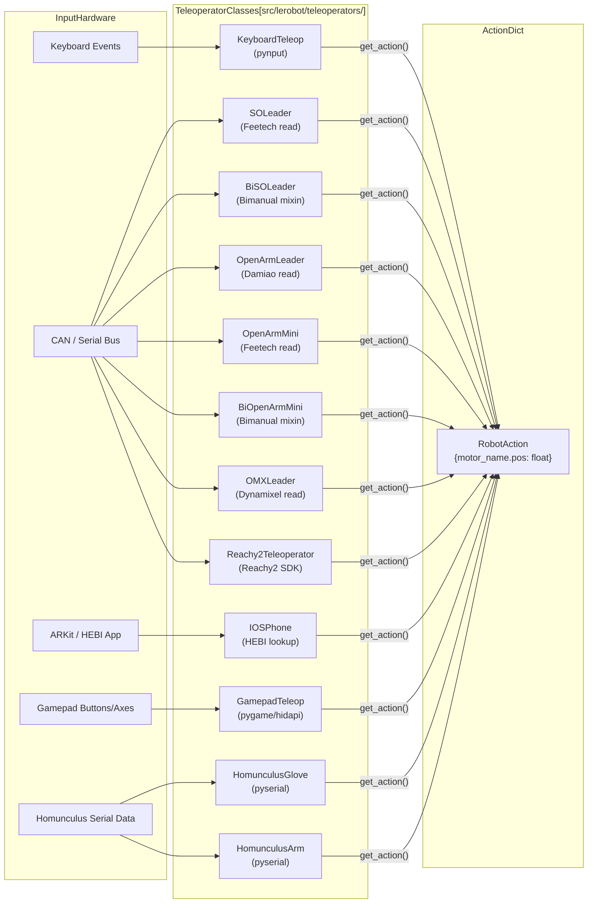

<!-- source: DeepWiki mcp.deepwiki.com · repo huggingface/lerobot · page 6.2 Supported Hardware · fetched 2026-10-26 -->

# Supported Hardware

Relevant source files

The following files were used as context for generating this wiki page:

- [docs/source/envhub.mdx](docs/source/envhub.mdx)
- [docs/source/hil_data_collection.mdx](docs/source/hil_data_collection.mdx)
- [docs/source/koch.mdx](docs/source/koch.mdx)
- [docs/source/lekiwi.mdx](docs/source/lekiwi.mdx)
- [docs/source/omx.mdx](docs/source/omx.mdx)
- [docs/source/openarm.mdx](docs/source/openarm.mdx)
- [docs/source/rebot_b601.mdx](docs/source/rebot_b601.mdx)
- [docs/source/so100.mdx](docs/source/so100.mdx)
- [docs/source/so101.mdx](docs/source/so101.mdx)
- [docs/source/third_party_robots.mdx](docs/source/third_party_robots.mdx)
- [docs/source/third_party_sensors.mdx](docs/source/third_party_sensors.mdx)
- [src/lerobot/robots/bi_openarm_follower/bi_openarm_follower.py](src/lerobot/robots/bi_openarm_follower/bi_openarm_follower.py)
- [src/lerobot/robots/bi_openarm_follower/config_bi_openarm_follower.py](src/lerobot/robots/bi_openarm_follower/config_bi_openarm_follower.py)
- [src/lerobot/robots/bi_rebot_b601_follower/bi_rebot_b601_follower.py](src/lerobot/robots/bi_rebot_b601_follower/bi_rebot_b601_follower.py)
- [src/lerobot/robots/bi_rebot_b601_follower/config_bi_rebot_b601_follower.py](src/lerobot/robots/bi_rebot_b601_follower/config_bi_rebot_b601_follower.py)
- [src/lerobot/robots/bi_so_follower/bi_so_follower.py](src/lerobot/robots/bi_so_follower/bi_so_follower.py)
- [src/lerobot/robots/openarm_follower/__init__.py](src/lerobot/robots/openarm_follower/__init__.py)
- [src/lerobot/robots/openarm_follower/config_openarm_follower.py](src/lerobot/robots/openarm_follower/config_openarm_follower.py)
- [src/lerobot/robots/reachy2/configuration_reachy2.py](src/lerobot/robots/reachy2/configuration_reachy2.py)
- [src/lerobot/robots/reachy2/robot_reachy2.py](src/lerobot/robots/reachy2/robot_reachy2.py)
- [src/lerobot/robots/rebot_b601_follower/__init__.py](src/lerobot/robots/rebot_b601_follower/__init__.py)
- [src/lerobot/robots/rebot_b601_follower/config_rebot_b601_follower.py](src/lerobot/robots/rebot_b601_follower/config_rebot_b601_follower.py)
- [src/lerobot/robots/rebot_b601_follower/motor_family.py](src/lerobot/robots/rebot_b601_follower/motor_family.py)
- [src/lerobot/robots/rebot_b601_follower/rebot_b601_follower.py](src/lerobot/robots/rebot_b601_follower/rebot_b601_follower.py)
- [src/lerobot/teleoperators/bi_openarm_leader/bi_openarm_leader.py](src/lerobot/teleoperators/bi_openarm_leader/bi_openarm_leader.py)
- [src/lerobot/teleoperators/bi_so_leader/bi_so_leader.py](src/lerobot/teleoperators/bi_so_leader/bi_so_leader.py)
- [src/lerobot/teleoperators/gamepad/teleop_gamepad.py](src/lerobot/teleoperators/gamepad/teleop_gamepad.py)
- [src/lerobot/teleoperators/homunculus/homunculus_arm.py](src/lerobot/teleoperators/homunculus/homunculus_arm.py)
- [src/lerobot/teleoperators/homunculus/homunculus_glove.py](src/lerobot/teleoperators/homunculus/homunculus_glove.py)
- [src/lerobot/teleoperators/koch_leader/koch_leader.py](src/lerobot/teleoperators/koch_leader/koch_leader.py)
- [src/lerobot/teleoperators/omx_leader/config_omx_leader.py](src/lerobot/teleoperators/omx_leader/config_omx_leader.py)
- [src/lerobot/teleoperators/omx_leader/omx_leader.py](src/lerobot/teleoperators/omx_leader/omx_leader.py)
- [src/lerobot/teleoperators/openarm_leader/__init__.py](src/lerobot/teleoperators/openarm_leader/__init__.py)
- [src/lerobot/teleoperators/openarm_leader/config_openarm_leader.py](src/lerobot/teleoperators/openarm_leader/config_openarm_leader.py)
- [src/lerobot/teleoperators/openarm_leader/openarm_leader.py](src/lerobot/teleoperators/openarm_leader/openarm_leader.py)
- [src/lerobot/teleoperators/openarm_mini/openarm_mini.py](src/lerobot/teleoperators/openarm_mini/openarm_mini.py)
- [src/lerobot/teleoperators/phone/teleop_phone.py](src/lerobot/teleoperators/phone/teleop_phone.py)
- [src/lerobot/teleoperators/reachy2_teleoperator/reachy2_teleoperator.py](src/lerobot/teleoperators/reachy2_teleoperator/reachy2_teleoperator.py)
- [src/lerobot/teleoperators/so_leader/so_leader.py](src/lerobot/teleoperators/so_leader/so_leader.py)
- [tests/conftest.py](tests/conftest.py)
- [tests/envs/test_envs.py](tests/envs/test_envs.py)
- [tests/robots/test_reachy2.py](tests/robots/test_reachy2.py)
- [tests/robots/test_rebot_b601_follower.py](tests/robots/test_rebot_b601_follower.py)
- [tests/test_control_robot.py](tests/test_control_robot.py)

This page documents all robot platforms, teleoperation devices, motor control buses, and camera systems supported by the LeRobot framework. The purpose of this hardware integration layer is to abstract away low-level vendor protocols, providing uniform `Robot` and `Teleoperator` interfaces so that data collection, policy training, and evaluation scripts execute seamlessly across heterogeneous hardware. For details on abstract interface contracts, see [Robot and Teleoperator Abstraction]().

---

## Hardware Ecosystem Overview

LeRobot supports diverse robotic form factors ranging from low-cost 3D-printed benchtop arms to industrial bimanual systems, mobile rovers, and humanoids.

### Hardware-to-Code Mapping

The following diagram bridges physical natural-language hardware concepts to concrete code classes and SDK bindings across the codebase.

```mermaid
graph TB
    subgraph "RobotPlatforms[src/lerobot/robots/]"
        subgraph "ManipulatorArms"
            SO100["SO100Follower[so_follower/]<br/>6-DOF arm<br/>Feetech motors"]
            SO101["SO101Follower[so_follower/]<br/>6-DOF arm<br/>Feetech motors"]
            Koch["KochFollower[koch_follower/]<br/>6-DOF arm<br/>Dynamixel motors"]
            OpenArm["OpenArmFollower[openarm_follower/]<br/>7-DOF arm<br/>Damiao CAN motors"]
            BiOpenArm["BiOpenArmFollower[bi_openarm_follower/]<br/>Bimanual 7-DOF arms"]
            OMX["OMXFollower[omx_follower/]<br/>6-DOF arm<br/>Dynamixel motors"]
            ReBot["RebotB601Follower[rebot_b601_follower/]<br/>6-DOF arm<br/>Damiao/Robstride CAN motors"]
            BiReBot["BiRebotB601Follower[bi_rebot_b601_follower/]<br/>Bimanual 6-DOF arms"]
            HopeJR_Arm["HopeJRArm[hope_jr/]<br/>7-DOF arm<br/>Feetech motors"]
        end
        
        subgraph "MobilePlatforms"
            LeKiwi["LeKiwi[lekiwi/]<br/>Arm + 3-wheel base<br/>Feetech motors"]
            EarthRover["EarthRoverMiniPlus[earthrover_mini_plus/]<br/>Cloud rover<br/>Frodobots SDK"]
        end
        
        subgraph "AdvancedPlatforms"
            UnitreeG1["UnitreeG1[unitree_g1/]<br/>Humanoid robot<br/>Unitree SDK2"]
            Reachy2["Reachy2[reachy2/]<br/>Humanoid upper body<br/>Reachy2 SDK"]
        end
    end
    
    subgraph "TeleoperationDevices[src/lerobot/teleoperators/]"
        subgraph "LeaderArms"
            SOLeader["SOLeader[so_leader/]<br/>6-DOF leader"]
            BiSOLeader["BiSOLeader[bi_so_leader/]<br/>Bimanual SO leader arms"]
            OpenArmL["OpenArmLeader[openarm_leader/]<br/>7-DOF leader"]
            OpenArmMini["OpenArmMini[openarm_mini/]<br/>8-motor dual arms"]
            BiOpenArmMini["BiOpenArmMini[bi_openarm_mini/]<br/>Bimanual variant"]
            OMXLeader["OMXLeader[omx_leader/]<br/>6-DOF leader"]
            Reachy2Teleop["Reachy2Teleoperator[reachy2_teleoperator/]<br/>Reachy2 as teleop"]
        end
        
        subgraph "InputDevices"
            Gamepad["GamepadTeleop[gamepad/]<br/>pygame + hidapi"]
            Keyboard["KeyboardTeleop[keyboard/]<br/>pynput"]
            Phone["IOSPhone<br/>(HEBI lookup)"]
        end
        
        subgraph "Specialized"
            HomunculusGlove["HomunculusGlove[homunculus/]<br/>Hand teleoperation"]
            HomunculusArm["HomunculusArm[homunculus/]<br/>Arm teleoperation"]
        end
    end
    
    subgraph "MotorControllers[src/lerobot/motors/]"
        Dynamixel["DynamixelMotorsBus<br/>Dynamixel SDK"]
        Feetech["FeetechMotorsBus<br/>Feetech SDK"]
        DamiaoMotors["DamiaoMotorsBus<br/>python-can"]
        RobstrideMotors["RobstrideMotorsBus<br/>python-can"]
    end
    
    SO100 --> Feetech
    SO101 --> Feetech
    Koch --> Dynamixel
    OpenArm --> DamiaoMotors
    BiOpenArm --> DamiaoMotors
    LeKiwi --> Feetech
    HopeJR_Arm --> Feetech
    OMX --> Dynamixel
    ReBot --> DamiaoMotors
    ReBot --> RobstrideMotors
    BiReBot --> DamiaoMotors
    BiReBot --> RobstrideMotors
    OMXLeader --> Dynamixel
    Reachy2Teleop --> ReachySDK
    
    UnitreeG1 -.-> UnitreeSDK["unitree-sdk2py"]
    Reachy2 -.-> ReachySDK["reachy2_sdk"]
    EarthRover -.-> FrodoSDK["Frodobots SDK"]
```

Sources: [src/lerobot/robots/lekiwi/lekiwi.py:41-51](), [src/lerobot/robots/bi_so_follower/bi_so_follower.py:31-37](), [src/lerobot/teleoperators/bi_so_leader/bi_so_leader.py:31-37](), [src/lerobot/robots/openarm_follower/openarm_follower.py:39-48](), [src/lerobot/robots/rebot_b601_follower/rebot_b601_follower.py:69-78](), [src/lerobot/robots/bi_rebot_b601_follower/bi_rebot_b601_follower.py:31-37](), [src/lerobot/teleoperators/omx_leader/omx_leader.py:25](), [src/lerobot/teleoperators/reachy2_teleoperator/reachy2_teleoperator.py:25]()

---

## Robot Platforms

### Manipulator Arms

#### SO-100 & SO-101
Low-cost, 3D-printable 6-DOF manipulator arms driven by Feetech STS3215 servo motors.
- **Classes:** `SO100Follower`, `SO101Follower`, subclassing the generic `SOFollower` base [docs/source/so101.mdx:16]().
- **Motor Bus:** `FeetechMotorsBus` managing 6 joints (`shoulder_pan`, `shoulder_lift`, `elbow_flex`, `wrist_flex`, `wrist_roll`, `gripper`) [src/lerobot/teleoperators/so_leader/so_leader.py:64-73]().
- **Bimanual Variant:** `BiSOFollower` combines two `SOFollower` instances using the `BimanualMixin`, automatically managing prefixed observation and action keys (e.g., `left_shoulder_pan.pos`, `right_shoulder_pan.pos`) [src/lerobot/robots/bi_so_follower/bi_so_follower.py:31-88]().

#### Koch v1.1
A 6-DOF manipulator arm utilizing high-precision Dynamixel servo motors.
- **Class:** `KochFollower` [docs/source/koch.mdx:16]().
- **Motor Bus:** `DynamixelMotorsBus` via the official Dynamixel SDK [src/lerobot/teleoperators/koch_leader/koch_leader.py:60-69]().

#### OpenArm & BiOpenArm
High-payload, high-performance 7-DOF arms using Damiao CAN-based motors operating in MIT impedance control mode.
- **Class:** `OpenArmFollower` [docs/source/openarm.mdx:16]().
- **Bimanual Class:** `BiOpenArmFollower` [src/lerobot/robots/bi_openarm_follower/bi_openarm_follower.py:31-37]().
- **Motor Bus:** `DamiaoMotorsBus` using `python-can` with CAN FD support, enabling dynamic configuration of stiffness (`Kp`) and damping (`Kd`) gains [src/lerobot/robots/openarm_follower/openarm_follower.py:62-70]().

#### OMX & reBot B601
- **OMX:** 6-DOF manipulator arm powered by Dynamixel motors wrapped by `OMXFollower` [docs/source/omx.mdx:16]().
- **reBot B601:** 6-DOF arm utilizing Damiao or Robstride CAN motors managed via `RebotB601Follower` and `BiRebotB601Follower` [docs/source/rebot_b601.mdx:16](), [src/lerobot/robots/rebot_b601_follower/rebot_b601_follower.py:69-78](), [src/lerobot/robots/bi_rebot_b601_follower/bi_rebot_b601_follower.py:31-37]().

#### HopeJR
Research platform incorporating a 7-DOF arm (`HopeJRArm`) and a dexterous multi-fingered hand (`HopeJRHand`) driven by Feetech servos [src/lerobot/robots/hope_jr/hope_jr_arm.py:23](), [src/lerobot/robots/hope_jr/hope_jr_hand.py:22]().

Sources: [src/lerobot/teleoperators/so_leader/so_leader.py:64-73](), [src/lerobot/robots/openarm_follower/openarm_follower.py:62-70](), [src/lerobot/robots/bi_so_follower/bi_so_follower.py:31-88](), [src/lerobot/teleoperators/koch_leader/koch_leader.py:60-69](), [src/lerobot/robots/bi_openarm_follower/bi_openarm_follower.py:31-37](), [src/lerobot/robots/rebot_b601_follower/rebot_b601_follower.py:69-78](), [src/lerobot/robots/bi_rebot_b601_follower/bi_rebot_b601_follower.py:31-37](), [src/lerobot/robots/hope_jr/hope_jr_arm.py:23](), [src/lerobot/robots/hope_jr/hope_jr_hand.py:22](), [docs/source/so101.mdx:16](), [docs/source/koch.mdx:16](), [docs/source/openarm.mdx:16](), [docs/source/omx.mdx:16](), [docs/source/rebot_b601.mdx:16]()

### Mobile Platforms

#### LeKiwi
A mobile manipulator platform integrating a 6-DOF follower arm with a three-omniwheel mobile base.
- **Class:** `LeKiwi` [docs/source/lekiwi.mdx:9]().
- **Motor Bus:** 9x Feetech STS3215 motors on a single bus (Motors 1-6 control arm joints; Motors 7-9 control `base_left_wheel`, `base_back_wheel`, and `base_right_wheel`) [src/lerobot/robots/lekiwi/lekiwi.py:56-72]().
- **Kinematics:** Base actions are specified as body velocities (`x.vel`, `y.vel`, `theta.vel`) [src/lerobot/robots/lekiwi/lekiwi.py:84-98]().
- **Host/Client Distribution:** Supports network separation via `LeKiwiHostConfig` and `LeKiwiClientConfig`, communicating commands and image streams over ZeroMQ [src/lerobot/robots/lekiwi/config_lekiwi.py:68-112]().

#### EarthRover Mini Plus
A cloud-connected mobile outdoor rover.
- **Class:** `EarthRoverMiniPlus` [src/lerobot/robots/earthrover_mini_plus/robot_earthrover_mini_plus.py:72-91]().
- **Communication:** Communicates via HTTP REST endpoints provided by the Frodobots SDK [src/lerobot/robots/earthrover_mini_plus/robot_earthrover_mini_plus.py:101-143]().
- **Observation Space:** Exposes 24 observation streams including front/rear video feeds, GPS coordinates, IMU orientation, and wheel RPMs [src/lerobot/robots/earthrover_mini_plus/robot_earthrover_mini_plus.py:168-200]().

Sources: [src/lerobot/robots/lekiwi/lekiwi.py:56-98](), [src/lerobot/robots/lekiwi/config_lekiwi.py:68-112](), [src/lerobot/robots/earthrover_mini_plus/robot_earthrover_mini_plus.py:72-200](), [docs/source/lekiwi.mdx:9]()

### Advanced Platforms

#### Unitree G1
A humanoid robot available in 23 and 29 DoF configurations [docs/source/unitree_g1.mdx:9]().
- **Class:** `UnitreeG1` [src/lerobot/robots/unitree_g1/unitree_g1.py:148]().
- **Control Integration:** Interfaces through `unitree-sdk2py`, supporting whole-body controllers such as `HolosomaLocomotionController` and `GrootLocomotionController` [src/lerobot/robots/unitree_g1/unitree_g1.py:100-113]().

#### Reachy2
A humanoid upper-body research platform by Pollen Robotics.
- **Class:** `Reachy2` [src/lerobot/robots/reachy2/robot_reachy2.py]().
- **SDK & External Control:** Interacts via `reachy2_sdk` and supports external VR command streams via `use_external_commands` [docs/source/reachy2.mdx:112-181]().

Sources: [src/lerobot/robots/unitree_g1/unitree_g1.py:100-148](), [src/lerobot/robots/reachy2/robot_reachy2.py](), [docs/source/unitree_g1.mdx:9](), [docs/source/reachy2.mdx:112-181]()

---

## Teleoperation Devices

Teleoperators implement the `Teleoperator` interface, mapping human input devices to action dictionaries.

### Teleoperation Control Flow

Sources: [src/lerobot/teleoperators/keyboard/teleop_keyboard.py:51-145](), [src/lerobot/teleoperators/bi_so_leader/bi_so_leader.py:89-100](), [src/lerobot/teleoperators/so_leader/so_leader.py:146-152](), [src/lerobot/teleoperators/phone/teleop_phone.py:83-110](), [src/lerobot/teleoperators/gamepad/teleop_gamepad.py:103-130](), [src/lerobot/teleoperators/homunculus/homunculus_glove.py:169-175](), [src/lerobot/teleoperators/homunculus/homunculus_arm.py:170-176](), [src/lerobot/teleoperators/openarm_leader/openarm_leader.py:146-152](), [src/lerobot/teleoperators/openarm_mini/openarm_mini.py:200-206](), [src/lerobot/teleoperators/bi_openarm_leader/bi_openarm_leader.py:89-100](), [src/lerobot/teleoperators/omx_leader/omx_leader.py:146-152](), [src/lerobot/teleoperators/reachy2_teleoperator/reachy2_teleoperator.py:146-152]()

### Device Details

#### Leader Arms
- `SOLeader`: Generic leader arm implementation for SO-100/101/102 [src/lerobot/teleoperators/so_leader/so_leader.py:56]().
- `BiSOLeader`: Bimanual orchestrator for dual SO leader arms, routing feedback for smooth DAgger handovers [src/lerobot/teleoperators/bi_so_leader/bi_so_leader.py:59-141]().
- `OpenArmLeader`: 7-DOF leader arm using Damiao motors [src/lerobot/teleoperators/openarm_leader/openarm_leader.py]().
- `OpenArmMini` & `BiOpenArmMini`: Dual-arm Feetech-based compact leader units supporting active force feedback and torque-free teaching [src/lerobot/teleoperators/openarm_mini/openarm_mini.py:54](), [src/lerobot/teleoperators/bi_openarm_leader/bi_openarm_leader.py:31-37]().
- `OMXLeader`: 6-DOF leader arm using Dynamixel motors [src/lerobot/teleoperators/omx_leader/omx_leader.py:25]().
- `Reachy2Teleoperator`: Uses a Reachy2 robot as a teleoperation device [src/lerobot/teleoperators/reachy2_teleoperator/reachy2_teleoperator.py:25]().

#### Input Devices & Gamepads
- `KeyboardTeleop` & `KeyboardRoverTeleop`: Process keyboard events via `pynput` for discrete velocity or joint control [src/lerobot/teleoperators/keyboard/teleop_keyboard.py:51-66]().
- `GamepadTeleop`: Interfaces with gamepads via `pygame` and `hidapi` for continuous joystick control [src/lerobot/teleoperators/gamepad/teleop_gamepad.py:55]().

#### Mobile & Wearable Teleoperators
- `IOSPhone`: Integrates iOS devices running the HEBI Mobile I/O app via `hebi-py`, streaming 6-DoF ARKit poses and button states [src/lerobot/teleoperators/phone/teleop_phone.py:96-124]().
- `HomunculusGlove` & `HomunculusArm`: Wearable exoskeleton gloves and arms for dexterous hand and arm teleoperation [src/lerobot/teleoperators/homunculus/homunculus_glove.py:66](), [src/lerobot/teleoperators/homunculus/homunculus_arm.py:40]().
- `UnitreeG1Exo`: Whole-body exoskeleton teleoperator for the G1 humanoid [docs/source/unitree_g1.mdx:207-208]().

Sources: [src/lerobot/teleoperators/so_leader/so_leader.py:56](), [src/lerobot/teleoperators/bi_so_leader/bi_so_leader.py:31-141](), [src/lerobot/teleoperators/openarm_leader/openarm_leader.py](), [src/lerobot/teleoperators/openarm_mini/openarm_mini.py:54](), [src/lerobot/teleoperators/bi_openarm_leader/bi_openarm_leader.py:31-37](), [src/lerobot/teleoperators/omx_leader/omx_leader.py:25](), [src/lerobot/teleoperators/reachy2_teleoperator/reachy2_teleoperator.py:25](), [src/lerobot/teleoperators/keyboard/teleop_keyboard.py:51-66](), [src/lerobot/teleoperators/gamepad/teleop_gamepad.py:55](), [src/lerobot/teleoperators/phone/teleop_phone.py:96-124](), [src/lerobot/teleoperators/homunculus/homunculus_glove.py:66](), [src/lerobot/teleoperators/homunculus/homunculus_arm.py:40](), [docs/source/unitree_g1.mdx:207-208]()

---

## Motor Control Systems

LeRobot abstracts low-level motor communication behind unified bus classes inheriting from `MotorsBusBase`:

| Bus Class | Communication Protocol | Supported Hardware |
|-----------|------------------------|--------------------|
| `FeetechMotorsBus` | Feetech Servo Protocol (UART) | SO-100, SO-101, LeKiwi, HopeJR, OpenArm Mini, reBot |
| `DynamixelMotorsBus` | Dynamixel SDK (TTL/RS485) | Koch v1.1, OMX |
| `DamiaoMotorsBus` | CAN / CAN FD (`python-can`) | OpenArm, BiOpenArm, reBot B601 |
| `RobstrideMotorsBus` | CAN / CAN FD (`python-can`) | Robstride actuators, reBot B601 |

Sources: [src/lerobot/teleoperators/so_leader/so_leader.py:64-73](), [src/lerobot/teleoperators/koch_leader/koch_leader.py:60-69](), [src/lerobot/robots/openarm_follower/openarm_follower.py:62-70](), [src/lerobot/robots/rebot_b601_follower/rebot_b601_follower.py:69-78](), [src/lerobot/teleoperators/openarm_mini/openarm_mini.py:64-73]()

---

## Camera Systems & Discovery Tools

Cameras are managed through the `lerobot.cameras` module, supporting multi-camera setups, depth streams, and remote network transport.

- **OpenCV Cameras**: Standard USB cameras configured via `OpenCVCameraConfig` [src/lerobot/robots/lekiwi/config_lekiwi.py:23-41]().
- **Intel RealSense**: RGB-D depth sensor integration.
- **ZeroMQ Cameras**: Network video streaming for remote robots like LeKiwi or Unitree G1 [docs/source/unitree_g1.mdx:57](), [src/lerobot/robots/lekiwi/config_lekiwi.py:68-73]().
- **SDK Cameras**: Reachy2 camera streaming via `Reachy2Camera` using `reachy2_sdk` [src/lerobot/cameras/reachy2_camera/reachy2_camera.py:57-82]().

### Calibration & Setup CLI Utilities
LeRobot provides command-line tools for hardware bring-up:
- `lerobot-find-port`: Identifies serial port assignments for motor buses [docs/source/so101.mdx:50-54]().
- `lerobot-setup-motors`: Configures motor IDs and baudrates in EEPROM [docs/source/so101.mdx:130-132](), [src/lerobot/teleoperators/so_leader/so_leader.py:162-166]().
- `lerobot-calibrate`: Interactively calibrates joint homing offsets and motion ranges [tests/test_control_robot.py:47-50](), [src/lerobot/teleoperators/so_leader/so_leader.py:105-149]().
- `lerobot-find-cameras`: Enumerates and tests available camera indices.

Sources: [src/lerobot/robots/lekiwi/config_lekiwi.py:23-41](), [docs/source/unitree_g1.mdx:57](), [src/lerobot/robots/lekiwi/config_lekiwi.py:68-73](), [src/lerobot/cameras/reachy2_camera/reachy2_camera.py:57-82](), [docs/source/so101.mdx:50-54](), [docs/source/so101.mdx:130-132](), [src/lerobot/teleoperators/so_leader/so_leader.py:162-166](), [tests/test_control_robot.py:47-50](), [src/lerobot/teleoperators/so_leader/so_leader.py:105-149]()

---

