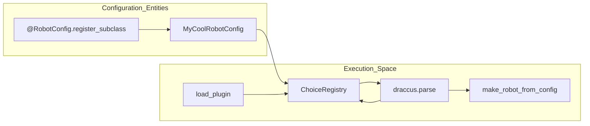

<!-- source: DeepWiki mcp.deepwiki.com · repo huggingface/lerobot · page 6.3 Configuration System · fetched 2026-10-26 -->

# Configuration System

Relevant source files

The following files were used as context for generating this wiki page:

- [src/lerobot/motors/encoding_utils.py](src/lerobot/motors/encoding_utils.py)
- [src/lerobot/robots/earthrover_mini_plus/__init__.py](src/lerobot/robots/earthrover_mini_plus/__init__.py)
- [src/lerobot/robots/earthrover_mini_plus/config_earthrover_mini_plus.py](src/lerobot/robots/earthrover_mini_plus/config_earthrover_mini_plus.py)
- [src/lerobot/robots/earthrover_mini_plus/earthrover_mini_plus.mdx](src/lerobot/robots/earthrover_mini_plus/earthrover_mini_plus.mdx)
- [src/lerobot/robots/so_follower/config_so_follower.py](src/lerobot/robots/so_follower/config_so_follower.py)
- [src/lerobot/teleoperators/keyboard/__init__.py](src/lerobot/teleoperators/keyboard/__init__.py)
- [src/lerobot/teleoperators/keyboard/configuration_keyboard.py](src/lerobot/teleoperators/keyboard/configuration_keyboard.py)
- [src/lerobot/teleoperators/so_leader/config_so_leader.py](src/lerobot/teleoperators/so_leader/config_so_leader.py)
- [tests/motors/test_dynamixel.py](tests/motors/test_dynamixel.py)
- [tests/motors/test_feetech.py](tests/motors/test_feetech.py)
- [tests/utils/test_encoding_utils.py](tests/utils/test_encoding_utils.py)
- [tests/utils/test_process.py](tests/utils/test_process.py)

## Purpose and Scope

This document details the configuration system used for hardware integration within LeRobot. It covers how `RobotConfig`, `TeleoperatorConfig`, and `CameraConfig` classes are structured, how the `register_subclass` decorator pattern enables dynamic instantiation via `draccus` [src/lerobot/configs/parser.py:28-37](), how validation is implemented through post-initialization hooks, and how hardware-specific parameters are managed.

For information about runtime hardware classes, see [Robot and Teleoperator Abstraction](6.1). For available hardware implementations, see [Supported Hardware](6.2). For command-line parsing mechanics, see [Command Line Interface](1.3).

Sources: [src/lerobot/configs/parser.py:28-37]()

---

## Configuration Architecture Overview

LeRobot employs a dataclass-based configuration system powered by `draccus` [src/lerobot/configs/parser.py:28-37](), combined with a registry pattern to support modular hardware additions. The architecture maps natural language hardware identifiers to concrete configuration and runtime classes.

Title: "Hardware Configuration Class Hierarchy and Code Entities"

```mermaid
graph TB
    subgraph "Natural_Language_Space"
        CameraType["opencv / reachy2"]
        TeleopType["keyboard / keyboard_rover / so100_leader"]
        RobotType["earthrover_mini_plus / so100_follower"]
    end

    subgraph "Code_Entity_Space"
        CameraConfig["CameraConfig"]
        TeleopConfig["TeleoperatorConfig"]
        RobotConfig["RobotConfig"]

        OpenCVConfig["OpenCVCameraConfig"]
        Reachy2CamConfig["Reachy2CameraConfig"]
        
        KeyboardConfig["KeyboardTeleopConfig"]
        KeyboardEEConfig["KeyboardEndEffectorTeleopConfig"]
        KeyboardRoverConfig["KeyboardRoverTeleopConfig"]
        SOLeaderConfig["SOLeaderTeleopConfig"]
        
        EarthRoverConfig["EarthRoverMiniPlusConfig"]
        SOFollowerConfig["SOFollowerRobotConfig"]
    end

    CameraType --> OpenCVConfig
    CameraType --> Reachy2CamConfig
    TeleopType --> KeyboardConfig
    TeleopType --> KeyboardEEConfig
    TeleopType --> KeyboardRoverConfig
    TeleopType --> SOLeaderConfig
    RobotType --> EarthRoverConfig
    RobotType --> SOFollowerConfig

    CameraConfig --> OpenCVConfig
    CameraConfig --> Reachy2CamConfig
    TeleopConfig --> KeyboardConfig
    TeleopConfig --> KeyboardEEConfig
    TeleopConfig --> KeyboardRoverConfig
    TeleopConfig --> SOLeaderConfig
    RobotConfig --> EarthRoverConfig
    RobotConfig --> SOFollowerConfig
```

Sources: [src/lerobot/configs/parser.py:28-37]()

---

## Base Configuration Classes and Subclass Registration

The configuration hierarchy roots in abstract base dataclasses that provide common attributes and expose subclass registration decorators.

### RobotConfig and TeleoperatorConfig

`RobotConfig` [src/lerobot/robots/config.py]() and `TeleoperatorConfig` [src/lerobot/teleoperators/config.py]() act as the base classes for all robot and teleoperator configurations respectively. Using `draccus` [src/lerobot/configs/parser.py:28-37](), they support choice-type fields where the exact configuration dataclass is resolved dynamically at runtime based on the `--robot.type` or `--teleop.type` CLI arguments.

For example, `SOFollowerRobotConfig` [src/lerobot/robots/so_follower/config_so_follower.py:59-60]() registers itself for both `"so101_follower"` and `"so100_follower"` types, inheriting from `RobotConfig` and `SOFollowerConfig`. Similarly, `SOLeaderTeleopConfig` [src/lerobot/teleoperators/so_leader/config_so_leader.py:39-40]() registers for `"so101_leader"` and `"so100_leader"`.

### CameraConfig

`CameraConfig` provides a unified base class for streaming image capture parameters (resolution, FPS, color space). Concrete implementations inherit from `CameraConfig` and register themselves under distinct string keys.

Sources: [src/lerobot/configs/parser.py:28-37](), [src/lerobot/robots/so_follower/config_so_follower.py:59-60](), [src/lerobot/teleoperators/so_leader/config_so_leader.py:39-40]()

---

## Registration System and Dynamic Resolution

The registration system uses a decorator pattern (`register_subclass`) implemented via `draccus` choice registries [src/lerobot/utils/import_utils.py:21-21](). When third-party packages or internal modules are imported, their configuration classes register themselves against the parent class registry.

Title: "Registration and Resolution Data Flow"

Plugin discovery is handled by `load_plugin` [src/lerobot/configs/parser.py:150-181](), which imports specified package paths and executes registration hooks so that custom hardware options become available to CLI parsers and config loaders.

Sources: [src/lerobot/configs/parser.py:28-37](), [src/lerobot/configs/parser.py:150-181](), [src/lerobot/utils/import_utils.py:21-21]()

---

## Validation and Post-Initialization (`__post_init__`)

Configuration classes implement validation logic inside Python's standard `__post_init__` method. This guarantees that parameters are validated immediately upon instantiation, whether loaded from a YAML/JSON configuration file or parsed from CLI arguments.

For example, camera and robot configurations validate enum coercions, string parameters, and numerical constraints during post-initialization [docs/source/integrate_hardware.mdx:36-65]().

Sources: [docs/source/integrate_hardware.mdx:36-65]()

---

## Hardware-Specific Parameters

Configuration classes define typed attributes specific to individual physical platforms [docs/source/integrate_hardware.mdx:36-65](). 

### Keyboard Teleoperator Parameters

The `KeyboardTeleopConfig` [src/lerobot/teleoperators/keyboard/configuration_keyboard.py:23-24]() serves as a base for keyboard-based teleoperation. Specific variants include:
- `KeyboardEndEffectorTeleopConfig` [src/lerobot/teleoperators/keyboard/configuration_keyboard.py:33-34](): Adds a `use_gripper` attribute for controlling end-effectors.
- `KeyboardRoverTeleopConfig` [src/lerobot/teleoperators/keyboard/configuration_keyboard.py:47-48](): Defines parameters like `linear_speed`, `angular_speed`, `speed_increment`, and `turn_assist_ratio` for mobile robot control.

### SO Follower Robot Parameters

The `SOFollowerConfig` [src/lerobot/robots/so_follower/config_so_follower.py:25-26]() includes parameters such as `port`, `disable_torque_on_disconnect`, `max_relative_target`, `cameras`, `use_degrees`, PID gains (`position_p_coefficient`, `position_i_coefficient`, `position_d_coefficient`), and `num_read_retries` for motor communication robustness [src/lerobot/robots/so_follower/config_so_follower.py:29-53](). The `num_read_retries` parameter helps mitigate issues with corrupted status packets from Feetech motors [src/lerobot/robots/so_follower/config_so_follower.py:49-53]().

### SO Leader Teleoperator Parameters

The `SOLeaderConfig` [src/lerobot/teleoperators/so_leader/config_so_leader.py:24-25]() defines `port`, `use_degrees`, and `num_read_retries` [src/lerobot/teleoperators/so_leader/config_so_leader.py:28-36](), similar to the follower configuration, to ensure reliable communication with Feetech motors during teleoperation.

### EarthRover Mini Plus Parameters

The `EarthRoverMiniPlusConfig` [src/lerobot/robots/earthrover_mini_plus/config_earthrover_mini_plus.py:25-26]() specifies `sdk_url` for connecting to the Frodobots SDK, which handles cloud-based control and camera streams for the robot [src/lerobot/robots/earthrover_mini_plus/config_earthrover_mini_plus.py:35-35]().

### Camera Parameters

Camera configurations capture device indexing, resolutions, and rotation offsets:
- `OpenCVCameraConfig`: Handles integer device indices or file `Path` objects, frame rates, and compression parameters.
- `Reachy2CameraConfig`: Manages network parameters (`ip_address`, `port`) and stream types.

Sources: [docs/source/integrate_hardware.mdx:36-65](), [src/lerobot/teleoperators/keyboard/configuration_keyboard.py:23-24](), [src/lerobot/teleoperators/keyboard/configuration_keyboard.py:33-34](), [src/lerobot/teleoperators/keyboard/configuration_keyboard.py:47-48](), [src/lerobot/robots/so_follower/config_so_follower.py:25-26](), [src/lerobot/robots/so_follower/config_so_follower.py:29-53](), [src/lerobot/teleoperators/so_leader/config_so_leader.py:24-25](), [src/lerobot/teleoperators/so_leader/config_so_leader.py:28-36](), [src/lerobot/robots/earthrover_mini_plus/config_earthrover_mini_plus.py:25-26](), [src/lerobot/robots/earthrover_mini_plus/config_earthrover_mini_plus.py:35-35]()

---

## Factory Instantiation

Once configuration dataclasses are parsed and validated, utility factory functions translate static configuration entities into live hardware driver instances [src/lerobot/rollout/context.py:50-51]().

Functions like `make_robot_from_config` [src/lerobot/rollout/context.py:50-50]() and `make_teleoperator_from_config` [src/lerobot/rollout/context.py:51-51]() map configuration objects into active runtime instances.

Sources: [src/lerobot/rollout/context.py:50-51]()

---

