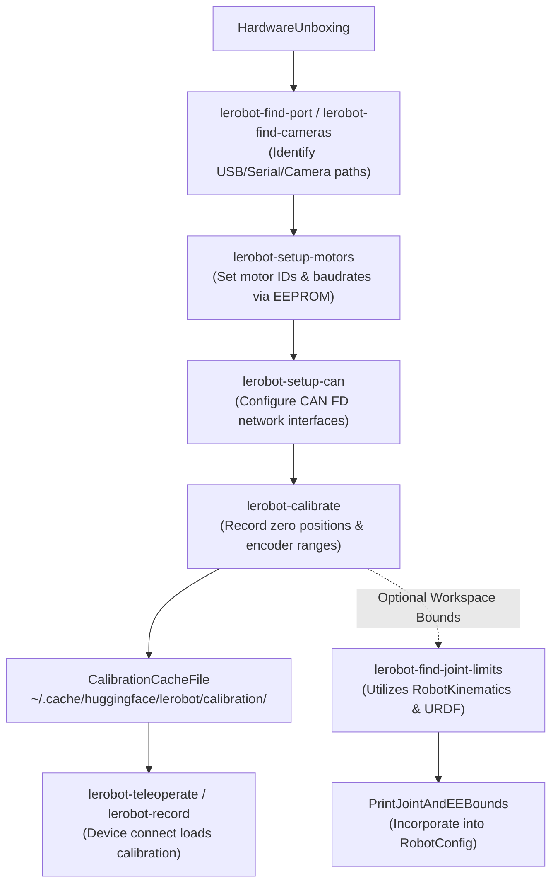
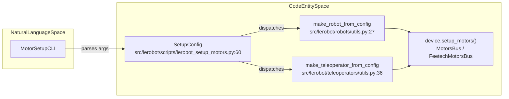
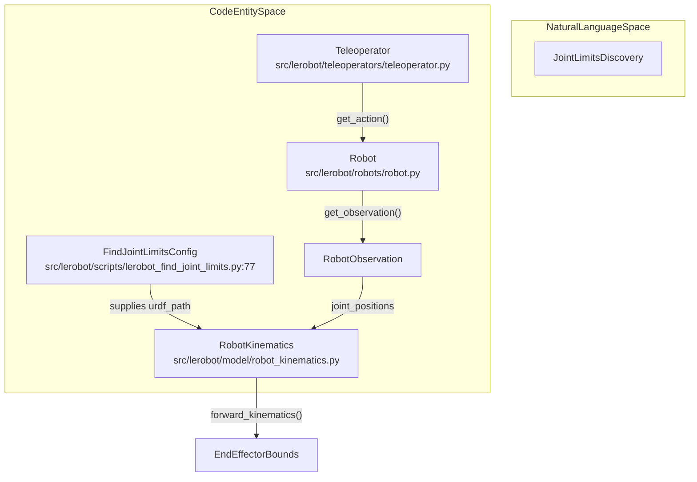

<!-- source: DeepWiki mcp.deepwiki.com · repo huggingface/lerobot · page 6.4 Calibration and Setup · fetched 2026-10-26 -->

# Calibration and Setup

Relevant source files

The following files were used as context for generating this wiki page:

- [docs/source/damiao.mdx](docs/source/damiao.mdx)
- [src/lerobot/motors/__init__.py](src/lerobot/motors/__init__.py)
- [src/lerobot/motors/calibration_gui.py](src/lerobot/motors/calibration_gui.py)
- [src/lerobot/motors/damiao/__init__.py](src/lerobot/motors/damiao/__init__.py)
- [src/lerobot/motors/damiao/damiao.py](src/lerobot/motors/damiao/damiao.py)
- [src/lerobot/motors/damiao/tables.py](src/lerobot/motors/damiao/tables.py)
- [src/lerobot/motors/dynamixel/dynamixel.py](src/lerobot/motors/dynamixel/dynamixel.py)
- [src/lerobot/motors/feetech/feetech.py](src/lerobot/motors/feetech/feetech.py)
- [src/lerobot/motors/motors_bus.py](src/lerobot/motors/motors_bus.py)
- [src/lerobot/robots/utils.py](src/lerobot/robots/utils.py)
- [src/lerobot/scripts/lerobot_calibrate.py](src/lerobot/scripts/lerobot_calibrate.py)
- [src/lerobot/scripts/lerobot_find_joint_limits.py](src/lerobot/scripts/lerobot_find_joint_limits.py)
- [src/lerobot/scripts/lerobot_record.py](src/lerobot/scripts/lerobot_record.py)
- [src/lerobot/scripts/lerobot_replay.py](src/lerobot/scripts/lerobot_replay.py)
- [src/lerobot/scripts/lerobot_setup_motors.py](src/lerobot/scripts/lerobot_setup_motors.py)
- [src/lerobot/scripts/lerobot_teleoperate.py](src/lerobot/scripts/lerobot_teleoperate.py)
- [src/lerobot/teleoperators/utils.py](src/lerobot/teleoperators/utils.py)
- [tests/scripts/test_setup_motors.py](tests/scripts/test_setup_motors.py)

This page details the calibration workflow and configuration utilities used to prepare physical robot hardware for operation: `lerobot-find-port`, `lerobot-setup-motors`, `lerobot-calibrate`, the calibration GUI (`calibration_gui.py`), and `lerobot-find-joint-limits`. These tools guide users from low-level serial port identification and motor EEPROM configuration to interactive joint calibration and URDF-based kinematic workspace discovery.

For information about the general hardware abstraction layer (`Robot` and `Teleoperator` base classes), see page [6.1. Robot and Teleoperator Abstraction](). For details on specific motor systems and communication protocols, see page [6.11. Motor Systems]().

---

## Overview and Hardware Setup Workflow

Before a robot or teleoperator can be used for recording or policy deployment, its hardware must be fully configured. The setup pipeline consists of five key phases:
1. **Port & Camera Discovery**: Locating physical USB/serial paths and camera devices.
2. **Motor Configuration**: Programming unique IDs and baudrates into motor EEPROMs.
3. **CAN Bus Setup**: Configuring high-speed CAN/CAN FD network interfaces (where applicable).
4. **Calibration**: Mapping raw motor encoder counts to physical radians and recording neutral/zero positions via the interactive calibration GUI.
5. **Joint Limits Discovery**: Empirically tracking safe operating ranges and end-effector (EE) bounds using URDF-based forward kinematics.

**Complete Hardware Setup Pipeline**

Sources: [src/lerobot/scripts/lerobot_calibrate.py:15-28](), [src/lerobot/scripts/lerobot_find_joint_limits.py:17-36](), [src/lerobot/scripts/lerobot_setup_motors.py:15-25]()

---

## Port and Camera Discovery

### `lerobot-find-port`
This utility identifies which USB serial path (e.g., `/dev/ttyACM0` or `/dev/tty.usbmodem...`) corresponds to a specific controller board. It lists active serial ports, prompts the user to disconnect the target hardware, and calculates the difference set to isolate the correct port.

### `lerobot-find-cameras`
Used to discover connected `OpenCVCamera` and `RealSenseCamera` streams. It inspects available capture devices, retrieves serial numbers, resolutions, and default frame rates, and can optionally capture a test frame to verify camera orientation and field of view.

Sources: [src/lerobot/scripts/lerobot_calibrate.py:15-28]()

---

## Motor Configuration

### `lerobot-setup-motors`
**Entry point:** `src/lerobot/scripts/lerobot_setup_motors.py`

This script configures motor IDs and communication baudrates in the non-volatile memory (EEPROM) of serial bus motors (such as Feetech or Dynamixel). Because multiple motors share a single serial bus, each must possess a unique identifier.

The execution flow relies on `SetupConfig` [src/lerobot/scripts/lerobot_setup_motors.py:60-62]() to accept either a `teleop` or `robot` configuration, instantiating the device via `make_robot_from_config` [src/lerobot/scripts/lerobot_setup_motors.py:82]() or `make_teleoperator_from_config` [src/lerobot/scripts/lerobot_setup_motors.py:85](). It then invokes `device.setup_motors()` [src/lerobot/scripts/lerobot_setup_motors.py:87](), which guides the user through connecting individual motors sequentially to burn the correct EEPROM parameters.

**Motor Setup Code Entity Association**

Sources: [src/lerobot/scripts/lerobot_setup_motors.py:60-87](), [src/lerobot/robots/utils.py:27-89](), [src/lerobot/teleoperators/utils.py:36-118]()

---

## Calibration Workflow and Calibration GUI

### `lerobot-calibrate`
**Entry point:** `src/lerobot/scripts/lerobot_calibrate.py`

The `lerobot-calibrate` script executes the interactive calibration procedure for a given robot follower or teleoperator leader device.

#### `CalibrateConfig` and Execution Flow
The script parses arguments into `CalibrateConfig` [src/lerobot/scripts/lerobot_calibrate.py:75-78](), enforcing that exactly one of `teleop` or `robot` is specified [src/lerobot/scripts/lerobot_calibrate.py:80-81]().

1. **Instantiation**: The device is constructed using `make_robot_from_config` [src/lerobot/scripts/lerobot_calibrate.py:100]() or `make_teleoperator_from_config` [src/lerobot/scripts/lerobot_calibrate.py:102]().
2. **Raw Connection**: The script calls `device.connect(calibrate=False)` to establish serial communication without attempting to load non-existent or stale calibration offsets [src/lerobot/scripts/lerobot_calibrate.py:104]().
3. **Interactive Calibration Routine**: It invokes `device.calibrate()`, which launches the calibration interface [src/lerobot/scripts/lerobot_calibrate.py:107]().
4. **Storage**: The resulting calibration profiles are serialized to JSON and stored under `~/.cache/huggingface/lerobot/calibration/{device_id}.json`.

### Calibration GUI (`RangeSlider` and `RangeValues`)
For bus-based actuators, calibration is backed by an interactive Pygame-based GUI defined in `src/lerobot/motors/calibration_gui.py`. 
- **`RangeValues`**: Encapsulates minimum encoder limit (`min_v`), current live position (`pos_v`), and maximum encoder limit (`max_v`) [src/lerobot/motors/calibration_gui.py]().
- **`RangeSlider`**: Manages a graphical slider row per motor (`motor`), mapping raw encoder resolution (`res`) to interactive drag handles, tick marks, and GUI buttons (`min_btn`, `max_btn`) [src/lerobot/motors/calibration_gui.py](). Users manually articulate the robot joints through their physical extremes to record valid operating windows and homing offsets.

Sources: [src/lerobot/scripts/lerobot_calibrate.py:75-109](), [src/lerobot/motors/calibration_gui.py](), [src/lerobot/robots/utils.py:27-89]()

---

## Joint Limits and End-Effector Bounds Discovery

### `lerobot-find-joint-limits`
**Entry point:** `src/lerobot/scripts/lerobot_find_joint_limits.py`

Once calibration is complete, `lerobot-find-joint-limits` can be used to empirically map the safe operational joint limits and the 3D workspace bounds of the robot's end-effector.

### Kinematics Integration and Control Loop
The script instantiates a `RobotKinematics` helper using a user-supplied URDF path and target frame name [src/lerobot/scripts/lerobot_find_joint_limits.py:105-106](). During execution, it runs a timed control loop:
1. **Teleoperation Control**: Reads actions from the leader via `teleop.get_action()` and forwards them to the follower via `robot.send_action(action)` [src/lerobot/scripts/lerobot_find_joint_limits.py:134-135]().
2. **Observation Sampling**: Queries `robot.get_observation()` to extract current joint positions in radians across all motors in `robot.bus.motors` [src/lerobot/scripts/lerobot_find_joint_limits.py:138-140]().
3. **Forward Kinematics**: Computes the 3D translation vector `(x, y, z)` of the end-effector via `kinematics.forward_kinematics(joint_positions)` [src/lerobot/scripts/lerobot_find_joint_limits.py:144]().
4. **Extrema Tracking**: Accumulates minimum and maximum bounds using element-wise `np.maximum` and `np.minimum` across the recording phase [src/lerobot/scripts/lerobot_find_joint_limits.py:171-174]().

**Joint Limits and Kinematics Entity Map**

Sources: [src/lerobot/scripts/lerobot_find_joint_limits.py:77-188](), [src/lerobot/scripts/lerobot_find_joint_limits.py:200-218]()

---

## Safety and Action Clamping

To prevent physical damage during teleoperation or policy rollouts, discovered joint limits and position differentials are enforced at runtime. The utility `ensure_safe_goal_position` validates target positions against present positions, clamping any relative displacement exceeding `max_relative_target` [src/lerobot/robots/utils.py:93-128]().

Sources: [src/lerobot/robots/utils.py:93-128]()

---

