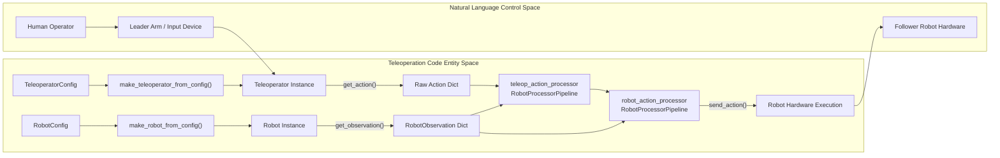

<!-- source: DeepWiki mcp.deepwiki.com · repo huggingface/lerobot · page 6.5 Teleoperation · fetched 2026-10-26 -->

# Teleoperation

<details>
<summary>Relevant source files</summary>

The following files were used as context for generating this wiki page:

- [docs/source/feetech.mdx](docs/source/feetech.mdx)
- [docs/source/phone_teleop.mdx](docs/source/phone_teleop.mdx)
- [docs/source/processors_robots_teleop.mdx](docs/source/processors_robots_teleop.mdx)
- [docs/source/rtc.mdx](docs/source/rtc.mdx)
- [src/lerobot/policies/rtc/configuration_rtc.py](src/lerobot/policies/rtc/configuration_rtc.py)
- [src/lerobot/policies/rtc/modeling_rtc.py](src/lerobot/policies/rtc/modeling_rtc.py)
- [src/lerobot/robots/utils.py](src/lerobot/robots/utils.py)
- [src/lerobot/scripts/lerobot_calibrate.py](src/lerobot/scripts/lerobot_calibrate.py)
- [src/lerobot/scripts/lerobot_find_joint_limits.py](src/lerobot/scripts/lerobot_find_joint_limits.py)
- [src/lerobot/scripts/lerobot_record.py](src/lerobot/scripts/lerobot_record.py)
- [src/lerobot/scripts/lerobot_replay.py](src/lerobot/scripts/lerobot_replay.py)
- [src/lerobot/scripts/lerobot_setup_motors.py](src/lerobot/scripts/lerobot_setup_motors.py)
- [src/lerobot/scripts/lerobot_teleoperate.py](src/lerobot/scripts/lerobot_teleoperate.py)
- [src/lerobot/teleoperators/utils.py](src/lerobot/teleoperators/utils.py)
- [tests/policies/rtc/test_configuration_rtc.py](tests/policies/rtc/test_configuration_rtc.py)
- [tests/policies/rtc/test_modeling_rtc.py](tests/policies/rtc/test_modeling_rtc.py)
- [tests/scripts/test_setup_motors.py](tests/scripts/test_setup_motors.py)

</details>


**Purpose and Scope**: This page documents the teleoperation workflow, including the control loop, action processing pipelines, and verification scripts. For information about the abstract robot and teleoperator interfaces, see [Robot and Teleoperator Abstraction](6.1). For dataset recording with teleoperation, see [Recording Episodes](6.6). For hardware setup and calibration, see [Calibration and Setup](6.4).

Teleoperation in LeRobot enables manual control of robots using teleoperation devices such as leader arms, keyboards, gamepads, or other input devices. The `lerobot-teleoperate` command provides a continuous control loop that reads actions from a teleoperator, processes those actions through configurable `RobotProcessorPipeline` pipelines, and sends them to a follower robot [src/lerobot/scripts/lerobot_teleoperate.py:15-16]().

---

## Teleoperation Workflow

The teleoperation workflow establishes a real-time control loop between a teleoperator device and a follower robot. The system continuously reads the current state of the teleoperator via `Teleoperator.get_action()`, converts it into robot actions, processes those actions through configurable `RobotProcessorPipeline` pipelines, and sends them to the robot via `Robot.send_action()` [src/lerobot/scripts/lerobot_teleoperate.py:155-214]().



**Diagram: Teleoperation Architecture bridging Natural Language and Code Entity Spaces**  
This diagram links the physical teleoperation setup (Natural Language Space) directly to the underlying classes and functions (`make_teleoperator_from_config`, `make_robot_from_config`, `RobotProcessorPipeline`, `get_action`, `send_action`) implemented in the codebase.

Sources: [src/lerobot/scripts/lerobot_teleoperate.py:155-214](), [src/lerobot/teleoperators/utils.py:36-118](), [src/lerobot/robots/utils.py:27-90]()

---

## Command-Line Interface

The `lerobot-teleoperate` script provides a direct command-line interface for controlling hardware robots [src/lerobot/scripts/lerobot_teleoperate.py:16-32]().

### Basic Usage

```bash
lerobot-teleoperate \
    --robot.type=so101_follower \
    --robot.port=/dev/tty.usbmodem58760431541 \
    --robot.id=black \
    --teleop.type=so101_leader \
    --teleop.port=/dev/tty.usbmodem58760431551 \
    --teleop.id=blue \
    --display_data=true
```

### Bimanual Teleoperation

For dual-arm configurations:

```bash
lerobot-teleoperate \
    --robot.type=bi_so_follower \
    --robot.left_arm_config.port=/dev/tty.usbmodem5A460822851 \
    --robot.right_arm_config.port=/dev/tty.usbmodem5A460814411 \
    --robot.id=bimanual_follower \
    --teleop.type=bi_so_leader \
    --teleop.left_arm_config.port=/dev/tty.usbmodem5A460852721 \
    --teleop.right_arm_config.port=/dev/tty.usbmodem5A460819811 \
    --teleop.id=bimanual_leader \
    --display_data=true
```

### Configuration Parameters

The `TeleoperateConfig` dataclass defines the configurable parameters for the script [src/lerobot/scripts/lerobot_teleoperate.py:134-153]().

| Parameter | Type | Default | Description |
|-----------|------|---------|-------------|
| `robot` | `RobotConfig` | Required | Configuration for the follower robot [src/lerobot/scripts/lerobot_teleoperate.py:138]() |
| `teleop` | `TeleoperatorConfig` | Required | Configuration for the teleoperator device [src/lerobot/scripts/lerobot_teleoperate.py:137]() |
| `fps` | `int` | `60` | Maximum frames per second for the control loop [src/lerobot/scripts/lerobot_teleoperate.py:140]() |
| `teleop_time_s` | `float \| None` | `None` | Duration in seconds (None = indefinite) [src/lerobot/scripts/lerobot_teleoperate.py:141]() |
| `display_data` | `bool` | `False` | Enable visualization in Rerun or Foxglove [src/lerobot/scripts/lerobot_teleoperate.py:143]() |
| `display_mode` | `str` | `"rerun"` | Visualization backend selection [src/lerobot/scripts/lerobot_teleoperate.py:145]() |
| `display_ip` | `str \| None` | `None` | IP address for remote visualization server [src/lerobot/scripts/lerobot_teleoperate.py:148]() |
| `display_port` | `int \| None` | `None` | Port for remote visualization server [src/lerobot/scripts/lerobot_teleoperate.py:150]() |
| `display_compressed_images` | `bool` | `False` | Compress images before streaming to backend [src/lerobot/scripts/lerobot_teleoperate.py:152]() |

Sources: [src/lerobot/scripts/lerobot_teleoperate.py:23-68](), [src/lerobot/scripts/lerobot_teleoperate.py:134-153]()

---

## Supported Teleoperator Types

The `make_teleoperator_from_config()` factory function maps string identifiers to concrete teleoperator classes [src/lerobot/teleoperators/utils.py:36-118]().

| `type` string | Class Name | Module | Description |
|---|---|---|---|
| `so100_leader` | `SO100Leader` | `so_leader` | SO-100 leader arm [src/lerobot/teleoperators/utils.py:50-53]() |
| `so101_leader` | `SO101Leader` | `so_leader` | SO-101 leader arm [src/lerobot/teleoperators/utils.py:54-57]() |
| `bi_so_leader` | `BiSOLeader` | `bi_so_leader` | Bimanual SO leader [src/lerobot/teleoperators/utils.py:82-85]() |
| `koch_leader` | `KochLeader` | `koch_leader` | Koch leader arm [src/lerobot/teleoperators/utils.py:42-45]() |
| `omx_leader` | `OmxLeader` | `omx_leader` | OMX leader arm [src/lerobot/teleoperators/utils.py:46-49]() |
| `openarm_leader` | `OpenArmLeader` | `openarm_leader` | OpenArm 7DOF leader [src/lerobot/teleoperators/utils.py:90-93]() |
| `bi_openarm_leader` | `BiOpenArmLeader` | `bi_openarm_leader` | Bimanual OpenArm leader [src/lerobot/teleoperators/utils.py:94-97]() |
| `openarm_mini` | `OpenArmMini` | `openarm_mini` | Compact OpenArm leader [src/lerobot/teleoperators/utils.py:98-101]() |
| `bi_openarm_mini` | `BiOpenArmMini` | `bi_openarm_mini` | Bimanual OpenArm Mini [src/lerobot/teleoperators/utils.py:102-105]() |
| `rebot_102_leader` | `RebotArm102Leader` | `rebot_102_leader` | reBot 102 leader arm [src/lerobot/teleoperators/utils.py:106-109]() |
| `bi_rebot_102_leader` | `BiRebot102Leader` | `bi_rebot_102_leader` | Bimanual reBot 102 leader [src/lerobot/teleoperators/utils.py:110-113]() |
| `keyboard` | `KeyboardTeleop` | `keyboard` | Basic keyboard control [src/lerobot/teleoperators/utils.py:38-41]() |
| `keyboard_ee` | `KeyboardEndEffectorTeleop` | `keyboard` | Keyboard for end-effector deltas [src/lerobot/teleoperators/utils.py:66-69]() |
| `gamepad` | `GamepadTeleop` | `gamepad` | Gamepad joystick input [src/lerobot/teleoperators/utils.py:62-65]() |
| `homunculus_glove` | `HomunculusGlove` | `homunculus` | Homunculus glove [src/lerobot/teleoperators/utils.py:70-73]() |
| `homunculus_arm` | `HomunculusArm` | `homunculus` | Homunculus arm [src/lerobot/teleoperators/utils.py:74-77]() |
| `unitree_g1` | `UnitreeG1Teleoperator` | `unitree_g1` | Unitree G1 humanoid teleop [src/lerobot/teleoperators/utils.py:78-81]() |
| `reachy2_teleoperator` | `Reachy2Teleoperator` | `reachy2_teleoperator` | Reachy 2 teleop [src/lerobot/teleoperators/utils.py:86-89]() |

Sources: [src/lerobot/teleoperators/utils.py:36-118]()

---

## Teleoperation Loop

The `teleop_loop()` function orchestrates the periodic execution of observation fetching, action retrieval, pipeline processing, and hardware commands [src/lerobot/scripts/lerobot_teleoperate.py:155-236]().

```mermaid
sequenceDiagram
    participant Loop as "teleop_loop()"
    participant Robot as "Robot"
    participant Teleop as "Teleoperator"
    participant Proc as "RobotProcessorPipeline"
    participant Viz as "visualization_utils"

    Loop->>Robot: "get_observation()"
    Robot-->>Loop: "robot_obs: RobotObservation"

    alt robot.type == unitree_g1
        Loop->>Teleop: "send_feedback(robot_obs)"
    end

    Loop->>Teleop: "get_action()"
    Teleop-->>Loop: "raw_action: RobotAction"

    Loop->>Proc: "teleop_action_processor((raw_action, robot_obs))"
    Proc-->>Loop: "teleop_action: RobotAction"

    Loop->>Proc: "robot_action_processor((teleop_action, robot_obs))"
    Proc-->>Loop: "robot_action_to_send: RobotAction"

    Loop->>Robot: "send_action(robot_action_to_send)"

    opt display_data == true
        Loop->>Proc: "robot_observation_processor(robot_obs)"
        Proc-->>Loop: "processed_obs"
        Loop->>Viz: "log_visualization_data(processed_obs, teleop_action)"
    end
```

**Diagram: Control Loop Execution Sequence**  
This sequence diagram details the function calls (`get_observation`, `get_action`, `send_action`, pipeline calls) occurring within each cycle of `teleop_loop()`.

Sources: [src/lerobot/scripts/lerobot_teleoperate.py:155-236]()

---

## Action Processing Pipelines

LeRobot uses `RobotProcessorPipeline` to bridge heterogeneous observation and action spaces [docs/source/processors_robots_teleop.mdx:22-30]().

Three distinct processing pipelines compose the architecture:
1.  **Teleop Action Pipeline**: Transforms device inputs (e.g., phone poses) into dataset actions [docs/source/processors_robots_teleop.mdx:34-47]().
2.  **Robot Action Pipeline**: Translates dataset/teleop actions into raw robot commands (e.g., inverse kinematics mapping EE targets to joints) [docs/source/processors_robots_teleop.mdx:49-57]().
3.  **Robot Observation Pipeline**: Converts raw sensor readings into standardized observation representations [docs/source/processors_robots_teleop.mdx:59-65]().

Sources: [src/lerobot/scripts/lerobot_teleoperate.py:155-166](), [docs/source/processors_robots_teleop.mdx:22-65]()

---

## Practice and Verification Workflow

Verification tools ensure hardware repeatability and safe operation prior to recording datasets:

-   **Workspace & Joint Limits (`lerobot-find-joint-limits`)**: Records physical bounds of joints and end-effectors by combining teleoperation with `RobotKinematics` forward kinematics calculations [src/lerobot/scripts/lerobot_find_joint_limits.py:18-36]().
-   **Device Calibration (`lerobot-calibrate`)**: Interacts directly with `device.calibrate()` to re-zero motor encoder positions and ranges [src/lerobot/scripts/lerobot_calibrate.py:91-101]().
-   **Episode Replay (`lerobot-replay`)**: Loads recorded trajectories from a `LeRobotDataset` and replays them on the physical follower robot using `robot_action_processor` to verify trajectory fidelity [src/lerobot/scripts/lerobot_replay.py:16-42]().
-   **Phone Teleoperation (`Phone`)**: Supports remote mobile control (iOS/Android) via specialized processor components such as `EEReferenceAndDelta` and `EEBoundsAndSafety` [docs/source/phone_teleop.mdx:21-38]().

Sources: [src/lerobot/scripts/lerobot_find_joint_limits.py:18-36](), [src/lerobot/scripts/lerobot_calibrate.py:16-28](), [src/lerobot/scripts/lerobot_replay.py:16-42](), [docs/source/phone_teleop.mdx:1-106]()

---

