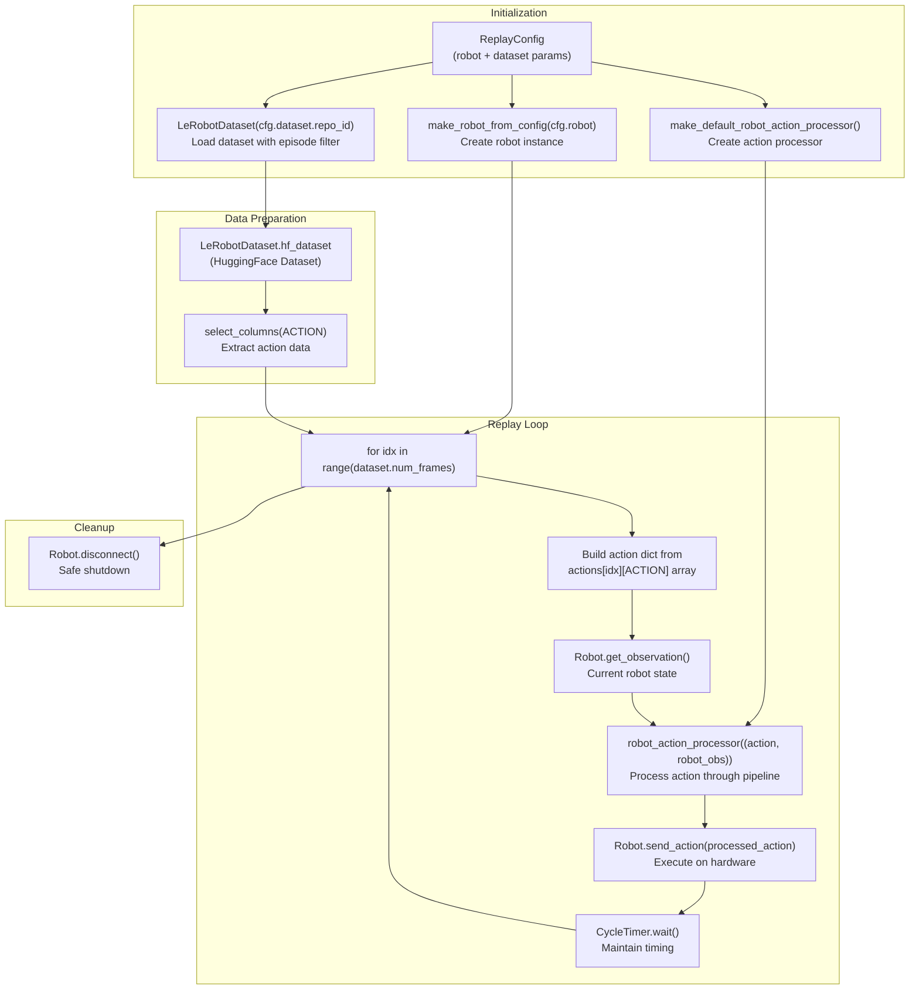
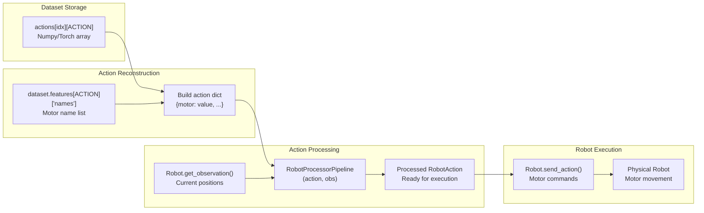

<!-- source: DeepWiki mcp.deepwiki.com · repo huggingface/lerobot · page 6.7 Replay and Verification · fetched 2026-10-26 -->

# Replay and Verification

<details>
<summary>Relevant source files</summary>

The following files were used as context for generating this wiki page:

- [docs/source/envhub_leisaac.mdx](docs/source/envhub_leisaac.mdx)
- [examples/backward_compatibility/replay.py](examples/backward_compatibility/replay.py)
- [examples/lekiwi/replay.py](examples/lekiwi/replay.py)
- [examples/phone_to_so100/replay.py](examples/phone_to_so100/replay.py)
- [examples/so100_to_so100_EE/replay.py](examples/so100_to_so100_EE/replay.py)
- [src/lerobot/rl/gym_manipulator.py](src/lerobot/rl/gym_manipulator.py)
- [src/lerobot/robots/utils.py](src/lerobot/robots/utils.py)
- [src/lerobot/scripts/lerobot_calibrate.py](src/lerobot/scripts/lerobot_calibrate.py)
- [src/lerobot/scripts/lerobot_find_joint_limits.py](src/lerobot/scripts/lerobot_find_joint_limits.py)
- [src/lerobot/scripts/lerobot_record.py](src/lerobot/scripts/lerobot_record.py)
- [src/lerobot/scripts/lerobot_replay.py](src/lerobot/scripts/lerobot_replay.py)
- [src/lerobot/scripts/lerobot_setup_motors.py](src/lerobot/scripts/lerobot_setup_motors.py)
- [src/lerobot/scripts/lerobot_teleoperate.py](src/lerobot/scripts/lerobot_teleoperate.py)
- [src/lerobot/teleoperators/utils.py](src/lerobot/teleoperators/utils.py)
- [tests/scripts/test_setup_motors.py](tests/scripts/test_setup_motors.py)

</details>


The replay system enables verification of recorded episodes by playing them back on physical robots. This allows you to test robot repeatability, validate recorded data quality, and verify hardware setup before large-scale data collection. The `lerobot-replay` command loads actions from a dataset episode and executes them on a robot at the original recording frequency.

For information about recording episodes, see [6.6 Recording Episodes](). For teleoperation without recording, see [6.5 Teleoperation]().

## Purpose and Workflow

Episode replay serves three primary verification purposes:

1. **Hardware Verification**: Confirm that the robot can accurately reproduce recorded motions, identifying mechanical issues or calibration problems.
2. **Data Quality Check**: Validate that recorded actions are valid and executable before investing in large-scale data collection.
3. **Pre-Training Validation**: Test a small number of episodes to ensure the recording setup produces high-quality demonstrations.

The typical verification workflow:
1. Record 1-2 test episodes using `lerobot-record` [src/lerobot/scripts/lerobot_record.py:25-39]().
2. Replay episodes using `lerobot-replay` to verify robot behavior [src/lerobot/scripts/lerobot_replay.py:23-29]().
3. Adjust hardware, calibration, or recording parameters if needed.
4. Proceed with full dataset recording once verification succeeds.

Sources: [src/lerobot/scripts/lerobot_replay.py:15-42](), [src/lerobot/scripts/lerobot_record.py:15-87]()

## Command-Line Interface

### Basic Usage

```shell
lerobot-replay \
    --robot.type=so100_follower \
    --robot.port=/dev/tty.usbmodem58760431541 \
    --robot.id=black \
    --dataset.repo_id=<USER>/record-test \
    --dataset.episode=0
```

### Bimanual Example

```shell
lerobot-replay \
  --robot.type=bi_so_follower \
  --robot.left_arm_port=/dev/tty.usbmodem5A460851411 \
  --robot.right_arm_port=/dev/tty.usbmodem5A460812391 \
  --robot.id=bimanual_follower \
  --dataset.repo_id=${HF_USER}/bimanual-so100-handover-cube \
  --dataset.episode=0
```

### Configuration Parameters

The `DatasetReplayConfig` [src/lerobot/scripts/lerobot_replay.py:82-91]() defines replay parameters:

| Parameter | Type | Default | Description |
| :--- | :--- | :--- | :--- |
| `repo_id` | `str` | - | Dataset identifier (e.g., `username/dataset_name`) |
| `episode` | `int` | - | Episode index to replay (zero-indexed) |
| `root` | `str \| Path` | `None` | Local dataset directory. If `None`, uses `$HF_LEROBOT_HOME/repo_id` |
| `fps` | `int` | `30` | Replay frequency. Defaults to dataset's original fps |

The `ReplayConfig` [src/lerobot/scripts/lerobot_replay.py:94-99]() combines robot configuration with dataset parameters:

| Parameter | Type | Default | Description |
| :--- | :--- | :--- | :--- |
| `robot` | `RobotConfig` | - | Robot configuration (type, port, etc) |
| `dataset` | `DatasetReplayConfig` | - | Dataset replay parameters |
| `play_sounds` | `bool` | `True` | Enable vocal synthesis for status updates |

Sources: [src/lerobot/scripts/lerobot_replay.py:82-99]()

## Replay Mechanism

The `replay` function [src/lerobot/scripts/lerobot_replay.py:102-142]() orchestrates the loading of the robot and dataset, followed by a timed loop that sends actions to the hardware.

### System Architecture



Sources: [src/lerobot/scripts/lerobot_replay.py:102-142](), [src/lerobot/robots/utils.py:27-90]()

### Data Flow

The replay system processes actions through the following pipeline:



Sources: [src/lerobot/scripts/lerobot_replay.py:120-138]()

### Action Processing Pipeline

The `make_default_robot_action_processor()` [src/lerobot/scripts/lerobot_replay.py:106]() creates a `RobotProcessorPipeline` that processes actions before sending them to the robot. While basic replay often uses an identity processor, advanced examples (like End-Effector replay) use specialized processors:

- **Inverse Kinematics**: Converting recorded End-Effector (EE) poses back to joint positions using `InverseKinematicsEEToJoints` [examples/phone_to_so100/replay.py:28-30]().
- **Safety Clipping**: Ensuring actions stay within bounds using `ensure_safe_goal_position` [src/lerobot/robots/utils.py:93-128]().

The processor takes a tuple of `(action, robot_observation)` and returns a processed `RobotAction` [src/lerobot/scripts/lerobot_replay.py:136]().

Sources: [src/lerobot/scripts/lerobot_replay.py:106](), [examples/phone_to_so100/replay.py:28-30](), [examples/phone_to_so100/replay.py:58-62](), [src/lerobot/robots/utils.py:93-128](), [src/lerobot/scripts/lerobot_replay.py:136]()

## Replay vs Recording Comparison

Understanding the differences between replay and recording workflows:

| Aspect | `lerobot-replay` | `lerobot-record` |
| :--- | :--- | :--- |
| **Purpose** | Verify recorded data | Create new dataset episodes |
| **Action Source** | `LeRobotDataset` (pre-recorded) | `Teleoperator` |
| **Data Flow** | Dataset → Robot | Teleop → Robot → Dataset |
| **Requirements** | `Robot` + existing dataset | `Robot` + `Teleoperator` + cameras |
| **Episode Selection** | Specific index via `--dataset.episode` | Sequential via `--dataset.num_episodes` |
| **Output** | None (verification only) | Updated dataset with new episodes |

Sources: [src/lerobot/scripts/lerobot_replay.py:15-42](), [src/lerobot/scripts/lerobot_record.py:15-90]()

## Verification Best Practices

### Pre-Recording Verification

Before collecting a full dataset:

1. **Test Episode**: Record a single episode with `--dataset.num_episodes=1` [src/lerobot/scripts/lerobot_record.py:34]().
2. **Immediate Replay**: Replay the test episode to verify robot behavior [src/lerobot/scripts/lerobot_replay.py:28]().
3. **Visual Inspection**: Observe if the robot reproduces the intended motion.
4. **Multiple Runs**: Replay 3-5 times to check for mechanical consistency.
5. **Troubleshooting**: If replay fails:
   - Recalibrate with `lerobot-calibrate` [src/lerobot/scripts/lerobot_calibrate.py:87-99]().
   - Verify joint limits with `lerobot-find-joint-limits` [src/lerobot/scripts/lerobot_find_joint_limits.py:95-186]().

Sources: [src/lerobot/scripts/lerobot_record.py:34](), [src/lerobot/scripts/lerobot_replay.py:28](), [src/lerobot/scripts/lerobot_calibrate.py:87-99](), [src/lerobot/scripts/lerobot_find_joint_limits.py:95-186]()

### FPS Control and Timing

The replay loop maintains precise timing using `CycleTimer` [src/lerobot/scripts/lerobot_replay.py:118-138]():

1. The `CycleTimer` is initialized with the dataset's FPS [src/lerobot/scripts/lerobot_replay.py:118]().
2. For each frame, `timer.tick()` marks the start and `timer.wait()` ensures the loop respects the frequency [src/lerobot/scripts/lerobot_replay.py:123-138]().
3. This ensures actions are executed at the same frequency they were recorded, which is critical for reproducing dynamic behaviors and maintaining the temporal integrity of the demonstration.

Sources: [src/lerobot/scripts/lerobot_replay.py:118-140]()

## Programmatic Usage

The `replay()` function can be called programmatically for automated testing or specialized scripts.

```python
from lerobot.scripts.lerobot_replay import replay, ReplayConfig, DatasetReplayConfig
from lerobot.robots.so_follower import SO100FollowerConfig

config = ReplayConfig(
    robot=SO100FollowerConfig(
        port="/dev/tty.usbmodem58760431541",
        id="black"
    ),
    dataset=DatasetReplayConfig(
        repo_id="username/my_dataset",
        episode=0,
        fps=30
    ),
    play_sounds=False
)

replay(config)
```

Sources: [src/lerobot/scripts/lerobot_replay.py:102-142](), [examples/backward_compatibility/replay.py:75-103]()

## Advanced: End-Effector Replay

When replaying datasets recorded in Cartesian space (End-Effector control), the replay script must integrate a kinematics solver to map the recorded poses back to motor joint angles.

Key components for EE Replay:
- **RobotKinematics**: Loads the URDF and computes Forward/Inverse Kinematics [src/lerobot/scripts/lerobot_find_joint_limits.py:106-112](), [examples/phone_to_so100/replay.py:49-53]().
- **InverseKinematicsEEToJoints**: A specialized processor step that takes the recorded EE pose and current joint positions to solve for the target joints [examples/phone_to_so100/replay.py:58-62]().
- **RobotProcessorPipeline**: Composes the IK step into a pipeline to transform actions in real-time during the replay loop [examples/phone_to_so100/replay.py:56-66]().

Sources: [src/lerobot/scripts/lerobot_find_joint_limits.py:106-112](), [examples/phone_to_so100/replay.py:49-66]()

---

