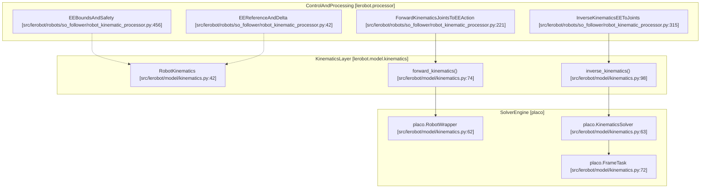

<!-- source: DeepWiki mcp.deepwiki.com · repo huggingface/lerobot · page 6.8 End-Effector Control and Kinematics · fetched 2026-10-26 -->

# End-Effector Control and Kinematics

<details>
<summary>Relevant source files</summary>

The following files were used as context for generating this wiki page:

- [src/lerobot/model/kinematics.py](src/lerobot/model/kinematics.py)
- [src/lerobot/robots/so_follower/robot_kinematic_processor.py](src/lerobot/robots/so_follower/robot_kinematic_processor.py)
- [src/lerobot/teleoperators/gamepad/gamepad_utils.py](src/lerobot/teleoperators/gamepad/gamepad_utils.py)
- [tests/model/__init__.py](tests/model/__init__.py)
- [tests/robots/test_robot_kinematic_processor.py](tests/robots/test_robot_kinematic_processor.py)

</details>


## Purpose and Scope

This page describes the end-effector (EE) control and kinematics capabilities in LeRobot, covering inverse kinematics (IK) integration, coordinate frame transformations, control modes operating in Cartesian space, and the `RobotKinematics` class [src/lerobot/model/kinematics.py:42-43](). End-effector control allows specifying desired positions and orientations of the robot's gripper or tool in task space, with the framework automatically resolving the required joint configurations.

For joint-level control interfaces, see [Robot and Teleoperator Abstraction](6.1). For platform configurations, see [Supported Hardware](6.2).

## Overview

LeRobot supports both **joint-space control** (directly commanding motor positions) and **end-effector control** (commanding Cartesian poses/orientations). End-effector control is used for:

- **Task-space planning**: Trajectory specification in Cartesian coordinates.
- **Teleoperation**: Intuitive control schemas for human operators using devices like gamepads or phones.
- **Policy training**: Leveraging task-space representations for improved spatial generalization.
- **Tool positioning**: Precise alignment of grippers via URDF-defined kinematic frames [src/lerobot/model/kinematics.py:48-50]().

Kinematics features are exposed through the `RobotKinematics` class, which wraps the `placo` library (built on Pinocchio) for forward and inverse kinematics solvers [src/lerobot/model/kinematics.py:42-43]().

Sources: [src/lerobot/model/kinematics.py:42-50]()

## Kinematics Architecture

The LeRobot kinematics pipeline bridges raw motor observations and task-space Cartesian commands using a URDF-based model and modular processor steps.


**Figure 1: Kinematics Architecture and Integration**

Sources: [src/lerobot/model/kinematics.py:42-73](), [src/lerobot/robots/so_follower/robot_kinematic_processor.py:42-456]()

## Implementation Details

### RobotKinematics Class
The `RobotKinematics` class [src/lerobot/model/kinematics.py:42-43]() provides the primary API for Cartesian control:

| Method | Description |
|------------|-------------|
| `forward_kinematics(joint_pos_deg)` | Computes the 4x4 transformation matrix of the end-effector given joint angles in degrees [src/lerobot/model/kinematics.py:74-96](). |
| `inverse_kinematics(...)` | Computes joint positions in degrees to reach a target 4x4 pose using current joint positions as an initial guess [src/lerobot/model/kinematics.py:98-151](). |

Sources: [src/lerobot/model/kinematics.py:74-151]()

### Cartesian Control Pipeline
In end-effector teleoperation, actions pass through specialized processor steps within a `RobotProcessorPipeline`:

1.  **Input Mapping**: Converts teleoperation inputs into target deltas (e.g., `target_x`, `target_y`).
2.  **EEReferenceAndDelta**: Computes an absolute target end-effector pose from relative deltas [src/lerobot/robots/so_follower/robot_kinematic_processor.py:44-48](). Supports `use_latched_reference` to lock the reference pose upon activation [src/lerobot/robots/so_follower/robot_kinematic_processor.py:50-52](). It requires joint observations via forward kinematics [src/lerobot/robots/so_follower/robot_kinematic_processor.py:81-84]().
3.  **EEBoundsAndSafety**: Clamps end-effector movement to defined workspaces.
4.  **InverseKinematicsEEToJoints**: Converts target EE poses into motor joint commands.

Sources: [src/lerobot/model/kinematics.py:98-151](), [src/lerobot/robots/so_follower/robot_kinematic_processor.py:40-78](), [src/lerobot/robots/so_follower/robot_kinematic_processor.py:81-84]()

## Coordinate Frames and Action Representations

Robotic tasks utilize multiple coordinate systems, managed via `transform_features` [src/lerobot/robots/so_follower/robot_kinematic_processor.py:167-183]().

### Data Flow for End-Effector Control

```mermaid
graph LR
    Teleop["InputController [src/lerobot/teleoperators/gamepad/gamepad_utils.py:36]"] --> P1["Pipeline_TeleopToDataset"]
    P1 --> Dataset["DatasetAction_ee.x_ee.y_ee.z"]
    Dataset --> P2["InverseKinematicsEEToJoints [src/lerobot/robots/so_follower/robot_kinematic_processor.py:315]"]
    P2 --> Robot["RobotCommand_JointPositions"]
    Robot --> Obs["RobotObservation_JointPositions"]
    Obs --> P3["ForwardKinematicsJointsToEEObservation [src/lerobot/robots/so_follower/robot_kinematic_processor.py:270]"]
    P3 --> DatasetObs["DatasetObservation_ee.x_ee.y_ee.z"]
```


**Figure 2: Data Flow for End-Effector Control**

| Component | Code Entity | Description |
|------------|-------------|----------|
| **Dataset Features** | `PolicyFeature` | Specifies stored features (e.g., `ee.x`, `ee.wx`) [src/lerobot/robots/so_follower/robot_kinematic_processor.py:167-183](). |
| **Workspace Bounds** | `end_effector_bounds` | Task-space min/max limits. |
| **Step Sizes** | `end_effector_step_sizes` | Scales relative motion deltas [src/lerobot/robots/so_follower/robot_kinematic_processor.py:68](). |

Sources: [src/lerobot/robots/so_follower/robot_kinematic_processor.py:68](), [src/lerobot/robots/so_follower/robot_kinematic_processor.py:167-183](), [src/lerobot/teleoperators/gamepad/gamepad_utils.py:36-50]()

## Safety and Constraints

LeRobot integrates safety layers for Cartesian control:

1.  **Workspace Bounds**: The `EEBoundsAndSafety` step restricts movement within a defined 3D volume.
2.  **Gripper Preservation**: `RobotKinematics` preserves gripper states during IK by retaining trailing joint indices [src/lerobot/model/kinematics.py:145-149]().
3.  **Soft Constraints**: The IK solver weights position over orientation (e.g., `position_weight=1.0`, `orientation_weight=0.01`) [src/lerobot/model/kinematics.py:102-103](), [src/lerobot/model/kinematics.py:131]().
4.  **Initial Guesses**: `inverse_kinematics` uses `current_joint_pos` to maintain trajectory continuity [src/lerobot/model/kinematics.py:121-123]().
5.  **Disabled State Handling**: `EEReferenceAndDelta` preserves the last commanded pose when disabled to prevent drift [src/lerobot/robots/so_follower/robot_kinematic_processor.py:140-145]().

Sources: [src/lerobot/model/kinematics.py:98-151](), [src/lerobot/robots/so_follower/robot_kinematic_processor.py:140-145]()

## Practical Usage: Robot Setup

```python
from lerobot.model.kinematics import RobotKinematics

kinematics_solver = RobotKinematics(
    urdf_path="./SO101/so101_new_calib.urdf",
    target_frame_name="gripper_frame_link",
    joint_names=["joint_1", "joint_2", "joint_3", "joint_4", "joint_5"]
)

current_joints = [0, 0, 0, 0, 0]
ee_pose = kinematics_solver.forward_kinematics(current_joints)

target_pose = ee_pose.copy()
target_pose[0, 3] += 0.05
new_joints = kinematics_solver.inverse_kinematics(current_joints, target_pose)
```

Sources: [src/lerobot/model/kinematics.py:45-151]()

---

