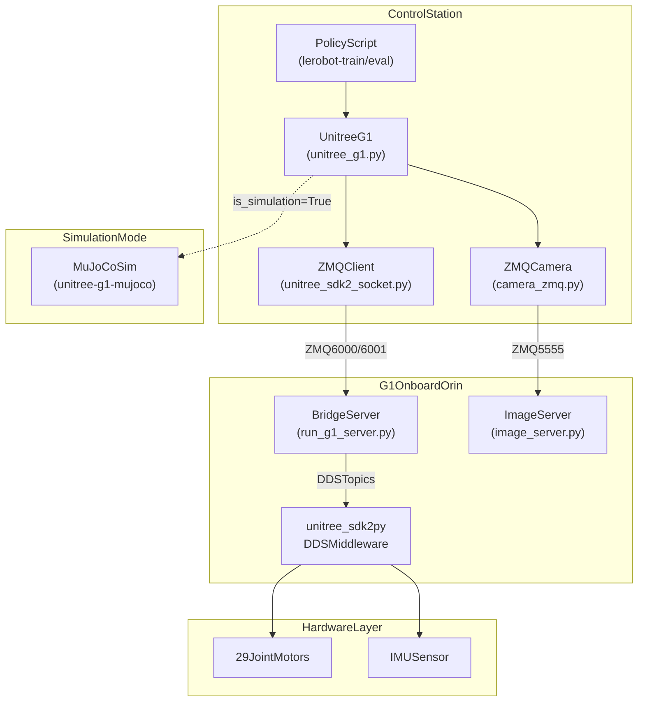
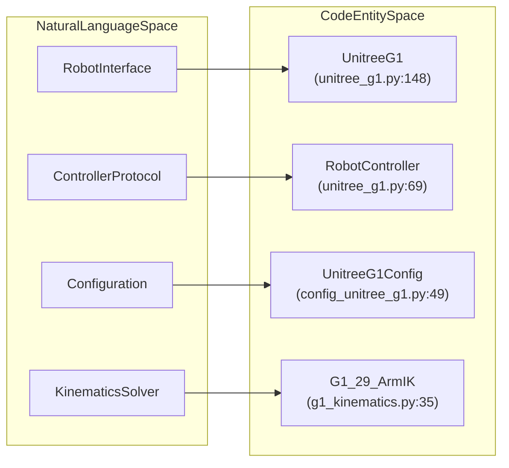
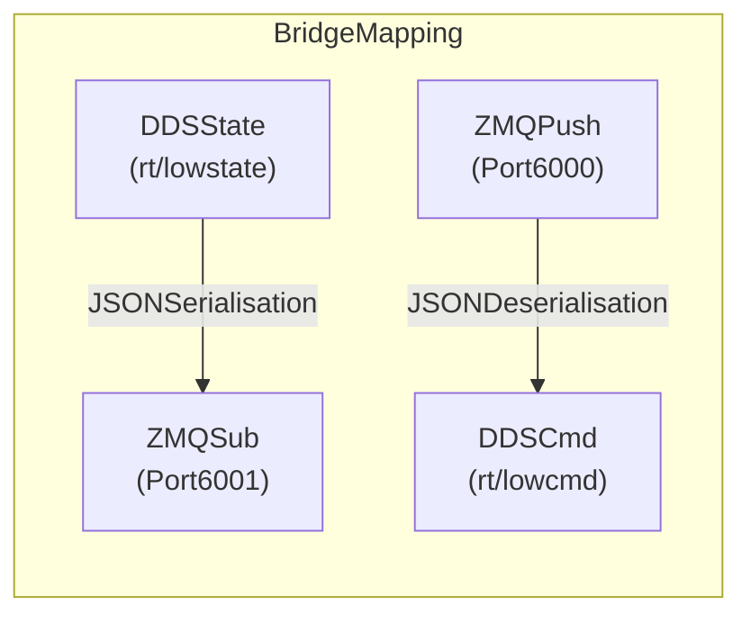

<!-- source: DeepWiki mcp.deepwiki.com · repo huggingface/lerobot · page 6.9 Unitree G1 Integration · fetched 2026-10-26 -->

# Unitree G1 Integration

<details>
<summary>Relevant source files</summary>

The following files were used as context for generating this wiki page:

- [docker/Dockerfile.benchmark.robocerebra](docker/Dockerfile.benchmark.robocerebra)
- [docs/source/robocerebra.mdx](docs/source/robocerebra.mdx)
- [docs/source/unitree_g1.mdx](docs/source/unitree_g1.mdx)
- [src/lerobot/robots/unitree_g1/__init__.py](src/lerobot/robots/unitree_g1/__init__.py)
- [src/lerobot/robots/unitree_g1/config_unitree_g1.py](src/lerobot/robots/unitree_g1/config_unitree_g1.py)
- [src/lerobot/robots/unitree_g1/controllers/__init__.py](src/lerobot/robots/unitree_g1/controllers/__init__.py)
- [src/lerobot/robots/unitree_g1/controllers/gr00t_locomotion.py](src/lerobot/robots/unitree_g1/controllers/gr00t_locomotion.py)
- [src/lerobot/robots/unitree_g1/controllers/holosoma_locomotion.py](src/lerobot/robots/unitree_g1/controllers/holosoma_locomotion.py)
- [src/lerobot/robots/unitree_g1/controllers/sonic_whole_body.py](src/lerobot/robots/unitree_g1/controllers/sonic_whole_body.py)
- [src/lerobot/robots/unitree_g1/g1_utils.py](src/lerobot/robots/unitree_g1/g1_utils.py)
- [src/lerobot/robots/unitree_g1/run_g1_server.py](src/lerobot/robots/unitree_g1/run_g1_server.py)
- [src/lerobot/robots/unitree_g1/unitree_g1.py](src/lerobot/robots/unitree_g1/unitree_g1.py)
- [src/lerobot/robots/unitree_g1/unitree_sdk2_socket.py](src/lerobot/robots/unitree_g1/unitree_sdk2_socket.py)
- [src/lerobot/teleoperators/unitree_g1/exo_calib.py](src/lerobot/teleoperators/unitree_g1/exo_calib.py)
- [src/lerobot/teleoperators/unitree_g1/exo_ik.py](src/lerobot/teleoperators/unitree_g1/exo_ik.py)
- [src/lerobot/teleoperators/unitree_g1/unitree_g1.py](src/lerobot/teleoperators/unitree_g1/unitree_g1.py)
- [tests/robots/test_sonic_whole_body.py](tests/robots/test_sonic_whole_body.py)
- [tests/robots/test_unitree_g1.py](tests/robots/test_unitree_g1.py)
- [tests/robots/test_unitree_g1_utils.py](tests/robots/test_unitree_g1_utils.py)

</details>


The Unitree G1 is an advanced humanoid robot platform with 29 degrees of freedom (DoF), featuring integrated IMU sensors, multiple camera configurations, and wireless remote control interfaces. This page details the G1-specific integration within LeRobot, covering installation, system architecture, communication bridges, control modes and controllers (SONIC whole-body, Holosoma locomotion, and GR00T locomotion), sensor systems, and configuration options.

For general robot interface concepts, see page 6.1. For camera abstraction details, see page 6.10. For simulation environment integration, see page 7.

---

## Hardware Overview & Installation

The G1 hardware architecture is divided into actuators, sensors, and compute infrastructure:

- **Actuators:** 29 servo motors comprising 12 leg joints, 3 waist joints, and 14 arm joints [src/lerobot/robots/unitree_g1/g1_utils.py:102-139]().
- **Sensors:** An onboard IMU providing quaternions `[w, x, y, z]`, gyroscope, and accelerometer data [src/lerobot/robots/unitree_g1/unitree_g1.py:131-137](), plus joint encoders providing position (`q`), velocity (`dq`), estimated torque (`tau_est`), and motor temperature [src/lerobot/robots/unitree_g1/unitree_g1.py:123-128]().
- **Compute:** An NVIDIA Orin onboard computer communicating via DDS middleware (Unitree SDK2).

Installation requires the Unitree SDK2 Python wrapper and LeRobot with unitree extras [docs/source/unitree_g1.mdx:15-36]():
```bash
git clone https://github.com/unitreerobotics/unitree_sdk2_python.git
cd unitree_sdk2_python
pip install -e .
cd ..
pip install -e '.[unitree_g1]'
```

Sources: [docs/source/unitree_g1.mdx:15-36](), [src/lerobot/robots/unitree_g1/g1_utils.py:102-139](), [src/lerobot/robots/unitree_g1/unitree_g1.py:123-137]()

---

## System Architecture

The integration supports both local MuJoCo simulation and remote physical operation through a bridge architecture.

### Component Interaction Diagram


Sources: [src/lerobot/robots/unitree_g1/unitree_g1.py:148-179](), [src/lerobot/robots/unitree_g1/run_g1_server.py:18-50]()

### Key Code Entities & Code Mapping

The following diagram bridges the natural language concepts of robot control to the precise code entities defined in the codebase.


Sources: [src/lerobot/robots/unitree_g1/unitree_g1.py:69-148](), [src/lerobot/robots/unitree_g1/config_unitree_g1.py:49]()

### Key Code Entities Table

| System Name | Code Entity | File Path |
| :--- | :--- | :--- |
| **Robot Interface** | `UnitreeG1` | [src/lerobot/robots/unitree_g1/unitree_g1.py:148]() |
| **Robot Config** | `UnitreeG1Config` | [src/lerobot/robots/unitree_g1/config_unitree_g1.py:49]() |
| **Controller Interface** | `RobotController` | [src/lerobot/robots/unitree_g1/unitree_g1.py:69]() |
| **Controller Factory** | `make_robot_controller` | [src/lerobot/robots/unitree_g1/unitree_g1.py:100]() |
| **IK Solver** | `G1_29_ArmIK` | [src/lerobot/robots/unitree_g1/g1_kinematics.py:35]() |

Sources: [src/lerobot/robots/unitree_g1/unitree_g1.py:69-148](), [src/lerobot/robots/unitree_g1/config_unitree_g1.py:49]()

---

## Communication Architecture

When operating on physical hardware, `run_g1_server.py` runs on the G1's onboard computer as a DDS-to-ZMQ proxy bridge [src/lerobot/robots/unitree_g1/run_g1_server.py:18-23]().


Sources: [src/lerobot/robots/unitree_g1/run_g1_server.py:46-81](), [src/lerobot/robots/unitree_g1/run_g1_server.py:128-153]()

Sources: [src/lerobot/robots/unitree_g1/run_g1_server.py:18-153]()

---

## Control Modes and Controllers

LeRobot uses a pluggable `RobotController` protocol [src/lerobot/robots/unitree_g1/unitree_g1.py:69-98]() to drive the background control thread.

```python
@runtime_checkable
class RobotController(Protocol):
    control_dt: float
    def run_step(self, action: dict, lowstate) -> dict: ...
    def reset(self) -> None: ...
```
Sources: [src/lerobot/robots/unitree_g1/unitree_g1.py:68-98]()

### Supported Controllers

| Controller Class | Purpose | Module Path |
| :--- | :--- | :--- |
| `GrootLocomotionController` | Dual-policy Balance + Walk | [src/lerobot/robots/unitree_g1/controllers/gr00t_locomotion.py:81]() |
| `HolosomaLocomotionController` | FastSAC/PPO Locomotion (200Hz) | [src/lerobot/robots/unitree_g1/controllers/holosoma_locomotion.py:99]() |
| `SonicWholeBodyController` | 64-D Token-based Whole-Body Control | [src/lerobot/robots/unitree_g1/controllers/sonic_whole_body.py:111]() |

Sources: [src/lerobot/robots/unitree_g1/unitree_g1.py:100-113]()

### SONIC Whole Body Controller
The `SonicWholeBodyController` implements the decoder half of NVIDIA's SONIC stack. It maps a 64-D latent `motion_token` plus a 10-frame proprioception history to absolute joint targets [src/lerobot/robots/unitree_g1/controllers/sonic_whole_body.py:17-29]().
- **Input Vector:** 994 dimensions (Token + 10 history frames of velocities/positions/actions + Gravity) [src/lerobot/robots/unitree_g1/controllers/sonic_whole_body.py:63-64]().
- **Output:** Residual actions added to `default_angles` under PD control [src/lerobot/robots/unitree_g1/controllers/sonic_whole_body.py:17-24]().

Sources: [src/lerobot/robots/unitree_g1/controllers/sonic_whole_body.py:17-124]()

### Holosoma Locomotion Controller
Operates at 200Hz (`control_dt = 0.005`) [src/lerobot/robots/unitree_g1/controllers/holosoma_locomotion.py:46](), utilizing FastSAC or PPO ONNX models loaded from the Hub to compute lower-body joint targets based on remote joystick inputs and IMU orientation [src/lerobot/robots/unitree_g1/controllers/holosoma_locomotion.py:62-143]().

Sources: [src/lerobot/robots/unitree_g1/controllers/holosoma_locomotion.py:44-195]()

### GR00T Locomotion Controller
Operates at 50Hz (`control_dt = 0.02`) [src/lerobot/robots/unitree_g1/controllers/gr00t_locomotion.py:42](), combining separate Balance and Walk ONNX policies [src/lerobot/robots/unitree_g1/controllers/gr00t_locomotion.py:52-78](). It stacks 6 observation frames (516-D vector) to generate smooth locomotion commands [src/lerobot/robots/unitree_g1/controllers/gr00t_locomotion.py:98-106]().

Sources: [src/lerobot/robots/unitree_g1/controllers/gr00t_locomotion.py:42-185]()

---

## Sensors

The Unitree G1 provides comprehensive sensor data through its `LowState` messages.

### IMU State
The `IMUState` dataclass [src/lerobot/robots/unitree_g1/unitree_g1.py:131]() captures the robot's orientation and angular/linear motion:
- `quaternion`: `[w, x, y, z]` orientation [src/lerobot/robots/unitree_g1/unitree_g1.py:132]()
- `gyroscope`: `[x, y, z]` angular velocity (rad/s) [src/lerobot/robots/unitree_g1/unitree_g1.py:133]()
- `accelerometer`: `[x, y, z]` linear acceleration (m/s²) [src/lerobot/robots/unitree_g1/unitree_g1.py:134]()
- `rpy`: `[roll, pitch, yaw]` (rad) [src/lerobot/robots/unitree_g1/unitree_g1.py:135]()
- `temperature`: IMU temperature [src/lerobot/robots/unitree_g1/unitree_g1.py:136]()

The `get_gravity_orientation` utility function [src/lerobot/robots/unitree_g1/g1_utils.py:72]() converts the quaternion to a gravity vector, useful for controllers.

### Motor State
The `MotorState` dataclass [src/lerobot/robots/unitree_g1/unitree_g1.py:123]() provides per-joint information:
- `q`: Joint position [src/lerobot/robots/unitree_g1/unitree_g1.py:124]()
- `dq`: Joint velocity [src/lerobot/robots/unitree_g1/unitree_g1.py:125]()
- `tau_est`: Estimated torque [src/lerobot/robots/unitree_g1/unitree_g1.py:126]()
- `temperature`: Motor temperature [src/lerobot/robots/unitree_g1/unitree_g1.py:127]()

These are aggregated into a list of `MotorState` objects within `G1_29_LowState` [src/lerobot/robots/unitree_g1/unitree_g1.py:145]().

### Wireless Remote
Raw wireless remote data is available as `wireless_remote` bytes in `G1_29_LowState` [src/lerobot/robots/unitree_g1/unitree_g1.py:147](). This data is parsed by the `RemoteController` class [src/lerobot/teleoperators/unitree_g1/unitree_g1.py:46]() to extract joystick axes (`lx`, `ly`, `rx`, `ry`) and button states.

Sources: [src/lerobot/robots/unitree_g1/unitree_g1.py:123-149](), [src/lerobot/robots/unitree_g1/g1_utils.py:72-79](), [src/lerobot/teleoperators/unitree_g1/unitree_g1.py:46-158]()

---

## Exoskeleton Teleoperator

The `UnitreeG1Teleoperator` [src/lerobot/teleoperators/unitree_g1/unitree_g1.py:160]() enables bimanual teleoperation of the G1's arms using custom exoskeleton hardware. It leverages inverse kinematics to map exoskeleton joint angles to G1 arm joint commands.

### Exoskeleton IK Helper
The `ExoskeletonIKHelper` class [src/lerobot/teleoperators/unitree_g1/exo_ik.py:97]() handles the core kinematics:
- Loads G1 and exoskeleton URDF models using Pinocchio [src/lerobot/teleoperators/unitree_g1/exo_ik.py:109-118]().
- Computes forward kinematics for the exoskeleton to determine end-effector poses [src/lerobot/teleoperators/unitree_g1/exo_ik.py:100]().
- Solves inverse kinematics for the G1 to match these target poses [src/lerobot/teleoperators/unitree_g1/exo_ik.py:101]().
- Provides Meshcat visualization for debugging and calibration [src/lerobot/teleoperators/unitree_g1/exo_ik.py:102]().

### Calibration
Exoskeleton sensors (hall effect sensors) require calibration to convert raw ADC readings into accurate joint angles. The `exo_calib.py` module [src/lerobot/teleoperators/unitree_g1/exo_calib.py:17]() provides tools for this:
- Each joint's sin/cos ADC channels trace an ellipse due to sensor imperfections [src/lerobot/teleoperators/unitree_g1/exo_calib.py:19-21]().
- The calibration process fits this ellipse to a unit circle and calculates `arctan2` for the joint angle [src/lerobot/teleoperators/unitree_g1/exo_calib.py:20-21]().
- `ExoskeletonCalibration` stores parameters like `center_fit`, transformation matrix `T`, and `zero_offset` for each joint [src/lerobot/teleoperators/unitree_g1/exo_calib.py:60-64]().
- The `run_exo_calibration` function [src/lerobot/teleoperators/unitree_g1/exo_calib.py:150]() provides an interactive calibration routine.

### Exoskeleton Joystick Integration
The `RemoteController` class [src/lerobot/teleoperators/unitree_g1/unitree_g1.py:46]() can integrate joysticks embedded in the exoskeleton arms:
- It detects and calibrates the center positions of these joysticks [src/lerobot/teleoperators/unitree_g1/unitree_g1.py:105-124]().
- Raw ADC values from the exoskeleton joysticks are mapped to `lx`, `ly`, `rx`, `ry` remote control axes [src/lerobot/teleoperators/unitree_g1/unitree_g1.py:126-143]().
- Buttons on the exoskeleton can also be mapped to remote button inputs [src/lerobot/teleoperators/unitree_g1/unitree_g1.py:135]().

Sources: [src/lerobot/teleoperators/unitree_g1/unitree_g1.py:160-181](), [src/lerobot/teleoperators/unitree_g1/exo_ik.py:97-104](), [src/lerobot/teleoperators/unitree_g1/exo_calib.py:17-21](), [src/lerobot/teleoperators/unitree_g1/exo_calib.py:60-64](), [src/lerobot/teleoperators/unitree_g1/exo_calib.py:150-161](), [src/lerobot/teleoperators/unitree_g1/unitree_g1.py:105-143]()

---

## Configuration Reference

The `UnitreeG1Config` dataclass manages hardware gains, simulation toggles, and controller selection [src/lerobot/robots/unitree_g1/config_unitree_g1.py:48-88]().

| Parameter | Type | Default | Description |
| :--- | :--- | :--- | :--- |
| `kp` | `list[float]` | `_DEFAULT_KP` | Proportional motor gains [src/lerobot/robots/unitree_g1/config_unitree_g1.py:51]() |
| `kd` | `list[float]` | `_DEFAULT_KD` | Derivative motor gains [src/lerobot/robots/unitree_g1/config_unitree_g1.py:52]() |
| `control_dt` | `float` | `1/250` | Control loop timestep [src/lerobot/robots/unitree_g1/config_unitree_g1.py:58]() |
| `is_simulation` | `bool` | `True` | Launches MuJoCo simulation environment [src/lerobot/robots/unitree_g1/config_unitree_g1.py:61]() |
| `end_effector` | `G1EndEffector` | `DEX1` | End-effector variant (`dex1`, `dex3`, `dummy`) [src/lerobot/robots/unitree_g1/config_unitree_g1.py:64]() |
| `sim_publish_images` | `bool` | `True` | Whether the simulation publishes camera images via ZMQ [src/lerobot/robots/unitree_g1/config_unitree_g1.py:70]() |
| `sim_camera_port` | `int` | `5555` | ZMQ port for simulation camera images [src/lerobot/robots/unitree_g1/config_unitree_g1.py:71]() |
| `sim_onscreen` | `bool | None` | `None` | Toggles MuJoCo's interactive viewer [src/lerobot/robots/unitree_g1/config_unitree_g1.py:74]() |
| `robot_ip` | `str` | `192.168.123.164` | Physical robot Ethernet IP [src/lerobot/robots/unitree_g1/config_unitree_g1.py:77]() |
| `cameras` | `dict[str, CameraConfig]` | `{}` | Configuration for ZMQ-based remote cameras [src/lerobot/robots/unitree_g1/config_unitree_g1.py:80]() |
| `gravity_compensation` | `bool` | `False` | Compensates for gravity on arms using IK solver [src/lerobot/robots/unitree_g1/config_unitree_g1.py:83]() |
| `controller` | `str | None` | `None` | Active controller name (`GrootLocomotionController`, etc.) [src/lerobot/robots/unitree_g1/config_unitree_g1.py:87]() |

Sources: [src/lerobot/robots/unitree_g1/config_unitree_g1.py:48-88]()

---

