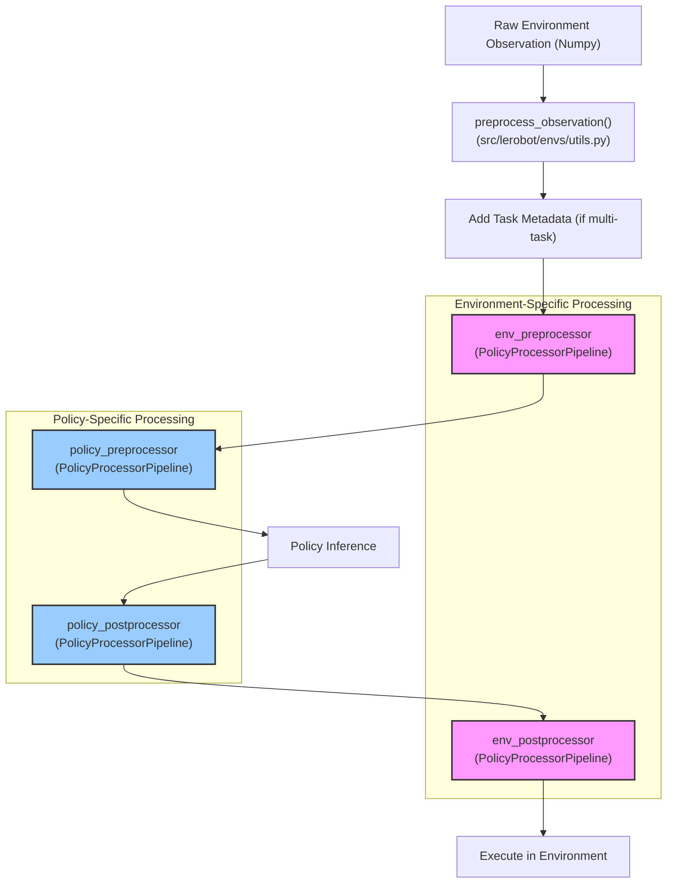

<!-- source: DeepWiki mcp.deepwiki.com · repo huggingface/lerobot · page 7 Simulation Environments · fetched 2026-10-26 -->

# Simulation Environments

<details>
<summary>Relevant source files</summary>

The following files were used as context for generating this wiki page:

- [docs/source/env_processor.mdx](docs/source/env_processor.mdx)
- [docs/source/libero_plus.mdx](docs/source/libero_plus.mdx)
- [src/lerobot/envs/configs.py](src/lerobot/envs/configs.py)
- [src/lerobot/envs/factory.py](src/lerobot/envs/factory.py)
- [src/lerobot/envs/libero.py](src/lerobot/envs/libero.py)
- [src/lerobot/envs/metaworld.py](src/lerobot/envs/metaworld.py)
- [src/lerobot/envs/utils.py](src/lerobot/envs/utils.py)
- [src/lerobot/processor/relative_action_processor.py](src/lerobot/processor/relative_action_processor.py)
- [src/lerobot/scripts/lerobot_eval.py](src/lerobot/scripts/lerobot_eval.py)
- [tests/envs/test_dispatch.py](tests/envs/test_dispatch.py)
- [tests/envs/test_freeze_after_episode_end.py](tests/envs/test_freeze_after_episode_end.py)
- [tests/policies/test_relative_actions.py](tests/policies/test_relative_actions.py)

</details>


This page introduces LeRobot's simulation environment support, covering the configuration architecture, built-in environments, the EnvHub distribution mechanism, and preprocessing pipelines. Simulation environments in LeRobot provide standardized testing grounds for imitation learning and reinforcement learning policies, leveraging Gymnasium vector environments [src/lerobot/envs/configs.py:49-53]().

This is a parent page. For deep technical details, see the child pages:
- [Environment Configuration](#7.1)
- [PushT and Basic Simulation Environments](#7.2)
- [LIBERO Benchmark](#7.3)
- [EnvHub: Loading Environments from Hugging Face](#7.4)
- [Environment Preprocessing](#7.5)
- [Additional Benchmarks](#7.6)

---

## Architecture Overview

All simulation environments are constructed via the unified `make_env()` factory function, which accepts either a typed `EnvConfig` dataclass or a Hugging Face Hub reference [src/lerobot/envs/factory.py:58-64](). It returns a nested dictionary mapping suite names and task IDs to vectorized environments (`gym.vector.VectorEnv`) [src/lerobot/envs/factory.py:82-86]().

**Diagram: Simulation Environment Architecture**

```mermaid
flowchart TD
    EvalPipelineConfig["\"EvalPipelineConfig\n(lerobot/configs/eval.py)\""]
    make_env["\"make_env()\n(lerobot/envs/factory.py)\""]
    EnvConfig["\"EnvConfig (abstract)\n(lerobot/envs/configs.py)\""]
    HubEnvConfig["\"HubEnvConfig\n(lerobot/envs/configs.py)\""]

    AlohaEnv["\"AlohaEnv\n(src/lerobot/envs/configs.py)\""]
    LiberoEnvCfg["\"LiberoEnv\n(src/lerobot/envs/configs.py)\""]
    MetaworldEnv["\"MetaworldEnv\n(src/lerobot/envs/metaworld.py)\""]

    LiberoGymEnv["\"LiberoEnv (gym.Env)\n(src/lerobot/envs/libero.py)\""]
    create_envs["\"create_envs()\n(lerobot/envs/configs.py)\""]

    ReturnType["\"Return: dict[suite][task_id]\n→ gym.vector.VectorEnv\""]

    EvalPipelineConfig --> make_env
    make_env --> EnvConfig
    EnvConfig --> AlohaEnv
    EnvConfig --> LiberoEnvCfg
    EnvConfig --> MetaworldEnv
    EnvConfig --> HubEnvConfig

    LiberoEnvCfg --> create_envs
    create_envs --> LiberoGymEnv

    AlohaEnv --> ReturnType
    LiberoGymEnv --> ReturnType
    MetaworldEnv --> ReturnType
```

Sources: [src/lerobot/envs/configs.py:56-147](), [src/lerobot/envs/factory.py:58-122](), [src/lerobot/envs/libero.py:107-132]()

---

## Sub-Topic Overview

### 7.1. Environment Configuration
Environments are configured using subclasses of `EnvConfig`, which inherits from `draccus.ChoiceRegistry` [src/lerobot/envs/configs.py:56-57](). Configurations define tasks, frame rates, observation/action features, and custom vectorization wrappers like `AsyncVectorEnv` or `SyncVectorEnv` [src/lerobot/envs/configs.py:49-124](). It also includes helper utilities like `FreezeAfterEpisodeEnd` to optimize rollouts by stopping unnecessary simulator steps after task termination [tests/envs/test_freeze_after_episode_end.py:14-19]().

For details, see [Environment Configuration](#7.1).
Sources: [src/lerobot/envs/configs.py:49-124](), [tests/envs/test_freeze_after_episode_end.py:14-19]()

### 7.2. PushT and Basic Simulation Environments
LeRobot includes lightweight benchmark environments such as PushT (`gym_pusht`) and ALOHA (`gym_aloha`) [src/lerobot/envs/configs.py:148-190](). These serve as fast, reliable quick-start targets for verifying imitation learning algorithms like ACT and Diffusion Policies.

For details, see [PushT and Basic Simulation Environments](#7.2).
Sources: [src/lerobot/envs/configs.py:148-190]()

### 7.3. LIBERO Benchmark
The LIBERO benchmark integration supports its core task suites (`libero_spatial`, `libero_object`, `libero_goal`, `libero_10`, `libero_90`) and the LIBERO-plus robustness variant [src/lerobot/envs/libero.py:98-104](), [docs/source/libero_plus.mdx:1-7](). It handles custom initial state loading, camera remapping, and specialized evaluation protocols [src/lerobot/envs/libero.py:67-88]().

For details, see [LIBERO Benchmark](#7.3).
Sources: [src/lerobot/envs/libero.py:67-104](), [docs/source/libero_plus.mdx:1-7]()

### 7.4. EnvHub: Loading Environments from Hugging Face
`HubEnvConfig` and `make_env()` support pulling custom simulation environments directly from Hugging Face Hub repositories [src/lerobot/envs/configs.py:132-147](), [src/lerobot/envs/factory.py:98-113](). By parsing `repo_id` strings (with optional branch and revision specs), LeRobot downloads and executes remote `env.py` modules securely when `trust_remote_code=True` is provided [src/lerobot/envs/factory.py:63-76]().

For details, see [EnvHub: Loading Environments from Hugging Face](#7.4).
Sources: [src/lerobot/envs/configs.py:132-147](), [src/lerobot/envs/factory.py:58-113]()

### 7.5. Environment Preprocessing
Environment observations undergo environment-specific preprocessing before entering policy pipelines [docs/source/env_processor.mdx:1-13](). The `make_env_pre_post_processors()` function builds pipelines that handle state flattening, camera key remapping, and task conditioning without mixing environment logic into policy implementations [src/lerobot/envs/factory.py:37-55](), [docs/source/env_processor.mdx:65-86]().

**Diagram: Environment Preprocessing Pipeline**

Sources: [src/lerobot/envs/factory.py:37-55](), [src/lerobot/envs/utils.py:68-149](), [docs/source/env_processor.mdx:1-86]()

### 7.6. Additional Benchmarks
LeRobot integrates advanced benchmarks including MetaWorld, VLABench, RoboTwin 2.0, RoboCasa365, RoboCerebra, and RoboMME [src/lerobot/envs/metaworld.py:78-141](). These environments are supported via containerized Docker setups and validated through dedicated CI benchmark workflows.

For details, see [Additional Benchmarks](#7.6).
Sources: [src/lerobot/envs/metaworld.py:78-141]()

---

