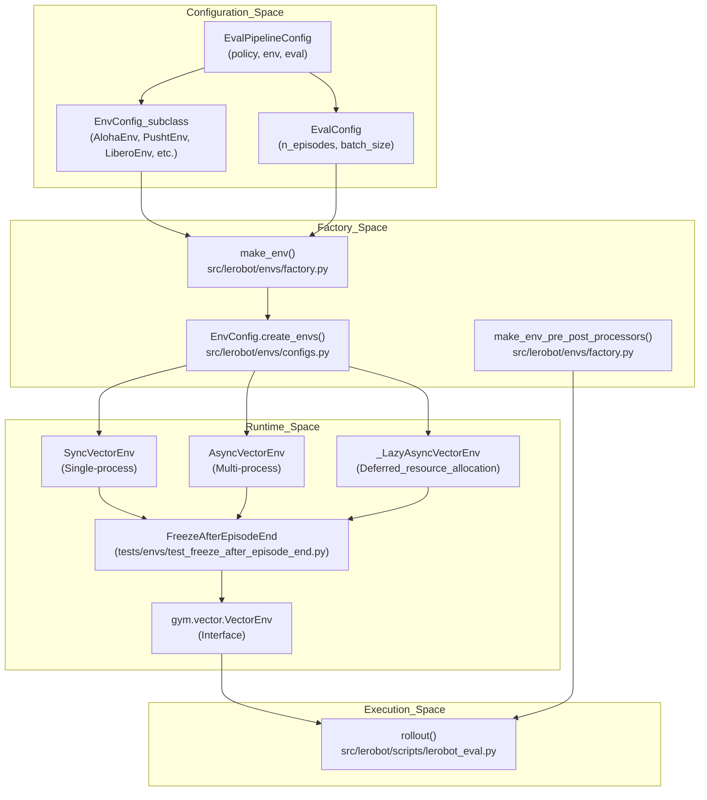
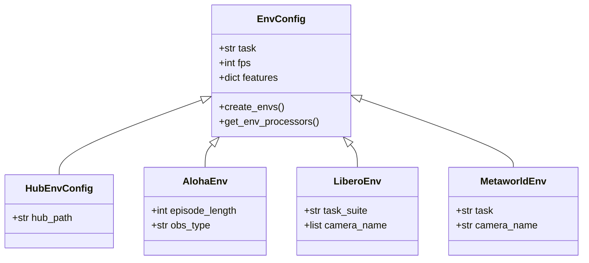

<!-- source: DeepWiki mcp.deepwiki.com · repo huggingface/lerobot · page 7.1 Environment Configuration · fetched 2026-10-26 -->

# Environment Configuration

<details>
<summary>Relevant source files</summary>

The following files were used as context for generating this wiki page:

- [docs/source/env_processor.mdx](docs/source/env_processor.mdx)
- [docs/source/envhub_isaaclab_arena.mdx](docs/source/envhub_isaaclab_arena.mdx)
- [docs/source/libero_plus.mdx](docs/source/libero_plus.mdx)
- [src/lerobot/configs/eval.py](src/lerobot/configs/eval.py)
- [src/lerobot/configs/parser.py](src/lerobot/configs/parser.py)
- [src/lerobot/envs/__init__.py](src/lerobot/envs/__init__.py)
- [src/lerobot/envs/configs.py](src/lerobot/envs/configs.py)
- [src/lerobot/envs/factory.py](src/lerobot/envs/factory.py)
- [src/lerobot/envs/libero.py](src/lerobot/envs/libero.py)
- [src/lerobot/envs/metaworld.py](src/lerobot/envs/metaworld.py)
- [src/lerobot/envs/utils.py](src/lerobot/envs/utils.py)
- [src/lerobot/policies/flux3/f3/transformer.py](src/lerobot/policies/flux3/f3/transformer.py)
- [src/lerobot/processor/relative_action_processor.py](src/lerobot/processor/relative_action_processor.py)
- [src/lerobot/scripts/lerobot_eval.py](src/lerobot/scripts/lerobot_eval.py)
- [tests/envs/test_dispatch.py](tests/envs/test_dispatch.py)
- [tests/envs/test_freeze_after_episode_end.py](tests/envs/test_freeze_after_episode_end.py)
- [tests/policies/test_relative_actions.py](tests/policies/test_relative_actions.py)
- [tests/test_yaml_policy_path.py](tests/test_yaml_policy_path.py)

</details>


## Purpose and Scope

This page documents the environment configuration system in LeRobot, which controls how simulation environments are instantiated, parameterized, and managed during policy evaluation. Environment configuration is used exclusively for **simulation-based evaluation**, not for real robot control (see [Robot and Teleoperator Abstraction]() for hardware control).

The environment configuration system provides:
- The `EnvConfig` class hierarchy for declarative environment specification [src/lerobot/envs/configs.py:56-62]().
- The `make_env` factory function for environment instantiation [src/lerobot/envs/factory.py:58-64]().
- Vectorized environment wrapping for parallel evaluation via `SyncVectorEnv`, `AsyncVectorEnv`, and lazy resource allocation [src/lerobot/envs/configs.py:48-54](), [src/lerobot/envs/utils.py:35-36]().
- Episode lifecycle optimization via `FreezeAfterEpisodeEnd` to prevent unnecessary simulator stepping after termination [tests/envs/test_freeze_after_episode_end.py:14-19]().
- Task specification and seed management [src/lerobot/envs/configs.py:57-57]().

For information about loading custom environments from Hugging Face Hub, see [EnvHub: Loading Environments from Hugging Face](). For details on specific built-in environments, see [PushT and Basic Simulation Environments]().

Sources: [src/lerobot/envs/configs.py:56-62](), [src/lerobot/envs/factory.py:58-64](), [tests/envs/test_freeze_after_episode_end.py:14-19]()

---

## Environment Configuration in the System Architecture

The following diagram illustrates how configuration entities translate into operational environment instances during evaluation.

Title: "Environment Configuration Data Flow"


**Environment Configuration Flow**

Sources: [src/lerobot/configs/eval.py:30-41](), [src/lerobot/envs/factory.py:58-64](), [src/lerobot/envs/configs.py:83-87](), [src/lerobot/envs/utils.py:35-36](), [tests/envs/test_freeze_after_episode_end.py:14-19]()

---

## EnvConfig Class Structure

The `EnvConfig` class hierarchy provides a declarative way to specify environment parameters. It uses `draccus.ChoiceRegistry` to allow dynamic selection of environment types from CLI or config files [src/lerobot/envs/configs.py:56-57]().

### Core Configuration Fields

The base `EnvConfig` includes several key fields:

| Field | Type | Purpose |
|-------|------|---------|
| `task` | `str \| None` | Specific task identifier (e.g., "PushT-v0") [src/lerobot/envs/configs.py:58](). |
| `fps` | `int` | Control frequency of the environment [src/lerobot/envs/configs.py:59](). |
| `features` | `dict[str, PolicyFeature]` | Input/Output feature definitions for policy alignment [src/lerobot/envs/configs.py:60](). |
| `features_map` | `dict[str, str]` | Mapping from env keys to LeRobot standard keys [src/lerobot/envs/configs.py:61](). |
| `max_parallel_tasks` | `int` | Max tasks evaluated in parallel [src/lerobot/envs/configs.py:62](). |
| `disable_env_checker` | `bool` | Whether to disable Gymnasium's environment checker [src/lerobot/envs/configs.py:63](). |

### Environment-Specific Configuration

Different environment types extend the base configuration. Subclasses must implement `gym_kwargs` to pass parameters to the underlying simulator [src/lerobot/envs/configs.py:79-82]().

Title: "Environment Configuration Hierarchy"


**Environment Configuration Class Hierarchy**

Sources: [src/lerobot/envs/configs.py:56-190](), [src/lerobot/envs/libero.py:107-130](), [src/lerobot/envs/metaworld.py:78-91]()

---

## Environment Creation and VectorEnv Wrapping

The `make_env` factory function is the primary interface for creating environments. It handles environment instantiation, vectorization, and optional remote code execution [src/lerobot/envs/factory.py:58-64]().

### Factory Logic

1.  **Hub Detection**: If `cfg` is a string or `HubEnvConfig`, it downloads the environment code from the Hugging Face Hub and executes the remote `make_env` function [src/lerobot/envs/factory.py:91-113](). This requires `trust_remote_code=True` [src/lerobot/envs/factory.py:63]().
2.  **Vectorization**: It delegates to `cfg.create_envs()`, which instantiates either `gym.vector.SyncVectorEnv` or `gym.vector.AsyncVectorEnv` based on `n_envs` and `use_async_envs` [src/lerobot/envs/configs.py:83-93](). For `AsyncVectorEnv`, `context="forkserver"` is configured for process safety [src/lerobot/envs/configs.py:115-116]().
3.  **Lazy Allocation (`_LazyAsyncVectorEnv`)**: For heavy multi-task benchmarks like LIBERO, LeRobot uses `_LazyAsyncVectorEnv` to defer worker process creation until the first `reset()` or `step()`, preventing unnecessary resource allocation [src/lerobot/envs/libero.py:35]().
4.  **Episode Ending Optimization (`FreezeAfterEpisodeEnd`)**: During parallel evaluation rollouts, faster sub-environments complete their episodes before slower ones. `rollout()` continues stepping the batch until the slowest member finishes [src/lerobot/scripts/lerobot_eval.py:175-184](). To avoid redundant physical simulation and rendering in terminated sub-environments, `FreezeAfterEpisodeEnd` latches `done`, freezes simulator stepping, and replays terminal observations until a new rollout begins [tests/envs/test_freeze_after_episode_end.py:59-87]().

Sources: [src/lerobot/envs/factory.py:58-122](), [src/lerobot/envs/configs.py:83-124](), [src/lerobot/envs/libero.py:35](), [tests/envs/test_freeze_after_episode_end.py:14-101](), [src/lerobot/scripts/lerobot_eval.py:175-184]()

---

## Seed Management

Reproducibility is maintained through deterministic seeding across parallel environments.

1.  **Global Seed**: The evaluation pipeline starts with a base seed (default 1000) [src/lerobot/configs/eval.py:39]().
2.  **Batch Seeding**: In the `rollout()` function, seeds are passed to the environment batch via `env.reset(seed=seeds)`. This ensures each sub-environment in the vector is initialized with a specific seed [src/lerobot/scripts/lerobot_eval.py:175-184]().
3.  **LIBERO Episode Indexing**: In LIBERO, the `init_state_id` is tied to the episode index to ensure different parallel environments start in different initial states of the same task [src/lerobot/envs/libero.py:124-125]().

Sources: [src/lerobot/configs/eval.py:39](), [src/lerobot/scripts/lerobot_eval.py:175-184](), [src/lerobot/envs/libero.py:124-125]()

---

## Task Specification and Observation Preprocessing

LeRobot standardizes how tasks are communicated to policies and how raw observations are transformed into tensors.

### Observation Preprocessing
The `preprocess_observation` function in `lerobot.envs.utils` performs critical transformations [src/lerobot/envs/utils.py:68-75]():
-   **Image Normalization**: Converts `uint8` `(B, H, W, C)` images to `float32` `(B, C, H, W)` tensors in range `[0, 1]` [src/lerobot/envs/utils.py:86-104]().
-   **Key Mapping**: Maps raw keys like `agent_pos` to `observation.state` and `environment_state` to `observation.env_state` [src/lerobot/envs/utils.py:106-117]().
-   **Robot State**: Handles nested `robot_state` dictionaries by converting numpy arrays to tensors recursively [src/lerobot/envs/utils.py:119-120]().
-   **Framework Support**: Includes specific handling for IsaacLab Arena and MetaWorld formats [src/lerobot/envs/utils.py:123-147]().

### Task Injection
Policies require task context (e.g., natural language instructions). During `rollout()`, the script attempts to retrieve task descriptions from the sub-environments [src/lerobot/scripts/lerobot_eval.py:184]():

```python
try:
    observation["task"] = list(env.call("task_description"))
except (AttributeError, NotImplementedError):
    try:
        observation["task"] = list(env.call("task"))
    except (AttributeError, NotImplementedError):
        pass
```

In benchmarks like LIBERO, the `task_description` is retrieved from the task's language metadata [src/lerobot/envs/libero.py:172]() (approx). In MetaWorld, it is loaded from `metaworld_config.json` [src/lerobot/envs/metaworld.py:33-53]().

Sources: [src/lerobot/envs/utils.py:68-149](), [src/lerobot/envs/libero.py:38-46](), [src/lerobot/envs/metaworld.py:33-53](), [src/lerobot/scripts/lerobot_eval.py:184]()

---

