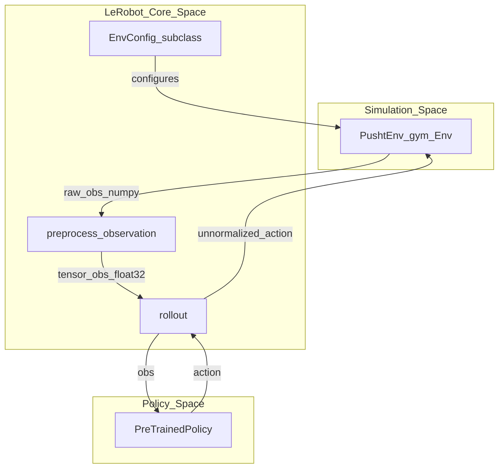
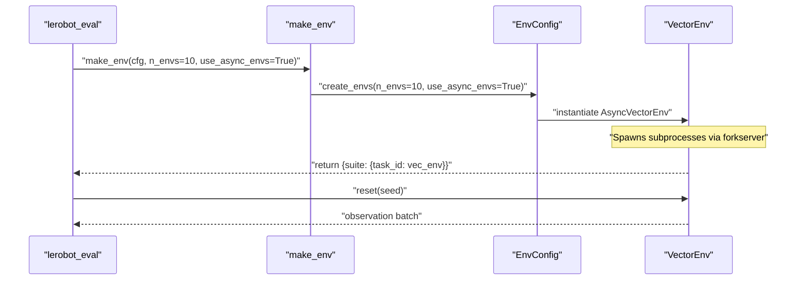

<!-- source: DeepWiki mcp.deepwiki.com · repo huggingface/lerobot · page 7.2 PushT and Basic Simulation Environments · fetched 2026-10-26 -->

# PushT and Basic Simulation Environments

Relevant source files

The following files were used as context for generating this wiki page:

- [docs/source/env_processor.mdx](docs/source/env_processor.mdx)
- [docs/source/envhub.mdx](docs/source/envhub.mdx)
- [docs/source/koch.mdx](docs/source/koch.mdx)
- [docs/source/lekiwi.mdx](docs/source/lekiwi.mdx)
- [docs/source/libero_plus.mdx](docs/source/libero_plus.mdx)
- [docs/source/so100.mdx](docs/source/so100.mdx)
- [docs/source/so101.mdx](docs/source/so101.mdx)
- [src/lerobot/envs/configs.py](src/lerobot/envs/configs.py)
- [src/lerobot/envs/factory.py](src/lerobot/envs/factory.py)
- [src/lerobot/envs/libero.py](src/lerobot/envs/libero.py)
- [src/lerobot/envs/metaworld.py](src/lerobot/envs/metaworld.py)
- [src/lerobot/envs/utils.py](src/lerobot/envs/utils.py)
- [src/lerobot/processor/relative_action_processor.py](src/lerobot/processor/relative_action_processor.py)
- [src/lerobot/scripts/lerobot_eval.py](src/lerobot/scripts/lerobot_eval.py)
- [tests/envs/test_dispatch.py](tests/envs/test_dispatch.py)
- [tests/envs/test_envs.py](tests/envs/test_envs.py)
- [tests/envs/test_freeze_after_episode_end.py](tests/envs/test_freeze_after_episode_end.py)
- [tests/policies/test_relative_actions.py](tests/policies/test_relative_actions.py)

LeRobot provides integrated support for several lightweight simulation environments that serve as benchmarks for policy development and testing. These environments, such as **PushT** and **ALOHA**, are typically used for quick-start experiments and unit testing of imitation learning (IL) and reinforcement learning (RL) policies due to their low computational overhead and ease of installation.

## Overview of Simulation Environments

Simulation environments in LeRobot are wrapped in a standard `gym.Env` interface. The `make_env` factory function is the primary entry point for instantiating these environments, supporting both local configurations and remote environments hosted on the Hugging Face Hub `[src/lerobot/envs/factory.py:58-87]()`.

### Data Flow in Simulation
During evaluation, data moves through a multi-stage pipeline to ensure compatibility between diverse simulators and standardized policies:

1. **Observation Acquisition**: The `gym.Env` produces raw observations as `numpy` dictionaries `[src/lerobot/envs/utils.py:68-149]()`.
2. **Preprocessing**: Observations are converted to PyTorch tensors and normalized (e.g., images are converted to channel-first `float32` in the `[0, 1]` range) via `preprocess_observation` `[src/lerobot/envs/utils.py:68-104]().`
3. **Environment-Specific Processing**: Transformations like flattening nested robot states (e.g., in LIBERO) or coordinate system adjustments are applied using an `env_preprocessor` `[src/lerobot/envs/factory.py:37-55]()`.
4. **Policy Inference**: The policy predicts an action based on the processed observations via `select_action()` or `forward()` `[src/lerobot/scripts/lerobot_eval.py:168-183]()`.
5. **Action Execution**: Predicted actions are post-processed and sent back to the environment's `step()` method `[src/lerobot/scripts/lerobot_eval.py:168-183]()`.

**System Mapping: Natural Language to Code Entities**

| Concept | Code Entity | File |
| :--- | :--- | :--- |
| Environment Configuration | `EnvConfig` | `[src/lerobot/envs/configs.py:57-64]()` |
| Environment Factory | `make_env` | `[src/lerobot/envs/factory.py:58-87]()` |
| Vectorized Environment | `gym.vector.VectorEnv` | `[src/lerobot/envs/configs.py:87-125]()` |
| Observation Formatting | `preprocess_observation` | `[src/lerobot/envs/utils.py:68-149]()` |
| Evaluation Loop | `rollout` | `[src/lerobot/scripts/lerobot_eval.py:168-183]()` |

Sources: `[src/lerobot/envs/factory.py:37-87]()`, `[src/lerobot/envs/utils.py:68-149]`, `[src/lerobot/scripts/lerobot_eval.py:168-183]()`.

---

## PushT Environment

PushT is a 2D manipulation task where a robot arm must push a T-shaped block into a target area. It is widely used for benchmarking Diffusion Policies.

### Configuration and Task Definition
The environment is registered via the `EnvConfig` registry as `"pusht"` `[src/lerobot/envs/configs.py:57-68]()`. It maps raw keys like `agent_pos` to standard observation states and handles specific visualization dimensions.

| Parameter | Value |
| :--- | :--- |
| **Gym ID** | `gym_pusht/PushT-v0` |
| **FPS** | 10 |
| **Max Steps** | 300 |
| **Action Space** | 2D (End-effector position) |
| **Observation** | Pixels (384x384) + Agent Position |

### Code Entity Data Flow Diagram
Title: "PushT Observation and Action Data Flow"

Sources: `[src/lerobot/envs/configs.py:57-68]()`, `[src/lerobot/envs/utils.py:68-149]()`, `[src/lerobot/scripts/lerobot_eval.py:168-183]()`.

---

## ALOHA (Simulation)

The ALOHA simulation environment provides a benchmark for dual-arm manipulation tasks, such as the `AlohaInsertion-v0` task `[src/lerobot/envs/configs.py:148-151]()`.

### Task Specifications
- **Task**: `AlohaInsertion-v0` (default) `[src/lerobot/envs/configs.py:150-151]()`.
- **FPS**: 50 `[src/lerobot/envs/configs.py:151-152]()`.
- **Episode Length**: 400 steps `[src/lerobot/envs/configs.py:152-153]()`.
- **Action Dimension**: 14 (7 per arm) `[src/lerobot/envs/configs.py:158-161]()`.
- **Observation**: Supports `pixels` (top camera) and `pixels_agent_pos` (top camera + joint positions) `[src/lerobot/envs/configs.py:172-181]()`.

### Configuration Mapping
The `AlohaEnv` config class maps internal ALOHA keys to LeRobot standards using `features_map` `[src/lerobot/envs/configs.py:163-170]()`:
- `agent_pos` $\rightarrow$ `OBS_STATE` `[src/lerobot/envs/configs.py:165-166]()`
- `pixels/top` $\rightarrow$ `OBS_IMAGES.top` `[src/lerobot/envs/configs.py:167-169]()`

Sources: `[src/lerobot/envs/configs.py:148-190]()`.

---

## MetaWorld Integration

MetaWorld is a multi-task benchmark featuring a Sawyer arm performing 50 different manipulation tasks. LeRobot integrates it via the `MetaworldEnv` class `[src/lerobot/envs/metaworld.py:78-79]()`.

### Implementation Details
- **Deferred Creation**: To avoid crashes with `AsyncVectorEnv` and rendering contexts, the underlying MetaWorld environment is created inside the worker subprocess on the first `reset()` call via `_ensure_env()` `[src/lerobot/envs/metaworld.py:142-159]()`.
- **Observation Mapping**: The `corner2` camera view is flipped to correct for MetaWorld's default inversion `[src/lerobot/envs/metaworld.py:170-173]()`.
- **Expert Policies**: Each task is mapped to its corresponding MetaWorld scripted expert policy for data collection or evaluation comparisons `[src/lerobot/envs/metaworld.py:107-107]()`.

Sources: `[src/lerobot/envs/metaworld.py:78-185]()`.

---

## Environment Factory and Vectorization

LeRobot uses `gym.vector` to parallelize simulation rollouts, which significantly speeds up evaluation.

### `make_env` Implementation
The `make_env` function orchestrates the creation of environments `[src/lerobot/envs/factory.py:58-87]()`:
1. **Hub Dispatch**: If a string or `HubEnvConfig` is provided, it downloads and calls a hub-hosted `make_env` function `[src/lerobot/envs/factory.py:91-113]()`. This requires explicit `trust_remote_code=True` `[src/lerobot/envs/factory.py:58-76]()`.
2. **Local Creation**: If a local `EnvConfig` is provided, it calls `cfg.create_envs()` `[src/lerobot/envs/factory.py:121-122]()`.
3. **Vectorization**: The `create_envs` method uses `AsyncVectorEnv` for parallel execution (using `forkserver` context) or `SyncVectorEnv` for single-threaded execution `[src/lerobot/envs/configs.py:87-126]()`.

### Benchmark Registration
New environments are added by subclassing `EnvConfig` and using the `@EnvConfig.register_subclass` decorator `[src/lerobot/envs/configs.py:57-68]`, `[src/lerobot/envs/configs.py:148-148]()`.

### Environment Instantiation Sequence Diagram
Title: "Environment Instantiation and Vectorization Sequence"

Sources: `[src/lerobot/envs/factory.py:58-122]()`, `[src/lerobot/envs/configs.py:57-126]()`.

---

## Evaluation Workflow (`lerobot-eval`)

The `rollout` function in `lerobot_eval.py` is the core loop for simulation benchmarking `[src/lerobot/scripts/lerobot_eval.py:168-183]()`.

### Rollout Loop Steps
1. **Reset**: Calls `env.reset(seed=seeds)` and `policy.reset()` to initialize the state `[src/lerobot/scripts/lerobot_eval.py:168-183]()`.
2. **Observation Preprocessing**: Converts raw pixels and states into the format expected by `PreTrainedPolicy` using `preprocess_observation` `[src/lerobot/envs/utils.py:68-149]()`.
3. **Processor Pipelines**: Applies `env_preprocessor` (environment-specific) and `preprocessor` (policy-specific) to the observations `[src/lerobot/scripts/lerobot_eval.py:168-183]()`.
4. **Policy Step**: The policy predicts actions via `policy.select_action(observation)` `[src/lerobot/scripts/lerobot_eval.py:168-183]()`.
5. **Action Post-processing**: Actions are passed through `postprocessor` and `env_postprocessor` before being sent to `env.step()` `[src/lerobot/scripts/lerobot_eval.py:168-183]()`.
6. **Success Tracking**: The loop monitors metrics and episode completion conditions `[src/lerobot/scripts/lerobot_eval.py:168-183]()`.

Sources: `[src/lerobot/scripts/lerobot_eval.py:168-183]()`, `[src/lerobot/envs/factory.py:37-55]()`.

---

