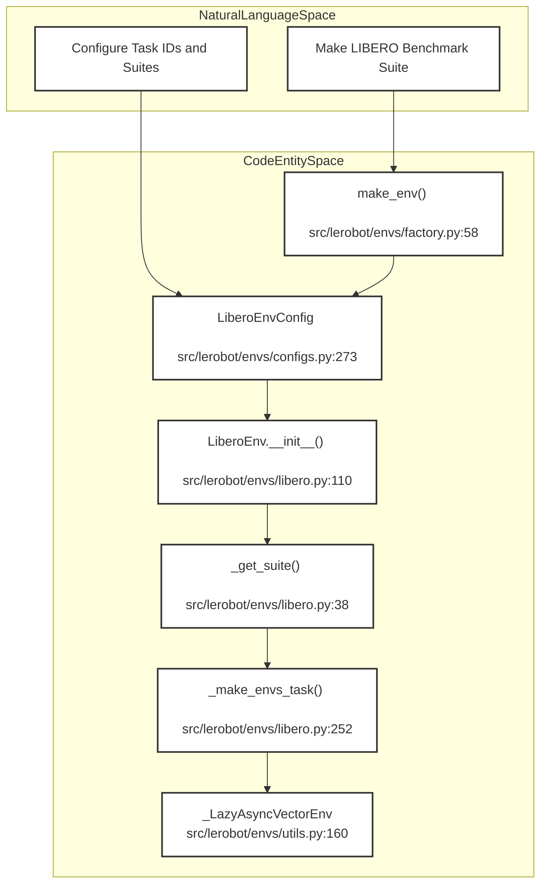
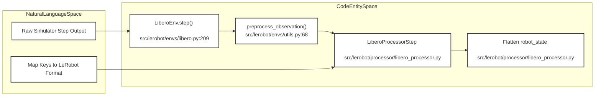

<!-- source: DeepWiki mcp.deepwiki.com · repo huggingface/lerobot · page 7.3 LIBERO Benchmark · fetched 2026-10-26 -->

# LIBERO Benchmark

<details>
<summary>Relevant source files</summary>

The following files were used as context for generating this wiki page:

- [docs/source/adding_benchmarks.mdx](docs/source/adding_benchmarks.mdx)
- [docs/source/env_processor.mdx](docs/source/env_processor.mdx)
- [docs/source/libero.mdx](docs/source/libero.mdx)
- [docs/source/libero_plus.mdx](docs/source/libero_plus.mdx)
- [docs/source/metaworld.mdx](docs/source/metaworld.mdx)
- [src/lerobot/envs/configs.py](src/lerobot/envs/configs.py)
- [src/lerobot/envs/factory.py](src/lerobot/envs/factory.py)
- [src/lerobot/envs/libero.py](src/lerobot/envs/libero.py)
- [src/lerobot/envs/metaworld.py](src/lerobot/envs/metaworld.py)
- [src/lerobot/envs/utils.py](src/lerobot/envs/utils.py)
- [src/lerobot/processor/relative_action_processor.py](src/lerobot/processor/relative_action_processor.py)
- [src/lerobot/scripts/lerobot_eval.py](src/lerobot/scripts/lerobot_eval.py)
- [src/lerobot/utils/eval_stats.py](src/lerobot/utils/eval_stats.py)
- [tests/envs/test_dispatch.py](tests/envs/test_dispatch.py)
- [tests/envs/test_freeze_after_episode_end.py](tests/envs/test_freeze_after_episode_end.py)
- [tests/policies/test_relative_actions.py](tests/policies/test_relative_actions.py)
- [tests/scripts/test_lerobot_eval_summary.py](tests/scripts/test_lerobot_eval_summary.py)
- [tests/utils/test_eval_stats.py](tests/utils/test_eval_stats.py)
- [utils/documentation_tests.txt](utils/documentation_tests.txt)

</details>


LIBERO (Lifelong roBotic lEarning benchmaRk) is a benchmark suite for evaluating manipulation policies on standardized tasks. LeRobot integrates LIBERO through the `LiberoEnv` class [src/lerobot/envs/libero.py:107]() and provides built-in support for multi-task evaluation across 130 manipulation tasks organized into 5 benchmark suites. It also supports the **LIBERO-plus** robustness benchmark which includes environment perturbations.

**Paper**: [LIBERO: Benchmarking Knowledge Transfer for Lifelong Robot Learning](https://arxiv.org/abs/2306.03310)  
**Original Repository**: [github.com/Lifelong-Robot-Learning/LIBERO](https://github.com/Lifelong-Robot-Learning/LIBERO)

## Integration Architecture

LIBERO environments are instantiated through the `make_env` factory function [src/lerobot/envs/factory.py:58-122](). The framework detects the `libero` environment type via `LiberoEnvConfig` [src/lerobot/envs/configs.py:259-304]() and constructs a nested dictionary of vectorized environments. The evaluation pipeline uses `rollout` [src/lerobot/scripts/lerobot_eval.py:167-285]() to systematically evaluate policies across multiple task groups.

Sources: [docs/source/libero.mdx:1-10](), [src/lerobot/envs/factory.py:58-122](), [src/lerobot/envs/libero.py:107-172](), [src/lerobot/envs/configs.py:259-304]()

---

## Task Suites

LIBERO organizes **130 manipulation tasks** across **5 benchmark suites**, each focusing on different aspects of robot learning:

| Suite Name       | CLI name         | Tasks | Description                              | Max Steps |
|------------------|------------------|-------|------------------------------------------|-----------|
| `LIBERO-Spatial` | `libero_spatial` | 10    | Spatial reasoning and relations          | 280       |
| `LIBERO-Object`  | `libero_object`  | 10    | Object-centric manipulation              | 280       |
| `LIBERO-Goal`    | `libero_goal`    | 10    | Goal-conditioned task adaptation         | 300       |
| `LIBERO-Long`    | `libero_10`      | 10    | Long-horizon tasks from LIBERO-100       | 520       |
| `LIBERO-90`      | `libero_90`      | 90    | Short-horizon tasks from LIBERO-100      | 400       |

### Suite Characteristics

- **LIBERO-Spatial**: Tasks requiring reasoning about spatial relations [docs/source/libero.mdx:17]().
- **LIBERO-Object**: Tasks centered on manipulating different objects [docs/source/libero.mdx:18]().
- **LIBERO-Goal**: Goal-conditioned tasks with changing targets [docs/source/libero.mdx:19]().
- **LIBERO-90**: Short-horizon tasks from the LIBERO-100 collection [docs/source/libero.mdx:20]().
- **LIBERO-Long (libero_10)**: Long-horizon tasks from the LIBERO-100 collection [docs/source/libero.mdx:21]().

Sources: [docs/source/libero.mdx:13-21](), [src/lerobot/envs/libero.py:98-104]()

---

## Evaluation Protocols

LIBERO supports both single-suite and multi-suite evaluation modes. The environment factory returns a nested dictionary structure that organizes vectorized environments by suite and task ID:

```python
dict[suite_name: str, dict[task_id: int, gym.vector.VectorEnv]]
```

### Environment Creation Pipeline

The following diagram bridges the natural language space of environment initialization to the specific code entities (`make_env`, `LiberoEnvConfig`, `LiberoEnv`, `_get_suite`, and `_LazyAsyncVectorEnv`) invoked during startup:


Sources: [src/lerobot/envs/factory.py:58-122](), [src/lerobot/envs/libero.py:38-58](), [src/lerobot/envs/libero.py:110-179](), [src/lerobot/envs/libero.py:252-282](), [src/lerobot/envs/configs.py:273-294](), [src/lerobot/envs/utils.py:160-205]()

### Evaluation Commands

Execute evaluations using `lerobot-eval`:

```bash
lerobot-eval \
  --policy.path="your-policy-id" \
  --env.type=libero \
  --env.task=libero_spatial,libero_object,libero_goal,libero_10 \
  --eval.batch_size=1 \
  --eval.n_episodes=10 \
  --env.max_parallel_tasks=1
```

**Command Options**:
- `--env.task`: Suite name (`libero_object`, `libero_spatial`, etc.) [docs/source/libero.mdx:69]().
- `--env.task_ids`: Specific task indices (e.g., `[0,1,2]`). Omit to run all tasks [docs/source/libero.mdx:70]().
- `--eval.batch_size`: Number of parallel environments per task [docs/source/libero.mdx:71]().
- `--eval.n_episodes`: Total episodes to run per task [docs/source/libero.mdx:72]().

Sources: [docs/source/libero.mdx:44-72](), [src/lerobot/scripts/lerobot_eval.py:27-45]()

---

## Environment Preprocessing and Spaces

### Observation Space

The `LiberoEnv` class [src/lerobot/envs/libero.py:107-130]() defines a `gym.spaces.Dict` observation space. Observations are processed by `LiberoProcessorStep` to follow LeRobot naming conventions.

| Raw LIBERO Key             | LeRobot Key                | Description                               |
|----------------------------|----------------------------|-------------------------------------------|
| `agentview_image`          | `observation.images.image` | Main camera view [src/lerobot/envs/libero.py:152]() |
| `robot0_eye_in_hand_image` | `observation.images.image2`| Wrist camera view [src/lerobot/envs/libero.py:153]() |
| `robot_state`              | `observation.state`        | 8-dim proprioceptive vector [src/lerobot/envs/configs.py:44]() |

### Environment Processing Pipeline

The following diagram maps raw observations from LIBERO simulator execution into preprocessed policy inputs via helper functions and pipeline steps:


The `LiberoProcessorStep` [tests/envs/test_dispatch.py:81]() is responsible for transforming the raw `robot_state` into a flattened 8-dimensional vector `observation.state` [tests/envs/test_dispatch.py:104](). This involves combining end-effector position, quaternion, and gripper joint positions.

Sources: [src/lerobot/envs/utils.py:68-149](), [src/lerobot/envs/factory.py:37-55](), [src/lerobot/envs/libero.py:209-225](), [src/lerobot/envs/configs.py:27](), [tests/envs/test_dispatch.py:81](), [tests/envs/test_dispatch.py:104]()

### Action Space

LIBERO uses **continuous control** with a 7-dimensional action space [src/lerobot/envs/libero.py:95]():
- **Dimensions 0-5**: 6D end-effector delta or absolute pose.
- **Dimension 6**: 1D gripper control [src/lerobot/envs/libero.py:92]().

The `control_mode` parameter determines if actions are `relative` (default) or `absolute` [src/lerobot/envs/libero.py:128-129]().
The `RelativeActionsProcessorStep` [src/lerobot/processor/relative_action_processor.py:102]() converts absolute actions to relative actions by subtracting the current state for masked dimensions. Conversely, `AbsoluteActionsProcessorStep` [src/lerobot/processor/relative_action_processor.py:102]() converts relative actions back to absolute. This is crucial for policies trained on relative action spaces.

Sources: [src/lerobot/envs/libero.py:92-97](), [src/lerobot/envs/libero.py:128-129](), [docs/source/libero.mdx:89-93](), [src/lerobot/processor/relative_action_processor.py:102](), [src/lerobot/processor/relative_action_processor.py:43-70](), [src/lerobot/processor/relative_action_processor.py:73-99]()

---

## LIBERO-plus Robustness Benchmark

LeRobot supports **LIBERO-plus**, which extends the standard suites with perturbation dimensions to test policy robustness. Perturbations include changes in lighting, camera view, and object layout [src/lerobot/envs/libero.py:60-88]().

### Perturbation Dimensions
LIBERO-plus introduces seven independent axes of variation [docs/source/libero_plus.mdx:15-23]():
- **Objects layout**: Target position and confounding objects.
- **Camera viewpoints**: Position, orientation, and FOV.
- **Robot initial states**: Manipulator start pose.
- **Language instructions**: LLM-rewritten task descriptions.
- **Light conditions**: Intensity, direction, and color.
- **Background textures**: Scene surface appearance.
- **Sensor noise**: Photometric distortions.

### Perturbation Handling
LIBERO-plus encodes perturbations in the task filenames. The `get_task_init_states` function [src/lerobot/envs/libero.py:67]() implements logic to strip perturbation suffixes (like `_view`, `_light`, `_table`) to locate base initialization states on disk [src/lerobot/envs/libero.py:64-88](). This function also handles specific `_add_` or `_level` variants for new object layouts by reshaping the initial states [src/lerobot/envs/libero.py:78-81]().

Sources: [src/lerobot/envs/libero.py:60-88](), [docs/source/libero_plus.mdx:11-23]()

---

## Configuration

### LiberoEnv Config

LIBERO environments are configured via the `LiberoEnvConfig` dataclass [src/lerobot/envs/configs.py:259-304]().

```python
@EnvConfig.register_subclass("libero")
@dataclass
class LiberoEnvConfig(EnvConfig):
    task: str | None = "libero_spatial"
    fps: int = 10
    obs_type: str = "pixels_agent_pos"
    control_mode: str = "relative"
    observation_width: int = 256
    observation_height: int = 256
    # ...
```

**Key Parameters**:
- `task`: The suite name or a comma-separated list of suites [src/lerobot/envs/configs.py:261]().
- `control_mode`: Action parameterization, either `"relative"` or `"absolute"` [src/lerobot/envs/configs.py:264]().
- `init_states`: Boolean to use predefined deterministic initial states for reproducibility [src/lerobot/envs/configs.py:270]().
- `is_libero_plus`: Boolean to enable LIBERO-plus specific state loading and perturbation handling [src/lerobot/envs/configs.py:271]().

Sources: [src/lerobot/envs/configs.py:259-304]()

---

## Training and Reproduction

### Dataset
A preprocessed LIBERO dataset is available on the Hugging Face Hub:
👉 [lerobot/libero](https://huggingface.co/datasets/lerobot/libero) (v3.0 format, MP4 video encoding) [docs/source/libero.mdx:145-155]().

### Reproduced Results (Pi0.5)
LeRobot reproduces the results of the Pi0.5 model on the LIBERO benchmark [docs/source/libero.mdx:173-182]().

| Model | LIBERO Spatial | LIBERO Object | LIBERO Goal | LIBERO 10 | Average |
| :--- | :---: | :---: | :---: | :---: | :---: |
| **Pi0.5 (LeRobot)** | 97.0 | 99.0 | 98.0 | 96.0 | **97.5** |
| **Pi0.5 (OpenPI)** | 98.8 | 98.2 | 98.0 | 92.4 | **96.85** |

Sources: [docs/source/libero.mdx:173-182]()

---

## Implementation Details

### Success Detection
The `LiberoEnv.step()` [src/lerobot/envs/libero.py:209-225]() wrapper ensures that the `info` dictionary contains the `is_success` key [src/lerobot/envs/libero.py:220](), which is critical for the `lerobot-eval` loop to aggregate metrics. The `success_summary` utility [src/lerobot/utils/eval_stats.py]() then calculates success rates and 95% Wilson intervals [src/lerobot/utils/eval_stats.py]() for robust evaluation.

### Deferred Environment Creation
LeRobot uses `_LazyAsyncVectorEnv` [src/lerobot/envs/utils.py:160-205]() for LIBERO evaluation. This defers the actual instantiation of the simulator workers until the first `reset()` call, preventing immediate allocation of GPU/EGL resources for all tasks in a suite [src/lerobot/envs/utils.py:161-167]().

### Action Normalization
LIBERO expects actions in the range `[-1, 1]` [src/lerobot/envs/libero.py:96-97](). The `ACTION_DIM` is fixed at 7 [src/lerobot/envs/libero.py:95]().

Sources: [src/lerobot/envs/utils.py:160-205](), [src/lerobot/envs/libero.py:209-225](), [src/lerobot/envs/libero.py:95-97](), [src/lerobot/utils/eval_stats.py]()

---

