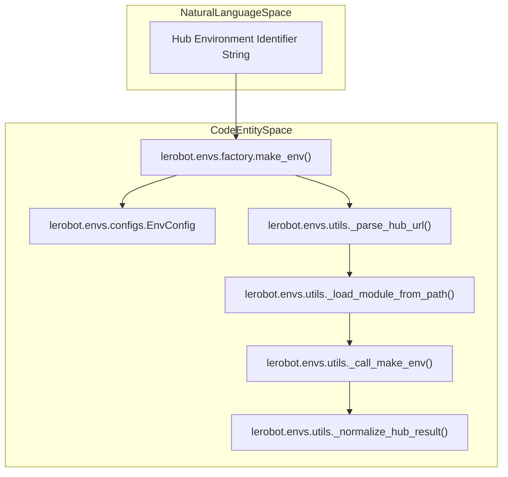

<!-- source: DeepWiki mcp.deepwiki.com · repo huggingface/lerobot · page 7.4 EnvHub: Loading Environments from Hugging Face · fetched 2026-10-26 -->

# EnvHub: Loading Environments from Hugging Face

<details>
<summary>Relevant source files</summary>

The following files were used as context for generating this wiki page:

- [docs/source/envhub.mdx](docs/source/envhub.mdx)
- [docs/source/envhub_isaaclab_arena.mdx](docs/source/envhub_isaaclab_arena.mdx)
- [docs/source/envhub_leisaac.mdx](docs/source/envhub_leisaac.mdx)
- [docs/source/koch.mdx](docs/source/koch.mdx)
- [docs/source/lekiwi.mdx](docs/source/lekiwi.mdx)
- [docs/source/so100.mdx](docs/source/so100.mdx)
- [docs/source/so101.mdx](docs/source/so101.mdx)
- [examples/backward_compatibility/replay.py](examples/backward_compatibility/replay.py)
- [examples/lekiwi/replay.py](examples/lekiwi/replay.py)
- [examples/phone_to_so100/replay.py](examples/phone_to_so100/replay.py)
- [examples/so100_to_so100_EE/replay.py](examples/so100_to_so100_EE/replay.py)
- [src/lerobot/configs/eval.py](src/lerobot/configs/eval.py)
- [src/lerobot/configs/parser.py](src/lerobot/configs/parser.py)
- [src/lerobot/envs/__init__.py](src/lerobot/envs/__init__.py)
- [src/lerobot/policies/flux3/f3/transformer.py](src/lerobot/policies/flux3/f3/transformer.py)
- [src/lerobot/rl/gym_manipulator.py](src/lerobot/rl/gym_manipulator.py)
- [tests/envs/test_envs.py](tests/envs/test_envs.py)
- [tests/test_yaml_policy_path.py](tests/test_yaml_policy_path.py)

</details>


## Purpose and Scope

This page documents the **EnvHub** system for dynamically loading simulation environments from Hugging Face Hub repositories. EnvHub enables researchers and developers to publish custom environments as Git repositories and load them at runtime without packaging or installation hassles.

For general environment configuration and the `make_env` factory function, see [Environment Configuration](#7.1). For information about built-in environments shipped with LeRobot (like LIBERO or Meta-World), see [PushT and Basic Simulation Environments](#7.2).

Sources: `[docs/source/envhub.mdx:3-9]()`, `[src/lerobot/configs/eval.py:34-44]()`

---

## Purpose and Design

EnvHub solves the distribution problem for custom simulation environments by leveraging the Hugging Face Hub as a remote repository. Instead of requiring environments to be packaged and installed as heavy Python libraries, EnvHub downloads environment code dynamically and executes it using Python's module loading system.

The key design principles are:
1. **Git-based versioning**: Environments are versioned using Git commits, tags, and branches. `[docs/source/envhub.mdx:15-15]()`
2. **Minimal packaging**: No PyPI package or `setup.py` required; just an `env.py` entry point. `[docs/source/envhub.mdx:13-14]()`, `[docs/source/envhub.mdx:56-62]()`
3. **Trust-based security**: Explicit `trust_remote_code=True` flag required for remote code execution. `[docs/source/envhub.mdx:39-41]()`, `[src/lerobot/configs/eval.py:43-43]()`
4. **Standard interface**: All environments must expose a `make_env` function. `[docs/source/envhub.mdx:20-22]()`
5. **Format flexibility**: Supports single environments, vectorized environments, and multi-task benchmarks. `[docs/source/envhub.mdx:22-26]()`

Sources: `[docs/source/envhub.mdx:1-30]()`, `[src/lerobot/configs/eval.py:43-43]()`

---

## Repository Structure Requirements

An EnvHub repository must contain at minimum an `env.py` file (or a custom-named Python file) that exposes the required interface.

```
username/my-environment/
├── env.py                    # Required: Environment definition
├── requirements.txt          # Optional: Dependencies
├── README.md                 # Recommended: Documentation
├── .gitignore               # Optional
└── assets/                  # Optional: Supporting files
```

Sources: `[docs/source/envhub.mdx:52-91]()`

### The `make_env` Function Contract

The `env.py` file must define a `make_env` function supporting signatures such as:
```python
def make_env(n_envs: int = 1, use_async_envs: bool = False)
def make_env(n_envs: int = 1, use_async_envs: bool = False, cfg: EnvConfig)
```
`[docs/source/envhub.mdx:22-29]()`

The function must return one of:
* `gym.Env`: A single environment (automatically wrapped in `VectorEnv`). `[docs/source/envhub.mdx:25-25]()`
* `gym.vector.VectorEnv`: A vectorized environment (most common). `[docs/source/envhub.mdx:24-24]()`
* `dict[str, dict[int, VectorEnv]]`: Multi-task benchmark format: `{suite_name: {task_id: VectorEnv}}`. `[docs/source/envhub.mdx:26-26]()`

Sources: `[docs/source/envhub.mdx:20-31]()`, `[docs/source/envhub.mdx:96-126]()`

---

## URL Format and Version Pinning

EnvHub supports a URL-like syntax for specifying repositories with optional version pinning and custom file paths.

| Pattern | Description | Example |
| :--- | :--- | :--- |
| `user/repo` | Load `env.py` from default branch | `lerobot/pusht-env` |
| `user/repo@revision` | Pin to specific commit/tag/branch | `lerobot/pusht-env@main` |
| `user/repo:path` | Load from custom file | `lerobot/envs:tasks/pusht.py` |
| `user/repo@rev:path` | Combine revision and path | `lerobot/envs@v1.0:tasks/pusht.py` |

`[tests/envs/test_envs.py:127-158]()`

Sources: `[tests/envs/test_envs.py:127-158]()`, `[docs/source/envhub.mdx:139-139]()`

---

## Loading Flow and Code Entity Architecture

The EnvHub loading process bridges natural language hub specifications to concrete Python runtime objects through dedicated parsing, caching, and module-loading utilities.

### Diagram: Natural Language Space to Code Entity Space (Loading Flow)

Title: "EnvHub Loading Pipeline and Code Entity Mapping"
```mermaid
graph TD
    NaturalInput[""User specifies repo_id / URL string (e.g. lerobot/cartpole-env@main)""] --> ParseFunction["_parse_hub_url()"]
    ParseFunction --> CheckSecurity["Check trust_remote_code flag in EvalPipelineConfig"]
    CheckSecurity -->|False| RaiseSecurityError["Raise RuntimeError (Security Refusal)"]
    CheckSecurity -->|True| DownloadFunction["_download_hub_file() using huggingface_hub"]
    DownloadFunction --> LoadModuleFunction["_load_module_from_path()"]
    LoadModuleFunction --> MakeEnvFunction["_call_make_env() invoking module.make_env()"]
    MakeEnvFunction --> NormalizeFunction["_normalize_hub_result()"]
    NormalizeFunction --> ReturnVectorEnv["Return dict[suite_name][task_id] -> gym.vector.VectorEnv"]
```
Sources: `[docs/source/envhub.mdx:39-48]()`, `[tests/envs/test_envs.py:127-193]()`, `[src/lerobot/configs/eval.py:43-44]()`

### Diagram: System Components to Code Entities Architecture

Title: "EnvHub Subsystem Component Mapping"

Sources: `[src/lerobot/envs/configs.py]()`, `[tests/envs/test_envs.py:127-193]()`, `[src/lerobot/envs/factory.py]()`, `[src/lerobot/envs/utils.py]()`

---

## GPU-Accelerated Environments: IsaacLab Arena & LeIsaac

EnvHub supports GPU-accelerated simulation frameworks such as **IsaacLab Arena** and **LeIsaac**, enabling high-throughput policy evaluation and teleoperation data collection at scale. `[docs/source/envhub_isaaclab_arena.mdx:1-19]()`, `[docs/source/envhub_leisaac.mdx:1-12]()`

### IsaacLab Arena Evaluation Example
To evaluate a policy in an IsaacLab Arena environment hosted on the Hub:
```bash
lerobot-eval \
    --policy.path=nvidia/smolvla-arena-gr1-microwave \
    --env.type=isaaclab_arena \
    --env.hub_path=nvidia/isaaclab-arena-envs \
    --rename_map='{"observation.images.robot_pov_cam_rgb": "observation.images.robot_pov_cam"}' \
    --policy.device=cuda \
    --env.environment=gr1_microwave \
    --env.embodiment=gr1_pink \
    --env.object=mustard_bottle \
    --env.headless=false \
    --env.enable_cameras=true \
    --env.video=true \
    --env.video_length=10 \
    --env.video_interval=15 \
    --env.state_keys=robot_joint_pos \
    --env.camera_keys=robot_pov_cam_rgb \
    --trust_remote_code=True \
    --eval.batch_size=1
```
`[docs/source/envhub_isaaclab_arena.mdx:92-110]()`

Sources: `[docs/source/envhub_isaaclab_arena.mdx:1-110]()`

---

## Security Model

Because EnvHub executes arbitrary Python code from remote repositories, it requires explicit user consent via the `trust_remote_code` flag. `[docs/source/envhub.mdx:43-48]`, `[src/lerobot/configs/eval.py:43-43]()`

### Security Best Practices
1. **Code Review**: Inspect `env.py` on the Hugging Face Hub before execution. `[docs/source/envhub.mdx:43-48]()`
2. **Commit Pinning**: Pin references to specific commit hashes instead of branch names to ensure immutability and reproducibility. `[docs/source/envhub.mdx:46-47]()`
3. **Dependency Verification**: Inspect `requirements.txt` for untrusted or unexpected package additions. `[docs/source/envhub.mdx:66-70]()`

Sources: `[docs/source/envhub.mdx:43-48]()`, `[src/lerobot/configs/eval.py:43-43]()`

---

## Local Testing Before Publishing

You can test custom EnvHub modules locally before pushing them to the Hub using internal parsing and loading utilities:

```python
from lerobot.envs.utils import _load_module_from_path, _call_make_env, _normalize_hub_result

# 1. Load local module
module = _load_module_from_path("./env.py")

# 2. Test make_env invocation
result = _call_make_env(module, n_envs=2, use_async_envs=False)

# 3. Normalize result to standard format
normalized = _normalize_hub_result(result)

# 4. Verify execution
suite_name = next(iter(normalized))
env = normalized[suite_name][0]
obs, info = env.reset()
env.close()
```
`[docs/source/envhub.mdx:132-147]()`

Sources: `[docs/source/envhub.mdx:127-147]()`

---

