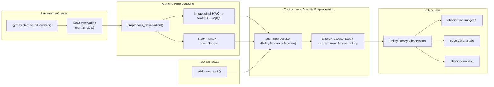
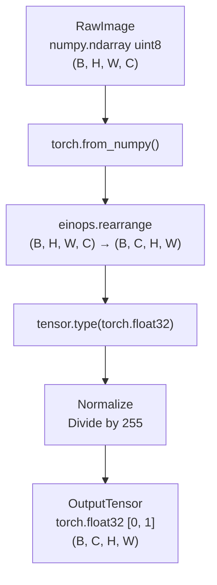
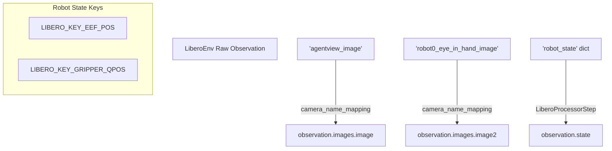
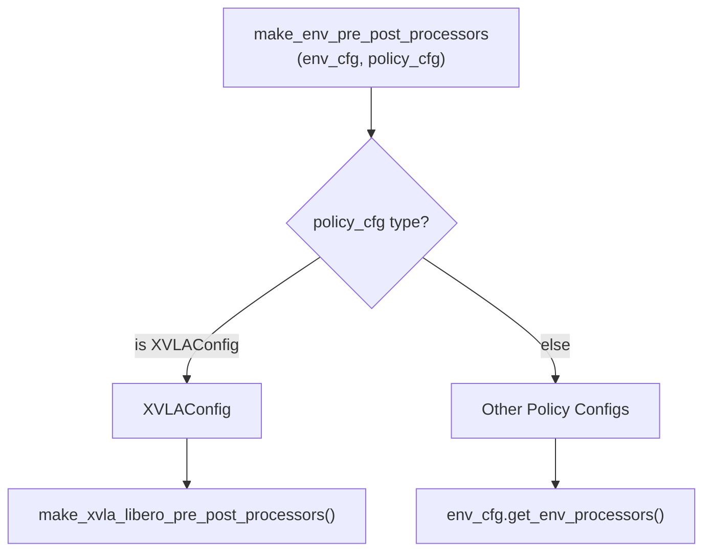

<!-- source: DeepWiki mcp.deepwiki.com · repo huggingface/lerobot · page 7.5 Environment Preprocessing · fetched 2026-10-26 -->

# Environment Preprocessing

Relevant source files

The following files were used as context for generating this wiki page:

- [docs/source/env_processor.mdx](docs/source/env_processor.mdx)
- [docs/source/libero_plus.mdx](docs/source/libero_plus.mdx)
- [src/lerobot/envs/configs.py](src/lerobot/envs/configs.py)
- [src/lerobot/envs/factory.py](src/lerobot/envs/factory.py)
- [src/lerobot/envs/libero.py](src/lerobot/envs/libero.py)
- [src/lerobot/envs/metaworld.py](src/lerobot/envs/metaworld.py)
- [src/lerobot/envs/metaworld_config.json](src/lerobot/envs/metaworld_config.json)
- [src/lerobot/envs/utils.py](src/lerobot/envs/utils.py)
- [src/lerobot/processor/relative_action_processor.py](src/lerobot/processor/relative_action_processor.py)
- [src/lerobot/scripts/lerobot_eval.py](src/lerobot/scripts/lerobot_eval.py)
- [tests/envs/test_dispatch.py](tests/envs/test_dispatch.py)
- [tests/envs/test_freeze_after_episode_end.py](tests/envs/test_freeze_after_episode_end.py)
- [tests/envs/test_metaworld_config.py](tests/envs/test_metaworld_config.py)
- [tests/policies/test_relative_actions.py](tests/policies/test_relative_actions.py)

## Purpose and Scope

Environment preprocessing transforms raw observations from simulation environments into the standardized LeRobot format expected by policies. This layer handles environment-specific quirks such as image orientation, nested state dictionaries, coordinate transformations, and episode boundary management (via wrappers like `FreezeAfterEpisodeEnd`), ensuring that observations are consistently formatted regardless of the underlying simulator.

This page documents the preprocessing pipeline for simulation environments. For data preprocessing during training (normalization, augmentation), see [Data Processing Pipeline](5.html). For robot hardware observation processing, see [Robot Hardware Integration](6.html).

Sources: `[src/lerobot/envs/utils.py:68-149]()`, `[src/lerobot/envs/factory.py:37-55]()`, `[docs/source/env_processor.mdx:1-62]()`

## Preprocessing Architecture

Environment preprocessing occurs in several stages: (1) generic preprocessing via `preprocess_observation()` that handles common transformations like image format conversion, (2) task metadata injection, and (3) environment-specific preprocessing via `PolicyProcessorPipeline` containing steps such as `LiberoProcessorStep` or `IsaaclabArenaProcessorStep`.

Title: "Observation Preprocessing Data Flow"

Sources: `[src/lerobot/envs/utils.py:68-149]()`, `[src/lerobot/envs/factory.py:37-55]()`, `[src/lerobot/scripts/lerobot_eval.py:158-185]()`, `[docs/source/env_processor.mdx:15-61]()`

## Generic Observation Preprocessing

The `preprocess_observation()` function in `[src/lerobot/envs/utils.py:68-149]()` provides generic transformations applied to all environments. It maps raw simulator keys to standard LeRobot keys and converts data types.

Title: "Generic Image Transformation Pipeline"

| Input Key | Output Key | Transform | Code Reference |
|-----------|------------|-----------|----------------|
| `pixels` (single) | `observation.image` | Channel-first, float32 [0,1] | `[src/lerobot/envs/utils.py:82-104]()` |
| `pixels` (dict) | `observation.images.<key>` | Channel-first, float32 [0,1] | `[src/lerobot/envs/utils.py:80-104]()` |
| `agent_pos` | `observation.state` | numpy → torch.float32 | `[src/lerobot/envs/utils.py:113-117]()` |
| `environment_state` | `observation.env_state` | numpy → torch.float32 | `[src/lerobot/envs/utils.py:106-111]()` |
| `robot_state` | `observation.robot_state` | Nested dict conversion | `[src/lerobot/envs/utils.py:119-120]()` |
| `policy` | `observation.policy` | Pass-through (IsaacLab Arena) | `[src/lerobot/envs/utils.py:123-124]()` |
| `camera_obs` | `observation.camera_obs` | Pass-through (IsaacLab Arena) | `[src/lerobot/envs/utils.py:126-127]()` |

The function handles both vectorized and non-vectorized observations by automatically adding a batch dimension when needed `[src/lerobot/envs/utils.py:90-91]()`.

Sources: `[src/lerobot/envs/utils.py:68-149]()`

## LIBERO Task Embeddings and State

LIBERO environments (`LiberoEnv`) require specific mapping of proprioceptive keys and image names to ensure consistency across the benchmark suites.

Title: "LIBERO Observation Key Mapping"

**Key Transformations:**

1. **Camera Mapping**: 
   - `agentview_image` is mapped to `image` `[src/lerobot/envs/libero.py:158]()`.
   - `robot0_eye_in_hand_image` is mapped to `image2` `[src/lerobot/envs/libero.py:159]()`.
   - These are prefixed with `observation.images.` by `preprocess_observation()` `[src/lerobot/envs/utils.py:80-84]()`.

2. **Proprioceptive State**: 
   - The policy typically expects an 8-dim state: EEF position (3D), EEF axis-angle (3D), and gripper positions (2D).
   - `LiberoProcessorStep` flattens the nested `robot_state` (containing `eef.pos`, `eef.quat`, and `gripper.qpos`) into a single 8-dimensional tensor `[tests/envs/test_dispatch.py:87-101]()`.
   - `LIBERO_KEY_EEF_POS`, `LIBERO_KEY_GRIPPER_QPOS`, and related constants define these lookup keys `[src/lerobot/envs/configs.py:32-40]()`.

3. **Task Conditioning**:
   - The environment exposes natural language task instructions via `task_description` which are injected into observations during rollout `[src/lerobot/scripts/lerobot_eval.py:173-174]()`.

Sources: `[src/lerobot/envs/libero.py:148-161]`, `[src/lerobot/envs/configs.py:32-40]`, `[tests/envs/test_dispatch.py:87-101]`, `[src/lerobot/scripts/lerobot_eval.py:173-174]`

## MetaWorld Integration

MetaWorld integration (`MetaworldEnv`) focuses on camera configuration and action space standardization.

- **Image Correction**: The `corner2` camera in MetaWorld outputs inverted frames. The `MetaworldEnv.render()` method applies `np.flip(image, (0, 1))` to correct orientation `[src/lerobot/envs/metaworld.py:170-173]()`.
- **Proprioceptive State**: Extracts `agent_pos` from the environment state vector `[src/lerobot/envs/metaworld.py:182]()`.
- **Action Space**: Operates on a 4D action space (3D delta position + 1D gripper) `[src/lerobot/envs/metaworld.py:140]()`.
- **Task Metadata**: Loads task descriptions, IDs, and expert policies from `metaworld_config.json` `[src/lerobot/envs/metaworld.py:33-73]()`.

Sources: `[src/lerobot/envs/metaworld.py:33-182]()`

## Preprocessor Pipeline Creation and `FreezeAfterEpisodeEnd`

The `make_env_pre_post_processors()` factory function creates preprocessing pipelines based on environment and policy configurations `[src/lerobot/envs/factory.py:37-55]()`.

Title: "Preprocessor Factory Logic"

- **XVLA Specialization**: For `XVLAConfig` instances, a specific LIBERO processor is instantiated to handle multimodal conditioning `[src/lerobot/envs/factory.py:50-53]()`.
- **Default Delegation**: For other configurations, it delegates to `env_cfg.get_env_processors()`, which defaults to empty `PolicyProcessorPipeline` objects (identity transforms) for standard environments like `AlohaEnv` or `PushtEnv` `[src/lerobot/envs/configs.py:126-128]()`.

### Episode Boundary Management: `FreezeAfterEpisodeEnd`

During batched rollouts, sub-environments terminate at different step counts. To avoid redundant physical simulation and rendering steps on finished sub-environments while waiting for the slowest member of the batch, LeRobot uses the `FreezeAfterEpisodeEnd` wrapper `[tests/envs/test_freeze_after_episode_end.py:14-19]()`. Once an episode terminates (`terminated` or `truncated` becomes `True`), `FreezeAfterEpisodeEnd` latches the terminal observation, ignores subsequent `step()` calls to the underlying simulator, and replays terminal states until a `NEW_ROLLOUT_OPTION` is issued during reset `[tests/envs/test_freeze_after_episode_end.py:60-117]()`.

Sources: `[src/lerobot/envs/factory.py:37-55]`, `[src/lerobot/envs/configs.py:126-128]`, `[tests/envs/test_freeze_after_episode_end.py:14-159]`

## Integration with Evaluation Pipeline

Environment preprocessing integrates directly into the `rollout()` function in `[src/lerobot/scripts/lerobot_eval.py:168-185]()`:

1. **Environment Step**: `env.step(action)` produces raw numpy observation dictionaries `[docs/source/env_processor.mdx:23]()`.
2. **Generic Conversion**: `preprocess_observation()` converts numpy arrays to PyTorch tensors and normalizes images to `[0, 1]` `[src/lerobot/envs/utils.py:68-149]()`.
3. **Environment Pipeline**: `env_preprocessor` applies simulator-specific steps such as `LiberoProcessorStep` `[docs/source/env_processor.mdx:35]()`.
4. **Policy Pipeline**: Standard `preprocessor` applies feature normalization and tokenization before policy inference `[docs/source/env_processor.mdx:42]()`.

Sources: `[src/lerobot/scripts/lerobot_eval.py:168-185]`, `[src/lerobot/envs/utils.py:68-149]`, `[docs/source/env_processor.mdx:15-61]`

---

