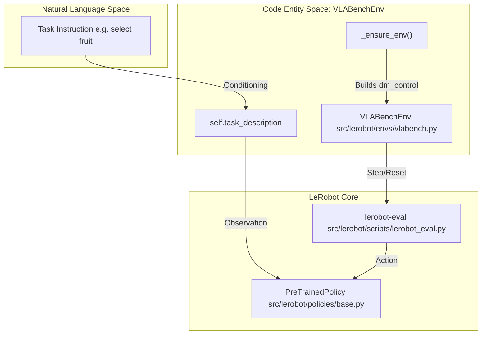
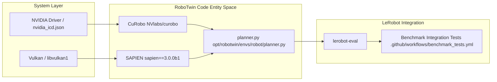

<!-- source: DeepWiki mcp.deepwiki.com · repo huggingface/lerobot · page 7.6 Additional Benchmarks · fetched 2026-10-26 -->

# Additional Benchmarks

Relevant source files

The following files were used as context for generating this wiki page:

- [docker/Dockerfile.benchmark.robocasa](docker/Dockerfile.benchmark.robocasa)
- [docker/Dockerfile.benchmark.robotwin](docker/Dockerfile.benchmark.robotwin)
- [docs/source/robocasa.mdx](docs/source/robocasa.mdx)
- [docs/source/robomme.mdx](docs/source/robomme.mdx)
- [docs/source/robotwin.mdx](docs/source/robotwin.mdx)
- [scripts/ci/extract_task_descriptions.py](scripts/ci/extract_task_descriptions.py)
- [src/lerobot/envs/robocasa.py](src/lerobot/envs/robocasa.py)
- [src/lerobot/envs/robomme.py](src/lerobot/envs/robomme.py)
- [src/lerobot/envs/robotwin.py](src/lerobot/envs/robotwin.py)
- [src/lerobot/envs/vlabench.py](src/lerobot/envs/vlabench.py)
- [src/lerobot/policies/pi05/memory.py](src/lerobot/policies/pi05/memory.py)
- [src/lerobot/processor/rename_processor.py](src/lerobot/processor/rename_processor.py)
- [tests/envs/test_robocasa.py](tests/envs/test_robocasa.py)
- [tests/envs/test_robotwin.py](tests/envs/test_robotwin.py)
- [tests/processor/test_rename_processor.py](tests/processor/test_rename_processor.py)
- [tests/test_robomme_env.py](tests/test_robomme_env.py)

LeRobot integrates several advanced robotic manipulation benchmarks beyond the standard suites. These benchmarks cover language-conditioned manipulation, bimanual coordination, kitchen environments, and large-scale reasoning tasks. Due to varying system dependencies (e.g., SAPIEN vs. MuJoCo) and conflicting library versions, these benchmarks are often managed through specialized Docker environments and integrated into the CI workflow for automated verification [.github/workflows/benchmark_tests.yml:15-17]().

## Supported Benchmarks

The following table summarizes the additional benchmarks integrated into LeRobot:

| Benchmark | Focus | Engine | Integration File |
| :--- | :--- | :--- | :--- |
| **VLABench** | Language-conditioned manipulation, long-horizon reasoning | MuJoCo | [src/lerobot/envs/vlabench.py:110-128]() |
| **RoboTwin 2.0** | Large-scale bimanual manipulation with domain randomization | SAPIEN | [src/lerobot/envs/robotwin.py:180-230]() |
| **RoboCasa365** | Large-scale kitchen manipulation tasks | MuJoCo | [src/lerobot/envs/robocasa.py:128-152]() |
| **RoboMME** | Memory-augmented manipulation (counting, permanence) | SAPIEN | [docs/source/robomme.mdx:1-8]() |
| **RoboCerebra** | Long-horizon reasoning and planning | MuJoCo | [scripts/ci/extract_task_descriptions.py:162-163]() |
| **LIBERO-plus** | Robustness analysis via perturbation dimensions | MuJoCo | [scripts/ci/extract_task_descriptions.py:38-50]() |
| **MetaWorld** | Multi-task reinforcement learning and robotics | MuJoCo | [scripts/ci/extract_task_descriptions.py:70-75]() |

Sources: [.github/workflows/benchmark_tests.yml:15-17](), [src/lerobot/envs/vlabench.py:110-128](), [src/lerobot/envs/robotwin.py:180-230](), [src/lerobot/envs/robocasa.py:128-152](), [docs/source/robomme.mdx:1-8](), [scripts/ci/extract_task_descriptions.py:38-163]()

### VLABench
VLABench evaluates six dimensions of robot intelligence, including mesh/texture understanding and physical-law reasoning. It utilizes a Franka Panda 7-DOF arm and provides 43 task categories split into `PRIMITIVE_TASKS` [src/lerobot/envs/vlabench.py:54-77]() and `COMPOSITE_TASKS` [src/lerobot/envs/vlabench.py:79-102](). The `VLABenchEnv` wrapper handles the `dm_control` simulation and supports multiple cameras (`image`, `second_image`, `wrist_image`) [src/lerobot/envs/vlabench.py:159-170]().

Sources: [src/lerobot/envs/vlabench.py:54-102](), [src/lerobot/envs/vlabench.py:159-170]()

### RoboTwin 2.0
RoboTwin 2.0 is a large-scale bimanual manipulation benchmark. It uses the SAPIEN 3.0 simulator and incorporates the CuRobo motion generator for realistic trajectory planning [docker/Dockerfile.benchmark.robotwin:15-18](). The integration requires specialized Vulkan and CUDA setups to handle rendering and motion planning simultaneously [docker/Dockerfile.benchmark.robotwin:30-46](). It supports joint-space control (14-dim) [src/lerobot/envs/robotwin.py:53]() and end-effector-pose control (16-dim) [src/lerobot/envs/robotwin.py:56]().

Sources: [docker/Dockerfile.benchmark.robotwin:15-46](), [src/lerobot/envs/robotwin.py:53-56]()

### RoboCasa365
RoboCasa365 provides 365 tasks in kitchen environments using a PandaOmron 12-DOF mobile manipulator [docs/source/robocasa.mdx:3](). LeRobot organizes these into shortcuts like `atomic_seen` or `composite_unseen` [src/lerobot/envs/robocasa.py:64-72](). The `RoboCasaEnv` wrapper maps the 16-dim state [src/lerobot/envs/robocasa.py:36]() and 12-dim action vector [src/lerobot/envs/robocasa.py:37]() to the standard LeRobot format.

Sources: [docs/source/robocasa.mdx:3](), [src/lerobot/envs/robocasa.py:36-72]()

### RoboMME
RoboMME evaluates a robot's ability to retain and use information across an episode, covering counting, spatial memory, and imitation [docs/source/robomme.mdx:3](). It uses a Panda arm in the ManiSkill/SAPIEN simulator [docs/source/robomme.mdx:8](). Static descriptions for tasks like `BinFill` or `PatternLock` are provided for metric reporting [scripts/ci/extract_task_descriptions.py:112-129]().

Sources: [docs/source/robomme.mdx:3-8](), [scripts/ci/extract_task_descriptions.py:112-129]()

### MetaWorld
Meta-World provides 50 tasks for multi-task and meta-RL. LeRobot supports individual tasks or difficulty groups. Task descriptions are extracted by cleaning the task name (e.g., removing "metaworld-" prefixes) [scripts/ci/extract_task_descriptions.py:70-75]().

Sources: [scripts/ci/extract_task_descriptions.py:70-75]()

## Integration Patterns

LeRobot uses a standardized wrapper pattern to bridge diverse simulator APIs to the `gymnasium.Env` interface.

### Environment Wrappers
Most benchmarks implement a dedicated class (e.g., `VLABenchEnv`, `RoboCasaEnv`) that handles:
1. **Deferred Initialization**: Simulator contexts are created on the first `reset()` inside worker subprocesses to avoid inheriting stale GPU/EGL contexts across `fork()` or `AsyncVectorEnv` spawns [src/lerobot/envs/vlabench.py:138-142](), [src/lerobot/envs/robocasa.py:172-174]().
2. **Observation Mapping**: Converting simulator-specific observation dictionaries into the LeRobot standard. For example, `VLABenchEnv` surfaces images as `pixels/image`, `pixels/second_image`, and `pixels/wrist_image` [src/lerobot/envs/vlabench.py:164-166]().
3. **Action Space Normalization**: Mapping simulator action ranges to the standard `[-1, 1]` range [src/lerobot/envs/robocasa.py:38-39]().
4. **Feature Renaming**: The `RenameObservationsProcessorStep` [src/lerobot/processor/rename_processor.py:27-64]() is used to map environment-specific observation keys to policy-expected keys. For example, RoboMME's `front_camera_name` and `wrist_camera_name` are mapped to `observation.images.camera1` and `observation.images.camera2` respectively [src/lerobot/envs/robomme.py:109-115](), [tests/test_robomme_env.py:95-97](). This is crucial for policies trained on a specific feature naming convention. The `rename_batch_keys` function [src/lerobot/processor/rename_processor.py:105-109]() handles this renaming before observations are grouped into a transition.

Sources: [src/lerobot/envs/vlabench.py:138-166](), [src/lerobot/envs/robocasa.py:38-174](), [src/lerobot/processor/rename_processor.py:27-109](), [src/lerobot/envs/robomme.py:109-115](), [tests/test_robomme_env.py:95-97]()

### Data Flow Diagram: VLABench Integration
The following diagram illustrates how natural language instructions and simulator states are bridged into the LeRobot `Policy` space.

Sources: [src/lerobot/envs/vlabench.py:110-150](), [src/lerobot/envs/robocasa.py:172-175]()

## Docker Environments

Because different benchmarks require conflicting dependencies, LeRobot maintains isolated Dockerfiles [.github/workflows/benchmark_tests.yml:15-17]().

| Dockerfile | Purpose | Key Dependencies |
| :--- | :--- | :--- |
| `Dockerfile.benchmark.robotwin` | RoboTwin 2.0 testing | `sapien==3.0.0b1`, `curobo`, `pytorch3d` [docker/Dockerfile.benchmark.robotwin:50-66]() |
| `Dockerfile.benchmark.vlabench` | VLABench testing | `dm_control`, `mujoco` [docker/Dockerfile.benchmark.vlabench:1-10]() |
| `Dockerfile.benchmark.robocasa` | RoboCasa testing | `robosuite`, `robocasa` [docker/Dockerfile.benchmark.robocasa:1-10]() |
| `Dockerfile.benchmark.libero` | LIBERO testing | `hf-libero`, `dm-control` [.github/workflows/benchmark_tests.yml:66-67]() |
| `Dockerfile.benchmark.robomme` | RoboMME testing | `mani-skill`, `robomme` [docker/Dockerfile.benchmark.robomme:1-10]() |

Sources: [.github/workflows/benchmark_tests.yml:15-67](), [docker/Dockerfile.benchmark.robotwin:50-66](), [docker/Dockerfile.benchmark.vlabench:1-10](), [docker/Dockerfile.benchmark.robocasa:1-10](), [docker/Dockerfile.benchmark.robomme:1-10]()

### RoboTwin Docker and Dependency Management
RoboTwin requires Vulkan system libraries for rendering and builds `pytorch3d` and `curobo` from source within the container [docker/Dockerfile.benchmark.robotwin:30-66](). It also downloads ~4GB of simulation assets (embodiments and objects) from the Hugging Face Hub using `hf_hub_download` [docker/Dockerfile.benchmark.robotwin:93-109]().

Sources: [docker/Dockerfile.benchmark.robotwin:26-109](), [.github/workflows/benchmark_tests.yml:15-22]()

## CI Benchmark Workflow

The `benchmark_tests.yml` workflow automates the validation of these environments [.github/workflows/benchmark_tests.yml:22](). It performs the following steps:
1. **Build isolated image**: Creates a Docker image specific to the benchmark to avoid dependency collisions [.github/workflows/benchmark_tests.yml:98-108]().
2. **Smoke Eval**: Runs an evaluation using `lerobot-eval` (usually 1 episode) to ensure the environment and policy can communicate [.github/workflows/benchmark_tests.yml:110-134]().
3. **Metric Extraction**: Uses `extract_task_descriptions.py` to pull natural language instructions from the simulator for inclusion in the evaluation metrics [scripts/ci/extract_task_descriptions.py:16-28]().

Sources: [.github/workflows/benchmark_tests.yml:22-134](), [scripts/ci/extract_task_descriptions.py:16-28]()

### Task Description Extraction
The script `extract_task_descriptions.py` maps simulator task indices to human-readable strings [scripts/ci/extract_task_descriptions.py:16-22]().
- **LIBERO**: Strips perturbation metadata (e.g., "view 0 0 100") from task language using `_LIBERO_PERTURBATION_TAIL_RE` [scripts/ci/extract_task_descriptions.py:43-50]().
- **RoboTwin**: Reads `description/task_instruction/<task>.json` and strips schema placeholders like `<` and `>` [scripts/ci/extract_task_descriptions.py:77-92]().
- **RoboCasa**: Splits CamelCase task names into lowercase words (e.g., "CloseFridge" → "close fridge") [scripts/ci/extract_task_descriptions.py:95-109]().
- **RoboMME**: Maps task names to static descriptions defined in `_ROBOMME_DESCRIPTIONS` [scripts/ci/extract_task_descriptions.py:112-142]().
- **VLABench**: Emits a cleaned-name label for each task, as the full environment loading is expensive and the instruction is captured in episode info during evaluation [scripts/ci/extract_task_descriptions.py:145-157]().

Sources: [scripts/ci/extract_task_descriptions.py:16-157]()

---

