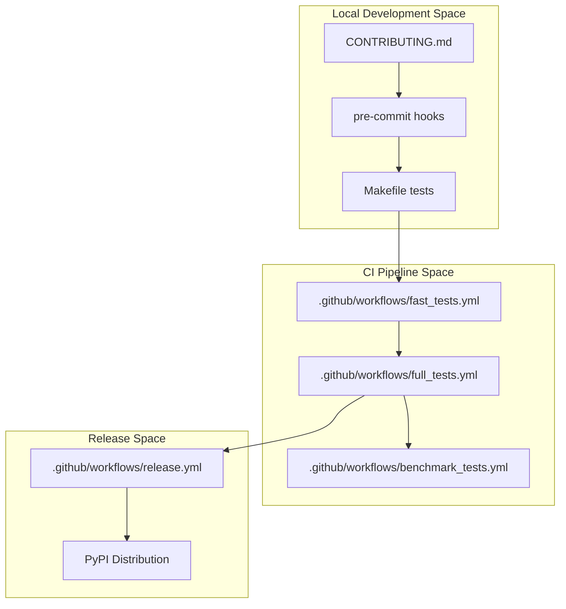
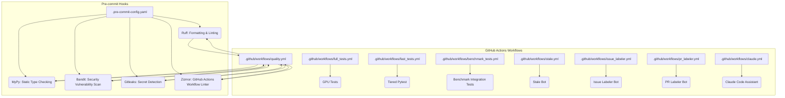

<!-- source: DeepWiki mcp.deepwiki.com · repo huggingface/lerobot · page 8 Development and Infrastructure · fetched 2026-10-26 -->

# Development and Infrastructure

Relevant source files

The following files were used as context for generating this wiki page:

- [.github/ISSUE_TEMPLATE/bug-report.yml](.github/ISSUE_TEMPLATE/bug-report.yml)
- [.github/PULL_REQUEST_TEMPLATE.md](.github/PULL_REQUEST_TEMPLATE.md)
- [.github/labeler.yml](.github/labeler.yml)
- [.github/workflows/benchmark_tests.yml](.github/workflows/benchmark_tests.yml)
- [.github/workflows/claude.yml](.github/workflows/claude.yml)
- [.github/workflows/docker_publish.yml](.github/workflows/docker_publish.yml)
- [.github/workflows/fast_tests.yml](.github/workflows/fast_tests.yml)
- [.github/workflows/full_tests.yml](.github/workflows/full_tests.yml)
- [.github/workflows/issue_labeler.yml](.github/workflows/issue_labeler.yml)
- [.github/workflows/latest_deps_tests.yml](.github/workflows/latest_deps_tests.yml)
- [.github/workflows/pr_labeler.yml](.github/workflows/pr_labeler.yml)
- [.github/workflows/quality.yml](.github/workflows/quality.yml)
- [.github/workflows/release.yml](.github/workflows/release.yml)
- [.github/workflows/security.yml](.github/workflows/security.yml)
- [.github/workflows/stale.yml](.github/workflows/stale.yml)
- [.pre-commit-config.yaml](.pre-commit-config.yaml)
- [CODE_OF_CONDUCT.md](CODE_OF_CONDUCT.md)
- [CONTRIBUTING.md](CONTRIBUTING.md)
- [Makefile](Makefile)
- [docs/source/backwardcomp.mdx](docs/source/backwardcomp.mdx)
- [src/lerobot/scripts/lerobot_info.py](src/lerobot/scripts/lerobot_info.py)
- [tests/training/test_multi_gpu.py](tests/training/test_multi_gpu.py)

This page provides a high-level overview of the development tooling, infrastructure, and continuous integration systems used to maintain and validate the LeRobot codebase [.github/workflows/full_tests.yml:16-34](). As a parent page, it summarizes the core workflows and links to dedicated child pages for deep technical details.

**Sources:** [CONTRIBUTING.md:1-90](), [.github/workflows/full_tests.yml:16-34](), [.github/workflows/fast_tests.yml:19-63](), [.github/workflows/benchmark_tests.yml:15-51](), [.github/workflows/release.yml:15-119]()

---

## Project Structure and Dependencies

LeRobot uses `pyproject.toml` as the single source of truth for metadata, entry points, and optional dependency groups, while `uv.lock` ensures deterministic dependency resolution [.github/workflows/full_tests.yml:82-90](). The project is structured around modular extras (`dataset`, `hardware`, `viz`, `test`, `all`) to keep installations lightweight.

For detailed information on configuration files, dependency extras, uv index configuration, and build setups, see [Project Structure and Dependencies](#8.1).

**Sources:** [.github/workflows/full_tests.yml:82-90](), [.github/workflows/fast_tests.yml:96-128]()

---

## Testing Infrastructure

The test suite is structured around `pytest` and spans multiple validation tiers. End-to-end integration tests are orchestrated via the `Makefile` to verify training and evaluation loops for imitation learning and VLA policies [.github/workflows/full_tests.yml:104-105](), [Makefile:35-181]().

For details on test suite organization, pytest configurations, fixtures, mocks, and execution tiers (fast, full, nightly), see [Testing Infrastructure](#8.2).

**Sources:** [.github/workflows/full_tests.yml:53-106](), [.github/workflows/fast_tests.yml:63-128](), [Makefile:35-181]()

---

## Code Quality and CI/CD

Code quality and security are enforced via automated pre-commit hooks (`ruff`, `mypy`, `bandit`, `gitleaks`, `zizmor`) and continuous integration workflows [.pre-commit-config.yaml:41-47](), [.pre-commit-config.yaml:94-103](), [.pre-commit-config.yaml:87-92](), [.pre-commit-config.yaml:77-81](), [.pre-commit-config.yaml:83-86](). GitHub Actions orchestrate tests across CPU and GPU environments, alongside automated bots for issue labeling and dependency updates [.github/workflows/latest_deps_tests.yml:18-81](), [.github/workflows/issue_labeler.yml:16-77]().

**Sources:** [.pre-commit-config.yaml:41-47](), [.pre-commit-config.yaml:94-103](), [.pre-commit-config.yaml:87-92](), [.pre-commit-config.yaml:77-81](), [.pre-commit-config.yaml:83-86](), [.github/workflows/quality.yml:40-61](), [.github/workflows/full_tests.yml:169-186](), [.github/workflows/fast_tests.yml:63-130](), [.github/workflows/benchmark_tests.yml:67-173](), [.github/workflows/stale.yml:43-71](), [.github/workflows/issue_labeler.yml:26-78](), [.github/workflows/pr_labeler.yml:26-41](), [.github/workflows/claude.yml:30-80]()

For details on static analysis checks, workflow configurations, GPU testing infrastructure, and automation bots, see [Code Quality and CI/CD](#8.3).

---

## Docker Environments

LeRobot provides specialized container definitions under the `docker/` directory to isolate execution dependencies across different deployment targets, including user environments, internal training nodes, Jetson hardware, and benchmark suites [.github/workflows/full_tests.yml:110-163](), [.github/workflows/benchmark_tests.yml:67-122](), [Makefile:29-34]().

For details on Docker image variants, build workflows, tagging conventions, and containerized testing, see [Docker Environments](#8.4).

**Sources:** [.github/workflows/full_tests.yml:110-163](), [.github/workflows/benchmark_tests.yml:67-122](), [Makefile:29-34]()

---

## Release and Distribution

Releases are managed through dedicated GitHub Actions workflows (`release.yml`) that validate tag versions against `pyproject.toml`, verify package availability on PyPI, build distribution archives, create GitHub releases, and publish to PyPI or TestPyPI [.github/workflows/release.yml:15-119](). An automated smoke test validates the published package end-to-end [.github/workflows/release.yml:121-168]().

For details on semantic versioning, version validation checks, and distribution steps, see [Release and Distribution](#8.5).

**Sources:** [.github/workflows/release.yml:15-168]()

---

## Contributing Guidelines

Contributing code and documentation to LeRobot follows a standard fork-and-pull-request workflow. Developers use the `Makefile` and `pre-commit` to validate changes locally before opening pull requests [CONTRIBUTING.md:19-88](), [.github/PULL_REQUEST_TEMPLATE.md:1-37]().

For step-by-step instructions on development environment setup, running local checks, code style requirements, AI policies, and the PR review process, see [Contributing Guidelines](#8.6).

**Sources:** [CONTRIBUTING.md:1-90](), [.github/PULL_REQUEST_TEMPLATE.md:1-37]()

---

