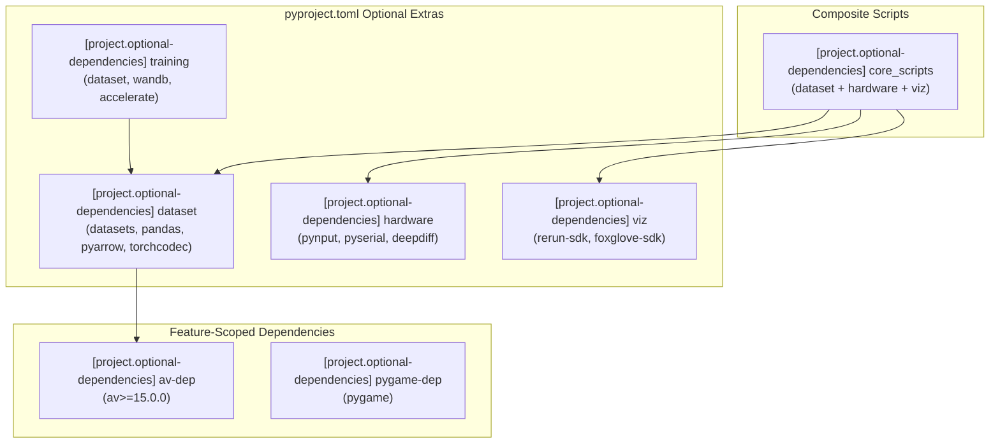
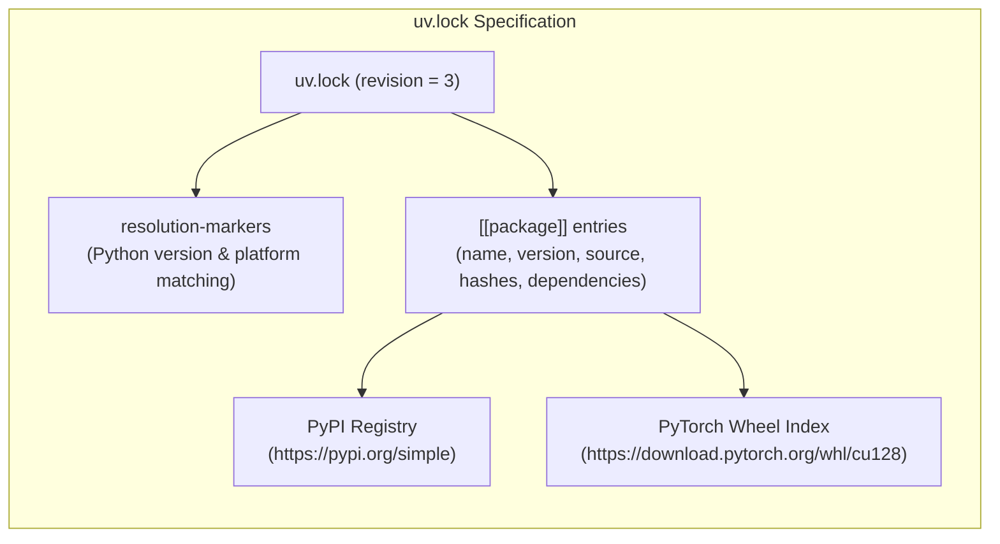

<!-- source: DeepWiki mcp.deepwiki.com · repo huggingface/lerobot · page 8.1 Project Structure and Dependencies · fetched 2026-10-26 -->

# Project Structure and Dependencies

<details>
<summary>Relevant source files</summary>

The following files were used as context for generating this wiki page:

- [.gitignore](.gitignore)
- [LICENSE](LICENSE)
- [MANIFEST.in](MANIFEST.in)
- [README.md](README.md)
- [docs/source/_toctree.yml](docs/source/_toctree.yml)
- [docs/source/lawam.mdx](docs/source/lawam.mdx)
- [docs/source/policy_lawam_README.md](docs/source/policy_lawam_README.md)
- [pyproject.toml](pyproject.toml)
- [src/lerobot/policies/__init__.py](src/lerobot/policies/__init__.py)
- [src/lerobot/policies/groot/processor_groot.py](src/lerobot/policies/groot/processor_groot.py)
- [src/lerobot/policies/lawam/README.md](src/lerobot/policies/lawam/README.md)
- [src/lerobot/policies/lawam/__init__.py](src/lerobot/policies/lawam/__init__.py)
- [src/lerobot/rewards/sarm/__init__.py](src/lerobot/rewards/sarm/__init__.py)
- [src/lerobot/templates/lerobot_modelcard_template.md](src/lerobot/templates/lerobot_modelcard_template.md)
- [src/lerobot/utils/import_utils.py](src/lerobot/utils/import_utils.py)
- [uv.lock](uv.lock)

</details>


This page describes the repository layout of LeRobot, its `pyproject.toml` configuration, core and optional dependency groups, CLI entrypoint registrations, and build system configurations. It provides a technical map of how the package is organized and how to install specific subsets of dependencies for different robotics use cases.

Sources: [pyproject.toml:15-32](), [docs/source/_toctree.yml:1-192](), [uv.lock:1-33]()

---

## Repository Layout

LeRobot follows a standard `src`-layout as defined in its build configuration. All core logic is contained within `src/lerobot/`, while top-level directories handle infrastructure, documentation, and testing.

**Top-level directory map:**

```
lerobot/                   ← repository root
├── src/
│   └── lerobot/           ← installable Python package
│       ├── common/        ← shared constants and core logic
│       ├── configs/       ← configuration dataclasses (draccus-based)
│       ├── datasets/      ← LeRobotDataset, video encoding, and tools
│       ├── envs/          ← simulation environment wrappers (Gymnasium)
│       ├── motors/        ← motor bus abstractions (Dynamixel, Feetech, CAN)
│       ├── policies/      ← PreTrainedPolicy and architecture implementations
│       ├── robots/        ← robot hardware abstractions and kinematics
│       ├── scripts/       ← CLI entrypoint main() functions
│       ├── utils/         ← shared utilities (Hub, wandb, rerun, logging)
│       └── ...
├── tests/                 ← pytest test suite and mocks
├── docs/                  ← documentation sources (mdx) and tutorials
├── benchmarks/            ← video and performance benchmarks
├── docker/                ← Dockerfiles for CPU/GPU environments
├── .github/               ← CI/CD workflows and GitHub Actions
├── pyproject.toml         ← build, deps, scripts, and tool config
├── setup.py               ← metadata and long description processing
└── uv.lock                ← pinned dependency resolution
```

Sources: [pyproject.toml:15-32](), [uv.lock:1-33]()

---

## Package Metadata and Build System

The package metadata and build specifications are housed within `pyproject.toml`. LeRobot uses `setuptools` as its build backend via `setuptools.build_meta`.

| Field | Value / Description | Code Reference |
|---|---|---|
| `name` | `lerobot` | [pyproject.toml:27]() |
| `version` | `0.6.2` | [pyproject.toml:28]() |
| `requires-python` | `>=3.12` | [pyproject.toml:32]() |
| `license` | Apache-2.0 | [pyproject.toml:31]() |
| `build-backend` | `setuptools.build_meta` | [pyproject.toml:15-17]() |

Sources: [pyproject.toml:15-32]()

---

## Core Dependencies

Core dependencies are defined under the `dependencies` array in `pyproject.toml` and are installed by default. They establish the minimum runtime environment for tensor manipulation, core configuration parsing via `draccus`, and Hugging Face Hub integration.

**Core dependency groups:**

| Group | Packages | Code Reference |
|---|---|---|
| **Core ML** | `torch`, `torchvision`, `numpy`, `opencv-python-headless`, `Pillow`, `einops` | [pyproject.toml:60-68]() |
| **Config & Hub** | `draccus`, `huggingface-hub`, `requests` | [pyproject.toml:70-72]() |
| **Environments** | `gymnasium` | [pyproject.toml:78]() |
| **Serialization** | `safetensors` | [pyproject.toml:81]() |
| **Utilities** | `packaging`, `termcolor`, `tqdm` | [pyproject.toml:84-86]() |
| **Build Tools** | `cmake`, `setuptools` | [pyproject.toml:88-90]() |

> **Note:** `gymnasium` is a core dependency because it is tightly coupled across `lerobot.envs`, `lerobot.policies.factory`, and hardware integrations like `lerobot.robots.unitree`.

Sources: [pyproject.toml:60-91]()

---

## Optional Dependency Groups and Extras

LeRobot uses a modular extras system declared under `[project.optional-dependencies]` in `pyproject.toml`. These extras scope feature sets such as dataset loading (`dataset`), training (`training`), hardware control (`hardware`), and visualization (`viz`).

### Dependency Hierarchy

The following diagram maps high-level feature requirements and composite packages to their underlying dependencies declared in `pyproject.toml`.



Sources: [pyproject.toml:94-157]()

### Composite Extras for CLI Scripts

Composite extras group multiple feature sets to support end-user workflows and script execution:

| Extra Name | Included Sub-Extras / Packages | Primary Use Case | Code Reference |
|---|---|---|---|
| `core_scripts` | `dataset`, `hardware`, `viz` | Operating physical robot hardware (recording, replay, calibration) | [pyproject.toml:140]() |
| `evaluation` | `av-dep` | Evaluating policies in simulation or video-based setups | [pyproject.toml:143]() |
| `dataset_viz` | `dataset`, `viz` | Visualizing datasets via `lerobot-dataset-viz` | [pyproject.toml:145]() |
| `training` | `dataset`, `wandb`, `accelerate-dep` | Running model training pipelines via `lerobot-train` | [pyproject.toml:124-128]() |

Sources: [pyproject.toml:124-146]()

---

## Lockfile and Index Configuration

LeRobot relies on `uv.lock` for reproducible dependency graphs. 

### Lockfile Architecture (`uv.lock`)
The lockfile uses `version = 1` and `revision = 3`, pinning every transitive dependency alongside its checksums, source registries, and environment markers.



Sources: [uv.lock:1-56]()

---

## Manifest and Source Distribution (`MANIFEST.in`)

Non-Python assets required during packaging and distribution are explicitly included via `MANIFEST.in`. This guarantees that model card templates, environment configurations, and dataset descriptions are bundled into source distributions (`sdist`).

| File Pattern Included | Purpose | Code Reference |
|---|---|---|
| `src/lerobot/templates/lerobot_modelcard_template.md` | Model card markdown template for trained policies | [MANIFEST.in:1]() |
| `src/lerobot/templates/lerobot_rewardmodel_modelcard_template.md` | Model card markdown template for reward models | [MANIFEST.in:2]() |
| `src/lerobot/datasets/card_template.md` | Markdown template for dataset cards on the Hub | [MANIFEST.in:3]() |
| `src/lerobot/envs/metaworld_config.json` | Meta-World simulation environment configuration | [MANIFEST.in:4]() |

Sources: [MANIFEST.in:1-4]()

---

## Development Tooling Configuration

Code quality, formatting, and type-checking standards are enforced across the repository via unified tool configurations in `pyproject.toml`:
*   **Linting and Formatting**: Managed via `ruff` with explicit line length and rule configurations.
*   **Type Checking**: Managed via `mypy` with settings to handle untyped third-party libraries.
*   **Testing**: Managed via `pytest` with custom markers for hardware and CUDA requirements.

Sources: [pyproject.toml:236-262]()

---

