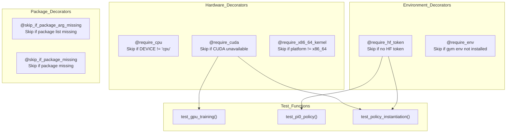
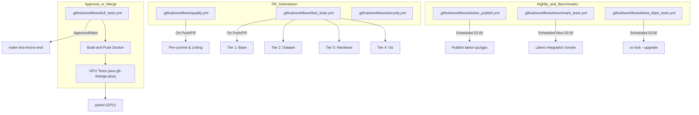

<!-- source: DeepWiki mcp.deepwiki.com · repo huggingface/lerobot · page 8.2 Testing Infrastructure · fetched 2026-10-26 -->

# Testing Infrastructure

Relevant source files

The following files were used as context for generating this wiki page:

- [tests/__init__.py](tests/__init__.py)
- [tests/artifacts/image_transforms/single_transforms.safetensors](tests/artifacts/image_transforms/single_transforms.safetensors)
- [tests/artifacts/policies/aloha_sim_insertion_human_act_/actions.safetensors](tests/artifacts/policies/aloha_sim_insertion_human_act_/actions.safetensors)
- [tests/artifacts/policies/aloha_sim_insertion_human_act_/grad_stats.safetensors](tests/artifacts/policies/aloha_sim_insertion_human_act_/grad_stats.safetensors)
- [tests/artifacts/policies/aloha_sim_insertion_human_act_/output_dict.safetensors](tests/artifacts/policies/aloha_sim_insertion_human_act_/output_dict.safetensors)
- [tests/artifacts/policies/aloha_sim_insertion_human_act_/param_stats.safetensors](tests/artifacts/policies/aloha_sim_insertion_human_act_/param_stats.safetensors)
- [tests/artifacts/policies/aloha_sim_insertion_human_act_1000_steps/actions.safetensors](tests/artifacts/policies/aloha_sim_insertion_human_act_1000_steps/actions.safetensors)
- [tests/artifacts/policies/aloha_sim_insertion_human_act_1000_steps/grad_stats.safetensors](tests/artifacts/policies/aloha_sim_insertion_human_act_1000_steps/grad_stats.safetensors)
- [tests/artifacts/policies/aloha_sim_insertion_human_act_1000_steps/output_dict.safetensors](tests/artifacts/policies/aloha_sim_insertion_human_act_1000_steps/output_dict.safetensors)
- [tests/artifacts/policies/aloha_sim_insertion_human_act_1000_steps/param_stats.safetensors](tests/artifacts/policies/aloha_sim_insertion_human_act_1000_steps/param_stats.safetensors)
- [tests/scripts/test_lerobot_train_overflow_gating.py](tests/scripts/test_lerobot_train_overflow_gating.py)
- [tests/test_available.py](tests/test_available.py)
- [tests/utils.py](tests/utils.py)

This page describes the test suite layout, test utilities and decorators, how to run tests locally, pytest configuration, and the CI workflow tiers that execute tests automatically. For information about pre-commit hooks and linting checks that run alongside tests, see [8.3](). For information about the Docker images used to run GPU tests, see [8.4]().

---

## Test Directory Layout

All tests live under the `tests/` directory at the repository root. Pre-committed binary test artifacts (e.g., `.safetensors` model snapshots) are stored under `tests/artifacts/` and are tracked via Git LFS.

| Path | Contents |
|---|---|
| `tests/` | All pytest test files |
| `tests/artifacts/` | Binary artifacts (`.safetensors`, reference data) tracked by Git LFS |
| `tests/fixtures/` | Shared pytest fixtures (datasets, hub, optimizers) |
| `tests/motors/` | Motor-hardware tests (skipped in multi-GPU runs) |
| `tests/outputs/` | Runtime outputs written during end-to-end test runs (gitignored) |
| `tests/policies/` | Policy-specific tests organized by policy type (ACT, Diffusion, PI0, Wall-X, etc.) |
| `tests/processor/` | Tests for data normalization and observation pipelines |
| `tests/robots/` | Mocked hardware tests for robot implementations (e.g., Reachy2) |
| `tests/utils.py` | Shared test utilities, decorators, and fixtures [tests/utils.py:1-189]() |

Sources: [tests/utils.py:1-189](), [.github/workflows/full_tests.yml:68-68]()

---

## Test Utilities and Decorators

The `tests/utils.py` module provides a set of decorators for conditionally skipping tests based on hardware availability, environment requirements, or package availability.

**Diagram: Test Utility Decorators System**

Sources: [tests/utils.py:54-189]()

### Common Test Decorators

| Decorator | Purpose | Implementation |
|---|---|---|
| `@require_cpu` | Skip test if device is not CPU | [tests/utils.py:69-81]() |
| `@require_cuda` | Skip test if CUDA is unavailable | [tests/utils.py:84-96]() |
| `@require_hf_token` | Skip test if no Hugging Face token available | [tests/utils.py:99-112]() |
| `@require_env` | Skip test if simulation environment not installed | [tests/utils.py:115-140]() |
| `@skip_if_package_arg_missing` | Skip test if required packages not in args | [tests/utils.py:143-172]() |
| `@skip_if_package_missing` | Skip test if specific package is not installed | [tests/utils.py:175-189]() |
| `@require_x86_64_kernel` | Skip test if platform is not x86_64 | [tests/utils.py:54-66]() |

Sources: [tests/utils.py:54-189]()

### Test Environment Configuration

The `tests/utils.py` module defines hardware constants and port defaults used for physical device testing. These are primarily controlled via environment variables:

| Constant | Default Value | Environment Variable |
|---|---|---|
| `DEVICE` | Auto-selected device | `LEROBOT_TEST_DEVICE` [tests/utils.py:26-26]() |
| `OPENCV_CAMERA_INDEX` | `0` | `LEROBOT_TEST_OPENCV_CAMERA_INDEX` [tests/utils.py:30-30]() |
| `INTELREALSENSE_SERIAL_NUMBER` | `128422271614` | `LEROBOT_TEST_INTELREALSENSE_SERIAL_NUMBER` [tests/utils.py:31-31]() |
| `DYNAMIXEL_PORT` | `/dev/tty.usbmodem575E0032081` | `LEROBOT_TEST_DYNAMIXEL_PORT` [tests/utils.py:33-33]() |
| `FEETECH_PORT` | `/dev/tty.usbmodem585A0080971` | `LEROBOT_TEST_FEETECH_PORT` [tests/utils.py:43-43]() |

Sources: [tests/utils.py:26-52]()

---

## Pytest Configuration and Fixtures

### Pytest Plugins and Hooks
The `tests/conftest.py` file serves as the central configuration for pytest. It dynamically loads pytest plugins (fixtures) based on package availability, ensuring that tests can be collected and run even with minimal installs [tests/conftest.py:37-46]().

A `pytest_collection_finish` hook is used to print the detected `DEVICE` at the end of test collection [tests/conftest.py:50-51]().

Sources: [tests/conftest.py:37-51]()

### Fixtures
*   **`dummy_dataset_metadata`**: A fixture that creates a dummy dataset metadata object with a single squared camera input and motor/state features. This is used to satisfy policy constraints that might require specific input shapes or single camera inputs [tests/policies/test_policies.py:67-98]().
*   **`cadence_log`**: This fixture captures and provides logs related to the execution cadence of robot control loops (e.g., `teleoperate`, `record`, `replay`). It's used to verify that these loops operate at their target frequencies and that all expected steps are executed [tests/test_control_robot.py:53-71]().
*   **`patch_builtins_input`**: A fixture that mocks the `builtins.input` function to prevent interactive prompts during tests, which is useful for automated testing of CLI tools [tests/conftest.py:91-97]().
*   **`policy_feature_factory`**: A factory fixture to create `PolicyFeature` objects, simplifying the definition of policy input/output features in tests [tests/conftest.py:100-106]().
*   **Module-Scoped Fixtures**: Heavy tests, especially for VLAs (Vision-Language-Action) policies, use module-scoped fixtures to avoid repeatedly loading model weights or initializing complex components. These fixtures are often gated by `@require_cuda` and `@require_hf_token` to ensure they only run in environments capable of handling them. An example is `pi0_fast_components` which instantiates the PI0Fast policy, preprocessor, and postprocessor once per module [tests/policies/pi0_fast/test_pi0_fast_original_vs_lerobot.py:162-171]().

Sources: [tests/policies/test_policies.py:67-98](), [tests/test_control_robot.py:53-71](), [tests/conftest.py:91-97](), [tests/conftest.py:100-106](), [tests/policies/pi0_fast/test_pi0_fast_original_vs_lerobot.py:162-171]()

### Mocks
The test suite extensively uses `unittest.mock.patch` and `MagicMock` to isolate components and simulate external dependencies.
*   **Robot Mocks**: For hardware-related tests (e.g., `test_control_robot.py`, `test_reachy2.py`), `MockRobotConfig` [tests/mocks/mock_robot.py]() and `MockTeleopConfig` [tests/mocks/mock_teleop.py]() are used to simulate robot and teleoperator behavior without requiring actual hardware. The `_make_reachy2_sdk_mock` and `_make_reachy2_camera_mock` functions in `tests/robots/test_reachy2.py` provide detailed mock implementations for the Reachy2 SDK and its cameras, allowing tests to verify robot connection, disconnection, joint control, and observation retrieval [tests/robots/test_reachy2.py:57-147]().
*   **Hub Mocks**: When testing dataset recording or replay, `patch` is used to prevent actual Hugging Face Hub calls, instead returning dummy values for `get_safe_version` and `snapshot_download` [tests/test_control_robot.py:99-106]().
*   **Processor Mocks**: In `tests/processor/test_normalize_processor.py`, `Mock` objects are used to simulate `LeRobotDataset` instances when testing the `hotswap_stats` function, ensuring that normalization statistics can be correctly updated [tests/processor/test_normalize_processor.py:1000-1000]().
*   **`update_policy` Mocking**: The `tests/scripts/test_lerobot_train_overflow_gating.py` file uses a `StubAccelerator` [tests/scripts/test_lerobot_train_overflow_gating.py:38-60]() and `_StubScaler` [tests/scripts/test_lerobot_train_overflow_gating.py:63-69]() to control the outcome of the `update_policy` function during training, specifically to test how LeRobot handles skipped optimizer updates when using mixed-precision training with `accelerate`. This allows verifying that policy state (e.g., EMA updates) and metrics are correctly managed even when gradients overflow [tests/scripts/test_lerobot_train_overflow_gating.py:120-123]().

Sources: [tests/mocks/mock_robot.py](), [tests/mocks/mock_teleop.py](), [tests/robots/test_reachy2.py:57-147](), [tests/test_control_robot.py:99-106](), [tests/processor/test_normalize_processor.py:1000-1000](), [tests/scripts/test_lerobot_train_overflow_gating.py:38-60](), [tests/scripts/test_lerobot_train_overflow_gating.py:63-69](), [tests/scripts/test_lerobot_train_overflow_gating.py:120-123]()

### Artifacts
The `tests/artifacts/` directory stores pre-committed binary test artifacts, such as `.safetensors` model snapshots. These artifacts are tracked via Git LFS to keep the main repository size manageable. They are used in tests like `tests/policies/pi0_pi05/test_pi0_original_vs_lerobot.py` to load reference model weights for parity checks [tests/policies/pi0_pi05/test_pi0_original_vs_lerobot.py:132-132](). Examples include `actions.safetensors` [tests/artifacts/policies/aloha_sim_insertion_human_act_1000_steps/actions.safetensors:1-3](), `grad_stats.safetensors` [tests/artifacts/policies/aloha_sim_insertion_human_act_1000_steps/grad_stats.safetensors:1-3](), `output_dict.safetensors` [tests/artifacts/policies/aloha_sim_insertion_human_act_1000_steps/output_dict.safetensors:1-3](), and `param_stats.safetensors` [tests/artifacts/policies/aloha_sim_insertion_human_act_1000_steps/param_stats.safetensors:1-3]().

Sources: [tests/policies/pi0_pi05/test_pi0_original_vs_lerobot.py:132-132](), [tests/artifacts/policies/aloha_sim_insertion_human_act_1000_steps/actions.safetensors:1-3](), [tests/artifacts/policies/aloha_sim_insertion_human_act_1000_steps/grad_stats.safetensors:1-3](), [tests/artifacts/policies/aloha_sim_insertion_human_act_1000_steps/output_dict.safetensors:1-3](), [tests/artifacts/policies/aloha_sim_insertion_human_act_1000_steps/param_stats.safetensors:1-3]()

---

## CI Workflow Tiers

LeRobot uses a multi-tiered CI strategy to balance fast feedback for contributors with comprehensive verification of hardware and environment integrations.

**Diagram: CI Workflow Orchestration**

Sources: [.github/workflows/quality.yml:15-96](), [.github/workflows/fast_tests.yml:15-128](), [.github/workflows/full_tests.yml:15-195](), [.github/workflows/release.yml:121-169](), [.github/workflows/documentation.yml:93-107](), [.github/workflows/documentation-upload-pr.yml:16-41](), [.github/workflows/docker_publish.yml:15-202](), [.github/workflows/latest_deps_tests.yml:15-138](), [.github/workflows/benchmark_tests.yml:15-151](), [.github/workflows/security.yml:15-54]()

### 1. Quality and Security
*   **Quality**: Runs pre-commit hooks (Ruff, MyPy, Bandit, etc.) on all files via `pre-commit/action` [.github/workflows/quality.yml:41-58](). It also executes documentation checks like `make check-doctest-list` and `make doctest` [.github/workflows/quality.yml:87-96]().
*   **Security**: Scans for secret leaks using `trufflehog` [.github/workflows/security.yml:41-54]().
*   **Documentation**: Builds and previews documentation for PRs [.github/workflows/documentation.yml:93-107]() and handles automated deployment of the documentation preview [.github/workflows/documentation-upload-pr.yml:16-41]().

### 2. Fast Tests (Isolated Tiers)
This workflow validates optional-dependency tiers in isolation. Each tier installs a different extra and runs the test suite; tests requiring missing extras are skipped via `pytest` guards [tests/test_available.py:33-38]() [tests/test_available.py:56-61]() [tests/test_available.py:31-31]() [tests/test_available.py:48-49]() [.github/workflows/fast_tests.yml:15-19]().
*   **Tier 1**: Base `test` extra [.github/workflows/fast_tests.yml:97-107]().
*   **Tier 2**: `test` + `dataset` extras [.github/workflows/fast_tests.yml:110-114]().
*   **Tier 3**: `test` + `hardware` extras [.github/workflows/fast_tests.yml:117-121]().
*   **Tier 4**: `test` + `viz` extras [.github/workflows/fast_tests.yml:124-128]().

### 3. Full Tests
Runs upon PR approval or push to `main`.
*   **Standard Runners**: Executes the full `pytest` suite and `make test-end-to-end` on `ubuntu-latest` after installing all extras via `uv sync --extra all` [.github/workflows/full_tests.yml:89-102]().
*   **GPU Runners**: Builds a GPU-enabled Docker image using `docker/Dockerfile.internal` [.github/workflows/full_tests.yml:107-160]() and executes tests on AWS GPU instances (`aws-g6-4xlarge-plus`) [.github/workflows/full_tests.yml:163-195]().

### 4. Nightly and Maintenance
*   **Docker Publish**: Builds and pushes `huggingface/lerobot-cpu:latest` and `huggingface/lerobot-gpu:latest` daily [.github/workflows/docker_publish.yml:25-109]().
*   **Multi-GPU Verification**: Runs training tests on 4x GPU instances (`aws-g4dn-12xlarge`) [.github/workflows/docker_publish.yml:178-195]().
*   **Unbound Dependencies**: Checks if latest upstream dependencies break the build by running `uv lock --upgrade` and executing the full suite [.github/workflows/latest_deps_tests.yml:15-138]().
*   **Benchmark Integration**: Runs 1-episode smoke evaluations for specific benchmarks (e.g., Libero) in isolated containers to prevent dependency collisions [.github/workflows/benchmark_tests.yml:15-134]().

### 5. Release Workflow
When a release tag is pushed, a dedicated workflow validates the package on PyPI/TestPyPI:
*   **Version Validation**: Ensures the tag matches `pyproject.toml` and doesn't already exist on PyPI [.github/workflows/release.yml:58-84]().
*   **Release Tests**: Installs the library from the release distribution and runs `make test-end-to-end` to ensure the published package is functional [.github/workflows/release.yml:121-169]().

Sources: [.github/workflows/quality.yml:15-96](), [.github/workflows/fast_tests.yml:15-128](), [.github/workflows/full_tests.yml:15-195](), [.github/workflows/release.yml:121-169](), [.github/workflows/documentation.yml:93-107](), [.github/workflows/documentation-upload-pr.yml:16-41](), [.github/workflows/docker_publish.yml:15-202](), [.github/workflows/latest_deps_tests.yml:15-138](), [.github/workflows/benchmark_tests.yml:15-151](), [.github/workflows/security.yml:15-54](), [tests/test_available.py:31-31](), [tests/test_available.py:33-38](), [tests/test_available.py:48-49](), [tests/test_available.py:56-61]()

---

