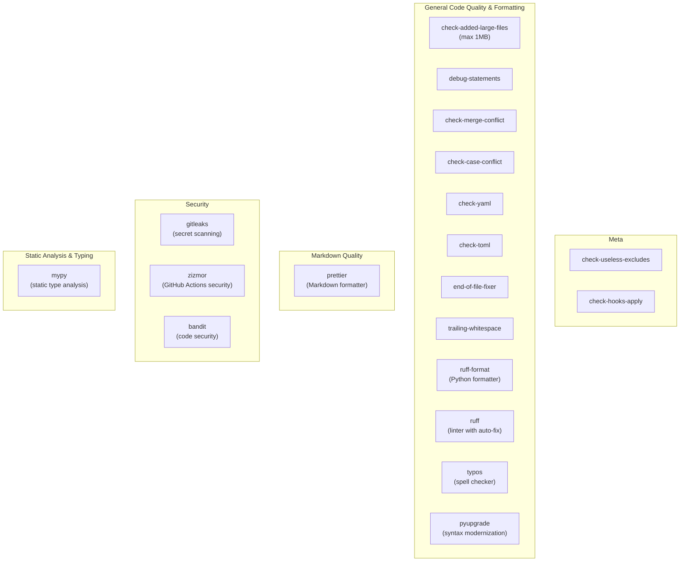
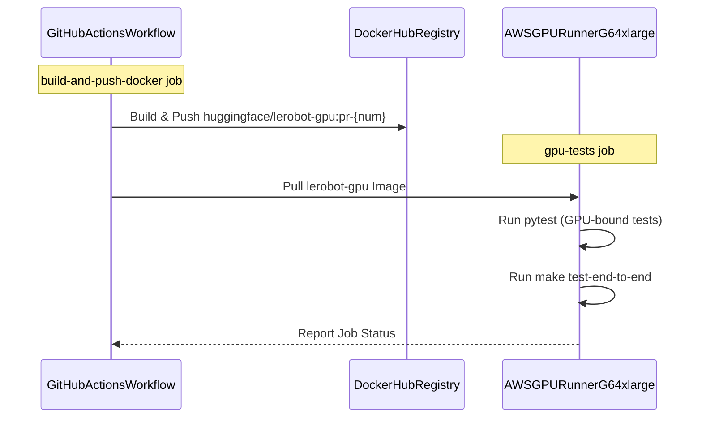
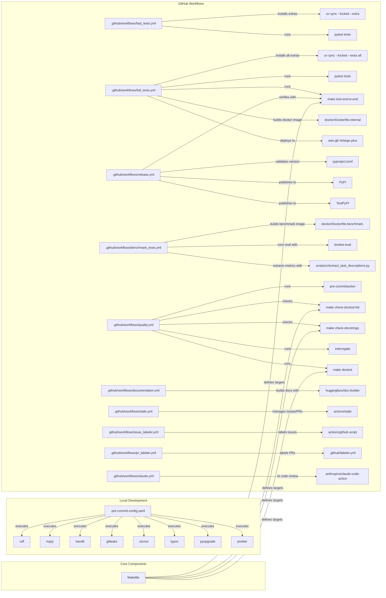

<!-- source: DeepWiki mcp.deepwiki.com · repo huggingface/lerobot · page 8.3 Code Quality and CI/CD · fetched 2026-10-26 -->

# Code Quality and CI/CD

Relevant source files

The following files were used as context for generating this wiki page:

- [.github/ISSUE_TEMPLATE/bug-report.yml](.github/ISSUE_TEMPLATE/bug-report.yml)
- [.github/PULL_REQUEST_TEMPLATE.md](.github/PULL_REQUEST_TEMPLATE.md)
- [.github/labeler.yml](.github/labeler.yml)
- [.github/workflows/benchmark_tests.yml](.github/workflows/benchmark_tests.yml)
- [.github/workflows/claude.yml](.github/workflows/claude.yml)
- [.github/workflows/docker_publish.yml](.github/workflows/docker_publish.yml)
- [.github/workflows/documentation-upload-pr.yml](.github/workflows/documentation-upload-pr.yml)
- [.github/workflows/documentation.yml](.github/workflows/documentation.yml)
- [.github/workflows/fast_tests.yml](.github/workflows/fast_tests.yml)
- [.github/workflows/full_tests.yml](.github/workflows/full_tests.yml)
- [.github/workflows/issue_labeler.yml](.github/workflows/issue_labeler.yml)
- [.github/workflows/latest_deps_tests.yml](.github/workflows/latest_deps_tests.yml)
- [.github/workflows/pr_labeler.yml](.github/workflows/pr_labeler.yml)
- [.github/workflows/quality.yml](.github/workflows/quality.yml)
- [.github/workflows/release.yml](.github/workflows/release.yml)
- [.github/workflows/security.yml](.github/workflows/security.yml)
- [.github/workflows/stale.yml](.github/workflows/stale.yml)
- [.pre-commit-config.yaml](.pre-commit-config.yaml)
- [CODE_OF_CONDUCT.md](CODE_OF_CONDUCT.md)
- [CONTRIBUTING.md](CONTRIBUTING.md)
- [Makefile](Makefile)
- [docs/source/backwardcomp.mdx](docs/source/backwardcomp.mdx)
- [src/lerobot/scripts/lerobot_info.py](src/lerobot/scripts/lerobot_info.py)
- [tests/training/test_multi_gpu.py](tests/training/test_multi_gpu.py)

This document describes the code quality enforcement mechanisms and continuous integration/continuous deployment (CI/CD) infrastructure for LeRobot. The system ensures code consistency, catches bugs early, and provides comprehensive test coverage across different hardware configurations and dependency tiers.

## Overview

LeRobot's quality and CI/CD infrastructure implements a multi-tiered approach:

- **Local quality gates**: Pre-commit hooks (`ruff`, `mypy`, `bandit`, `gitleaks`, `zizmor`, `typos`, `pyupgrade`, `prettier`) enforce code standards before commits `[.pre-commit-config.yaml:1-120]()`.
- **Fast feedback**: Lightweight `fast_tests.yml` runs on every PR commit, validating isolated dependency tiers `[.github/workflows/fast_tests.yml:19-62]()`.
- **Comprehensive validation**: `full_tests.yml` runs the full suite with GPU support on PR approval or pushes to `main` `[.github/workflows/full_tests.yml:51-195]()`.
- **Nightly Tests**: `latest_deps_tests.yml` ensures compatibility with the newest upstream dependencies `[.github/workflows/latest_deps_tests.yml:18-37]()`.
- **Benchmark Integration**: `benchmark_tests.yml` runs isolated smoke evaluations for simulation environments like LIBERO `[.github/workflows/benchmark_tests.yml:15-22]()`.
- **Release Automation**: `release.yml` handles version validation, PyPI publishing, and automated end-to-end testing of the final package `[.github/workflows/release.yml:15-170]()`.

## Pre-commit Hooks

LeRobot uses `pre-commit` to enforce code quality standards locally. Contributors are encouraged to install these hooks using `pre-commit install` `[CONTRIBUTING.md:43-43]()`.

### Hook Categories

**Quality Control Hook Flow**

**Sources**: `[.pre-commit-config.yaml:20-102]()`

### Key Hooks and Implementation

| Hook | Purpose | Implementation Detail |
| :--- | :--- | :--- |
| `ruff` | Linting and Formatting | Handles Python code style and auto-fixes `[.pre-commit-config.yaml:41-46]()`. |
| `mypy` | Static Typing | Validates type hints, excluding examples and tests `[.pre-commit-config.yaml:96-102]()`. |
| `bandit` | Security | Scans for common security vulnerabilities in Python code `[.pre-commit-config.yaml:88-92]()`. |
| `gitleaks` | Secret Scanning | Prevents accidental commits of API keys or credentials `[.pre-commit-config.yaml:77-79]()`. |
| `zizmor` | Workflow Linting | Audits GitHub Actions YAML files for security best practices `[.pre-commit-config.yaml:82-84]()`. |
| `typos` | Spell Checker | Catches common typos in code and documentation `[.pre-commit-config.yaml:49-52]()`. |
| `pyupgrade` | Python Syntax Modernization | Automatically upgrades Python syntax to newer versions `[.pre-commit-config.yaml:55-58]()`. |
| `prettier` | Markdown Formatting | Formats Markdown files for consistent style, with exclusions for Jinja2 templates and generated API docs `[.pre-commit-config.yaml:61-75]()`. |

The `quality.yml` workflow executes these hooks on every push and pull request to `main` `[.github/workflows/quality.yml:25-32]()`. Additionally, `quality.yml` runs documentation checks, including verifying that the doctest list is sorted, documented arguments match their signatures, docstring coverage has not regressed via `interrogate`, and running doctests `[.github/workflows/quality.yml:60-96]()`.

**Sources**: `[.pre-commit-config.yaml:1-121]`, `[.github/workflows/quality.yml:1-96]()`

---

## Multi-Tiered Testing Strategy

LeRobot employs a tiered testing strategy to balance developer velocity with comprehensive coverage.

### 1. Fast Tests (Isolated Tiers)
The `fast_tests.yml` workflow validates that the codebase remains functional even when only specific "extra" dependencies are installed. This ensures that users who only need `lerobot[dataset]` are not forced to install `lerobot[sim]`.

| Tier | Command | Purpose |
| :--- | :--- | :--- |
| **Tier 1: Base** | `uv sync --extra test` | Core functionality and basic utilities `[.github/workflows/fast_tests.yml:98-100]()`. |
| **Tier 2: Dataset** | `uv sync --extra test --extra dataset` | Dataset loading, streaming, and manipulation `[.github/workflows/fast_tests.yml:111-113]()`. |
| **Tier 3: Hardware** | `uv sync --extra test --extra hardware` | Robot and teleoperator abstractions `[.github/workflows/fast_tests.yml:118-120]()`. |
| **Tier 4: Viz** | `uv sync --extra test --extra viz` | Rerun and visualization integrations `[.github/workflows/fast_tests.yml:125-127]()`. |

**Sources**: `[.github/workflows/fast_tests.yml:15-130]()`

### 2. Full Tests (CPU & E2E)
Triggered on PR approval or pushes to `main`, this workflow runs `pytest` with all extras enabled (`uv sync --locked --extra all`) and executes the End-to-End (E2E) test suite via `make test-end-to-end` `[.github/workflows/full_tests.yml:51-106]()`. The `Makefile` defines the `test-end-to-end` target, which orchestrates several `lerobot-train` and `lerobot-eval` commands for different policy types (ACT, Diffusion, TDMPC, SmolVLA) `[Makefile:35-45]()`.

**Sources**: `[.github/workflows/full_tests.yml:50-106]()`, `[Makefile:35-45]()`

### 3. GPU Test Infrastructure
For policies and simulations requiring hardware acceleration, LeRobot uses specialized AWS runners and containerized GPU environments.

**GPU Test Workflow Architecture**

The `build-and-push-docker` job builds a GPU-enabled Docker image (`huggingface/lerobot-gpu`) using `docker/Dockerfile.internal` `[.github/workflows/full_tests.yml:161-165]()`. This image is tagged based on the Git ref (e.g., `latest` for `main` pushes, `pr-{PR_NUMBER}` for PRs) `[.github/workflows/full_tests.yml:131-141]()`. The `gpu-tests` job then runs on `aws-g6-4xlarge-plus` runners `[.github/workflows/full_tests.yml:174-176]()`, pulling the newly built Docker image and executing `pytest` and `make test-end-to-end` within the container with GPU access (`--gpus all`) `[.github/workflows/full_tests.yml:182-184]()`. Cache directories for Hugging Face Hub, Torch, and Triton are mounted to `/home/user_lerobot/.cache` within the container `[.github/workflows/full_tests.yml:177-180]()`.

**Sources**: `[.github/workflows/full_tests.yml:107-195]()`, `[.github/workflows/docker_publish.yml:1-191]()`

### 4. Nightly and Integration Tests
- **Latest Dependency Tests**: Runs daily at 03:00 UTC to upgrade `uv.lock` and run the full suite against the latest upstream packages `[.github/workflows/latest_deps_tests.yml:25-26]()`.
- **Benchmark Integration Tests**: Builds isolated Docker images per benchmark (e.g., `docker/Dockerfile.benchmark.libero`) to prevent dependency collisions and runs a 1-episode smoke eval using `lerobot-eval` and task extraction scripts like `scripts/ci/extract_task_descriptions.py` `[.github/workflows/benchmark_tests.yml:15-22]`, `[scripts/ci/extract_task_descriptions.py:1-162]()`. The `libero-integration-test` job, for instance, builds `lerobot-benchmark-libero:ci` and runs `lerobot-eval` with a `smolvla_libero` policy `[.github/workflows/benchmark_tests.yml:103-137]()`.

**Sources**: `[.github/workflows/latest_deps_tests.yml:1-197]()`, `[.github/workflows/benchmark_tests.yml:1-181]`, `[scripts/ci/extract_task_descriptions.py:1-162]()`

---

## Release and Distribution

LeRobot uses an automated release pipeline to ensure package integrity (`release.yml`).

- **Version Validation**: The workflow checks if the Git tag (e.g., `v0.1.0`) matches the version defined in `pyproject.toml` `[.github/workflows/release.yml:58-71]()`.
- **PyPI Publishing**: Stable releases are published to PyPI, while pre-releases (containing a hyphen in the tag, e.g., `v0.2.0-rc1`) are published to TestPyPI `[.github/workflows/release.yml:104-119]()`.
- **Release Verification**: The `test-release` job installs the newly published package from PyPI/TestPyPI in a clean environment and runs `make test-end-to-end` to verify the installation `[.github/workflows/release.yml:121-170]()`.

**Sources**: `[.github/workflows/release.yml:1-172]()`

---

## Maintenance, Documentation, and Bots

### Documentation Pipeline
Documentation is built using `huggingface/doc-builder` (`documentation.yml`).
- **Main Docs**: Deployed on pushes to `main`, manual triggers, or new releases `[.github/workflows/documentation.yml:56-68]()`.
- **PR Previews**: Built for every PR via `build_pr_docs` and uploaded via `documentation-upload-pr.yml`, allowing reviewers to see documentation changes before merging `[.github/workflows/documentation.yml:93-107]`, `[.github/workflows/documentation-upload-pr.yml:1-41]()`. The `pre_command` `uv pip install "./lerobot[dataset]"` is crucial for both main and PR docs builds to ensure `lerobot` is properly installed before documentation generation, as `doc-builder`'s default "light install" is insufficient `[.github/workflows/documentation.yml:76-76]`, `[.github/workflows/documentation.yml:107-107]()`.

### Stale Bot
The `stale.yml` workflow automatically marks issues and pull requests as stale after a period of inactivity (365 days for issues, -1 for PRs, meaning PRs are never marked stale automatically by age) and closes them after 30 days of inactivity if they were already stale `[.github/workflows/stale.yml:63-66]()`. Custom messages are defined for warning and closing issues/PRs `[.github/workflows/stale.yml:26-41]()`.

### Labeler Bots
- **Issue Labeler**: The `issue_labeler.yml` workflow automatically assigns labels to new or edited issues based on keywords found in their title and body `[.github/workflows/issue_labeler.yml:15-20]`. It uses a JavaScript script to parse the issue content and apply labels like `bug`, `enhancement`, `question`, `documentation`, `dataset`, `simulation`, `training`, `CI`, etc. `[.github/workflows/issue_labeler.yml:36-65]()`.
- **PR Labeler**: The `pr_labeler.yml` workflow automatically labels pull requests based on the files changed, using the configuration in `.github/labeler.yml` `[.github/workflows/pr_labeler.yml:15-20]`.

### Claude Code Assistant
The `claude.yml` workflow enables interactive AI code reviews on PRs and issues. When a user mentions `@claude` in a comment or review, the workflow triggers the `anthropics/claude-code-action` to provide feedback `[.github/workflows/claude.yml:30-50]`, `[.github/workflows/claude.yml:57-59]()`. It uses specific `claude_args` to configure the model, effort, fallback, and tools, and appends system prompts to guide the review process, emphasizing grounding findings in code and focusing on correctness, simplicity, and maintainability `[.github/workflows/claude.yml:66-80]()`.

**Sources**: `[.github/workflows/documentation.yml:1-108]`, `[.github/workflows/documentation-upload-pr.yml:1-42]`, `[.github/workflows/stale.yml:1-71]()`, `[.github/workflows/issue_labeler.yml:1-78]()`, `[.github/workflows/pr_labeler.yml:1-20]()`, `[.github/workflows/claude.yml:1-80]()`

---

## Code Entity Mapping

The following diagram bridges high-level CI/CD concepts to specific files and entities within the repository.

**System Entity Mapping**

**Sources**: `[.pre-commit-config.yaml:1-120]`, `[.github/workflows/fast_tests.yml:98-127]`, `[.github/workflows/full_tests.yml:101-184]`, `[.github/workflows/release.yml:58-170]`, `[.github/workflows/benchmark_tests.yml:103-137]`, `[scripts/ci/extract_task_descriptions.py:1-162]()`, `[Makefile:35-45]`, `[Makefile:192-208]`, `[.github/workflows/quality.yml:41-100]`, `[.github/workflows/documentation.yml:56-107]`, `[.github/workflows/stale.yml:55-71]`, `[.github/workflows/issue_labeler.yml:33-77]`, `[.github/labeler.yml:1-10]()`, `[.github/workflows/pr_labeler.yml:25-30]()`, `[.github/workflows/claude.yml:57-80]()`

---

