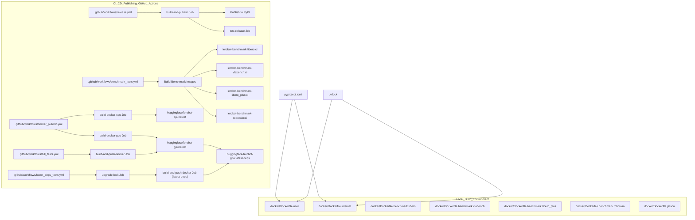

<!-- source: DeepWiki mcp.deepwiki.com · repo huggingface/lerobot · page 8.4 Docker Environments · fetched 2026-10-26 -->

# Docker Environments

<details>
<summary>Relevant source files</summary>

The following files were used as context for generating this wiki page:

- [docker/Dockerfile.benchmark.robotwin](docker/Dockerfile.benchmark.robotwin)
- [docker/Dockerfile.internal](docker/Dockerfile.internal)
- [docker/Dockerfile.jetson](docker/Dockerfile.jetson)
- [docker/Dockerfile.user](docker/Dockerfile.user)
- [docker/README.md](docker/README.md)
- [docs/source/installation.mdx](docs/source/installation.mdx)
- [docs/source/robotwin.mdx](docs/source/robotwin.mdx)
- [setup.py](setup.py)
- [tests/envs/test_robotwin.py](tests/envs/test_robotwin.py)

</details>


This page documents the Docker containerization infrastructure for LeRobot, detailing the image variants, build workflows, and their integration into the CI/CD pipeline for automated testing, deployment, and benchmark execution.

## Overview

LeRobot utilizes Docker to provide reproducible environments for training, evaluation, and hardware interaction. The infrastructure is centered around several Dockerfiles located in the `docker/` directory, which serve different stages of the development lifecycle and specific benchmarking requirements.

- **`lerobot-cpu` / `Dockerfile.user`**: A lightweight image based on Python Slim, intended for users and CPU-bound tasks [docker/Dockerfile.user:15-25]().
- **`lerobot-gpu` / `Dockerfile.internal`**: A CUDA-enabled image based on NVIDIA's official base images, designed for GPU-accelerated training and internal CI [docker/Dockerfile.internal:15-24]().
- **Benchmark Images**: Specialized images (e.g., `Dockerfile.benchmark.libero`, `Dockerfile.benchmark.robotwin`) that isolate incompatible dependency trees for specific simulators [.github/workflows/benchmark_tests.yml:15-17]().

**Build Workflow Architecture:**


Sources: [docker/Dockerfile.user:15-25](), [docker/Dockerfile.internal:15-24](), [.github/workflows/full_tests.yml:107-160](), [.github/workflows/release.yml:15-119](), [.github/workflows/benchmark_tests.yml:97-104](), [.github/workflows/docker_publish.yml:24-110](), [.github/workflows/latest_deps_tests.yml:24-182]()

## Image Variants and Tagging

The project maintains several image variants on Docker Hub under the `huggingface/` namespace.

| Image Name | Base Image | Tagging Strategy | Purpose |
|:---|:---|:---|:---|
| `lerobot-cpu` | `python:3.12-slim` | `latest` | General usage, CPU inference, and dataset manipulation [docker/Dockerfile.user:24-25](), [.github/workflows/docker_publish.yml:32](). |
| `lerobot-gpu` | `nvidia/cuda:12.8.1-base` | `latest`, `pr-<num>`, `latest-deps` | GPU training, E2E testing, and CI validation [.github/workflows/full_tests.yml:42](), [docker/Dockerfile.internal:21-23](), [.github/workflows/latest_deps_tests.yml:32](). |
| `lerobot-benchmark-libero` | `Dockerfile.benchmark.libero` | `ci` | Isolated image for LIBERO benchmark integration tests [.github/workflows/benchmark_tests.yml:104](). |
| `lerobot-benchmark-vlabench` | `Dockerfile.benchmark.vlabench` | `ci` | Isolated image for VLABench benchmark integration tests. |
| `lerobot-benchmark-libero_plus` | `Dockerfile.benchmark.libero_plus` | `ci` | Isolated image for LIBERO-plus benchmark integration tests. |
| `lerobot-benchmark-robotwin` | `Dockerfile.benchmark.robotwin` | `ci` | Isolated image for RoboTwin 2.0 benchmark integration tests [docker/Dockerfile.benchmark.robotwin:24](). |

### Internal vs. User Dockerfiles
1.  **`Dockerfile.user`**: Optimized for standard users. It installs system dependencies like `ffmpeg`, `cmake`, and `libusb-1.0-0-dev` before installing the `lerobot[all]` package via `uv sync` [docker/Dockerfile.user:33-67]().
2.  **`Dockerfile.internal`**: Optimized for CI environments. It uses an NVIDIA CUDA base and includes additional setup for `ptxas` permissions to ensure `triton` kernels compile correctly during GPU tests [docker/Dockerfile.internal:45-77](). It creates a virtual environment inside the container to ensure compatibility with MuJoCo and OpenGL drivers [docker/Dockerfile.internal:65-69]().

### Jetson Dockerfile
The `docker/Dockerfile.jetson` is a community-maintained Dockerfile specifically for NVIDIA Jetson Orin devices. It builds `torch`, `torchcodec`, and `torchvision` from source with CUDA support for JetPack 6.2 (CUDA 12.6), as prebuilt Python 3.12 wheels are not available for this platform [docker/Dockerfile.jetson:10-14](). This Dockerfile is not part of the nightly CI/Docker Hub pipeline but is maintained externally and published to `ghcr.io/ravediamond/lerobot-jetson` [docker/Dockerfile.jetson:1-7]().
Sources: [docker/Dockerfile.user:1-73](), [docker/Dockerfile.internal:1-83](), [.github/workflows/docker_publish.yml:28-34](), [docker/README.md:36-38](), [docker/Dockerfile.jetson:1-118]()

## Benchmark-Specific Images

LeRobot provides specialized Dockerfiles for benchmarks that require heavy dependencies or large assets. This isolation prevents dependency collisions (e.g., `hf-libero` vs `metaworld`) [.github/workflows/benchmark_tests.yml:15-17]().

### LIBERO Benchmark
The `Dockerfile.benchmark.libero` is used to run smoke evaluations and training smoke tests for policies like `smolvla_libero` [.github/workflows/benchmark_tests.yml:121]().
- **Integration Tests**: Executes a 1-episode evaluation and a 1-step training smoke test inside the container to verify the full pipeline [.github/workflows/benchmark_tests.yml:106-180]().
- **Artifact Handling**: Uses `docker cp` to extract metrics and videos from the container for CI reporting [.github/workflows/benchmark_tests.yml:136-141]().
- **Caching**: The Dockerfile separates dependency installation from source copying so that code-only changes skip the slow `uv sync` layer [.github/workflows/benchmark_tests.yml:94-96]().
- **Task Description Extraction**: The `scripts/ci/extract_task_descriptions.py` script is run inside the container to extract natural language descriptions for benchmark tasks, which are then included in the evaluation metrics [.github/workflows/benchmark_tests.yml:133-138](), [scripts/ci/extract_task_descriptions.py:16-28]().

### RoboTwin 2.0 Benchmark
The `Dockerfile.benchmark.robotwin` is designed for the RoboTwin 2.0 benchmark, which requires a specific simulator stack including `sapien`, `mplib`, `pytorch3d`, and `NVlabs CuRobo` [docker/Dockerfile.benchmark.robotwin:15-16]().
- **Base Image**: Extends `huggingface/lerobot-gpu:latest` [docker/Dockerfile.benchmark.robotwin:24]().
- **System Dependencies**: Installs `cuda-nvcc`, `cuda-cudart-dev`, `libvulkan1`, and `vulkan-tools` as the base GPU image is `CUDA -base` (no compiler or Vulkan loader) [docker/Dockerfile.benchmark.robotwin:33-35]().
- **RoboTwin Installation**: Clones the RoboTwin repository, checks out a pinned SHA for reproducibility, and installs its Python dependencies including `sapien`, `mplib`, `pytorch3d`, and `curobo` [docker/Dockerfile.benchmark.robotwin:36-66]().
- **Patches**: Applies upstream patches to `mplib` and `sapien` to fix known issues [docker/Dockerfile.benchmark.robotwin:75-88]().
- **Asset Download**: Downloads RoboTwin simulation assets (`embodiments.zip`, `objects.zip`) from the Hugging Face Hub [docker/Dockerfile.benchmark.robotwin:93-109]().
- **Validation**: Includes a `RUN` command to import `curobo.types.math.Pose` and verify the RoboTwin planner's reference to it, ensuring the CuRobo package layout is correct [docker/Dockerfile.benchmark.robotwin:120-130]().
Sources: [.github/workflows/benchmark_tests.yml:15-180](), [scripts/ci/extract_task_descriptions.py:1-207](), [docker/Dockerfile.benchmark.robotwin:1-138](), [docs/source/robotwin.mdx:70-111](), [tests/envs/test_robotwin.py:16-21]()

## Build and Publishing Workflows

### Automated CI Publishing
Images are automatically built and pushed to Docker Hub via GitHub Actions:
- **Full Tests**: For approved PRs or pushes to `main`, the `build-and-push-docker` job builds an image tagged `latest` (for main) or `pr-<number>` (for PRs) [.github/workflows/full_tests.yml:107-160]().
- **Docker Publish & Test**: A scheduled workflow (daily at 02:00 UTC) builds and pushes both `lerobot-cpu` and `lerobot-gpu` images to Docker Hub [.github/workflows/docker_publish.yml:24-110]().
- **Latest Dependency Tests**: A scheduled workflow (daily at 03:00 UTC) upgrades `uv.lock` and builds a `latest-deps` image to ensure compatibility with upstream updates [.github/workflows/latest_deps_tests.yml:24-182]().

### Release Workflow
When a new version tag (e.g., `v0.1.0`) is pushed, the `release.yml` workflow:
1. Validates that the tag matches the version in `pyproject.toml` [.github/workflows/release.yml:58-71](). The version is extracted from the tag (e.g., `v0.1.0` -> `0.1.0`) and compared against the `version` field in `pyproject.toml` [setup.py:19-40]().
2. Checks if the version already exists on PyPI to prevent accidental overwrites [.github/workflows/release.yml:74-84]().
3. Builds the Python distribution and publishes to PyPI (or TestPyPI for pre-releases) [.github/workflows/release.yml:86-119]().
4. Creates a GitHub Release with generated notes [.github/workflows/release.yml:92-102]().
5. Runs a `test-release` job that installs the fresh release from PyPI inside a clean environment to run `make test-end-to-end` [.github/workflows/release.yml:121-168]().

Sources: [.github/workflows/release.yml:15-168](), [.github/workflows/full_tests.yml:107-160](), [.github/workflows/docker_publish.yml:15-110](), [.github/workflows/latest_deps_tests.yml:18-182](), [setup.py:19-40]()

## Containerized Testing

The primary use of these Docker environments is to execute the test suite in a controlled environment, particularly for GPU-bound tasks.

### GPU Test Configuration
When running GPU tests (e.g., in `full_tests.yml` or `docker_publish.yml`), the container is started with specific options to ensure access to hardware and shared memory [.github/workflows/full_tests.yml:174-179](), [.github/workflows/docker_publish.yml:157-158]():
- `--gpus all`: Enables NVIDIA GPU passthrough.
- `--shm-size "16gb"`: Allocates sufficient shared memory for PyTorch `DataLoader` workers.

**Code Entity Mapping: Test Execution**

```mermaid
graph TD
    subgraph "Docker_Container_Internal"
        PytestCmd["pytest tests -vv --maxfail=10"]
        MakeE2ECmd["make test-end-to-end"]
        LoginHF["hf auth login --token ..."]
    end

    subgraph "CI_Environment_Variables"
        HF_HOME["HF_HOME=/home/user_lerobot/.cache/huggingface"]
        HF_LEROBOT_HOME["HF_LEROBOT_HOME=/home/user_lerobot/.cache/huggingface/lerobot"]
        TORCH_HOME["TORCH_HOME=/home/user_lerobot/.cache/torch"]
        TRITON_CACHE_DIR["TRITON_CACHE_DIR=/home/user_lerobot/.cache/triton"]
        MUJOCO_GL["MUJOCO_GL=egl"]
        DEVICE["DEVICE=cuda"]
        TEST_TYPE["TEST_TYPE=single_gpu"]
        CUDA_VISIBLE_DEVICES["CUDA_VISIBLE_DEVICES=0,1,2,3"]
        HF_USER_TOKEN["HF_USER_TOKEN"]
    end

    LoginHF --> HF_USER_TOKEN
    PytestCmd --> HF_HOME
    PytestCmd --> HF_LEROBOT_HOME
    PytestCmd --> TORCH_HOME
    PytestCmd --> TRITON_CACHE_DIR
    PytestCmd --> DEVICE
    PytestCmd --> TEST_TYPE
    PytestCmd --> CUDA_VISIBLE_DEVICES

    MakeE2ECmd --> MUJOCO_GL
    MakeE2ECmd --> HF_HOME
    MakeE2ECmd --> HF_LEROBOT_HOME
    MakeE2ECmd --> TORCH_HOME
    MakeE2ECmd --> TRITON_CACHE_DIR
    MakeE2ECmd --> DEVICE
    MakeE2ECmd --> TEST_TYPE
    MakeE2ECmd --> CUDA_VISIBLE_DEVICES

    style HF_HOME fill:#f9f,stroke:#333,stroke-width:2px
    style HF_LEROBOT_HOME fill:#f9f,stroke:#333,stroke-width:2px
    style TORCH_HOME fill:#f9f,stroke:#333,stroke-width:2px
    style TRITON_CACHE_DIR fill:#f9f,stroke:#333,stroke-width:2px
    style MUJOCO_GL fill:#f9f,stroke:#333,stroke-width:2px
    style DEVICE fill:#f9f,stroke:#333,stroke-width:2px
    style TEST_TYPE fill:#f9f,stroke:#333,stroke-width:2px
    style CUDA_VISIBLE_DEVICES fill:#f9f,stroke:#333,stroke-width:2px
    style HF_USER_TOKEN fill:#f9f,stroke:#333,stroke-width:2px
```


Sources: [docker/Dockerfile.internal:29-34](), [docker/Dockerfile.internal:59-63](), [.github/workflows/full_tests.yml:163-195](), [.github/workflows/docker_publish.yml:117-122](), [.github/workflows/docker_publish.yml:188-189]()

## Usage Guide

### Running with Physical Hardware
To use LeRobot Docker for physical robot control, you must pass through the device nodes [docker/Dockerfile.user:21]():

```bash
docker run -it --rm \
    --device=/dev/ \
    -v /dev/:/dev/ \
    huggingface/lerobot-cpu:latest
```

### Environment Variable Configuration
The containers are pre-configured with standard paths for caching and execution [docker/Dockerfile.user:28-55]():

| Variable | Default Value | Description |
|:---|:---|:---|
| `HF_HOME` | `/home/user_lerobot/.cache/huggingface` | Hugging Face Hub cache [docker/Dockerfile.user:52]() |
| `HF_LEROBOT_HOME` | `/home/user_lerobot/.cache/huggingface/lerobot` | LeRobot-specific Hugging Face cache [docker/Dockerfile.user:53]() |
| `TORCH_HOME` | `/home/user_lerobot/.cache/torch` | PyTorch cache directory [docker/Dockerfile.user:54]() |
| `TRITON_CACHE_DIR` | `/home/user_lerobot/.cache/triton` | Triton compilation cache [docker/Dockerfile.user:55]() |
| `MUJOCO_GL` | `egl` | Headless rendering backend for MuJoCo [docker/Dockerfile.user:29]() |
| `PATH` | `/lerobot/.venv/bin:$PATH` | Ensures the virtual environment's executables are prioritized [docker/Dockerfile.user:30]() |
| `CUDA_VISIBLE_DEVICES` | `0` (internal), `0,1,2,3` (multi-GPU tests) | Specifies which GPUs are visible to the container [docker/Dockerfile.internal:32](), [.github/workflows/docker_publish.yml:188]() |
| `TEST_TYPE` | `single_gpu` | Internal variable for test configuration [docker/Dockerfile.internal:33]() |
| `DEVICE` | `cuda` | Default device for PyTorch operations [docker/Dockerfile.internal:34]() |

Sources: [docker/Dockerfile.user:28-55](), [docker/Dockerfile.internal:29-63](), [.github/workflows/docker_publish.yml:188]()

## Development Workflow

For contributors, the recommended workflow involves using the Docker image as a base while mounting the local source code to enable live editing:

```bash
docker run -it --rm \
    -v $(pwd):/lerobot \
    --gpus all \
    huggingface/lerobot-gpu:latest bash
```

This allows running `pytest` or `lerobot-train` against local changes without rebuilding the image. The `Dockerfile.internal` variant includes `uv` for fast dependency management and pre-configured `ptxas` permissions for NVIDIA Triton [docker/Dockerfile.internal:45-77]().
Sources: [docker/Dockerfile.internal:45-77](), [docker/Dockerfile.user:37-67](), [.github/workflows/full_tests.yml:191]()

---

