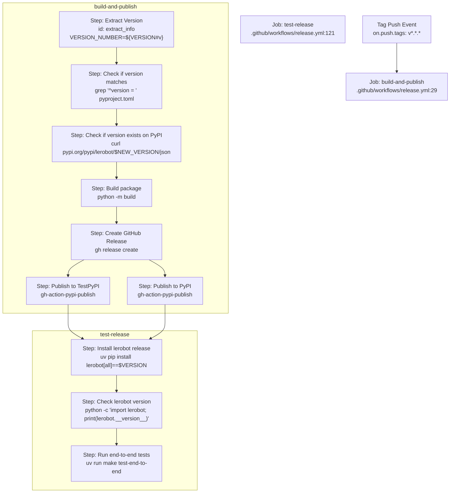
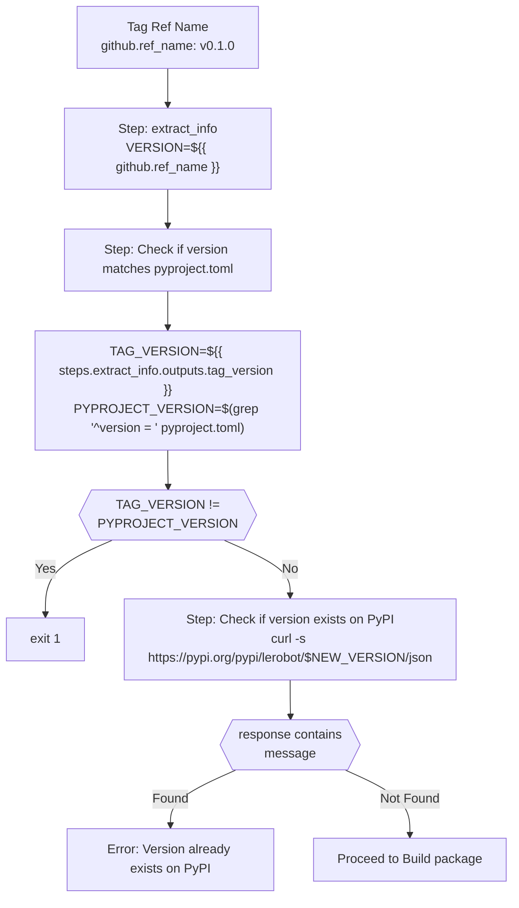
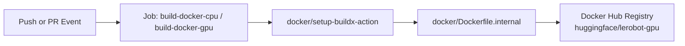

<!-- source: DeepWiki mcp.deepwiki.com · repo huggingface/lerobot · page 8.5 Release and Distribution · fetched 2026-10-26 -->

# Release and Distribution

<details>
<summary>Relevant source files</summary>

The following files were used as context for generating this wiki page:

- [.github/workflows/benchmark_tests.yml](.github/workflows/benchmark_tests.yml)
- [.github/workflows/claude.yml](.github/workflows/claude.yml)
- [.github/workflows/docker_publish.yml](.github/workflows/docker_publish.yml)
- [.github/workflows/fast_tests.yml](.github/workflows/fast_tests.yml)
- [.github/workflows/full_tests.yml](.github/workflows/full_tests.yml)
- [.github/workflows/issue_labeler.yml](.github/workflows/issue_labeler.yml)
- [.github/workflows/latest_deps_tests.yml](.github/workflows/latest_deps_tests.yml)
- [.github/workflows/pr_labeler.yml](.github/workflows/pr_labeler.yml)
- [.github/workflows/quality.yml](.github/workflows/quality.yml)
- [.github/workflows/release.yml](.github/workflows/release.yml)
- [.github/workflows/security.yml](.github/workflows/security.yml)
- [.github/workflows/stale.yml](.github/workflows/stale.yml)
- [README.md](README.md)
- [docs/source/_toctree.yml](docs/source/_toctree.yml)
- [pyproject.toml](pyproject.toml)
- [src/lerobot/policies/__init__.py](src/lerobot/policies/__init__.py)
- [src/lerobot/policies/groot/processor_groot.py](src/lerobot/policies/groot/processor_groot.py)
- [src/lerobot/templates/lerobot_modelcard_template.md](src/lerobot/templates/lerobot_modelcard_template.md)
- [src/lerobot/utils/import_utils.py](src/lerobot/utils/import_utils.py)
- [tests/training/test_multi_gpu.py](tests/training/test_multi_gpu.py)
- [uv.lock](uv.lock)

</details>


This page documents the release and distribution infrastructure for LeRobot, covering PyPI package publishing, GitHub releases, Docker image distribution, and the automated workflows that ensure release quality. This includes both stable releases and pre-releases, as well as version validation and automated testing of release artifacts.

---

## Release Workflow Overview

The release process is fully automated through GitHub Actions defined in [.github/workflows/release.yml:15-120](), triggered by pushing semantic version tags matching `v*.*.*` to the repository [.github/workflows/release.yml:17-21](). The pipeline handles version validation, package building via standard Python tools, PyPI/TestPyPI publishing using OIDC authentication, and GitHub release creation [.github/workflows/release.yml:27-119]().

### Release Pipeline: Jobs and Steps

Title: Release Pipeline Architecture (`.github/workflows/release.yml`)


Sources: [.github/workflows/release.yml:17-169]()

---

## Version Tagging and Validation

Releases are triggered by pushing Git tags matching the pattern `v*.*.*` (e.g., `v0.1.0`, `v0.2.0-rc1`) [.github/workflows/release.yml:18-20](). The workflow performs strict validation checks before proceeding to ensure consistency between the Git tag, `pyproject.toml`, and the package index.

### Version Validation Process

Title: Release Validation Logic (`.github/workflows/release.yml`)


| Validation Step | Shell Command / Logic | File Reference |
|----------------|-----------------------|----------------|
| **Tag Extraction** | `VERSION_NUMBER=${VERSION#v}` | [.github/workflows/release.yml:54-57]() |
| **pyproject.toml Match** | `grep '^version = ' pyproject.toml` | [.github/workflows/release.yml:64-71]() |
| **PyPI Availability** | `curl -s "https://pypi.org/pypi/lerobot/$NEW_VERSION/json"` | [.github/workflows/release.yml:78-84]() |

Sources: [.github/workflows/release.yml:50-84]()

---

## Package Building and Publishing

The workflow builds the Python package using the standard `build` module [.github/workflows/release.yml:86-90](). Publishing is managed by `pypa/gh-action-pypi-publish` using trusted publisher OIDC tokens [.github/workflows/release.yml:37]().

### Publishing Strategy

| Release Type | Tag Pattern | Destination | GitHub Release Status |
|-------------|-------------|-------------|-----------------------|
| **Stable Release** | `v*.*.*` (no hyphen) | PyPI | Standard Release [.github/workflows/release.yml:113-119]() |
| **Pre-release** | `v*.*.*-*` (with hyphen) | TestPyPI | Draft / Pre-release [.github/workflows/release.yml:104-112]() |

### GitHub Releases

The workflow automatically creates GitHub releases with generated notes and attaches built distribution artifacts from `dist/` [.github/workflows/release.yml:92-102]().

```bash
gh release create ${{ github.ref_name }} \
  --title "Release ${{ github.ref_name }}" \
  --generate-notes \
  --draft=$([[ "${{ github.ref_name }}" == *-* ]] && echo true || echo false) \
  --prerelease=$([[ "${{ github.ref_name }}" == *-* ]] && echo true || echo false) \
  ./dist/*
```
Sources: [.github/workflows/release.yml:92-102]()

---

## Post-Release Verification

An automated `test-release` job runs immediately after publishing to ensure the distributed package functions correctly in a clean target environment [.github/workflows/release.yml:121-169]().

| Step | Implementation | File Reference |
|------|----------------|----------------|
| **Environment Setup** | `uv venv` with Python 3.12 | [.github/workflows/release.yml:140-146]() |
| **Package Installation** | `uv pip install "lerobot[all]==$VERSION"` (handles TestPyPI indices for pre-releases) | [.github/workflows/release.yml:147-163]() |
| **Version Check** | `uv run python -c "import lerobot; print(lerobot.__version__)"` | [.github/workflows/release.yml:164-165]() |
| **End-to-End Tests** | `uv run make test-end-to-end` | [.github/workflows/release.yml:167-168]() |

Sources: [.github/workflows/release.yml:121-169]()

---

## Docker Distribution

Docker images are distributed to enforce reproducible environments across benchmarking and CI systems.

### Docker Image Variants

| Variant | Dockerfile Path | Target Use Case |
|---------|-----------------|-----------------|
| **User (CPU)** | `docker/Dockerfile.user` | Lightweight base image (`python:3.12-slim`) for experimentation and local CPU inference [.github/workflows/docker_publish.yml:72]() |
| **Internal (GPU)** | `docker/Dockerfile.internal` | NVIDIA CUDA container for high-performance training, evaluation, and CI pipelines [.github/workflows/docker_publish.yml:107]() |
| **Benchmark** | `docker/Dockerfile.benchmark.*` | Isolated images for specific benchmark suites (e.g., Libero) to prevent dependency conflicts [.github/workflows/benchmark_tests.yml:15-21]() |

### Automated Build and Push

The `full_tests.yml` and `docker_publish.yml` workflows handle building and pushing images to Docker Hub [.github/workflows/full_tests.yml:107-160]() [.github/workflows/docker_publish.yml:41-110]().

Title: Docker Build Flow (`.github/workflows/docker_publish.yml`)


Sources: [.github/workflows/full_tests.yml:107-160](), [.github/workflows/docker_publish.yml:1-110]()

### Image Tagging Strategy

Images are tagged based on the trigger event and target architecture [.github/workflows/full_tests.yml:127-136]() [.github/workflows/docker_publish.yml:32-33]():
- **Push to main**: `huggingface/lerobot-gpu:latest` and `huggingface/lerobot-cpu:latest` [.github/workflows/docker_publish.yml:32-33]().
- **Pull Request**: `huggingface/lerobot-gpu:pr-<number>` [.github/workflows/full_tests.yml:133]().
- **Latest Dependencies**: `huggingface/lerobot-gpu:latest-deps` [.github/workflows/latest_deps_tests.yml:32]().

Sources: [.github/workflows/full_tests.yml:107-160](), [.github/workflows/docker_publish.yml:1-110](), [.github/workflows/latest_deps_tests.yml:32]()

---

## Documentation Distribution

Documentation is automatically built and deployed for both the `main` branch and active pull requests.

| Job / Workflow | Trigger | Destination |
|----------------|---------|-------------|
| **Build Main Docs** | Push to `main` (docs folder), Release, or Manual dispatch | Official Hugging Face Documentation |
| **Build PR Docs** | Pull Request targeting `main` (docs folder) | Documentation Preview Deployment |

Sources: [docs/source/_toctree.yml:1-218]()

---

## Automated Testing of Releases

LeRobot employs a multi-tiered testing strategy across distinct workflows to ensure stability under different dependency constraints.

### Testing Tiers

| Tier | Workflow File | Purpose |
|------|---------------|---------|
| **Fast Tests** | [.github/workflows/fast_tests.yml:15-19]() | Validates optional-dependency tiers in isolation (`base`, `dataset`, `hardware`, `viz`). |
| **Full Tests** | [.github/workflows/full_tests.yml:51-59]() | Executes the complete test suite with all extras enabled on both CPU and GPU hosts. |
| **Benchmark Tests** | [.github/workflows/benchmark_tests.yml:15-21]() | Runs integration smoke tests for specific evaluation benchmarks using isolated Docker environments. |
| **Latest Deps** | [.github/workflows/latest_deps_tests.yml:15-18]() | Upgrades lockfiles against latest upstream package versions and verifies functionality. |

Sources: [.github/workflows/fast_tests.yml:15-128](), [.github/workflows/full_tests.yml:1-196](), [.github/workflows/benchmark_tests.yml:1-181](), [.github/workflows/latest_deps_tests.yml:1-197]()

---

