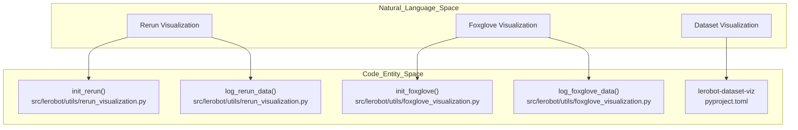
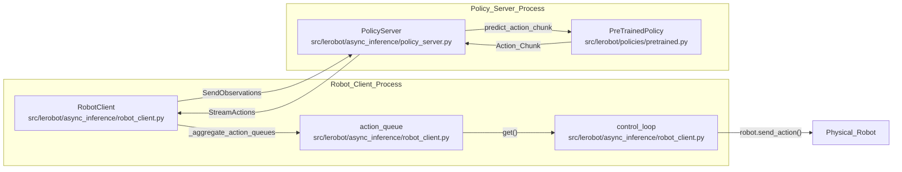
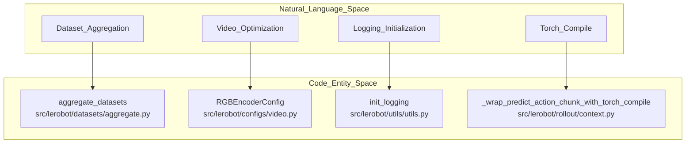

<!-- source: DeepWiki mcp.deepwiki.com · repo huggingface/lerobot · page 9 Advanced Topics · fetched 2026-10-26 -->

# Advanced Topics

Relevant source files

The following files were used as context for generating this wiki page:

- [src/lerobot/utils/collate.py](src/lerobot/utils/collate.py)
- [src/lerobot/utils/feature_utils.py](src/lerobot/utils/feature_utils.py)
- [src/lerobot/utils/foxglove_visualization.py](src/lerobot/utils/foxglove_visualization.py)
- [src/lerobot/utils/keyboard_input.py](src/lerobot/utils/keyboard_input.py)
- [src/lerobot/utils/process.py](src/lerobot/utils/process.py)
- [src/lerobot/utils/random_utils.py](src/lerobot/utils/random_utils.py)
- [src/lerobot/utils/rerun_visualization.py](src/lerobot/utils/rerun_visualization.py)
- [src/lerobot/utils/transition.py](src/lerobot/utils/transition.py)
- [src/lerobot/utils/utils.py](src/lerobot/utils/utils.py)
- [tests/utils/test_foxglove_visualization.py](tests/utils/test_foxglove_visualization.py)

This page covers advanced features and specialized use cases in LeRobot for power users and researchers. These features enable high-performance training, real-time reactive control, distributed reinforcement learning, and framework extensibility.

- **Hugging Face Hub Integration** — Mechanisms for sharing and versioning datasets and models.
- **Experiment Tracking with Weights & Biases** — Advanced logging and experiment organization.
- **Visualization Tools** — Real-time telemetry with Rerun and dataset exploration utilities.
- **Asynchronous Inference** — Decoupling action prediction from action execution to eliminate "wait-for-inference" lags.
- **Distributed RL** — Scalable actor-learner architectures for reinforcement learning.
- **PEFT Training and Fine-tuning** — Fine-tuning large models like VLAs using LoRA and MISS.
- **Version Compatibility and Migration** — Managing the `CODEBASE_VERSION` system and dataset migrations.
- **Performance Optimization** — Techniques including mixed precision, KV-caching, and memory-mapping.
- **Plugin Development** — Extending the framework with third-party policies and hardware.

For basic usage patterns, see [Core Concepts](#1.2). For training workflows, see [Training Pipeline](#3.1). For robot hardware integration, see [Robot Hardware Integration](#6).

## Hugging Face Hub Integration

LeRobot provides seamless integration with the Hugging Face Hub. Policies and datasets implement mechanisms for standardized `push_to_hub` and `pull_from_repo`. The framework utilizes `huggingface-hub` [pyproject.toml:71]() for repository management.

The `DatasetInfo` [src/lerobot/datasets/utils.py:115]() dataclass manages the `codebase_version` [src/lerobot/datasets/utils.py:124]() and Hub metadata. When working with Hub datasets, `get_safe_version` [src/lerobot/datasets/utils.py:31]() ensures the local codebase is compatible with the remote repository version. The `create_lerobot_dataset_card` [tests/datasets/test_dataset_utils.py:31]() utility generates the necessary `DatasetCard` [src/lerobot/datasets/utils.py:28]() for Hub indexing.

For details, see [Hugging Face Hub Integration](#9.1).

Sources: [src/lerobot/datasets/utils.py:28-124](), [tests/datasets/test_dataset_utils.py:31-85](), [pyproject.toml:71]()

## Experiment Tracking with Weights and Biases

LeRobot integrates with Weights and Biases (WandB) for tracking training runs, supported via the `wandb` dependency [pyproject.toml:118](). The `WandBLogger` [src/lerobot/common/wandb_utils.py]() manages logging of training losses, gradient norms, and learning rates during the training loop. Configuration is handled via `WandBConfig`, allowing users to specify project names, entities, and whether to log artifacts like model checkpoints or evaluation videos.

For details, see [Experiment Tracking with Weights and Biases](#9.2).

Sources: [pyproject.toml:118](), [src/lerobot/common/wandb_utils.py]()

## Visualization Tools

LeRobot provides specialized tools for data and training visualization, primarily utilizing the `rerun-sdk` [pyproject.toml:127]() and `foxglove-sdk` [src/lerobot/utils/foxglove_visualization.py:89]().

- **`lerobot-dataset-viz`**: A CLI tool for exploring `LeRobotDataset` episodes with seekable timelines [pyproject.toml:137]().
- **Rerun**: The `init_rerun` [src/lerobot/utils/rerun_visualization.py:40]() and `log_rerun_data` [src/lerobot/utils/rerun_visualization.py:112]() functions enable real-time logging of observations and actions to the Rerun viewer.
- **Foxglove**: The `init_foxglove` [src/lerobot/utils/foxglove_visualization.py:77]() and `log_foxglove_data` [src/lerobot/utils/foxglove_visualization.py:300]() functions provide live control-loop streaming and seekable dataset playback over a WebSocket server.
- **Video Benchmarking**: The `video-benchmark` Space [docs/source/video_encoding_parameters.mdx:15]() provides a comparison of encoding parameters.
- **Queue Visualization**: The `visualize_action_queue_size` [src/lerobot/async_inference/helpers.py:53]() utility helps debug asynchronous inference by plotting queue depth over time.
- **LeLab**: A GUI for no-code robot operation [docs/source/_toctree.yml:12]().

### Visualization Tool Integration

For details, see [Visualization Tools](#9.3).

Sources: [docs/source/video_encoding_parameters.mdx:15](), [src/lerobot/async_inference/helpers.py:53-64](), [pyproject.toml:127-137](), [src/lerobot/utils/rerun_visualization.py:40-112](), [src/lerobot/utils/foxglove_visualization.py:77-300]()

## Asynchronous Inference

Asynchronous inference decouples action prediction from action execution to ensure the robot never stays idle while the policy server computes the next chunk [docs/source/async.mdx:3](). This is supported by the `async` dependency group [pyproject.toml:153]().

The architecture consists of:
- **`PolicyServer`**: A gRPC server [src/lerobot/async_inference/policy_server.py:64]() that wraps a `PreTrainedPolicy` and manages an `observation_queue`.
- **`RobotClient`**: A client [src/lerobot/async_inference/robot_client.py:96]() that connects to the server, sends `TimedObservation` [src/lerobot/async_inference/robot_client.py:196](), and maintains an `action_queue` [src/lerobot/async_inference/robot_client.py:138]().
- **Aggregation**: The `_aggregate_action_queues` method [tests/async_inference/test_robot_client.py:103]() combines overlapping action chunks using functions like `weighted_average` [src/lerobot/async_inference/configs.py:30]().
- **Latency Management**: Parameters like `actions_per_chunk` and `chunk_size_threshold` are tuned to eliminate "wait-for-inference" lags [docs/source/async.mdx:11]().

### Async Inference Architecture

For details, see [Asynchronous Inference](#9.4).

Sources: [src/lerobot/async_inference/robot_client.py:96-208](), [docs/source/async.mdx:1-103](), [tests/async_inference/test_robot_client.py:94-176](), [pyproject.toml:153]()

## Distributed RL: Actor-Learner Architecture

LeRobot supports distributed reinforcement learning where "Actor" processes collect data from environments and "Learner" processes optimize the policy. This architecture coordinates experience collection and training in a decoupled manner, particularly for algorithms like SAC in HIL-SERL [docs/source/hilserl.mdx:1]().

For details, see [Distributed RL: Actor-Learner Architecture](#9.5).

Sources: [docs/source/hilserl.mdx:1](), [docs/source/_toctree.yml:19]()

## PEFT Training and Fine-tuning

Parameter-Efficient Fine-Tuning (PEFT) is supported for large models via the `peft` library [pyproject.toml:156](). Policies can be wrapped using `wrap_with_peft` to enable LoRA or MISS, allowing for efficient adaptation to new tasks or robot embodiments without full parameter updates. The `_peft_available` flag [src/lerobot/utils/import_utils.py:115]() checks for the availability of the PEFT library.

For details, see [PEFT Training and Fine-tuning](#9.6).

Sources: [pyproject.toml:156](), [docs/source/_toctree.yml:27](), [src/lerobot/utils/import_utils.py:115]()

## Version Compatibility and Migration

The `CODEBASE_VERSION` system ensures that datasets and models remain compatible across updates. 

- **Compatibility Errors**: The framework includes `BackwardCompatibilityError` [src/lerobot/datasets/utils.py:68]() and `ForwardCompatibilityError` [src/lerobot/datasets/utils.py:79]().
- **Migration Scripts**: LeRobot provides scripts like `convert_dataset_v21_to_v30.py` [src/lerobot/datasets/utils.py:38]() to update older dataset structures.
- **Safe Loading**: `get_safe_version` [src/lerobot/datasets/utils.py:31]() checks the Hub for tagged versions to prevent loading incompatible data.

For details, see [Version Compatibility and Migration](#9.7).

Sources: [src/lerobot/datasets/utils.py:31-83]()

## Performance Optimization

Optimization techniques in LeRobot target both training and inference:
- **Mixed Precision**: Leveraging Hugging Face `accelerate` [pyproject.toml:154]() for faster training and evaluation.
- **Dataset Aggregation**: The `aggregate_datasets` [src/lerobot/datasets/aggregate.py:31]() function enables efficient merging of heterogeneous datasets while validating consistency in `fps` and `robot_type` [src/lerobot/datasets/aggregate.py:139-149]().
- **Video Encoding**: Users can tune `RGBEncoderConfig` parameters like `vcodec` (defaulting to `libsvtav1`) [docs/source/video_encoding_parameters.mdx:54]() and `crf` [docs/source/video_encoding_parameters.mdx:57]() to optimize storage and I/O.
- **Logging**: Standardized logging via `init_logging` [src/lerobot/utils/utils.py:43]() suppresses redundant console output in multi-GPU setups [src/lerobot/utils/utils.py:52]().
- **`torch.compile`**: The `_wrap_predict_action_chunk_with_torch_compile` function [src/lerobot/rollout/context.py:75]() can be used to compile the `predict_action_chunk` method of a policy for performance gains during rollout.
- **KV-caching**: For VLA models, KV-caching can significantly speed up inference.
- **Memory-mapped/streaming dataset loading**: These methods reduce memory footprint and improve data loading efficiency.

### Data Pipeline Optimization

For details, see [Performance Optimization](#9.8).

Sources: [src/lerobot/datasets/aggregate.py:31-155](), [docs/source/video_encoding_parameters.mdx:52-61](), [src/lerobot/utils/utils.py:43-102](), [pyproject.toml:154](), [src/lerobot/rollout/context.py:75-100]()

## Plugin Development

LeRobot is extensible via a plugin system. Users can register third-party policies or robots using the `register_third_party_plugins` [src/lerobot/utils/import_utils.py:203]() utility. Custom environments and robot drivers can be integrated by following the abstraction contracts defined in base classes like `Robot` [docs/source/integrate_hardware.mdx:5](). The `RolloutStrategyConfig` [src/lerobot/rollout/configs.py:43]() also supports third-party strategy registration.

For details, see [Plugin Development](#9.9).

Sources: [src/lerobot/utils/import_utils.py:203](), [docs/source/integrate_hardware.mdx:5](), [docs/source/bring_your_own_policies.mdx:1](), [src/lerobot/rollout/configs.py:43]()

---

