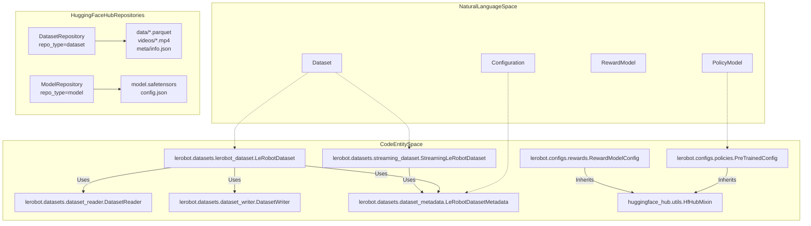
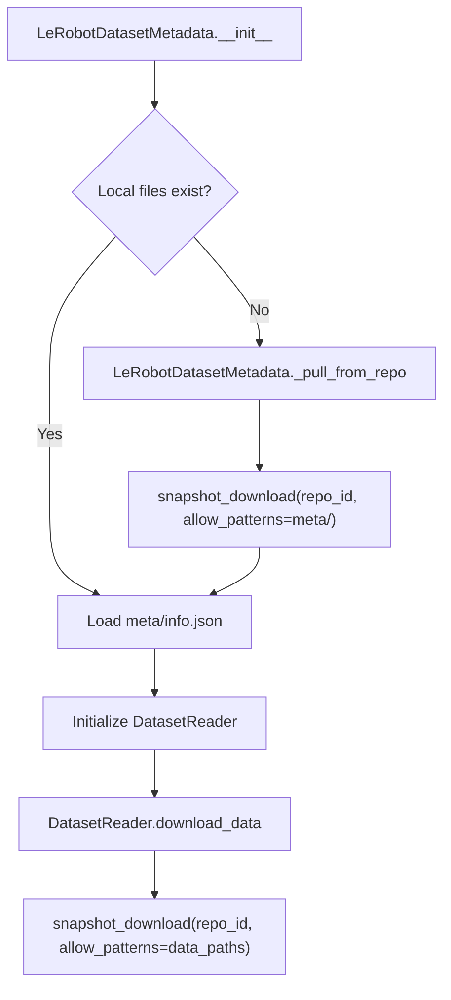
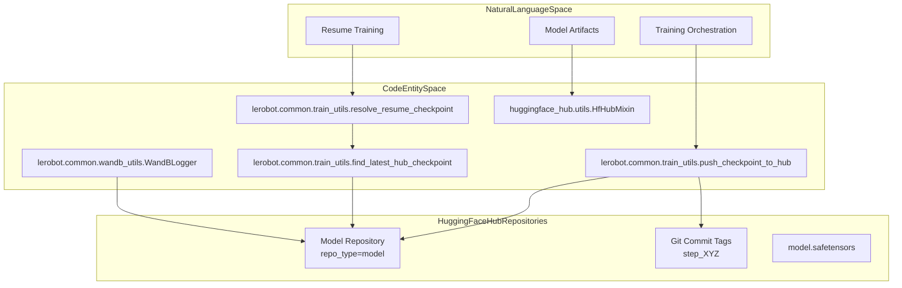

<!-- source: DeepWiki mcp.deepwiki.com · repo huggingface/lerobot · page 9.1 Hugging Face Hub Integration · fetched 2026-10-26 -->

# Hugging Face Hub Integration

Relevant source files

The following files were used as context for generating this wiki page:

- [src/lerobot/annotations/steerable_pipeline/executor.py](src/lerobot/annotations/steerable_pipeline/executor.py)
- [src/lerobot/configs/default.py](src/lerobot/configs/default.py)
- [src/lerobot/datasets/dataset_metadata.py](src/lerobot/datasets/dataset_metadata.py)
- [src/lerobot/datasets/dataset_reader.py](src/lerobot/datasets/dataset_reader.py)
- [src/lerobot/datasets/factory.py](src/lerobot/datasets/factory.py)
- [src/lerobot/datasets/lerobot_dataset.py](src/lerobot/datasets/lerobot_dataset.py)
- [src/lerobot/datasets/streaming_dataset.py](src/lerobot/datasets/streaming_dataset.py)
- [src/lerobot/datasets/utils.py](src/lerobot/datasets/utils.py)
- [src/lerobot/datasets/video_utils.py](src/lerobot/datasets/video_utils.py)
- [src/lerobot/jobs/__init__.py](src/lerobot/jobs/__init__.py)
- [src/lerobot/jobs/annotate.py](src/lerobot/jobs/annotate.py)
- [src/lerobot/jobs/hf.py](src/lerobot/jobs/hf.py)
- [tests/configs/test_default.py](tests/configs/test_default.py)
- [tests/datasets/test_dataset_utils.py](tests/datasets/test_dataset_utils.py)
- [tests/datasets/test_datasets.py](tests/datasets/test_datasets.py)
- [tests/datasets/test_streaming.py](tests/datasets/test_streaming.py)
- [tests/jobs/test_annotate.py](tests/jobs/test_annotate.py)
- [tests/jobs/test_hf.py](tests/jobs/test_hf.py)

## Purpose and Scope

This page documents how LeRobot integrates with the Hugging Face Hub for storing, versioning, and distributing datasets, policies, and reward models. The Hub serves as the central repository for all LeRobot components, enabling seamless sharing and reproducibility across the community.

LeRobot utilizes the `huggingface_hub` library to provide a Git-like experience for robotics data, supporting versioned snapshots, selective downloads, and automated metadata generation.

Sources: [src/lerobot/datasets/dataset_metadata.py:64-82](), [src/lerobot/configs/default.py:30-39]()

---

## Hub Integration Architecture

LeRobot treats the Hugging Face Hub as a first-class storage backend. The integration is primarily handled by `LeRobotDataset` for data and `HubMixin` (via `PreTrainedPolicy` and `RewardModelConfig`) for models and reward models.

Title: LeRobot Hub Entity Relationship

Sources: [src/lerobot/datasets/dataset_metadata.py:64-82](), [src/lerobot/configs/default.py:30-39]()

---

## Dataset Hub Operations

### Downloading Datasets from Hub

Dataset downloading uses `snapshot_download` with intelligent caching. When a `repo_id` is provided without a `root` path, LeRobot defaults to a revision-safe snapshot cache under `$HF_LEROBOT_HOME/hub` [src/lerobot/datasets/dataset_metadata.py:123-125](). The `LeRobotDatasetMetadata` class handles the initial discovery by downloading only the `meta/` directory first [src/lerobot/datasets/dataset_metadata.py:147-148]().

Title: Dataset Retrieval Logic

Sources: [src/lerobot/datasets/dataset_metadata.py:113-149](), [src/lerobot/datasets/dataset_metadata.py:72-111]()

### Streaming from the Hub

LeRobot introduces `StreamingLeRobotDataset` which leverages `datasets.load_dataset` to stream data directly from the Hub without full local materialization [src/lerobot/datasets/streaming_dataset.py:169-172]().

- **Backtrackable Buffering**: Uses the `Backtrackable` wrapper to allow stepping back up to `history` items and looking ahead up to `lookahead` items, which is critical for temporal queries in a streaming context [src/lerobot/datasets/streaming_dataset.py:72-104]().
- **Sharded Loading**: Shards are loaded and shuffled using a buffer to ensure data diversity during training [src/lerobot/datasets/streaming_dataset.py:111-126]().
- **Authentication**: The `token` is forwarded to `load_dataset` only for remote data; local roots bypass Hub authentication for the data loading phase [tests/datasets/test_streaming.py:53-62]().

Sources: [src/lerobot/datasets/streaming_dataset.py:72-104](), [src/lerobot/datasets/streaming_dataset.py:169-172](), [tests/datasets/test_streaming.py:53-62]()

### Dataset Metadata Files

Every dataset repository on the Hub contains a `meta/` directory managed by `LeRobotDatasetMetadata`:
- `info.json`: Contains `fps`, `codebase_version`, and `features` definitions [src/lerobot/datasets/utils.py:96-96]().
- `stats.json`: Stores global dataset statistics for normalization [src/lerobot/datasets/utils.py:97-97](). Loaded and written via `io_utils` [src/lerobot/datasets/dataset_metadata.py:43-47]().
- `tasks.parquet`: Contains natural language prompts and task indices [src/lerobot/datasets/utils.py:173-173]().
- `episodes/`: Chunked parquet files containing per-episode metadata [src/lerobot/datasets/utils.py:99-99]().

Sources: [src/lerobot/datasets/dataset_metadata.py:38-48](), [src/lerobot/datasets/dataset_metadata.py:64-70](), [src/lerobot/datasets/utils.py:96-99](), [src/lerobot/datasets/utils.py:173-173]()

---

## Training and Model Hub Integration

### Checkpoint Management

LeRobot provides utilities in `lerobot.common.train_utils` and model mixins to manage training checkpoints on the Hub.

Title: Model Checkpoint Hub Workflow

- **Pushing Checkpoints**: `push_checkpoint_to_hub` creates a model repository, uploads the checkpoint folder, and creates a Git tag named after the training step.
- **Resuming Training**: `resolve_resume_checkpoint` can automatically find the latest checkpoint in a Hub repository using `find_latest_hub_checkpoint` and download it for resumption.
- **WandB Artifacts**: When Weights & Biases logging is enabled, `WandBLogger.log_policy` can upload policy checkpoints as WandB artifacts, distinguishing between PEFT models and standard models.

Sources: [src/lerobot/common/wandb_utils.py:130-166]()

### Model Cards and Dataset Cards
LeRobot automatically generates documentation for Hub repositories:
- **Dataset Cards**: Created using `create_lerobot_dataset_card`, which populates YAML metadata and README content based on `LeRobotDatasetMetadata` [tests/datasets/test_dataset_utils.py:58-67]().
- **Model Cards**: Generated during training publication to provide details on policy architecture and training hyperparameters. The `lerobot_modelcard_template.md` provides a template for various policy types with specific descriptions and architecture diagrams.

Sources: [tests/datasets/test_dataset_utils.py:58-67]()

### Hugging Face Jobs Integration

LeRobot integrates with Hugging Face Jobs for managed training on cloud GPUs.
- **Job Submission**: Training commands can be submitted to HF Jobs by adding `--job.target=<flavor>` to a normal `lerobot-train` command.
- **Job Types**: The `WandBLogger` initializes WandB runs with `job_type="train_eval"` [src/lerobot/common/wandb_utils.py:111-111]().
- **Annotation Jobs**: The `lerobot-annotate` CLI tool can launch distributed annotation jobs on Hugging Face Jobs. The `AnnotationExecutor` class manages the execution of these jobs, including staging data, running tasks, and collecting results [src/lerobot/annotations/steerable_pipeline/executor.py:100-100](). The `hf.py` module provides specific utilities for interacting with the Hugging Face Jobs API, such as `create_job` and `get_job_status` [src/lerobot/jobs/hf.py:1-1]().

Sources: [src/lerobot/common/wandb_utils.py:111-111](), [src/lerobot/annotations/steerable_pipeline/executor.py:100-100](), [src/lerobot/jobs/hf.py:1-1]()

---

## Versioning and Compatibility

### Version Tags and Revisions

The constant `CODEBASE_VERSION = "v3.0"` is the current standard for the LeRobot dataset format [src/lerobot/datasets/dataset_metadata.py:64-64](). 

- **Git Revisions**: Users can specify a `revision` (branch name, tag, or commit hash) when initializing a dataset [src/lerobot/datasets/lerobot_dataset.py:62-62](). Similarly, `PreTrainedConfig` and `RewardModelConfig` support `pretrained_revision` for pinning model versions.
- **Safe Versions**: If a requested revision matches a codebase version, the system uses `get_safe_version` to ensure the Hub repository actually contains that version [src/lerobot/datasets/dataset_metadata.py:143-146]().
- **Compatibility Errors**: The system checks version compatibility against local schema requirements [src/lerobot/datasets/utils.py:53-58]().

### Branch Management
LeRobot includes utilities like `get_repo_versions` and branch reference helpers to manage repository versions directly from code [tests/datasets/test_dataset_utils.py:86-96]().

Sources: [src/lerobot/datasets/dataset_metadata.py:64-64](), [src/lerobot/datasets/dataset_metadata.py:143-146](), [src/lerobot/datasets/lerobot_dataset.py:62-62](), [src/lerobot/datasets/utils.py:53-58](), [tests/datasets/test_dataset_utils.py:86-96]()

---

## Authentication and Cache

### Cache Management

- **Hub Cache**: `HF_LEROBOT_HUB_CACHE` (defaulting to `$HF_LEROBOT_HOME/hub`) is used for revision-safe snapshot storage [src/lerobot/utils/constants.py:29-29]().
- **Local Root**: If a `root` path is explicitly provided, Hub downloads are materialized directly into that directory, bypassing the snapshot cache [src/lerobot/datasets/dataset_metadata.py:116-118]().
- **Bucket Support**: `LeRobotDatasetMetadata` supports `repo_type="bucket"` for streaming from HF Storage Buckets via `hf://buckets/` [src/lerobot/datasets/dataset_metadata.py:80-82]().

Sources: [src/lerobot/datasets/dataset_metadata.py:80-82](), [src/lerobot/datasets/dataset_metadata.py:116-118](), [src/lerobot/utils/constants.py:29-29]()

### Authentication

The integration relies on `huggingface_hub` authentication:
- `HfApi` is used for authenticated requests like listing repository references or pushing files [tests/datasets/test_dataset_utils.py:86-96]().
- `token` parameters are passed through to `snapshot_download` and `load_dataset` to support private repositories [tests/datasets/test_streaming.py:53-62]().
- The `hf auth login` command is required to authenticate CLI operations against the Hub.

Sources: [tests/datasets/test_dataset_utils.py:86-96](), [tests/datasets/test_streaming.py:53-62]()

---

