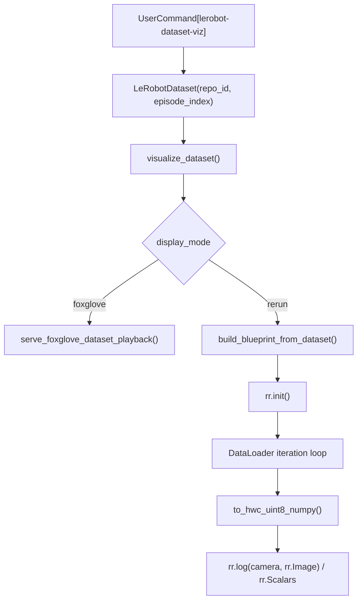
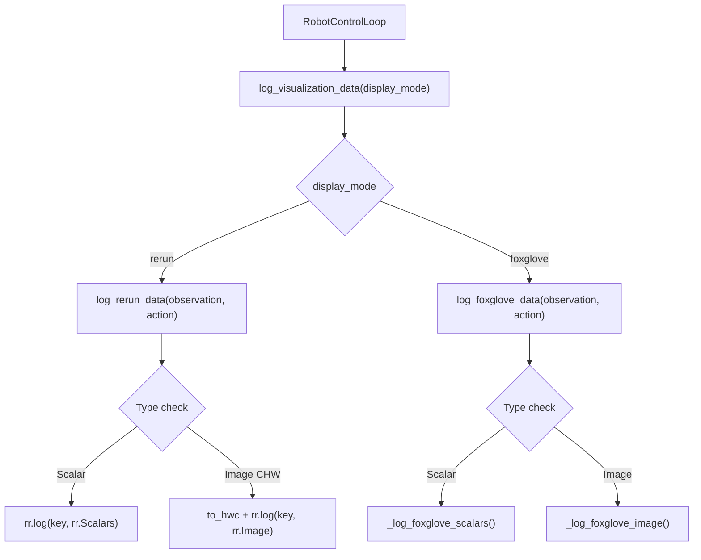
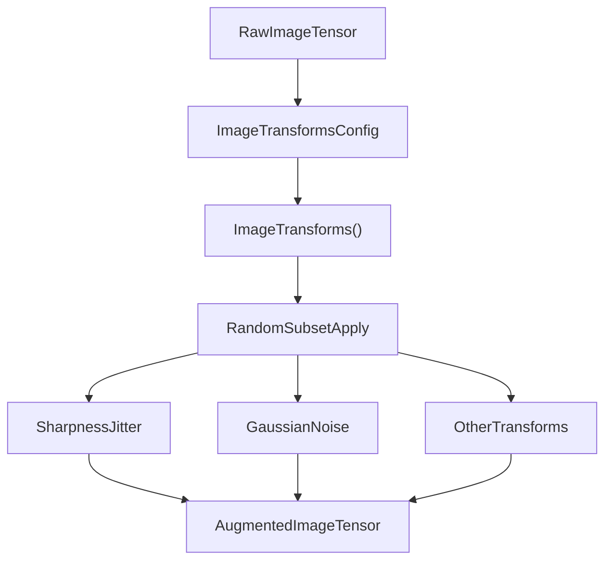

<!-- source: DeepWiki mcp.deepwiki.com · repo huggingface/lerobot · page 9.3 Visualization Tools · fetched 2026-10-26 -->

# Visualization Tools

Relevant source files

The following files were used as context for generating this wiki page:

- [src/lerobot/scripts/lerobot_dataset_viz.py](src/lerobot/scripts/lerobot_dataset_viz.py)
- [src/lerobot/utils/collate.py](src/lerobot/utils/collate.py)
- [src/lerobot/utils/feature_utils.py](src/lerobot/utils/feature_utils.py)
- [src/lerobot/utils/foxglove_visualization.py](src/lerobot/utils/foxglove_visualization.py)
- [src/lerobot/utils/keyboard_input.py](src/lerobot/utils/keyboard_input.py)
- [src/lerobot/utils/process.py](src/lerobot/utils/process.py)
- [src/lerobot/utils/random_utils.py](src/lerobot/utils/random_utils.py)
- [src/lerobot/utils/rerun_visualization.py](src/lerobot/utils/rerun_visualization.py)
- [src/lerobot/utils/transition.py](src/lerobot/utils/transition.py)
- [src/lerobot/utils/utils.py](src/lerobot/utils/utils.py)
- [src/lerobot/utils/visualization_utils.py](src/lerobot/utils/visualization_utils.py)
- [tests/utils/test_foxglove_visualization.py](tests/utils/test_foxglove_visualization.py)
- [tests/utils/test_visualization_utils.py](tests/utils/test_visualization_utils.py)

## Purpose and Scope
This page documents the visualization infrastructure in LeRobot, covering offline dataset replay tools (`lerobot-dataset-viz`), image augmentation inspection (`lerobot-imgtransform-viz`), backend-agnostic real-time control loop logging (`rerun` and `foxglove`), and evaluation video rendering with natural language instruction generation.

---

## 1. Tool Overview and Architecture

LeRobot provides modular visualization utilities across training, data recording, and offline inspection. The architecture decouples the visualization interface from the underlying visualization SDK via a dispatch layer in `lerobot.utils.visualization_utils` [src/lerobot/utils/visualization_utils.py:15-22]().

| CLI Command / Utility | Source Module | Purpose | Supported Backends |
|---|---|---|---|
| `lerobot-dataset-viz` | [src/lerobot/scripts/lerobot_dataset_viz.py]() | Replay and inspect frames of any episode in a `LeRobotDataset` [src/lerobot/scripts/lerobot_dataset_viz.py:16-18]() | Rerun, Foxglove [src/lerobot/scripts/lerobot_dataset_viz.py:171]() |
| `lerobot-imgtransform-viz` | `src/lerobot/scripts/lerobot_imgtransform_viz.py` | Preview image augmentation transform effects [src/lerobot/scripts/lerobot_imgtransform_viz.py:16-18]() | Disk / Image files |
| `init_visualization` / `log_visualization_data` | [src/lerobot/utils/visualization_utils.py]() | Real-time logging during robot control loops [src/lerobot/utils/visualization_utils.py:33-68]() | Rerun, Foxglove [src/lerobot/utils/visualization_utils.py:30]() |

Sources: [src/lerobot/scripts/lerobot_dataset_viz.py:16-74](), [src/lerobot/utils/visualization_utils.py:15-79]()

---

## 2. Dataset Visualization: `lerobot-dataset-viz`

The `lerobot-dataset-viz` script loads episodes from a `LeRobotDataset` and streams observation images, actions, states, and scalar metrics (reward, done, success) into a visualization backend [src/lerobot/scripts/lerobot_dataset_viz.py:16-28]().

### Display Modes and Configuration
- **Rerun (`--display-mode rerun`)**: Default visualization backend. Streams frames sequentially, supports local spawning, remote gRPC proxying, or saving to `.rrd` files [src/lerobot/scripts/lerobot_dataset_viz.py:40-60, 171]().
- **Foxglove (`--display-mode foxglove`)**: Starts a WebSocket server via `serve_foxglove_dataset_playback` that serves episode frames on demand, providing a seekable, scrubbable timeline [src/lerobot/scripts/lerobot_dataset_viz.py:62-73, 176-188]().

The function `build_blueprint_from_dataset` constructs a Rerun `rrb.Blueprint` layout containing spatial 2D views for camera modalities and time-series views for multi-dimensional actions and states [src/lerobot/scripts/lerobot_dataset_viz.py:135-157]().

**Diagram: Dataset Visualization Execution Flow (Natural Language to Code Entities)**

Sources: [src/lerobot/scripts/lerobot_dataset_viz.py:135-188]()

---

## 3. Real-Time Visualization Dispatch and Backends

LeRobot uses `lerobot.utils.visualization_utils` to expose a backend-agnostic dispatch layer so callers do not branch directly on specific SDK APIs [src/lerobot/utils/visualization_utils.py:15-22]().

### Dispatch Interface
- `init_visualization(display_mode, ...)`: Routes initialization to either `init_rerun` or `init_foxglove` depending on `VISUALIZATION_MODES = ("rerun", "foxglove")` [src/lerobot/utils/visualization_utils.py:30-52]().
- `log_visualization_data(display_mode, observation, action, compress_images)`: Dispatches observation and action dictionaries to `log_rerun_data` or `log_foxglove_data` [src/lerobot/utils/visualization_utils.py:55-68]().
- `shutdown_visualization(display_mode)`: Gracefully terminates the active backend session [src/lerobot/utils/visualization_utils.py:71-79]().

Sources: [src/lerobot/utils/visualization_utils.py:15-79]()

### Rerun Backend Implementation (`rerun_visualization.py`)
`init_rerun` initializes the Rerun SDK, configures flush limits (`RERUN_FLUSH_NUM_BYTES`), and either spawns a local viewer or connects via gRPC URL [src/lerobot/utils/rerun_visualization.py:40-64](). `log_rerun_data` inspects observation and action dictionary items:
- Scalars are logged as `rr.Scalars` [src/lerobot/utils/rerun_visualization.py:152-154]().
- 3D tensors are transposed from CHW to HWC format, optionally JPEG compressed if `compress_images=True`, and logged as `rr.Image` or `rr.EncodedImage` [src/lerobot/utils/rerun_visualization.py:111-175]().
- Depth frames are recognized with 1-channel arrays and logged as `rr.DepthImage` with inferred units [src/lerobot/utils/rerun_visualization.py:164-171]().

Sources: [src/lerobot/utils/rerun_visualization.py:40-171]()

### Foxglove Backend Implementation (`foxglove_visualization.py`)
`init_foxglove` starts a Foxglove WebSocket server via `foxglove.start_server` [src/lerobot/utils/foxglove_visualization.py:75-95](). Topics are normalized using `_foxglove_safe_name` (replacing dots with underscores) and `_foxglove_topic` to map camera frames to `/observation/images/<name>` and scalar signals to aggregate topics like `/observation/state` or `/action/state` [src/lerobot/utils/foxglove_visualization.py:109-136](). Scalars are serialized against `_SCALARS_SCHEMA` as an array of `{label, value}` objects [src/lerobot/utils/foxglove_visualization.py:51-66, 139-166]().

Sources: [src/lerobot/utils/foxglove_visualization.py:51-166]()

**Diagram: Real-Time Dispatch and Type Routing (Natural Language to Code Entities)**

Sources: [src/lerobot/utils/visualization_utils.py:55-68](), [src/lerobot/utils/rerun_visualization.py:111-175](), [src/lerobot/utils/foxglove_visualization.py:75-189]()

---

## 4. Image Transform Visualization and Augmentations

The script `lerobot-imgtransform-viz` allows developers to inspect image augmentation pipelines defined via `ImageTransformsConfig` [src/lerobot/scripts/lerobot_imgtransform_viz.py:16-18]()

### Custom Augmentation Modules
LeRobot implements custom torchvision v2-compatible transformations for robust real-world policy training:
- `RandomSubsetApply`: Samples and applies a random subset of $N$ transformations from a sequence with multinomial weights and optional random ordering [src/lerobot/transforms/transforms.py:31-90]().
- `SharpnessJitter`: Jitters image sharpness by sampling a `sharpness_factor` uniformly from a configurable range [src/lerobot/transforms/transforms.py:100-147]().
- `GaussianNoise`: Adds Gaussian noise to simulate camera sensor noise and low-light ADC quantization [src/lerobot/transforms/transforms.py:149-167]().
- Additional transforms include `CoarseDropout`, `GammaCorrection`, `GaussianPatchBrightness`, `JPEGCompression`, `MotionBlur`, `PlanckianJitter`, and `RandomShadow` [src/lerobot/transforms/__init__.py:15-28]().

**Diagram: Image Augmentation Pipeline**

Sources: [src/lerobot/transforms/transforms.py:31-167](), [src/lerobot/transforms/__init__.py:15-28]()

---

## 5. Evaluation Video Rendering and Benchmark Language Generation

During policy evaluation (`lerobot-eval`), rollout loops render simulation frames into episode MP4 videos. For benchmark suites such as RoboTwin 2.0, natural language task instructions are dynamically generated to match evaluation protocols.

The function `_generate_robotwin_official_instruction` in `src/lerobot/envs/robotwin.py` queries upstream RoboTwin description generation utilities (`generate_episode_descriptions`) using episode state information to construct language conditions [src/lerobot/envs/robotwin.py:124-169]().

Sources: [src/lerobot/envs/robotwin.py:124-169]()

---

## 6. Key Code Entities Reference

| Symbol Name | File Path | Role |
|---|---|---|
| `visualize_dataset` | [src/lerobot/scripts/lerobot_dataset_viz.py]() | Orchestrates dataset episode replay streaming [src/lerobot/scripts/lerobot_dataset_viz.py:160]() |
| `build_blueprint_from_dataset` | [src/lerobot/scripts/lerobot_dataset_viz.py]() | Constructs Rerun UI view layouts for dataset features [src/lerobot/scripts/lerobot_dataset_viz.py:135]() |
| `VISUALIZATION_MODES` | [src/lerobot/utils/visualization_utils.py]() | Tuple defining allowed runtime backends `("rerun", "foxglove")` [src/lerobot/utils/visualization_utils.py:30]() |
| `init_visualization` | [src/lerobot/utils/visualization_utils.py]() | Dispatches initialization to Rerun or Foxglove [src/lerobot/utils/visualization_utils.py:33]() |
| `log_visualization_data` | [src/lerobot/utils/visualization_utils.py]() | Dispatches observation and action data to active backend [src/lerobot/utils/visualization_utils.py:55]() |
| `init_rerun` | [src/lerobot/utils/rerun_visualization.py]() | Initializes Rerun session and stream connection [src/lerobot/utils/rerun_visualization.py:40]() |
| `log_rerun_data` | [src/lerobot/utils/rerun_visualization.py]() | Type-dispatches observations and actions to Rerun entities [src/lerobot/utils/rerun_visualization.py:111]() |
| `init_foxglove` | [src/lerobot/utils/foxglove_visualization.py]() | Starts the Foxglove WebSocket telemetry server [src/lerobot/utils/foxglove_visualization.py:75]() |
| `RandomSubsetApply` | `src/lerobot/transforms/transforms.py` | Applies a random subset of torchvision transforms [src/lerobot/transforms/transforms.py:31]() |
| `SharpnessJitter` | `src/lerobot/transforms/transforms.py` | Jitters image sharpness augmentation [src/lerobot/transforms/transforms.py:100]() |
| `GaussianNoise` | `src/lerobot/transforms/transforms.py` | Simulates sensor noise augmentation [src/lerobot/transforms/transforms.py:149]() |
| `_generate_robotwin_official_instruction` | `src/lerobot/envs/robotwin.py` | Generates official evaluation instruction prompts for RoboTwin [src/lerobot/envs/robotwin.py:124]() |

Sources: [src/lerobot/scripts/lerobot_dataset_viz.py:135-160](), [src/lerobot/utils/visualization_utils.py:30-55](), [src/lerobot/utils/rerun_visualization.py:40-111](), [src/lerobot/utils/foxglove_visualization.py:75](), [src/lerobot/transforms/transforms.py:31-149](), [src/lerobot/envs/robotwin.py:124]()

---

